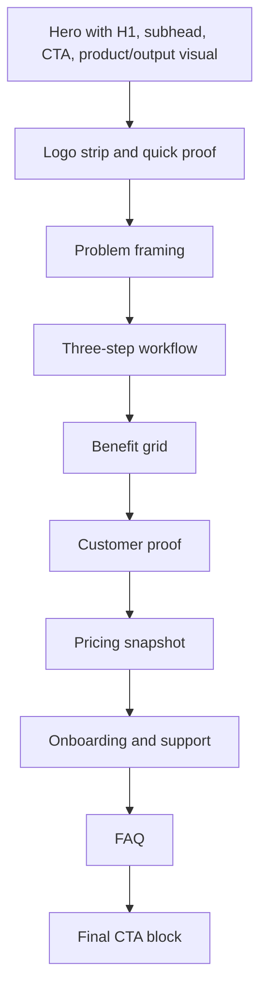
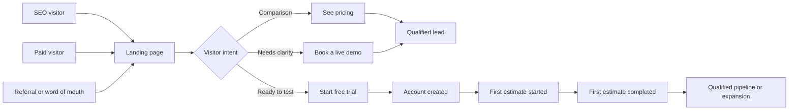

# SaaS Landing Page Research for ArchEstimator

## Executive summary

The strongest SaaS landing pages in this research set do not win with cleverness first; they win with clarity first. Amigo, Intercom, Bluebeam, Procore, and Autodesk all tell visitors what the product is, who it is for, and what business outcome it improves within the first screen, then support that claim with product visuals, proof, and a clear next step. citeturn24view1turn23view1turn23view6turn23view7turn11view10

For ArchEstimator, the highest-converting direction is to position the product around **budget confidence, estimate speed, and defensibility**, not around generic “software” language. The page should show a real output or interface above the fold, put one dominant CTA in the hero with secondary pathways for demo and pricing, and place proof directly under the hero so visitors can self-qualify quickly. Pages that reduce buying friction also tend to expose pricing or at least pricing logic early through a pricing page, calculator, or recommender, instead of forcing every visitor into a generic contact flow. citeturn23view0turn19view2turn10view14turn23view8turn23view7turn23view6

Branded design helps when it sharpens credibility and recognition, but it hurts when it obscures information scent. NN/g notes that first visual impressions heavily shape perceived relevance, credibility, and usability, and Intercom reports that on personalized ad landing pages, real product imagery outperformed purely brand-led illustrations for conversion. That means ArchEstimator should look refined and distinctive, but the first screen still needs an unmistakable H1, visible CTAs, and a product/output cue that confirms what the software does. citeturn17view0turn16view1turn23view1turn12view3

Accessibility and performance are conversion work, not cleanup work. WCAG 2.2 is organized around perceivable, operable, understandable, and robust content, while web.dev’s current Core Web Vitals targets remain LCP at 2.5 seconds or less, INP at 200 milliseconds or less, and CLS at 0.1 or less. For a landing page, that translates into lighter hero media, stable layouts, accessible forms, visible focus states, and low-friction interaction design. citeturn15view0turn14view9turn25search1turn25search3

| Decision area | Recommended direction for ArchEstimator |
|---|---|
| Core value proposition | “Turn drawings into defensible estimates before budget drift starts.” |
| Hero media | Real product UI, estimate output, or sample annotated drawing; not abstract art alone |
| CTA system | One primary CTA, one secondary CTA, one persistent pricing link |
| Proof stack | Logos + quantified outcome + role-specific testimonial + trust/support layer |
| Pricing | Publish pricing or at least clear pricing logic and qualification path |
| Onboarding cue | Show first-value path in three steps: upload, estimate, share/export |

## Patterns from leading SaaS landing pages

This analysis uses current official pages from Amigo.ai, Intercom, Slack, Notion, monday.com, Miro, HubSpot, Procore, Bluebeam, and Autodesk, plus original guidance from Intercom, Google Search Central, Google Analytics, W3C/WAI, NN/g, Baymard, and CXL. Exact conversion rates are generally private, so the goal here is to extract repeated public patterns rather than claim undisclosed results. citeturn16view0turn16view1turn13view0turn13view2turn17view0turn13view6turn15view0turn13view9turn10view18

| Example | Current landing-page pattern | What it teaches ArchEstimator | Visual reference |
|---|---|---|---|
| **Amigo.ai** | Trust-led category framing, single demo CTA, hero UI, healthcare logo wall, vertical segmentation, case studies, safety language, investor backing. | Specialized B2B buyers respond to **domain trust + precise category language** earlier than broad aspiration. | citeturn24view1turn24view0turn24view3 |
| **Intercom** | Category-dominance framing, dual CTA, product UI near hero, deep compliance/support section, transparent pricing section, integrated pricing calculator. | Use **clear category ownership**, pair trial/demo paths, and reduce risk with trust, support, and pricing clarity. | citeturn23view1turn23view2turn23view0turn19view2 |
| **Slack** | Platform framing on homepage; pricing page includes comparison table, free entry point, and a guided plan recommender. | Help visitors **self-select the right plan** instead of making them decode packaging alone. | citeturn1search0turn10view14turn11view5 |
| **Notion** | Broad product category plus strong social proof, named customer stories, outcome claims, and large user base proof. | Logos alone are weaker than **logos plus mini stories plus outcomes**. | citeturn23view3 |
| **monday.com** | Strong enterprise-adoption cue, logo strip, outcome-led headline, segmentation into departmental solutions and repeated CTA paths. | Show one main promise, then **segment by use case** for different buyer contexts. | citeturn23view4turn11view8 |
| **Miro** | Quantified proof block near top, customer study, ecosystem scale, user scale, integration scale. | Quantified outcome blocks create faster trust than generic praise. | citeturn23view5 |
| **HubSpot** | Quantified business proof, free entry point, tiered pricing, no-credit-card messaging, product-specific pages with ROI language. | If you offer self-serve, **remove friction aggressively** and show a clear upgrade path. | citeturn19view0turn23view8turn11view11 |
| **Procore** | Outcome-led estimating page, pricing + demo dual CTAs, testimonial, product screenshot, margin and rework language. | For construction buyers, **margin protection and scope-cost alignment** outperform generic productivity claims. | citeturn23view7turn22view3 |
| **Bluebeam** | Exact use-case SEO framing, free trial + plans + ROI tool, trust by AEC professionals, trade-specific sections, product-powered proof and quantified case outcomes. | Construction software should speak in **workflow and trade language**, not generic SaaS vocabulary. | citeturn23view6turn21view0 |
| **Autodesk Construction Cloud** | Industry-language framing built around builders, real-time visibility into costs and schedules. | Vertical SaaS works better when it uses **the buyer’s operating language**, not marketing abstractions. | citeturn10view12 |

The cross-sample pattern is consistent: pages that convert fastest reduce ambiguity before they increase persuasion. Amigo, Intercom, Bluebeam, Procore, and Autodesk all use explicit category language in the hero; CXL’s guidance aligns with this by recommending a headline, subhead, and bullets that state the benefit, audience, and utility immediately. citeturn24view1turn23view1turn23view6turn23view7turn11view10turn13view0turn13view2

The second pattern is balance: benefits first, features second, but never benefits without explanation. Intercom’s own landing-page guidance explicitly warns against leaning too far toward either feature dumping or empty benefit fluff, and the best pages in the sample follow that rule by pairing business outcomes with concrete mechanisms. Procore ties “protect margins” to connected takeoffs and proposals; Bluebeam ties “more winning bids” to measurements, Quantity Link, and Excel exports; HubSpot ties AI revenue promises to named product modules. citeturn16view0turn22view3turn21view0turn19view1

The third pattern is proof layering. Notion pairs recognizable logos with customer stories and outcome cues; Miro pairs scale proof with quantified results and a customer-study link; Intercom adds compliance, expert services, and pricing transparency; Amigo adds logos, case studies, safety metrics, time-to-value, and investor credibility. High-trust pages do not rely on a single testimonial or a single badge. citeturn23view3turn23view5turn23view2turn23view0turn24view0turn24view3

The fourth pattern is self-qualification. Slack’s pricing recommender, Intercom’s calculator, HubSpot’s plan ladder, Procore’s visible pricing link, and Bluebeam’s plans/ROI pathways all help visitors decide whether the product belongs on their shortlist before they ever speak to sales. For ArchEstimator, that means pricing clarity is not optional if comparison shoppers are part of the funnel. citeturn11view5turn19view2turn23view8turn23view7turn21view0

Finally, the pages that feel “premium” without sacrificing conversion all preserve obvious hierarchy. Intercom and Figma are both brand-forward, but their primary title and CTA remain unmistakable; NN/g’s first-impression research explains why that matters, because users form rapid judgments about relevance and credibility from design almost immediately. citeturn23view1turn12view3turn17view0

| Recurring pattern | Evidence in the sample | What ArchEstimator should do |
|---|---|---|
| **Say what the product is immediately** | Amigo, Intercom, Bluebeam, Autodesk use explicit category framing. | Use “construction estimating software” or “cost estimating software for architects and preconstruction teams,” not abstract slogan-only copy. citeturn24view1turn23view1turn23view6turn11view10 |
| **Lead with business outcome, then show the mechanism** | Intercom guidance, Procore, Bluebeam, HubSpot. | H1 = outcome; subhead = who/what/why; below fold = feature proof. citeturn16view0turn22view3turn21view0turn19view1 |
| **Show product or output early** | Amigo, Intercom, Procore, Bluebeam all place UI or product demonstration near the hero; Intercom says product visuals beat brand-only visuals for ad traffic. | Use screenshot of ArchEstimator, annotated estimate output, or sample drawing-to-estimate artifact above the fold. citeturn24view1turn23view1turn23view7turn23view6turn16view1 |
| **Layer proof instead of relying on one element** | Notion, Miro, Intercom, Amigo, Bluebeam. | Combine logo strip, quantified metric, testimonial, case study, and trust/onboarding support. citeturn23view3turn23view5turn23view2turn24view0turn23view6 |
| **Let buyers self-qualify on price** | Slack recommender, Intercom calculator, HubSpot ladder, Procore pricing link, Bluebeam plans. | Publish pricing or pricing logic and keep “See pricing” visible throughout the page. citeturn11view5turn19view2turn23view8turn23view7turn21view0 |
| **Reduce perceived implementation risk** | Intercom expert support, Amigo’s fast launch language, Bluebeam’s training/support. | Add a short onboarding strip that makes first value feel near, concrete, and supported. citeturn23view2turn24view3turn21view0 |

## ArchEstimator content blueprint

For this report, the working assumption is that ArchEstimator is sold to architecture firms, estimators, preconstruction teams, and contractor-side decision-makers who need to keep scope, cost, and budget aligned before procurement. That fits AIA’s emphasis on design-to-budget obligations and construction sources that define estimating around cost visibility, risk control, bid competitiveness, and alignment between drawings, scope, and financial decisions. citeturn22view0turn22view1turn22view2turn22view4turn23view6turn22view3

A strong positioning sentence for the homepage is:

> **ArchEstimator helps architecture and preconstruction teams turn drawings into fast, defensible cost estimates—without rebuilding spreadsheets every time scope changes.**

This positioning is stronger than “AI-powered estimating platform” or “next-generation construction software” because it is concrete, outcome-led, and legible to a buyer who is already comparing alternatives. The sample pages and Intercom’s own guidance repeatedly reward that structure. citeturn16view0turn24view1turn23view6turn23view7

A simple rule for ArchEstimator copy is this: **convert features into operational relief**.

| Feature-first phrasing | Better landing-page phrasing |
|---|---|
| PDF/drawing import | **Bring drawings into the estimate workflow without retyping scope by hand.** |
| Quantity takeoff tools | **Measure once and update estimates faster when the drawing changes.** |
| Templates and assemblies | **Standardize how your team prices similar work across projects.** |
| Version history and audit trail | **Show exactly what changed, why the number moved, and who updated it.** |
| Excel export / report export | **Give clients, principals, and estimators outputs they can review immediately.** |

That approach matches Intercom’s guidance to balance benefits and key features, while Procore, Bluebeam, and HubSpot all illustrate how landing pages become stronger when business outcomes are tied back to specific capabilities. citeturn16view0turn22view3turn21view0turn19view1

A recommended modular page structure for ArchEstimator is below.

| Module | Why it exists | Exact copy suggestion |
|---|---|---|
| **Sticky header** | Keeps navigation and action visible on long pages. | Nav: **Product · How It Works · Pricing · Customers · Demo**. Right-side CTA: **Start free trial**. Persistent text link: **See pricing**. |
| **Hero** | Establishes product category, outcome, and next action in one screen. | Headline: **Turn drawings into defensible estimates before budget drift starts.** Subhead: **ArchEstimator helps architects, estimators, and preconstruction teams build clear cost ranges, compare design options quickly, and cut spreadsheet rework when plans change.** CTAs: **Start free trial** / **Book a live demo** / **See pricing**. |
| **Proof bar** | Gives instant credibility after the hero. | Heading: **Trusted by teams that need cost answers early.** Logos from architecture firms, contractors, consultants, or owners. One short metric tile if proven. |
| **Problem section** | Names the current-state pain in buyer language. | Heading: **When drawings change, your estimate should not start over.** Body: **Manual takeoffs, scattered assumptions, and spreadsheet handoffs slow decisions down and make budget conversations harder than they should be.** |
| **Workflow section** | Makes adoption feel simple and procedural. | Heading: **Go from scope to estimate in three practical steps.** Steps: **Upload drawings. Build quantities and assumptions. Share a client-ready estimate.** |
| **Benefit grid** | Shows operational value in skimmable form. | Heading: **Built to make estimates faster and easier to defend.** Cards: **Reduce rework**, **Compare options**, **Standardize pricing logic**, **Explain every number**, **Share outputs faster**. |
| **Trust section** | Handles objections around accuracy, consistency, and support. | Heading: **Costs you can explain. Assumptions you can audit.** Supporting line: **Keep scope, quantities, and pricing logic connected so revisions are easier to review and easier to trust.** |
| **Customer proof** | Proves value in peer language. | Heading: **How teams move faster with ArchEstimator.** Format: one mini case card with role, firm type, metric, and quote. |
| **Pricing preview** | Lets comparison shoppers self-qualify without friction. | Heading: **Simple pricing for estimating teams.** Supporting line: **Start small, scale with teammates, and move to enterprise controls when your workflow needs governance.** Visible tiers or at minimum pricing model. |
| **Onboarding cue** | Reduces perceived switching risk. | Heading: **Be productive in your first week.** Supporting line: **Guided setup, live walkthroughs, and a clear first-estimate workflow help your team get useful output fast.** |
| **FAQ + final CTA** | Resolves objections and catches undecided buyers. | Heading: **Ready to stop rebuilding estimates in spreadsheets?** CTAs: **Start free trial** / **Book a live demo**. |

The hero should not carry equal-weight CTAs for every motion on every traffic source. The cleaner model is intent-matched:

| Visitor intent | Primary CTA | Secondary CTA |
|---|---|---|
| Category exploration from SEO or comparison search | **See pricing** | **Book a live demo** |
| Mid-funnel evaluation from ads or referrals | **Book a live demo** | **See pricing** |
| Brand or product-led traffic ready to test | **Start free trial** | **See pricing** |

### Exact copy templates for ArchEstimator

**Hero variant one**

**Headline:**  
**Turn drawings into defensible estimates before budget drift starts.**

**Subhead:**  
ArchEstimator helps architects, estimators, and preconstruction teams build clear cost ranges, compare design options quickly, and cut spreadsheet rework when plans change.

**Best primary CTA:**  
**Book a live demo**

**Hero variant two**

**Headline:**  
**Estimate faster, explain every number, and keep design decisions tied to cost.**

**Subhead:**  
Use ArchEstimator to move from drawings to structured quantities and client-ready estimate breakdowns in one workflow built for real project teams.

**Best primary CTA:**  
**Start free trial**

**Hero variant three**

**Headline:**  
**From quantity takeoff to client-ready estimate in one connected workflow.**

**Subhead:**  
Stop juggling scattered assumptions, outdated sheets, and revision chaos. ArchEstimator keeps scope, cost logic, and estimate output aligned from first pass to final review.

**Best primary CTA:**  
**See pricing**

**CTA variants**

- **Start free trial**
- **Book a live demo**
- **See pricing**

**Short benefit bullets**

- Reduce spreadsheet rework after drawing revisions.
- Compare cost impact across design options quickly.
- Keep quantities, assumptions, and markups in one place.
- Deliver review-ready estimate summaries faster.
- Protect margins before bids go out.

**Long-form paragraph option one**

Architects and preconstruction teams do not need another generic calculator. They need a faster way to turn drawings into numbers they can defend. ArchEstimator keeps quantities, assumptions, and estimate logic connected so teams can answer budget questions earlier, adapt faster when scope changes, and avoid restarting the process in disconnected spreadsheets.

**Long-form paragraph option two**

Estimating gets expensive when scope lives in one place, measurements in another, and pricing logic in someone’s private worksheet. ArchEstimator brings those steps into one repeatable workflow. Your team can create estimates faster, review assumptions clearly, and hand off cleaner information to clients, consultants, and internal decision-makers.

**Long-form paragraph option three**

The goal is not just speed. It is credible speed. ArchEstimator helps your team produce estimates that are easier to explain, easier to revise, and easier to trust—so design decisions stay grounded in cost reality and every revision does not become a manual fire drill.

For social proof, the most effective order for ArchEstimator is: **logo strip, quantified result, testimonial with role and firm type, case study, then trust/support layer**. That order mirrors how Amigo, Notion, Miro, Intercom, and Bluebeam build credibility without forcing the buyer to infer trust from branding alone. citeturn24view0turn23view3turn23view5turn23view2turn23view6

For pricing, do not hide the buying model unless pricing genuinely cannot be normalized. Intercom exposes a calculator, Slack a recommender, HubSpot a visible tier ladder, Procore a pricing path, and Bluebeam plans plus ROI tools. If exact pricing is still evolving, ArchEstimator should at least publish the model clearly: **per user, per team, per project, or enterprise custom**. citeturn19view2turn11view5turn23view8turn23view7turn21view0

## Wireframe and journey design

Intercom’s ad-page tests found that real product imagery converted better than brand illustrations for performance traffic, and NN/g’s research on first impressions explains why: users form rapid judgments about relevance and credibility from visual hierarchy. So ArchEstimator should keep a distinctive visual language, but the hero must still be unmistakably functional. citeturn16view1turn17view0

```text
┌──────────────────────────────────────────────────────────────────────┐
│ A  Logo        Product   How It Works   Pricing   Customers   Demo  │
│                                                      [Start trial]  │
├──────────────────────────────────────────────────────────────────────┤
│ B  H1: Turn drawings into defensible estimates...                   │
│    Subhead: clear audience + outcome + workflow                     │
│    [Start free trial] [Book a live demo]  See pricing               │
│    Short proof line: Trusted by ...                                 │
│                                                      E  Product UI  │
│                                                      or estimate    │
│                                                      output visual  │
├──────────────────────────────────────────────────────────────────────┤
│ F  Logo bar / metric strip                                          │
├──────────────────────────────────────────────────────────────────────┤
│ G  Problem framing: when drawings change, estimate chaos starts     │
├──────────────────────────────────────────────────────────────────────┤
│ H  3-step workflow: Upload → Estimate → Share/export                │
├──────────────────────────────────────────────────────────────────────┤
│ I  Benefit grid with 4–6 cards                                      │
├──────────────────────────────────────────────────────────────────────┤
│ J  Customer proof: metric + quote + role + company                  │
├──────────────────────────────────────────────────────────────────────┤
│ K  Pricing snapshot: Starter / Team / Enterprise                    │
├──────────────────────────────────────────────────────────────────────┤
│ L  Onboarding: first week, guided setup, integrations/support       │
├──────────────────────────────────────────────────────────────────────┤
│ M  FAQ                                                              │
├──────────────────────────────────────────────────────────────────────┤
│ N  Final CTA block                                                  │
└──────────────────────────────────────────────────────────────────────┘
```

| Annotation | Recommendation |
|---|---|
| **A** | Keep the nav short. Long navs increase exit paths before the value proposition lands. |
| **B** | Use one clear H1 only. Google’s title-link guidance also rewards a clear main page title and visible hierarchy. citeturn14view1 |
| **E** | Use actual product UI, estimate output, or a sample drawing-to-estimate visual. Avoid decorative art as the only hero proof. |
| **F** | Place proof immediately under the hero, not halfway down the page. |
| **G** | Name the current workflow pain in buyer language before explaining features. |
| **H** | Make onboarding feel procedural, not abstract. This is where adoption anxiety drops. |
| **I** | Benefit cards should answer “why this matters” faster than feature lists can. |
| **J** | Use one proof card with a specific role and firm type; do not bury the testimonial source. |
| **K** | Pricing should be easy to parse in under 20 seconds. Three tiers is enough for most startup SaaS. |
| **L** | Show implementation support, turnaround time, and “first-value” path. This reduces sales friction. |
| **N** | Final CTA should mirror the hero CTA language, not introduce a new action. |





For branded-but-converting design, the right model is **restrained brand expression around a conventional conversion skeleton**. Figma and Intercom show that strong visual identity can coexist with conversion when the title, CTA, and core visual anchor stay dominant, and NN/g’s research explains why clarity in that first moment is so consequential. For ArchEstimator, that means premium typography, subtle plan-line motifs, controlled motion, and a real estimate artifact—not generic gradients or abstract “innovation” graphics taking over the first screen. citeturn12view3turn23view1turn17view0

## Testing, analytics, and SEO

NN/g recommends that A/B tests start from a clear hypothesis tied to a specific goal and isolate one meaningful design change rather than testing broad redesigns all at once. That is the right operating model for ArchEstimator as well. citeturn14view5turn14view6

| Priority | Hypothesis | Why it matters | Primary metric | Guardrail |
|---|---|---|---|---|
| **1** | An outcome-led hero headline will outperform a feature-led hero headline. | This is the biggest ambiguity reducer on the page. | Hero CTA CTR | Bounce rate |
| **2** | Showing a real estimate output in the hero will outperform brand-only illustration or abstract art. | Product proof should increase confidence faster. | Demo/trial conversion rate | LCP |
| **3** | A primary **Book a live demo** CTA will outperform **Start free trial** for cold traffic. | Construction buyers may need explanation before action. | Demo bookings / session | Form completion rate |
| **4** | A visible **See pricing** link in the hero and sticky nav will increase qualified conversions. | Comparison shoppers want self-qualification. | Pricing page views leading to conversion | Overall CTR dilution |
| **5** | A proof bar directly below the hero will outperform proof placed below the workflow section. | Faster trust should reduce bounce and improve scroll depth. | Scroll-to-workflow rate | LCP |
| **6** | A three-step onboarding strip will increase trial starts and demo completions. | Implementation anxiety is a major B2B blocker. | Trial start rate | Time on page |
| **7** | A short pricing snapshot on the homepage will outperform hiding pricing behind nav only. | Reduces qualification friction. | Homepage-to-pricing CTR and conversion rate | Total demo rate |
| **8** | Verticalized customer proof for architects vs contractors will outperform generic testimonials. | Peer relevance usually beats generic praise. | Demo/trial CVR by segment | Page engagement |
| **9** | An email-only demo form will outperform a multi-field demo form on cold traffic. | Lower friction at first step. | Form completion rate | Lead quality rate |
| **10** | An ROI or sample-estimate offer on the page will capture more mid-funnel leads than a generic newsletter signup. | Buyers want evaluative assets, not generic updates. | Lead capture rate | Lead qualification rate |

Google Analytics recommends using standard events where possible, including `generate_lead` for a form submission or information request, `sign_up` for account creation, `tutorial_begin` for the start of onboarding, and `qualify_lead` when a lead becomes qualified. Use those as the backbone, then add ArchEstimator-specific custom events for product-qualified actions like first estimate creation or export. citeturn14view2turn14view3turn10view18

| Funnel stage | KPI to track | Suggested event name | Trigger | Important parameters |
|---|---|---|---|---|
| Acquisition | Landing-page sessions by source | `page_view` | Page load | `page_type`, `traffic_source`, `campaign_id` |
| Engagement | Hero CTA click-through rate | `lp_cta_click` | Any hero CTA click | `cta_text`, `cta_location`, `page_variant`, `audience_variant` |
| Engagement | Pricing interest rate | `view_pricing` | Pricing section view or pricing page visit | `from_page`, `plan_toggle`, `audience_variant` |
| Lead capture | Demo request completion | `generate_lead` | Demo/contact form submitted | `lead_type`, `company_size`, `persona`, `industry_segment` |
| Trial | Trial account created | `sign_up` | Trial signup success | `plan_intent`, `trial_source`, `audience_variant` |
| Onboarding | Onboarding started | `tutorial_begin` | First guided setup or product walk-through started | `onboarding_type`, `persona` |
| Activation | First drawing upload started | `ae_drawing_upload_started` | Upload initiated | `file_type`, `plan_type` |
| Activation | First drawing upload completed | `ae_drawing_upload_completed` | Upload success | `file_type`, `pages_uploaded` |
| Activation | First estimate created | `ae_first_estimate_created` | Estimate saved successfully | `estimate_type`, `project_type`, `plan_type` |
| Activation | Estimate shared/exported | `ae_estimate_exported` | PDF/XLSX/share action | `export_type`, `estimate_stage` |
| Sales quality | Qualified lead rate | `qualify_lead` | Lead marked qualified in CRM | `persona`, `company_size`, `source_page` |
| Revenue proxy | Demo-to-opportunity rate | `ae_demo_to_opportunity` | CRM stage change | `sales_segment`, `plan_type` |

The KPIs that matter most for ArchEstimator are not just page-level CTR and form completion. They are **visitor-to-demo**, **visitor-to-trial**, **pricing-page assisted conversion rate**, and **trial-to-first-estimate activation rate**. For a workflow product, “first useful output” is usually the strongest activation milestone.

For SEO, Google’s current documentation is clear on three points that matter here: snippets are primarily generated from page content, sometimes from the meta description; title links can be influenced by clear on-page title structure and concise branding; and the `keywords` meta tag does not help Google’s web search rankings. ArchEstimator should therefore treat metadata as click-through copy aligned to actual on-page content, not as a dumping ground for keyword lists. citeturn13view9turn13view10turn14view0turn14view1turn15view3

Official competitor and adjacent vertical pages cluster around search-intent phrases such as **construction estimating software**, **quantity takeoff**, **digital takeoffs**, **construction cost estimating**, and **built for builders/construction pros**. That is a better starting point for ArchEstimator’s keyword architecture than generic “project software” language. citeturn23view6turn22view3turn10view12turn20search1

| Page | Suggested title tag | Suggested meta description |
|---|---|---|
| **Homepage** | **ArchEstimator \| Construction Estimating Software for Architects and Preconstruction Teams** | **Turn drawings into fast, defensible cost estimates. Compare design options, reduce spreadsheet rework, and keep projects aligned to budget with ArchEstimator.** |
| **Pricing** | **ArchEstimator Pricing \| Plans for Estimating Teams** | **See ArchEstimator pricing for solo users, growing teams, and enterprise firms. Compare features, onboarding support, and plan options clearly.** |
| **Demo** | **Book an ArchEstimator Demo \| See Faster Cost Estimating in Action** | **See how ArchEstimator helps architecture and preconstruction teams move from drawings to review-ready estimates with less manual work.** |
| **Feature page** | **Quantity Takeoff and Cost Estimating Software \| ArchEstimator** | **Create faster quantity takeoffs, build clearer estimates, and update costs more easily as drawings evolve.** |
| **Audience page** | **Cost Estimating Software for Architects \| ArchEstimator** | **Help your architectural team keep design decisions tied to budget with faster estimate workflows and clearer cost visibility.** |

Practical SEO recommendations for launch are straightforward. Keep one clear H1, align it closely with the page title, brand the title concisely, write unique meta descriptions for each intent page, and publish dedicated pages for the highest-intent clusters rather than forcing everything into the homepage. The first pages worth building after the homepage are: **pricing**, **demo**, **for architects**, **for contractors**, and **quantity takeoff / estimating**. citeturn14view0turn14view1turn13view10turn16view1

## Microcopy, accessibility, and performance

NN/g notes that microcopy often makes up most of the written information in an experience, and that effective UI copy is brief, informative, and verb-led. That is exactly how ArchEstimator’s CTA labels, helper text, disclaimers, and error states should behave. citeturn13view3turn13view5

| Experience moment | Sample microcopy | Why it works |
|---|---|---|
| Trial CTA helper | **Start free trial** | Direct and intent-aligned. |
| Demo CTA helper | **Book a live demo** | Tells the visitor exactly what happens next. |
| Pricing helper | **See pricing** | Lower-friction self-qualification path. |
| Hero reassurance | **Built for architects, estimators, and preconstruction teams.** | Confirms audience fit immediately. |
| Form helper text | **Use your work email so we can tailor the walkthrough to your estimating workflow.** | Explains why data is requested. |
| Upload empty state | **Upload a drawing to start your first estimate.** | Action-oriented and product-specific. |
| Pricing reassurance | **No hidden platform surprises. See what each plan includes.** | Reduces skepticism. |
| Success state | **You’re booked. We’ll send your calendar invite and a sample workflow before the call.** | Confirms action and next step. |

| Error state | Sample error message | Rule it follows |
|---|---|---|
| Invalid email | **Enter a valid work email, for example name@firm.com.** | Specific correction, not vague failure. |
| Required field missing | **This field is required so we can route your request correctly.** | Explains why the field matters. |
| File too large | **Your file is too large. Upload a PDF under 25 MB.** | Gives a precise limit and remedy. |
| Unsupported file type | **This upload supports PDF, XLSX, and CSV only.** | States acceptable formats directly. |
| General form failure | **We saved your entries. Fix the highlighted fields and try again.** | Preserves work and reduces frustration. |
| Scheduling failure | **We could not book that time. Choose another slot and we’ll hold your details.** | Preserves user effort. |
| Slow upload state | **Uploading drawing… this can take a minute for larger plan sets.** | Sets expectation instead of leaving ambiguity. |
| Empty search/filter state | **No matching estimate found. Try a project name, client, or date range.** | Offers constructive next actions. |

Form UX should be strict in one way and forgiving in another: strict about clarity, forgiving about recovery. Baymard’s research supports placing labels above fields, avoiding inline labels, validating after the user finishes a field rather than while typing, and preserving entered data when a submission fails. On a landing page, that means short forms, explicit labels, no placeholder-only fields, and no destructive revalidation. citeturn13view7turn13view8turn13view6

Accessibility should target WCAG 2.2 AA from the start. WAI’s overview organizes WCAG under four principles—perceivable, operable, understandable, and robust—and WCAG 2.2 adds criteria especially relevant to conversion pages and forms, including focus not obscured, target size minimum, consistent help, redundant entry, and accessible authentication. For ArchEstimator, that means visible focus, keyboard-usable CTAs and forms, accessible error handling, large-enough tap targets, and persistent support/help access if offered. citeturn15view0turn15view2

Performance should be treated as a design constraint. The current Core Web Vitals thresholds remain LCP at 2.5s or less, INP at 200ms or less, and CLS at 0.1 or less. Reserve dimensions for hero images and videos to prevent layout shifts, cut unnecessary JavaScript to avoid long tasks, and keep the hero media light enough that the main message appears quickly on mobile. citeturn14view9turn25search1turn25search3

A practical performance checklist for the homepage is:

| Performance focus | What to do |
|---|---|
| Hero LCP element | Use compressed image/video poster, prioritize it, and avoid oversized autoplay media. |
| CLS control | Set image/video dimensions or `aspect-ratio` placeholders. citeturn25search1 |
| INP control | Remove non-essential JS, delay heavy scripts, and avoid interaction-blocking widgets at load. citeturn25search3 |
| Third-party scripts | Load chat, heatmaps, and other tools lazily or after interaction where possible. |
| Fonts | Use fewer families/weights and avoid typography that delays first render. |
| Mobile layout | Keep the first screen compact enough that headline, CTA, and product cue are all visible without waiting for media below to settle. |

## Implementation checklist and rollout

Intercom’s own “Pages at Scale” approach is the right mental model for ArchEstimator: build a strong modular page system first, then create targeted variants by audience and keyword cluster instead of redesigning from scratch for every campaign. Their landing-page guidance also reinforces the need for clear CTAs, pricing access, proof, and instrumentation before optimization begins. citeturn16view1turn16view0

| Rollout phase | What should ship | Exit criteria |
|---|---|---|
| **Foundation launch** | Final H1/subhead, hero CTAs, product screenshot/output visual, logo bar, one testimonial, pricing preview or pricing page, FAQ, GA4 event taxonomy, SEO title/meta, accessibility QA, performance pass. | Clear positioning, all key events firing, forms accessible, page meets CWV targets in test and major mobile breakpoints. |
| **Qualification upgrade** | Mini case study, quantified metric block, richer pricing comparison, onboarding/support section, role-based proof for architects vs contractors, sample estimate asset, demo routing logic. | Higher pricing engagement, improved demo quality, better assisted conversion from pricing traffic. |
| **Scale and segmentation** | Dedicated landing pages for architectural firms, contractors, preconstruction teams, and search-intent pages for estimating/takeoff/pricing/demos; matched ad-to-page message variants; A/B testing program. | Consistent uplift by audience segment and a reusable modular template system. |

A launch checklist that is actually useful for ArchEstimator looks like this:

| Workstream | Must-have before launch |
|---|---|
| **Messaging** | One sentence that says exactly what ArchEstimator is, who it is for, and what result it creates. |
| **Proof** | At least 5 logos, 2 real testimonials with role/company type, and 1 quantified result if provable. |
| **Visual proof** | One hero screenshot or output mockup that makes the workflow obvious in under 5 seconds. |
| **CTA design** | One primary CTA only, with secondary demo/pricing pathways kept visible but subordinate. |
| **Pricing** | Published pricing or at least a published pricing model and qualification path. |
| **Analytics** | `generate_lead`, `sign_up`, `tutorial_begin`, `qualify_lead`, and custom activation events implemented and tested. |
| **SEO** | Final title, meta description, H1 alignment, internal links to pricing/demo pages, and no keyword-meta busywork. |
| **Accessibility** | Keyboard pass, visible focus, clear labels, readable error handling, tap-target review. |
| **Performance** | Hero media optimized, dimensions reserved, third-party scripts reviewed, mobile performance checked. |
| **Sales handoff** | Demo forms route by company size, persona, and use case so sales sees context, not just contact details. |

The rollout priority should be ruthless. First, get the homepage telling the truth clearly. Second, make buyers trust it fast. Third, let them qualify themselves on price and motion. Only after that should ArchEstimator spend cycles on heavy personalization, broad page proliferation, or cosmetic experimentation.

The decisive recommendation is simple: **build ArchEstimator’s landing page around budget-aligned estimating, not around software adjectives**. Show the product or its output immediately, make the action paths obvious, and prove credibility before the visitor has to ask for it. That is the common denominator across the strongest pages in this research set, and it is the fastest route to a homepage that feels branded **and** converts. citeturn24view1turn23view1turn23view6turn23view7turn23view5turn23view8