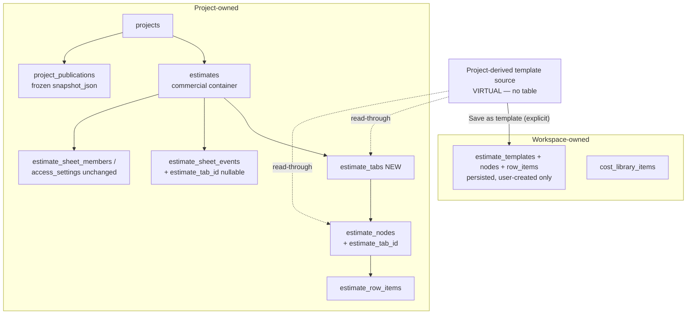
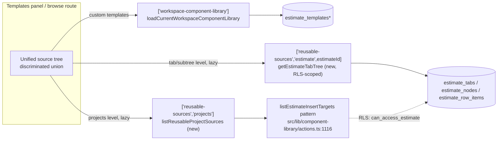
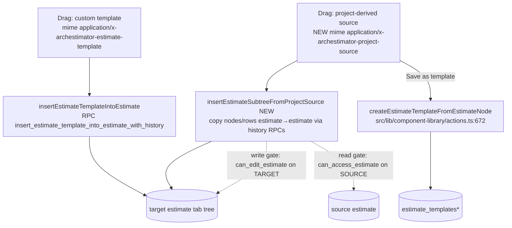
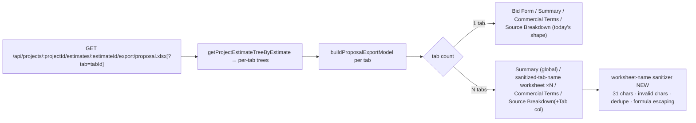

# 02 — Target Architecture

**Date:** 2026-06-12 · **Status:** recommended target, grounded in [01_CURRENT_STATE_AUDIT.md](01_CURRENT_STATE_AUDIT.md)
Evidence classes used below: **[V]** verified by repo evidence · **[A]** assumption for planning · **[D]** deferred implementation discovery · **[P]** requires product-owner decision · **[M]** requires provider/manual proof.

---

## 1. Target hierarchy

```
Workspace
  → Projects
    → Estimates                 (commercial/revision container; keeps sheet_code identity)
      → Tabs (estimate_tabs)    (NEW — worksheet/tree containers inside an estimate)
        → Estimate tree         (estimate_nodes, now keyed by estimate_tab_id)
          → Groups / Areas
            → Row items         (estimate_row_items, unchanged keying via node_id)
```

The current estimate node tree moves from "belongs to the estimate" to "belongs to a tab". Every existing estimate gets exactly one backfilled default tab, so day-one behavior is identical. **[V]** that nothing prevents this: nodes/rows key only by `estimate_id` today (01 §1).

## 2. Definitions (canonical vocabulary)

| Term | Definition |
|---|---|
| **Estimate** | The commercial/revision container inside a project: identity (`estimates.id`), name, `sheet_code` (e.g. `ES-001`, user-relabeled "Estimate code"), currency, budget, notes, collaboration boundary (`estimate_sheet_members` / `estimate_sheet_access_settings`), publication selection unit (`project_publications.selected_estimate_ids`), and export unit. It no longer directly owns tree nodes. |
| **Tab** | A named, ordered tree container inside one estimate (`estimate_tabs` row). Owns one estimate tree (root groups → areas → rows). Maps 1:1 to an Excel bid-form worksheet on export. CRUD: create, rename, duplicate, reorder, archive/delete. |
| **Template** | A persisted, workspace-scoped reusable tree in `estimate_templates(+nodes,+row_items)` — user-created only, exactly as today (01 §4). |
| **Project-derived template source** | A **virtual, read-through** entry in the templates panel pointing at live project content (a project → estimate → tab → group/area subtree). Never persisted into template tables; it is a query result + drag payload + insert action. Becomes a Template only when the user explicitly runs "Save as template" (existing `createEstimateTemplateFromEstimateNode` path, `src/lib/component-library/actions.ts:672-827`). |
| **Excel worksheet tab** | An ExcelJS `Worksheet` inside the exported XLSX (`src/lib/proposal-export/create-proposal-workbook.ts`). User copy calls these "worksheet tabs" or "Excel sheet tabs" to disambiguate from estimate Tabs. |

## 3. Recommended storage model

**Create a first-class `estimate_tabs` table (Option A of [03_DATABASE_MIGRATION_PLAN.md](03_DATABASE_MIGRATION_PLAN.md); full DDL evaluation there).** Key shape decisions:

- `estimate_tabs(id, estimate_id FK→estimates ON DELETE CASCADE, name, sort_order, is_default, archived_at, metadata, created_by, created_at, updated_at)` + unique `(estimate_id, id)` to support composite child FKs. `tab_code` from the prompt's proposed shape is **dropped for v1** (YAGNI: Excel names derive from `name`; the estimate keeps `sheet_code`; adding a column later is trivial).
- `estimate_nodes.estimate_tab_id` (uuid, FK composite `(estimate_id, estimate_tab_id) → estimate_tabs(estimate_id, id)`) — nullable during backfill, then `NOT NULL`. The composite FK structurally prevents a node pointing at another estimate's tab — same pattern as `estimate_sheet_members → estimates(id, project_id)` (`supabase/migrations/20260526142913:26-34`). **[V]** pattern exists.
- `estimate_row_items` gets **no tab column** — rows resolve tab through `node_id`, and every current read already loads rows by `estimate_id` then groups by `node_id` (`workspace-repository.ts:1545-1550`). Add later only if measured query need appears. **[D]**
- `estimate_sheet_events.estimate_tab_id` (nullable, `ON DELETE SET NULL`) for tab-scoped activity filtering of new events; historical events stay NULL = "default tab era". Table name unchanged (01 §17).
- `estimate_sheet_versions`: no column change now; the dormant snapshot RPC needs a `schemaVersion` bump (v3 with `tabs[]`) **before that feature is awakened** — documented, not implemented. **[V]** dormant (01 §12).
- Sibling-sort uniqueness moves from `(estimate_id, parent_id, sort_order)` to `(estimate_tab_id, parent_id, sort_order)` so each tab has independent root ordering (01 §1, complication #4 in the repo audit).
- Persisted templates remain the storage for user-created templates; project-derived sources are **never written** to template tables (Critical principle in the prompt; honored throughout).

### Data ownership diagram



## 4. Recommended UI model

(Detail in [05_ESTIMATE_TABS_UI_UX_PLAN.md](05_ESTIMATE_TABS_UI_UX_PLAN.md) and [06_TEMPLATES_PANEL_UNIFICATION_PLAN.md](06_TEMPLATES_PANEL_UNIFICATION_PLAN.md).)

- **Estimate editor:** a horizontal tab strip at the top of the sheet center column in `EstimateSheetContent`, reusing the existing `TreePanelHeader`/tab-strip semantics already proven at `EstimateSheetTree.tsx:63, 1303-1305` (single hardcoded "Sheets" tab today) and `SharePageTabs` tablist patterns. The left tree panel shows only the active tab's tree; its panel label flips "Sheets" → "Tabs".
- **Templates panel:** one unified left tree with two top-level sections — `Custom Templates` (existing `TemplatesTreeDatum` subtree) and `Projects` (new virtual datum variants: all readable workspace projects → estimate → tab → whole-tab / group / area). Shared preview/drag/insert behavior; divergent context-menu actions (custom: rename/duplicate/move/delete/insert; project-derived: insert/preview/save-as-template only).
- **Vocabulary:** user copy says "tab"; "estimate sheet" copy collapses to "estimate"; `sheet_code` is relabeled "Estimate code". Internal identifiers keep "sheet" until cleanup (01 §17).

### Read path — unified templates panel sources



### Write/insertion path — custom vs project-derived



## 5. Recommended export model

(Full options analysis in [07_XLSX_EXPORT_TABS_PLAN.md](07_XLSX_EXPORT_TABS_PLAN.md).)

- **Single-tab estimate (all existing data post-backfill): byte-shape-identical workbook** — `Bid Form / Summary / Commercial Terms / Source Breakdown`, exactly today's literals (`create-proposal-workbook.ts:174-347`). Zero regression for current users and current tests.
- **Multi-tab estimate: all tabs by default** — `Summary` (global, first), then one bid-form worksheet **per tab named after the sanitized tab name**, then `Commercial Terms` and `Source Breakdown` (global; breakdown gains a Tab column). Active-tab-only export via additive `?tab=<tabId>` query param; the bare route keeps meaning "everything", so existing export links never break.
- New deterministic worksheet-name sanitizer (invalid chars `[ ] : * ? / \`, 31-char limit, dedupe suffixes, quoted-name escaping for `'{name}'!H{n}` formula references — the one cross-sheet formula today is `'Bid Form'!H{n}` at `create-proposal-workbook.ts:283`).

### XLSX export model diagram



## 6. Data ownership rules

1. A tab belongs to exactly one estimate (`estimate_tabs.estimate_id`, cascade delete).
2. A node belongs to exactly one tab of its own estimate (composite FK; cross-estimate/cross-tab parenting impossible by constraint — see 03 §6).
3. Rows belong to nodes; tab membership is derived. Row writes keep validating "node is an area in this estimate" (`actions.ts:2220`); tab consistency follows from node constraints.
4. Templates are workspace-owned and copy-on-insert (ID remap preserved, `20260522091621:281-304`). Project-derived sources own nothing — they are views over project data; inserting them copies data into the target tab with fresh IDs.
5. Publication snapshots copy tab structure at publish time (snapshot schema v1.2); old snapshots stay renderable. **[V]** copy semantics (01 §13).

## 7. Permission rules

(Full matrices in [08_ACCESS_SECURITY_RLS_PLAN.md](08_ACCESS_SECURITY_RLS_PLAN.md).)

- **Tab-level access is out of scope** — the estimate remains the access boundary; tabs inherit estimate access. **Decision, not open question**: nothing in the audit shows sub-estimate access need, and `estimate_sheet_members` already occupies that slot (01 §11).
- `estimate_tabs` RLS mirrors `estimate_nodes`: SELECT `can_access_estimate(estimate_id)`, ALL `can_edit_estimate(estimate_id)`, platform-admin override — same policy family as `20260526142913:740-746`.
- Project-derived browsing must only surface projects/estimates the caller can read. Server actions run as the user (RLS-scoped clients, as `listEstimateInsertTargets` does today via `listCurrentWorkspaceProjects`), never the admin client.
- Insert actions verify write permission on the target: extend the existing `assertCanEditEstimate` gate (`actions.ts:333-337`) to the new insert path — closing the asymmetry noted in 01 §7.

## 8. Caching boundaries

(Detail in [04_DOMAIN_AND_REPOSITORY_PLAN.md](04_DOMAIN_AND_REPOSITORY_PLAN.md) §3.)

- Estimate detail: `["estimate", estimateId]` (unchanged).
- Tab list: `["estimate", estimateId, "tabs"]` (new).
- Tab tree: `["estimate", estimateId, "tab", tabId, "area-tree"]` + sibling revision slot — the existing `areaTree(estimateId)` key becomes a resolved alias for the default tab during migration.
- Library: `["workspace-component-library"]` unchanged (global).
- Project-derived sources: `["reusable-sources", …]` family, lazy per level, short `staleTime` with visible "live source" freshness metadata instead of copying data.
- Selection/expansion state moves from `…ByEstimateId` to `…ByTabId` records in `use-estimate-workspace-state.ts` (per-tab selection survives tab switching).

## 9. Compatibility strategy

- **URLs:** `/workshop/projects/[projectId]/estimates/[nodeId]` keeps working unchanged. The segment already resolves node-or-estimate (`workspace-repository.ts:1655`); the new `resolveEstimateTabRouteContext` derives the active tab from the resolved node (`node.estimate_tab_id`), falling back to the default tab for estimate-id URLs. No redirects needed; a `/tabs/[tabId]` route is deferred (05 §8).
- **DB names:** all `estimate_sheet_*` names, `sheet_code`, RPC names, stored event types stay (01 §17).
- **Repository wrappers:** `getProjectEstimateTreeByEstimate`/`ByNode` keep their signatures and return the default/active tab's tree during Phases 1–2, so every existing caller (export route, AI read context, publication snapshot builder) is untouched until intentionally migrated.
- **Export links:** bare export URL = all tabs; single-tab estimates byte-compatible (§5).
- **Ask Flip:** URL regex (`EstimateCopilotFloatingButton.tsx:165-172`) keeps matching because the route shape is unchanged.
- **Rollout with old data:** backfill creates exactly one default tab per estimate and attaches all nodes; validation queries prove 100% coverage before the NOT NULL flip (03 §7).

## 10. Event/versioning strategy

- New event types written by new/extended RPCs: `tab_created`, `tab_renamed`, `tab_reordered`, `tab_duplicated`, `tab_archived`, `tab_deleted` — free-text `event_type` column means no enum migration (`20260524033151:11-36`). Activity composer gains labels (`src/lib/activity/activity-composer.ts:75-102`).
- Existing node/row events gain `estimate_tab_id` stamping inside the `*_with_history` RPCs (derivable from the node; NULL acceptable where unknown).
- Activity UI gains a tab level in the scope tree ("Sheets" tab → "Tabs"); node-with-descendants scope resolution (`actions.ts:1159-1194`) is tab-compatible because descendants stay within one tab.
- Dormant version RPCs (`estimate_sheet_snapshot` v2, create/restore): document required v3 snapshot shape (`tabs:[{id,name,sortOrder,isDefault}]`, nodes carry `estimateTabId`); actual SQL changes deferred until the feature is awakened, with a guard note in 03 §9. **[D]**

## 11. Publication/shared-link snapshot strategy

- Bump `ProjectPublicationSnapshot` to schemaVersion 1.2: each estimate entry gains `tabs: [{id, name, sortOrder}]` and `treeNodes` gain `tabId` (`src/lib/publication/snapshot.ts:118-187`; `types.ts:78-95`). Builder reads tabs alongside nodes (`publication/actions.ts:342-437`).
- Share page: `SharePageTabs` already renders one tab per estimate; inside a sheet panel, render a second-level tab strip per estimate tab when `tabs.length > 1` (reusing its existing tablist semantics, `SharePageTabs.tsx:245`). Old snapshots (no `tabs`) render exactly as today — reconstruct-share-tree fallback already tolerates absent `treeNodes` (`src/lib/share/reconstruct-share-tree.ts:81-338`).
- Comments/decisions keep anchoring to `estimateId`/`rowId` — unaffected (01 §13).

## 12. Performance model (many estimates/tabs/nodes)

- **Editor:** load only the active tab's tree. `getEstimateTabTree(estimateId, tabId)` filters nodes by `estimate_tab_id` (new index `(estimate_tab_id, parent_id, sort_order)`), rows by joining the tab's node ids — strictly less data per query than today's whole-estimate load. Tab list is a tiny separate query. Route-level load limits (1200/3000) become per-tab. **Budgets:** tab switch triggers at most one `tabs` read (if stale) + one `tabTree` read; no whole-estimate row fetch; a 1,200-node/3,000-row tab returns within the current route limit without raising the 413 ceiling; switching tabs must not render row tables from the previously active tab. EXPLAIN proof is required in implementation; hosted query plans remain **[M]** provider proof.
- **Templates panel project browsing:** the Projects section is a cross-project reuse surface and therefore defaults to **all readable workspace projects**, not current-project-only. Preserve usability through search, project grouping, recency/favorite affordances, collapsed-by-default projects, and lazy tree expansion per level (projects list → estimates per project → tabs + top-level groups per estimate). Never load all workspaces' rows eagerly. Counts/totals come from existing aggregate patterns (`listProjectEstimates` aggregates, `workspace-repository.ts:1314-1380`) computed per expanded estimate only; cache with `staleTime: 60_000`, no polling, and manual refresh. **Budgets:** 20 projects × 5 estimates × 3 tabs test fixture performs one project-list call initially, one estimate-list call per expanded project, one outline call per expanded estimate, and zero row-detail calls until preview/insert; local outline action p95 under 500 ms in the jsdom/server-action harness or it must move to pagination/search-first before release.
- **Export:** per-tab model building is O(rows) as today; multi-tab workbooks raise worksheet count — keep the 413 limits global across tabs (07 §8). **Budgets:** single-tab workbook build stays within 10% of the current benchmark; 5 tabs × 500 rows completes under 1.5 s local build time and produces a buffer under 10 MB, otherwise use the streaming writer escape hatch before shipping multi-tab export.

## 13. Route and deep-link strategy

- Keep `[nodeId]` as the only estimate-editor segment in v1. Tab switching = select tab → select its remembered/first node → `history.replaceState` to that node's URL (mechanism already exists, `EstimateSheetTree.tsx:468-479`). Deep-linking to a tab = deep-linking to any node inside it.
- Estimate-id URLs (no node) land on the **default tab**'s first area (extends `selectFirstEstimateNodeIds`, `tree-hierarchy.ts:66-112`, to scope per tab).
- A future explicit `/estimates/[estimateId]/tabs/[tabId]` route is deferred until a concrete need (sharing a specific empty tab) appears; the node-based scheme covers current flows and avoids breaking the Ask Flip regex and link builders. **[P-lite]** — flagged in [12_OPEN_QUESTIONS_AND_DECISIONS.md](12_OPEN_QUESTIONS_AND_DECISIONS.md) as a non-blocking decision taken by this plan.

## 14. Rollout strategy (old data, old URLs)

1. **DB first, invisible:** create `estimate_tabs`, backfill one default tab per estimate, attach nodes, validate, flip NOT NULL — app still reads by `estimate_id` and behaves identically.
2. **Repos second, behind wrappers:** tab-aware loaders ship with compatibility wrappers; old call sites untouched.
3. **UI third:** tab strip appears only when it can render (default tab always exists); single-tab estimates show the strip with one tab + "Add tab".
4. **Rebrand fourth:** copy flips after the tab concept is real on screen, so users never see "tab" vocabulary before tabs exist.
5. **Templates panel fifth, export sixth, hardening seventh, cleanup eighth** — per [10_IMPLEMENTATION_PHASES.md](10_IMPLEMENTATION_PHASES.md).
6. Rollback at every phase = revert the slice; the backfilled default tab is semantically inert if UI phases are reverted (loaders fall back to whole-estimate reads via wrappers). No feature flags required **[A]**, consistent with the repo's no-flag posture for the share overhaul (`.ai/10_state/decisions.md`, 2026-06-03 entries).

## Evidence Used

- [01_CURRENT_STATE_AUDIT.md](01_CURRENT_STATE_AUDIT.md) (all sections; primary grounding)
- `src/lib/repositories/workspace-repository.ts:1590-1671` (loaders + fallback to preserve)
- `src/components/workshop/EstimateSheetTree.tsx:63, 468-479, 1303-1305` (existing tab primitive + URL sync mechanism)
- `supabase/migrations/20260522091621_component_library_templates.sql` (template graph + insertion RPC to mirror)
- `supabase/migrations/20260526142913_project_sheet_collaboration_access.sql` (composite-FK pattern, RLS helper family)
- `src/lib/proposal-export/create-proposal-workbook.ts:174-347, 283` (worksheet literals + the one cross-sheet formula)
- `src/lib/publication/snapshot.ts:118-187`; `src/components/share/SharePageTabs.tsx:245` (snapshot/tab precedents)
- `src/lib/component-library/actions.ts:672-827, 1116-1131` (save-as-template + project enumeration reuse)
- `src/lib/ai/package-builder/draft.ts:313-359`; `src/components/workshop/EstimateCopilotFloatingButton.tsx:165-172` (AI compatibility constraints)
