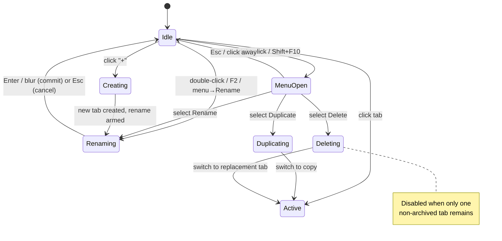

# 02 — UX / UI Design (Impeccable, Browser-Grade)

This is the heart of the plan. The owner asked for a browser-style "+" and a
genuinely impeccable treatment (`/impeccable`, `/frontend-design`,
`/ce-frontend-design`, `/design-is`). The existing strip is a solid base; the
work is to make the create/lifecycle interaction feel like a real browser tab
bar while staying inside Archestimator's restrained design system.

> **Hard constraint — design system.** The estimate editor uses a deliberately
> quiet, dense, neutral system: SF Pro / system stack, type capped at
> `text-[10px]`–`text-[12px]`, `rounded-xs`, hairline borders, neutral tokens
> only (no new accent colors), Phosphor **regular**-weight icons at 12px. Every
> new affordance must pass `bun run lint:design-system`. Do **not** introduce a
> bigger, louder "+" than the surrounding chrome — browser-grade here means
> *behavior and polish*, not visual loudness.

---

## 1. Anatomy of the tab strip (target state)

```
┌───────────────────────────────────────────────────────────────┐
│  [ Main ·Default ] [ Tab 2 ] [ Tab 3 ] … (overflow scrolls)  + │  ← strip
├───────────────────────────────────────────────────────────────┤
│  (active tab's estimate tree / empty state below)               │
└───────────────────────────────────────────────────────────────┘
```

Controls, by interaction (browser model):

| Affordance | Trigger | Result |
|---|---|---|
| **"+"** (only persistent control) | click / Enter / Space | Create tab → switch to it → inline rename armed |
| Switch tab | click | Activate that tab |
| Rename | **double-click** a tab, or context-menu → Rename, or `F2` | Inline rename input |
| Context menu | **right-click** a tab (or context-menu key) | Menu: Rename · Duplicate · Delete (· Archive) |
| Reorder | `Ctrl/Cmd+Shift+←/→` while a tab is focused | Move active tab (already wired) |

The persistent **Duplicate / Rename-pencil / Archive / Delete buttons are
removed** from the strip. They migrate into the right-click context menu.

---

## 2. The "+" affordance

- **Visual:** keep the existing ghost icon button —
  `variant="ghost" size="icon-sm"`, `size-6`, `rounded-xs`, `text-tertiary`,
  Phosphor `Plus` at 12px regular ([EstimateTabStrip.tsx:411](src/components/workshop/estimate-sheet/EstimateTabStrip.tsx#L411)).
  This already matches the system. Do not enlarge or recolor it.
- **Position:** trailing the tab list, pinned so it stays reachable when the
  list overflows (see §4). In a true browser the "+" sits right after the last
  tab and is always visible — replicate that: the "+" must not scroll off.
- **Hover/focus:** `hover:text-ink`, visible `focus-visible:ring-2
  ring-focus` (inherited from `Button`). 
- **Tooltip:** add a `toolbar-tooltip` ("New tab") using the existing
  `src/components/ui/toolbar-tooltip.tsx`. Keep the keyboard hint out unless a
  global shortcut ships (see §6).
- **Disabled:** while any mutation is pending (`pendingAction` truthy) — already
  handled. Also hidden entirely when `!canEditEstimate` (see §7).

---

## 3. Right-click context menu (new surface)

There is **no context menu on tabs today**, but the design system ships a Radix
wrapper at `src/components/ui/context-menu.tsx`, already used by
[EstimateSheetTree.tsx](src/components/workshop/EstimateSheetTree.tsx) and the
library trees. **Mirror that usage** — same component, same item styling,
same `@radix-ui/react-context-menu` dependency (already in `package.json`). Do
not hand-roll a menu.

**Architecture (verified against `EstimateSheetTree`):** use **one controlled
context menu** for the whole strip, not one menu per tab. `EstimateSheetTree`
wraps the entire tree in a single `<ContextMenu>`, records the right-clicked row
in state (`contextMenuNode`) via an `onContextMenu` handler, and renders one
`<ContextMenuContent>` whose items read that state. Replicate exactly: a single
`<ContextMenu>` around the tab-list region, an `onContextMenu` on each tab button
that stores the right-clicked `tabId` in `contextMenuTabId`, and one
`<ContextMenuContent>`. This keeps idle cost to one lazily-mounted menu (see
[05 §2](05_PERFORMANCE.md)) and is the only architecture this plan endorses.

**Focus/blur on Rename (the single hardest interaction — spec it, don't
hand-wave).** The inline rename input auto-commits on `onBlur`. When the menu
closes, Radix restores focus to the trigger, which can fire the input's `onBlur`
→ a premature/empty commit. The menu→Rename path must: (a) record the target tab
and `scrollIntoView` it; (b) `preventDefault` the menu's `onCloseAutoFocus` for
the Rename action so focus can be moved to the input programmatically; (c) guard
the input `onBlur` so the transient menu-close focus event does not commit. This
is the same handoff `EstimateSheetTree` already solves between its context menu
and inline rename — mirror that sequencing.

**Items (top to bottom):**

1. **Rename** — opens inline rename on the target tab.
2. **Duplicate** — duplicates the target tab (deep copy already supported by
   `duplicate_estimate_tab_with_history`).
3. *(optional)* **Archive** — soft-delete; see OQ2.
4. **Delete** — destructive, rendered in `text-danger`. Disabled when this is
   the last non-archived tab (the RPC and existing `orderedTabs.length > 1`
   guards enforce this; the menu item should reflect it as disabled with a
   reason, not silently fail).

**Target semantics (important):** the menu acts on the **right-clicked tab**,
not the active tab. Today the handlers (`duplicateActiveTab`,
`archiveOrDeleteActiveTab`, the pencil's `beginRename`) all operate on
`resolvedActiveTabId` / `activeIndex`. They must be refactored to accept a
target `tabId`. Right-clicking a tab should **not** force-switch to it (browser
behavior: you can delete a background tab without first focusing it). Selecting
"Rename" may switch focus to that tab for the inline edit.

**Destructive confirmation:** Delete is irreversible at the data level (hard
delete via RPC). For v1, keep parity with the rest of the editor (no modal —
the editor deletes nodes without a confirm dialog) but rely on: (a) Delete
being one extra click inside a menu, (b) `text-danger` styling, (c) the
last-tab guard. If the owner prefers a guard rail, a lightweight "Delete tab
'Name'? This can't be undone." confirm is a small add — flag as OQ.

**A11y:** Radix context menu provides roving focus, `Escape` to close, and
typeahead for free. Ensure each item has a clear label; the destructive item
gets `aria-label="Delete tab {name}"`. Keyboard users reach the menu via the
context-menu key or `Shift+F10` on the focused tab (Radix handles this when the
trigger is the focusable tab button).

---

## 4. Overflow / scroll (browser-grade)

The strip already uses `overflow-x-auto` ([EstimateTabStrip.tsx:354](src/components/workshop/estimate-sheet/EstimateTabStrip.tsx#L354)),
but raw horizontal scroll is not browser-grade. Target behavior:

- **Pin the "+"**: the tab list scrolls; the "+" stays pinned at the trailing
  edge (flex layout: scrollable tab list region + non-shrinking "+" outside the
  scroll container, or a sticky "+").
- **Scroll the active / newly-created tab into view** (`scrollIntoView({ inline:
  "nearest", behavior: "smooth" })`) on activate and on create. This is the
  single biggest "feels like a browser" win.
- **Edge affordance**: a subtle gradient fade (left/right) on the scroll
  container when content overflows, signalling more tabs. Avoid chevron buttons
  unless the fade tests poorly — they add chrome the system tends to avoid.
- **No truncation of count**: tabs already truncate names at `max-w-44`. Keep.

No virtualization — tab counts are realistically small (single to low double
digits); see [05 — Performance](05_PERFORMANCE.md).

---

## 5. New-tab empty state

A freshly created tab has zero nodes. The empty state **already exists**
([EstimateSheetContent.tsx:1833](src/components/workshop/EstimateSheetContent.tsx#L1833)):
"This tab is empty" with **Add Group** (secondary) + **Browse templates**
(ghost), and the whole surface is a template drop zone.

Work here is **verification + gating**, not invention:

- Confirm it renders for a tab created via "+" (not just for legacy/empty
  estimates).
- Gate **Add Group** / **Browse templates** on `canEditEstimate` so viewers
  don't get dead buttons.
- Copy review: "This tab is empty" is fine; consider a one-line hint that drag
  from the library or a template fills it (the drop-zone is non-obvious).

---

## 6. Keyboard & motion

**Keyboard:**
- "+" is a real `<button>` — already focusable and Enter/Space-activatable.
- Existing tab roving focus (`ArrowLeft/Right`, `Home`, `End`), `F2` rename,
  and `Ctrl/Cmd+Shift+←/→` reorder are preserved.
- A **global "new tab" shortcut** (e.g. `Ctrl/Cmd+Alt+T` — *not* `Cmd+T`, which
  the browser owns) is **deferred** to OQ3. Risk of conflict outweighs value in
  v1; the focusable "+" is sufficient.

**Motion (restrained):**
- New tab: brief enter transition (opacity/translate over ~150ms) so it doesn't
  pop in, paired with smooth scroll-into-view.
- Respect `prefers-reduced-motion` — disable the enter transition and use
  instant scroll when set.
- No motion on hover beyond the existing color transition. Keep it quiet.

---

## 7. Permission gating (UX)

- When `canEditEstimate` is **false**: hide the "+", disable double-click
  rename, and do not attach the context menu (or render it with all items
  disabled). The strip becomes a pure read-only tab switcher. This is both
  correct and avoids server-rejection error flashes.
- When **true**: full affordance set.
- The signal is server-resolved and threaded in — see
  [01](01_CURRENT_STATE_AND_REFRAMING.md#access-model-why-permission-gating-is-needed)
  and [07 U1](07_IMPLEMENTATION_PLAN.md).

---

## 8. Interaction-state model



---

## 9. Cross-tab drag (already handled — keep discoverable)

Creating tabs makes a second tab reachable for the first time in beta. Users
will try to drag estimate-tree nodes between tabs. That is **intentionally
rejected** with a toast ("Moving between tabs isn't supported yet — duplicate
the tab or save the group as a template") — already implemented at
[EstimateTabStrip.tsx:168](src/components/workshop/estimate-sheet/EstimateTabStrip.tsx#L168)
and proven (D-7 / R1.7). Do **not** build cross-tab move. Just verify the
rejection still fires on a freshly created tab and keep the workaround copy
intact. See [08](08_DECISIONS_AND_OPEN_QUESTIONS.md) (deferred).

---

## 10. Design checklist (definition of "impeccable" for this work)

- [ ] "+" matches existing chrome; tooltip present; pinned on overflow.
- [ ] Right-click menu mirrors `context-menu.tsx` usage in `EstimateSheetTree`.
- [ ] Menu acts on the right-clicked tab; Delete disabled on last tab; danger styling.
- [ ] Double-click rename works; `Esc` cancels; empty name rejected.
- [ ] Active + new tab scroll into view; edge fade on overflow.
- [ ] New-tab empty state renders and its actions are edit-gated.
- [ ] All affordances hidden/disabled when `!canEditEstimate`.
- [ ] `prefers-reduced-motion` respected.
- [ ] `bun run lint:design-system` passes; no new tokens/colors.
- [ ] Screenshot proof at default + overflow + menu-open + 375px width.
