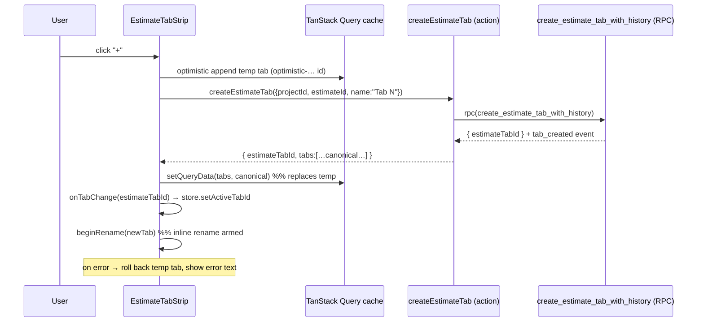

# 04 — Store, State & Data Fetching

The owner asked specifically about "store (if any)". There is one — a Zustand
workspace store — plus a TanStack Query layer. **Neither needs a schema change.**
The only state work is wiring optimistic create cleanly and making sure a new
tab's per-tab state initializes correctly.

---

## 1. Zustand store — `useEstimateWorkspaceState`

[src/hooks/use-estimate-workspace-state.ts](src/hooks/use-estimate-workspace-state.ts)

Relevant slices:

```ts
activeTabIdByEstimateId: Record<string, string | undefined>
selectedNodeIdByTabId:   Record<string, string | null>
expandedNodeIdsByTabId:  Record<string, string[] | undefined>
setActiveTabId(estimateId, tabId)
```

- Active tab is tracked **per estimate** via `useEstimateActiveTab(estimateId,
  defaultTabId)`; falls back to the default tab when unset.
- Selection and expansion are tracked **per tab** (`*ByTabId`) — so each tab
  remembers its own selected/expanded nodes.
- **In-memory only** (not persisted to `localStorage`): on reload, active tab
  resets to the default. This is existing behavior; **out of scope** to change
  (noted as a possible follow-up, not part of this plan).

**Create interaction with the store:**
- `createTab()` calls `onTabChange(newTabId)`, which flows to `setActiveTabId`.
  The new tab becomes active immediately. ✅ already wired.
- A brand-new tab has **no** `selectedNodeIdByTabId` / `expandedNodeIdsByTabId`
  entry yet — both read as `undefined`, which the editor already treats as
  "nothing selected / nothing expanded". The empty state renders. **No store
  initialization needed.** Verify (not build) this in tests.
- **Delete/archive of the active tab**: handler switches to a replacement tab
  ([EstimateTabStrip.tsx:296](src/components/workshop/estimate-sheet/EstimateTabStrip.tsx#L296)).
  Stale `*ByTabId` entries for the removed tab linger harmlessly (keyed by a
  now-absent id). A tiny cleanup (delete the removed tab's keys) is a nice-to-
  have, not required — flag as a minor follow-up, not a blocker.

---

## 2. TanStack Query layer

[src/hooks/use-estimate-query.ts](src/hooks/use-estimate-query.ts)

| Query | Key | Notes |
|---|---|---|
| Tabs list | `["estimate", estimateId, "tabs"]` | SSR-seeded `initialTabs`; 5-min stale |
| Tab tree (per tab) | `["estimate", estimateId, "tab", tabId, "area-tree"]` | per-tab nodes; revision tracking for optimistic rollback |

**Current create reconciliation (works, but improvable):**
- `createEstimateTab` returns the authoritative `tabs` array; `createTab` calls
  `onTabsChange(result.tabs)`.
- The mount passes `onTabsChange={onEstimateTabsChange}`, which in
  `EstimateWorkspaceClient` is `() => { void tabsQuery.refetch(); }`. So today a
  create triggers **both** the returned-array update path **and** a full
  refetch — redundant, and the refetch adds a round-trip flash.

**Recommended (KTD6 — see [08](08_DECISIONS_AND_OPEN_QUESTIONS.md)):**
1. On create, **set the `tabs` query cache from the server-returned array**
   (`queryClient.setQueryData(estimateQueryKeys.tabs(estimateId), result.tabs)`)
   instead of a blind `refetch()`. The action already returns canonical data.
2. Optionally add a true **optimistic append**: insert a temp tab with an
   `optimistic-` id prefix on the `tabs` key before the await, then reconcile
   with the server array (or roll back on error). This mirrors the repo's
   established pattern in
   [TemplatesBrowseManager.tsx](src/components/workshop/library/templates-browse/TemplatesBrowseManager.tsx)
   (optimistic rename/reorder with rollback). The `optimistic-` prefix is also
   the repo convention for guarding server calls against unsaved ids
   ([actions.ts:299](src/lib/estimates/actions.ts#L299)).
3. **No `revalidatePath`** for create — tab CRUD reconciles on the client. Only
   archive/delete also revalidate the estimates index (per-estimate aggregates).

**Invalidation summary for the new affordances:**
- Create / rename / duplicate → update `tabs(estimateId)` cache (no path revalidate).
- Delete / archive → update `tabs(estimateId)` **and** revalidate the estimates
  index (existing behavior).
- Switching to a new/empty tab → its tab-tree query loads (empty result is
  instant; nothing to optimize).

---

## 3. Data flow on create (sequence)



---

## 4. State work checklist

- [ ] Replace the create `refetch()` with `setQueryData` from the returned array.
- [ ] (Recommended) optimistic temp-tab append + rollback, `optimistic-` prefix.
- [ ] Verify new tab activates and its empty per-tab selection/expansion render.
- [ ] Confirm no `revalidatePath` on create; keep archive/delete revalidation.
- [ ] (Optional follow-up) prune `*ByTabId` store entries on delete/archive.
