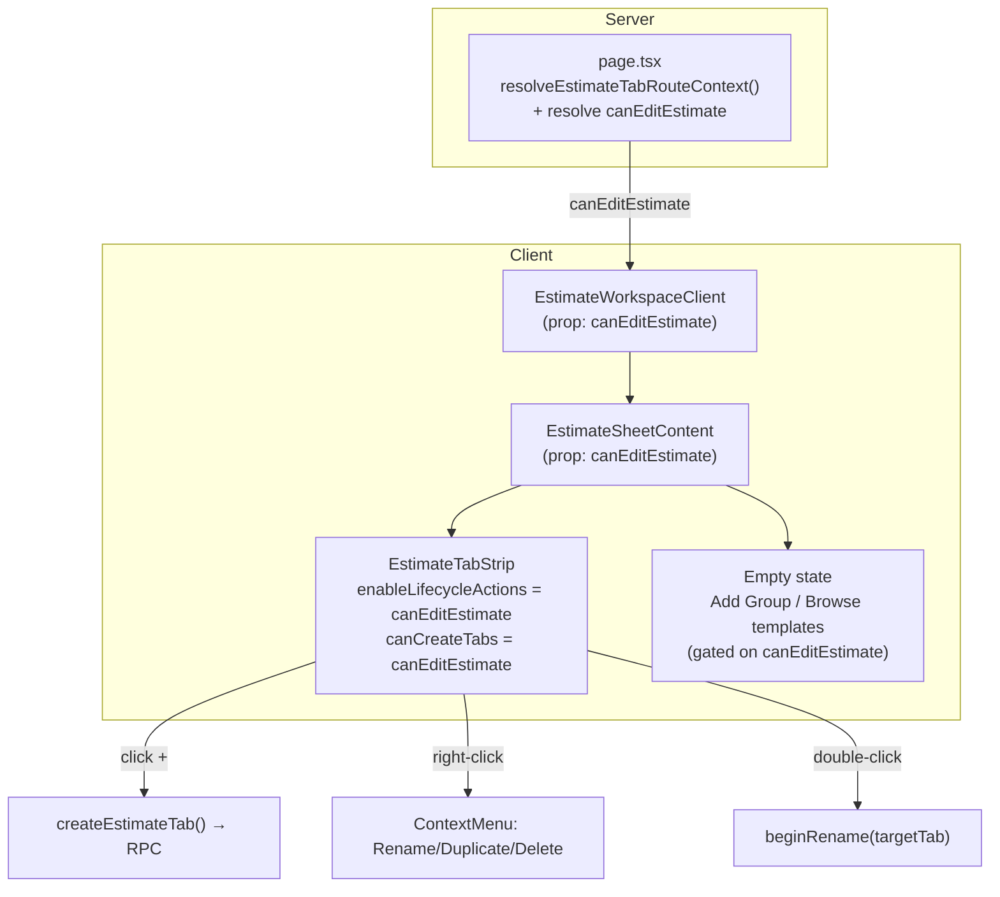

# 07 — Implementation Plan

The ce-plan core: dependency-ordered implementation units with test scenarios.
**Planning only — do not implement from this document yet.** All paths are
repo-relative. Target branch: `main` (or a `feat/add-new-tab-affordance`
branch off it).

> **Execution posture:** the strip already has a unit test
> (`tests/vitest/estimate-tab-strip.test.tsx`) that exercises the gated
> lifecycle path. Extend it **test-first** for each behavioral unit — write the
> failing assertion for the new behavior before changing the component. No DB
> work; full local validation via `bun run validate` / `bun run build`.

---

## Requirements (this plan)

| ID | Requirement |
|---|---|
| R1 | Editors see a "+" that creates a tab, switches to it, and arms inline rename. |
| R2 | Double-click a tab renames it inline (retain existing behavior). |
| R3 | Right-click a tab opens a context menu (Rename · Duplicate · Delete [· Archive]) acting on the **right-clicked** tab. |
| R4 | No persistent toolbar action row (Duplicate/Rename-pencil/Archive/Delete buttons removed). |
| R5 | All edit affordances are hidden/disabled for non-editors (`canEditEstimate`). |
| R6 | Browser-grade polish: pinned "+", scroll-active/new-into-view, overflow fade, "+" tooltip, restrained motion respecting `prefers-reduced-motion`. |
| R7 | New-tab empty state renders for "+"-created tabs; its actions are edit-gated. |
| R8 | Downstream consumers (export, activity, presence, AI, cross-tab drag reject) verified against user-created/empty tabs. |
| R9 | D-15 lift recorded in `.ai/10_state/decisions.md`; hosted-migration apply documented as a deploy prerequisite. |
| R10 | Create issues a single network round-trip (no redundant refetch); optional optimistic append with rollback. |

---

## High-Level Technical Design — permission/prop threading

The one structural change is a new server-resolved capability flowing down to
the strip. Everything else is local to the strip.



---

## U1. Thread an edit-capability signal to the editor

- **Goal:** Resolve whether the current user can edit this estimate, server-side,
  and thread it as `canEditEstimate` down to the tab strip and empty state.
- **Requirements:** R5
- **Dependencies:** none
- **Files:**
  - `src/app/workshop/projects/[projectId]/estimates/[nodeId]/page.tsx` (resolve + pass)
  - `src/components/workshop/EstimateWorkspaceClient.tsx` (prop pass-through)
  - `src/components/workshop/EstimateSheetContent.tsx` (`EstimateSheetContentProps` + pass to strip/empty state)
  - `src/lib/repositories/workspace-repository.ts` (capability helper, if added)
  - Test: `tests/vitest/estimate-tab-strip.test.tsx` (gating assertions)
- **Approach (CORRECTED after audit — see ⚠️ below):**
  - ⚠️ **There is no editor role to "reuse."** Audit (verified against source)
    found `resolveEstimateTabRouteContext` and its helper `getCurrentWorkspaceProject`
    resolve **no** per-user role/capability — the return type chain
    (`EstimateTabRouteContext` → `LiveEstimateTabTreeResult` → `LiveEstimateTreeResult`)
    contains only `workspace, project, estimate, tab, selectedNodeId, tree,
    loadLimitState`, and neither helper joins `workspace_members` /
    `project_members` / `estimate_sheet_members`. So the capability **must be
    resolved with a new server read.**
  - **Chosen path:** call the existing authoritative RPC `can_edit_estimate`
    (`supabase.rpc("can_edit_estimate", { target_estimate_id: estimate.id })`)
    **inside the page's existing `Promise.all`** at
    [page.tsx:34](src/app/workshop/projects/[projectId]/estimates/[nodeId]/page.tsx#L34),
    so it runs **in parallel** with `resolveEstimateTabRouteContext` /
    `requireCurrentUserContext` — one extra DB hop, **not** an added sequential
    round-trip. This reuses the same SQL function RLS uses (defined in
    `20260526142913_project_sheet_collaboration_access.sql`), so the client gate
    can never diverge from server enforcement.
  - **Do not** re-derive role rank in TypeScript from member tables — that
    duplicates RLS logic and rots. Use the RPC.
  - Add `canEditEstimate?: boolean` (default `false`) to the prop chain. Default-
    false keeps the gate closed if a caller forgets to pass it.
  - Server remains the source of truth (RLS + `assert_can_edit_estimate_for_history`);
    this prop is purely UX gating.
- **Patterns to follow:** `assertCanEditEstimate` at
  [actions.ts:345](src/lib/estimates/actions.ts#L345) already calls
  `can_edit_estimate` — reuse the same RPC name; the page just needs the boolean
  (not the throw). Add it to the route's `Promise.all`, not a new sequential await.
- **Test scenarios:**
  - `canEditEstimate=true` → strip renders the "+" (with U3 wired).
  - `canEditEstimate=false` → no "+", no context menu attached, double-click does
    not enter rename.
  - Prop omitted → defaults to read-only (no edit affordances).
  - The `can_edit_estimate` resolution is awaited **inside** the route's
    `Promise.all`, not added as a sequential await after it (assert via the
    page's data-loading shape / a structure test).
- **Verification:** With a viewer, the editor shows a read-only tab switcher;
  with an editor, full affordances. The capability RPC adds **one parallel** DB
  read to the route — confirm it does not become a sequential first-paint hop.

---

## U2. Replace the toolbar action row with a right-click context menu

- **Goal:** Remove the persistent Duplicate/Rename-pencil/Archive/Delete buttons;
  add a Radix context menu on each tab whose actions target the **right-clicked**
  tab. Keep "+" and double-click rename.
- **Requirements:** R2, R3, R4
- **Dependencies:** none (build behind the existing test flag before U3 exposes it)
- **Files:**
  - `src/components/workshop/estimate-sheet/EstimateTabStrip.tsx`
  - *(optional)* new `src/components/workshop/estimate-sheet/EstimateTabContextMenu.tsx`
  - Test: `tests/vitest/estimate-tab-strip.test.tsx`
- **Approach (CORRECTED after audit):**
  - **Explicitly delete the persistent action buttons** at
    [EstimateTabStrip.tsx:424–478](src/components/workshop/estimate-sheet/EstimateTabStrip.tsx#L424)
    (Duplicate, Rename pencil, Archive, Delete). ⚠️ **The Rename pencil
    ([:437](src/components/workshop/estimate-sheet/EstimateTabStrip.tsx#L437)) has
    NO per-action flag** — it renders whenever `enableLifecycleActions` is true.
    So you cannot suppress it by "leaving `canRenameTabs` false" (no such flag
    exists). It must be physically removed, or U3's gate-flip will leak a pencil
    button into the toolbar row. Keep only the "+" block.
  - **Single controlled context menu (NOT one menu per tab).** ⚠️ Audit
    correction: `EstimateSheetTree.tsx` wraps the **entire** tree in **one**
    `<ContextMenu>` and records the right-clicked node in state
    (`contextMenuNode` via an `onContextMenu` handler), then renders one
    `<ContextMenuContent>`. Mirror **that**: one `<ContextMenu>` around the tab-
    list region, an `onContextMenu` on each tab button that records the
    right-clicked `tabId` into a `contextMenuTabId` state, and a single
    `<ContextMenuContent>` whose items read that state. This matches
    [05 §2](05_PERFORMANCE.md) (one lazily-mounted menu, no N hydrated popovers)
    and resolves the prior contradiction. Do **not** wrap each tab button in its
    own `ContextMenu`.
  - Refactor `beginRename`, `duplicateActiveTab`, and `archiveOrDeleteActiveTab`
    to accept a **target `tabId`** instead of `resolvedActiveTabId` / `activeIndex`.
    Preserve the active-tab fallback only where keyboard (`F2`) needs it.
  - Menu items: Rename, Duplicate, Delete (danger), Archive (OQ2). Disable
    Delete/Archive when `orderedTabs.length <= 1` with a disabled reason.
  - Right-click must **not** force-activate the tab.
  - **Menu→Rename focus/blur contract (the hardest interaction — do not
    hand-wave).** The inline rename input auto-commits on `onBlur`
    ([:368](src/components/workshop/estimate-sheet/EstimateTabStrip.tsx#L368)).
    When the context menu closes, Radix fires a focus restore that will land on
    the trigger and can trigger the input's `onBlur` → a premature/empty commit.
    Required: (a) on selecting Rename, set `contextMenuTabId` as the rename
    target and `scrollIntoView` it; (b) suppress the menu's
    `onCloseAutoFocus` (preventDefault) when the chosen action is Rename so focus
    can be programmatically moved to the input; (c) guard the input's `onBlur`
    against the menu-close focus event (e.g. only commit on a real blur, not the
    transient close-focus). Mirror how `EstimateSheetTree` sequences
    menu-close → enter-rename. This is the same problem the tree already solved.
  - **Background-tab rename:** the input renders only at the tab whose
    `id === editingTabId` ([:357](src/components/workshop/estimate-sheet/EstimateTabStrip.tsx#L357)).
    Renaming a background/overflowed tab must `scrollIntoView` that tab and focus
    its input even if it does not become active. Add this to U5's scroll list.
  - Keep the cross-tab drag rejection ([:168](src/components/workshop/estimate-sheet/EstimateTabStrip.tsx#L168))
    intact. Verify wrapping the strip in one `ContextMenu` does not swallow the
    per-tab `onDragOver` / `onDrop` / spring-load handlers (Radix trigger is
    `asChild`; the tab buttons keep their drag handlers).
- **Patterns to follow:** `EstimateSheetTree.tsx` context-menu construction;
  `text-danger` destructive styling already used at
  [:471](src/components/workshop/estimate-sheet/EstimateTabStrip.tsx#L471).
- **Test scenarios:**
  - Right-click tab B (while A is active) → menu opens; "Delete" removes **B**,
    not A; active tab unchanged unless B was active.
  - Menu → Rename → inline input appears on the targeted tab; Enter commits; Esc cancels.
  - **Menu → Rename does NOT prematurely commit/clear on menu close** (focus
    contract): selecting Rename leaves the input focused with the existing name,
    and the menu-close focus event does not fire an empty/early `onBlur` commit.
  - **Background-tab rename:** right-click a non-active (or overflowed) tab →
    Rename → that tab scrolls into view and its input is focused, without
    force-activating it.
  - Menu → Duplicate → a copy appears and becomes active.
  - Delete disabled (with reason) when only one non-archived tab remains.
  - **No persistent Duplicate / Rename-pencil / Archive / Delete buttons render
    anywhere in the strip** — including when `enableLifecycleActions` is true
    (the flag-less pencil must be gone).
  - Double-click still renames (regression guard).
  - Context-menu keyboard: `Shift+F10`/menu key on focused tab opens it; `Esc` closes.
  - Cross-tab node drag onto a tab still shows the rejection toast (drag handlers
    survive the single-`ContextMenu` wrapper).
- **Verification:** Browser-tab-style interactions; the strip has only tabs + "+"
  visible at rest; all lifecycle actions reachable via right-click and target the
  correct tab.

---

## U3. Lift the D-15 gate at the mount, gated on edit capability

- **Goal:** Make the "+" (and context menu + double-click rename) visible to
  editors by passing the lifecycle props from `canEditEstimate`.
- **Requirements:** R1, R4, R5
- **Dependencies:** U1, U2
- **Files:**
  - `src/components/workshop/EstimateSheetContent.tsx` (mount at [:1719](src/components/workshop/EstimateSheetContent.tsx#L1719))
- **Approach:**
  - Pass `enableLifecycleActions={canEditEstimate}` and
    `canCreateTabs={canEditEstimate}`. Leave `canDuplicateTabs` / `canArchiveTabs`
    / `canDeleteTabs` **false** — those props previously rendered the now-removed
    toolbar buttons; duplicate/archive/delete now live in the context menu (U2),
    which should gate on `enableLifecycleActions` + `canEditEstimate`, not on the
    per-button `can*Tabs` flags. (Reconcile the menu's internal gating with U2 so
    it does not depend on the deprecated per-button flags.)
  - Update the prop doc comment (lines 28–32) to reflect that D-15 is lifted and
    the model is "+"+context-menu.
- **Patterns to follow:** existing conditional render guard
  `estimateTabs.length > 0` (keeps the fail-closed property when schema missing).
- **Test scenarios:**
  - Editor + ≥1 tab → "+" visible; clicking creates a tab and arms rename.
  - Viewer → no "+", no menu (covers R5 end-to-end through the mount).
  - `estimateTabs.length === 0` (schema missing / legacy) → strip not rendered;
    no "+" (fail-closed).
- **Verification:** In the live editor as an editor, the "+" appears and works;
  as a viewer it does not.

---

## U4. Efficient / optimistic create wiring

- **Goal:** One network round-trip on create; optional optimistic append.
- **Requirements:** R10
- **Dependencies:** U3
- **Files:**
  - `src/components/workshop/EstimateWorkspaceClient.tsx` (replace `refetch()` with `setQueryData`)
  - `src/components/workshop/estimate-sheet/EstimateTabStrip.tsx` (optional optimistic append)
  - `src/hooks/use-estimate-query.ts` (if a cache-setter helper is cleaner)
  - Test: `tests/vitest/estimate-tab-strip.test.tsx`
- **Approach:**
  - Change `onEstimateTabsChange` so create sets the `tabs` query cache from the
    returned array instead of blind `tabsQuery.refetch()`
    ([04 §2](04_STORE_STATE_AND_QUERY.md)).
  - *(Optional)* optimistic temp tab (`optimistic-`-prefixed id) appended before
    the await, reconciled/rolled back after — mirror
    [TemplatesBrowseManager.tsx](src/components/workshop/library/templates-browse/TemplatesBrowseManager.tsx).
  - No `revalidatePath` on create; preserve archive/delete revalidation.
- **Patterns to follow:** TemplatesBrowseManager optimistic rename/reorder;
  `optimistic-` id guard ([actions.ts:299](src/lib/estimates/actions.ts#L299)).
- **Test scenarios:**
  - Create updates the tabs list without a second fetch (assert no refetch / cache set).
  - Optimistic temp tab appears immediately; on success it reconciles to the
    server tab; on simulated action failure it rolls back and shows the error.
  - The `optimistic-` temp id is never sent to a server action.
- **Verification:** Creating a tab feels instant; network panel shows a single
  create call.

---

## U5. Browser-grade polish (overflow, tooltip, motion)

- **Goal:** Make the strip feel like a real browser tab bar.
- **Requirements:** R6
- **Dependencies:** U3
- **Files:**
  - `src/components/workshop/estimate-sheet/EstimateTabStrip.tsx`
  - *(maybe)* a small CSS/util for the overflow fade
- **Approach:**
  - **Pin the "+"** so it stays visible while the tab list scrolls (separate the
    scrollable tab region from the non-shrinking "+").
  - **Scroll active / newly-created / rename-target tab into view**
    (`scrollIntoView({ inline:"nearest", behavior: prefersReducedMotion ? "auto"
    : "smooth" })`) on activate, on create, **and when a (possibly background)
    tab enters rename** (U2). Note: `createTab` auto-arms rename on the new tab
    ([:230](src/components/workshop/estimate-sheet/EstimateTabStrip.tsx#L230)), so
    create immediately renders the rename `<input>` for the new tab — the enter
    motion and scroll must target that input, and the optimistic temp tab (U4)
    must reconcile before the rename commits.
  - **Edge fade** (gradient mask) on the scroll container when it overflows.
  - **Tooltip** "New tab" on the "+" via `src/components/ui/toolbar-tooltip.tsx`.
  - **Enter motion** for a new tab (~150ms opacity/translate); disabled under
    `prefers-reduced-motion`.
- **Patterns to follow:** `toolbar-tooltip.tsx`; existing `transition` usage on
  the tab button.
- **Test scenarios:**
  - With many tabs, the "+" remains in the DOM/visible (not scrolled away).
  - Creating a tab scrolls it into view (assert `scrollIntoView` called / element in view).
  - `prefers-reduced-motion` set → no enter transition, instant scroll.
  - Tooltip content present and accessible on the "+".
  - `bun run lint:design-system` passes (no new tokens/colors).
- **Verification:** Screenshots at default, overflow, and 375px; motion respects
  reduced-motion.

---

## U6. New-tab empty state — verify + edit-gate

- **Goal:** Ensure a "+"-created empty tab shows the empty state, and its actions
  are edit-gated.
- **Requirements:** R7
- **Dependencies:** U1
- **Files:**
  - `src/components/workshop/EstimateSheetContent.tsx` (empty state at [:1833](src/components/workshop/EstimateSheetContent.tsx#L1833))
  - Test: `tests/vitest/` (content-level test if one exists; else extend strip/integration test)
- **Approach:**
  - Confirm the empty state renders when the active tab has zero nodes (created
    via "+"), not only for legacy empty estimates.
  - Gate **Add Group** / **Browse templates** on `canEditEstimate`.
  - Light copy review (optional hint that drag/template fills the tab).
- **Test scenarios:**
  - New tab → "This tab is empty" + Add Group + Browse templates render.
  - Add Group from empty state creates a root group in the **new** tab.
  - Viewer → empty-state action buttons hidden/disabled.
- **Verification:** Create → land on a clear empty state → Add Group works in the
  new tab.

---

## U7. Downstream verification, decision record & deploy checklist

- **Goal:** Confirm the already-tolerant consumers behave with user-created/empty
  tabs; record the D-15 lift; document the hosted-apply prerequisite.
- **Requirements:** R8, R9
- **Dependencies:** U3
- **Files:**
  - `.ai/10_state/decisions.md` (D-15 lift entry)
  - `.ai/10_state/current-state.md` (status note)
  - *(verification only — no code)* export route, activity-composer, publication,
    read-context, cross-tab reject
- **Approach:**
  - Manual/integration verification per [06 §3](06_BLAST_RADIUS.md): empty-tab
    XLSX worksheet + preview scope chip; `tab_created` activity entry; publication
    snapshot includes the tab; AI read-context lists the empty tab without error;
    cross-tab drag rejection fires.
  - Record decision: "D-15 lifted — tab creation exposed now that tab-aware
    export shipped (completion audit 2026-06-12). Model: '+' + double-click
    rename + right-click menu; permission-gated on `can_edit_estimate`."
  - Add a deploy-checklist note: verify **both** `estimate_tabs` **and the
    `create_estimate_tab_with_history` RPC** exist in the target environment
    before enabling in prod. ⚠️ Audit edge case: the schema-missing fallback
    (`isEstimateTabsSchemaMissing`) only detects an **absent table/column**
    (42P01 / PGRST205 on `estimate_tabs`, 42703 / PGRST204 on `estimate_tab_id`).
    A **partial drift** — table present but the create RPC missing/older — does
    **not** trip the fallback: the strip renders, the "+" shows, and create
    errors on click ("fails open"). So the checklist must probe the RPC, not just
    the table.
  - **Rollback story (the gate-lift is a compile-time prop, not a runtime flag):**
    keep U3's mount-prop change as an **isolated single-file commit** (just the
    `EstimateSheetContent` mount props) so it can be reverted on its own. Primary
    fast path = **Vercel instant rollback** to the last green deployment; code
    path = revert that single commit. Decide explicitly (OQ) whether a runtime
    feature flag is worth adding — for a one-file, fail-mostly-closed change with
    instant-rollback available, a flag is likely overkill, but the revert path
    must be documented either way.
  - Manual/integration verification per [06 §3](06_BLAST_RADIUS.md): empty-tab
    XLSX worksheet + preview scope chip; `tab_created` activity entry; publication
    snapshot includes the tab; AI read-context lists the empty tab without error;
    cross-tab drag rejection fires. (Expected-result criteria: [06 §3](06_BLAST_RADIUS.md).)
  - Record decision: "D-15 lifted — tab creation exposed now that tab-aware
    export shipped (completion audit 2026-06-12). Model: '+' + double-click
    rename + right-click menu; permission-gated on `can_edit_estimate`."
- **Test scenarios:** `Test expectation: none` for the doc edits. Verification
  items are QA/manual (export byte-shape, activity render) — capture evidence in
  `.ai/05_logs/`.
- **Verification:** Decisions/current-state updated; downstream evidence logged;
  deploy checklist present.

---

## Sequencing

```
U1 (capability thread) ─┐
U2 (context menu)       ─┴─→ U3 (lift gate) ─→ U4 (optimistic create)
                                            ├─→ U5 (polish)
                                            ├─→ U6 (empty state)  (also needs U1)
                                            └─→ U7 (verify + decision)
```

U1 and U2 are independent and can proceed in parallel. U3 unblocks the rest.

## Validation gate (per unit and at close)

- `bun run validate` (type-check, ESLint, design-system, unit, DOM Vitest).
- `bun run build`.
- `tests/vitest/estimate-tab-strip.test.tsx` extended and green.
- `gitnexus_detect_changes()` confirms only expected symbols/flows changed.
- Screenshot proof (default / overflow / menu-open / empty state / 375px).
- **No** DB apply attempted; hosted apply tracked as owner prerequisite.
