# Estimate Tree — Single Node Type Unification

**Created:** 2026-06-13
**Type:** `refactor` (schema + interaction + data-safety; forward-only migration)
**Depth:** Deep (cross-cutting, irreversible step, multi-phase)
**Status:** Plan — **not yet approved to implement.** One open decision (node name) in [§ Decisions](#decisions-you-still-make).
**Supersedes:** the earlier two-type "friction reduction" framing. The committed decision is **one node type**, not two-disguised-as-one.
**Backed by:** [`.ai/13_research/single-node-type-sheet-tree-2026-06-13/implementation-research/`](../../13_research/single-node-type-sheet-tree-2026-06-13/implementation-research/00-README.md) — verified, implementation-grade research from two multi-agent workflows (10 + 7 agents) with adversarial verification.

---

## Decision

**Collapse `group` + `area` into ONE node type.** Every node may hold both child nodes **and** cost line items (`estimate_row_items`). The user-facing name is **"Area"** (pending your confirmation — see Decisions). No more "Group", no auto-wrap, no nesting rules, no "select a group first", no premature type choice. AI surfaces are out of scope (dormant in beta).

This is genuinely *simpler* — it **deletes** machinery rather than adding it (~14 functions/blocks removed, the entire wrap-template path gone). The earlier plan tried to keep two types and hide them, which is what felt complicated.

---

## Why this is safe to do (the one thing that matters)

Unification is a constraint-*relaxing* change. The single hazard is a **silent data-loss window**: rows vanish only when **(1)** the DB allows a row on a node that has children **AND (2)** a read path still filters on `kind === 'area'`. Today (1) is false. The plan drives **(2) to false everywhere first** — while (1) is still false, so every read fix is a *provable production no-op* — then flips (1) **relax-only with writes still withheld**, and only *last* enables the writes that can create a mixed node. **The window never opens.** This ordering is the whole plan.

It is also **forward-only**: Supabase PITR is disabled on this project, so the only rollback artifact is a fresh manual logical dump taken immediately before the migration. The route isolates the irreversible step into a small, *value-less*, separately-revertible release so the trapdoor is crossed with the least possible surprise.

---

## The route at a glance (chosen via a 3-route judge panel — full detail in [03](03_IMPLEMENTATION_ROUTE.md))

```mermaid
flowchart LR
  P0["P0 · Oracle + brittle-test demolition + prod probe"] --> P1["P1 · Public share firewall (standalone)"]
  P1 --> P2["P2 · Remaining silent-drop reads"]
  P2 --> P3["P3 · Throw paths + activity-scope cache fix"]
  P3 --> P4["P4 · 'Area' vocab + mixed-content layout — USER WIN"]
  P4 --> P5["P5 · Relax-only migration, estimate+template lockstep ⚠"]
  P5 --> P6["P6 · Enable writes / create flow 🚨 POINT OF NO RETURN"]
  P6 --> P7["P7 · Contract: delete dead code"]
```

- **Phases 0–5 are a clean-rollback corridor** — every read change is *monotonic*: it can only ever *add* rows, never drop one. Safe even if a later phase reverts.
- **The user-visible win (Phase 4)** ships *before* any irreversible step, on existing trees, at zero data risk.
- **Phase 5** relaxes the schema but ships **zero write capability** (still reversible-until-first-write).
- **Phase 6** is the single point of no return — the first time a user can save a mixed node.

---

## Document map

| Doc | Contents |
|---|---|
| [`00_INDEX.md`](00_INDEX.md) | This file — decision, safety thesis, route at a glance, open decision |
| [`01_PROBLEM_GOALS_AND_INVARIANTS.md`](01_PROBLEM_GOALS_AND_INVARIANTS.md) | Why unify; goals/non-goals; requirements; invariants **preserved** vs rules **intentionally removed** |
| [`02_BLAST_RADIUS_AND_DESIGN.md`](02_BLAST_RADIUS_AND_DESIGN.md) | Verified file-by-file blast radius; the migration; the mixed-content layout (adversarial conditions baked in); naming |
| [`03_IMPLEMENTATION_ROUTE.md`](03_IMPLEMENTATION_ROUTE.md) | **The sequenced route — Phases 0–7 as concrete PRs**, data-safety reasoning, rollback, verification gates, point of no return |
| [`04_DIMENSIONS_RISKS_ROLLOUT.md`](04_DIMENSIONS_RISKS_ROLLOUT.md) | Full dimension sweep; the adversarial findings as risks; open questions; decisions to author; verification checklist |

---

## Decisions you still make

1. **Node name → recommend "Area."** It's the BOQ term your market uses, it's already what the row-holding node is called internally (`kind:"area"`), and "an Area holds rows and nests sub-Areas" reads cleanly. **Pick "Section" instead only if** your users organize trees by trade/phase (e.g. "Electrical", "Phase 1") more than by space — "Section inside Section" reads better for pure organizers. (Full analysis: [research 05](../../13_research/single-node-type-sheet-tree-2026-06-13/implementation-research/05-naming-and-create-flow.md).)
2. **Mixed-node row order → recommend rows-first** (a node's own cost rows directly under its header; child sub-areas below). Already baked into the layout design ([02](02_BLAST_RADIUS_AND_DESIGN.md)).
3. **Maintenance window for Phase 5/6** — the migration briefly freezes writes. Acceptable for the closed-beta cohort; confirm timing when we get there.

Everything else is resolved by the research. Confirm the name (or say "go with Area") and the plan is implementation-ready.

---

## What this plan does NOT do
- Touch AI / package-builder surfaces (dormant; they inherit the relaxed RPCs automatically when re-enabled).
- Touch the dormant snapshot/version-control v2 stack (frozen; must not be awakened).
- Change the row cost formula, RLS, or the cross-tab/cycle invariants.
- Drop the `kind` column (kept as a vestigial display label — cheaper and safer than dropping; a later optional cleanup can remove it).
