# Estimate Tree — Single Node Type Unification

**Created:** 2026-06-13
**Type:** `refactor` (schema + interaction + data-safety; forward-only migration)
**Depth:** Deep (cross-cutting, irreversible step, multi-phase)
**Status:** Plan — **not yet approved to implement.** Two open owner decisions remain: node name and Phase 5/6 maintenance-window timing.
**Supersedes:** the earlier two-type "friction reduction" framing. The committed decision is **one node type**, not two-disguised-as-one.
**Backed by:** [`.ai/13_research/single-node-type-sheet-tree-2026-06-13/implementation-research/`](../../13_research/single-node-type-sheet-tree-2026-06-13/implementation-research/00-README.md) — verified, implementation-grade research from two multi-agent workflows (10 + 7 agents) with adversarial verification.

---

## Changelog — deepening pass (2026-06-13, live-repo ground-truthing)

The route, sequencing, two-vs-one decision, naming, and adversarial findings are **unchanged** (all confirmed correct). The pass closed the implementation gaps by running the code, not just reading it. **What changed and why:**

- **The migration is written, applied, and PROVEN.** [`08_unify_estimate_node_kinds.P5.sql`](08_unify_estimate_node_kinds.P5.sql) is complete DDL; [`scripts/prove-unify-estimate-node-kinds-postgres.mjs`](../../../scripts/prove-unify-estimate-node-kinds-postgres.mjs) applies it on the full 86-migration chain on local PG17 and proves: mixed content now persists; **cycle/cross-tab/missing-parent/orphan still reject (I1/I2/I3)**; the integrity block passes; the RPC write-freeze still blocks row writes. (Hosted-branch dry-run is now a formality; type regen is a verified no-op — relax-only changes no schema surface.) → [06 §C](06_GROUND_TRUTH_AND_CORRECTED_ANCHORS.md), [08](08_MIGRATION_PROOF_AND_APPLY.md).
- **The golden-master oracle exists but is only partially executable.** Current live test evidence shows O1 totals, formula/row-sum, and O5 cache-key assertions run; O2 share, O3 export, O4 chart, and O-DIV snapshot-contingency checks are still `it.todo`, and the committed snapshot only freezes O1 totals. PR0 must wire those todos before implementation can treat the oracle as the proof spine. → [07](07_GOLDEN_MASTER_ORACLE.md), [15](15_PREIMPLEMENTATION_AUDIT_AND_ACCEPTANCE_GATE.md).
- **3 plan corrections (would have caused bugs):** (1) 🆕 `insert_estimate_subtree_into_estimate` (`20260613134852:87`) carries a `kind='group'` guard, **postdates the research, and is missing from the migration list** — must relax or subtree-insert breaks. (2) `validate_estimate_template_tree` lives in the **component-library** migration, not the tabs migration as 02 §B implies. (3) **Relax the row-item triggers, don't drop them** (they are the only DB guard on a row write) and **keep the `kind` CHECK constraints** (they don't enforce the content split). → [06 §C/§E](06_GROUND_TRUTH_AND_CORRECTED_ANCHORS.md).
- **Sequencing refinement (adopted plan contract):** relax validators/triggers/reorder in **P5**, the 3 RPC kind-guards in **P6** — this keeps row/template/subtree writes withheld *at the enforcement layer* (not just the UI), honoring "relax-only ≠ enable-writes" more faithfully. Not a P5/P6 merge — the opposite. → [09 §D5](09_P1_DESIGN_DECISIONS.md).
- **All P1 design questions resolved** (activity-scope stored choice; snapshot-contingency formally deferred+tracked; by-space own-bucket rule; node-agnostic export consolidation; widen `kind` to required `string`). → [09](09_P1_DESIGN_DECISIONS.md).
- **All P2 artifacts produced:** test-migration map [10](10_TEST_MIGRATION_MAP.md), layout+a11y spec [11](11_LAYOUT_AND_A11Y_SPEC.md), runbook/write-freeze/rollback [12](12_MIGRATION_RUNBOOK_WRITE_FREEZE_ROLLBACK.md), template-editor parity [13](13_TEMPLATE_EDITOR_PARITY.md), effort+PR sequence [14](14_EFFORT_AND_PR_SEQUENCE.md).
- **Anchor drift corrected:** `EstimateSheetContent.tsx` gates moved (`:427→:435`, `:413→:421`, cache key `→:1025`); all other load-bearing anchors confirmed exact (incl. reorder hierarchy block `:427-451`). → [06 §A](06_GROUND_TRUTH_AND_CORRECTED_ANCHORS.md).

**Status after pass:** implementation-ready pending 2 owner decisions — node name (Q-1) and maintenance-window timing (Q-3). The §D5 RPC-split is now the adopted plan contract.

---

## Changelog — second audit pass (2026-06-13, acceptance hardening)

This pass does **not** change the chosen route. It adds the missing "do not false-green" layer:

- Added [`15_PREIMPLEMENTATION_AUDIT_AND_ACCEPTANCE_GATE.md`](15_PREIMPLEMENTATION_AUDIT_AND_ACCEPTANCE_GATE.md): a live-source source-sweep gate, stale-anchor warning, AI/passive-read quarantine rules, template/library summary additions, historical migration allow-listing, phase-specific proof additions, and an UltraQA scenario matrix.
- Current `EstimateSheetContent.tsx` anchors drifted again (`includeDescendants` now around `:465-474`, row-emission gate `:483`, inline activity key `:1080`), so every phase PR now starts with an anchor refresh instead of trusting the dated line table.
- The sweep found adjacent surfaces that must be classified before implementation: passive AI/copilot read/display surfaces, template summary/New Template modal copy, reusable-source metadata, publication snapshot metadata, and historical migration string traps.
- The implementation standard is now explicit: every remaining two-kind match must be changed, tested, or quarantined with evidence before a phase can be called complete.

---

## Decision

**Collapse `group` + `area` into ONE node type.** Every node may hold both child nodes **and** cost line items (`estimate_row_items`). The user-facing name is **"Area"** (pending your confirmation — see Decisions). No more "Group", no auto-wrap, no nesting rules, no "select a group first", no premature type choice. AI surfaces are out of scope (dormant in beta).

This is genuinely *simpler* — it **deletes** machinery rather than adding it (~14 functions/blocks removed, the entire wrap-template path gone). The earlier plan tried to keep two types and hide them, which is what felt complicated.

---

## Why this is safe to do (the one thing that matters)

Unification is a constraint-*relaxing* change. The single hazard is a **silent data-loss window**: rows vanish only when **(1)** the DB allows a row on a node that has children **AND (2)** a read path still filters on `kind === 'area'`. Today (1) is false. The plan drives **(2) to false everywhere first** — while (1) is still false, so every read fix is a *provable production no-op* — then flips (1) **relax-only with writes still withheld**, and only *last* enables the writes that can create a mixed node. **The window never opens.** This ordering is the whole plan.

It is also **forward-only**: Supabase PITR is disabled on this project, so the only rollback artifact is a fresh manual logical dump taken immediately before the migration. The route isolates the irreversible step into a small, *value-less*, separately-revertible release so the trapdoor is crossed with the least possible surprise.

---

## The route at a glance (chosen via a 3-route judge panel — full detail in [03](03_IMPLEMENTATION_ROUTE.md))

```mermaid
flowchart LR
  P0["P0 · Oracle + brittle-test demolition + prod probe"] --> P1["P1 · Public share firewall (standalone)"]
  P1 --> P2["P2 · Remaining silent-drop reads"]
  P2 --> P3["P3 · Throw paths + activity-scope cache fix"]
  P3 --> P4["P4 · 'Area' vocab + mixed-content layout — USER WIN"]
  P4 --> P5["P5 · Relax-only migration, estimate+template lockstep ⚠"]
  P5 --> P6["P6 · Enable writes / create flow 🚨 POINT OF NO RETURN"]
  P6 --> P7["P7 · Contract: delete dead code"]
```

- **Phases 0–5 are a clean-rollback corridor** — every read change is *monotonic*: it can only ever *add* rows, never drop one. Safe even if a later phase reverts.
- **The user-visible win (Phase 4)** ships *before* any irreversible step, on existing trees, at zero data risk.
- **Phase 5** relaxes the schema but ships **zero write capability** (still reversible-until-first-write).
- **Phase 6** is the single point of no return — the first time a user can save a mixed node.

---

## Document map

| Doc | Contents |
|---|---|
| [`00_INDEX.md`](00_INDEX.md) | This file — decision, safety thesis, route at a glance, open decision |
| [`01_PROBLEM_GOALS_AND_INVARIANTS.md`](01_PROBLEM_GOALS_AND_INVARIANTS.md) | Why unify; goals/non-goals; requirements; invariants **preserved** vs rules **intentionally removed** |
| [`02_BLAST_RADIUS_AND_DESIGN.md`](02_BLAST_RADIUS_AND_DESIGN.md) | Verified file-by-file blast radius; the migration; the mixed-content layout (adversarial conditions baked in); naming |
| [`03_IMPLEMENTATION_ROUTE.md`](03_IMPLEMENTATION_ROUTE.md) | **The sequenced route — Phases 0–7 as concrete PRs**, data-safety reasoning, rollback, verification gates, point of no return |
| [`04_DIMENSIONS_RISKS_ROLLOUT.md`](04_DIMENSIONS_RISKS_ROLLOUT.md) | Full dimension sweep; the adversarial findings as risks; open questions; decisions to author; verification checklist |
| **Deepening artifacts (2026-06-13)** | |
| [`06_GROUND_TRUTH_AND_CORRECTED_ANCHORS.md`](06_GROUND_TRUTH_AND_CORRECTED_ANCHORS.md) | P0.1 — corrected anchor table; authoritative SQL locations; plan corrections (§C/§E/§F); types reconciliation (§D) |
| [`07_GOLDEN_MASTER_ORACLE.md`](07_GOLDEN_MASTER_ORACLE.md) | P0.2 — oracle design: fixtures, captured surfaces, byte-parity + monotonic-delta rules (+ test/fixtures under `tests/vitest/`) |
| [`08_unify_estimate_node_kinds.P5.sql`](08_unify_estimate_node_kinds.P5.sql) + [`08_MIGRATION_PROOF_AND_APPLY.md`](08_MIGRATION_PROOF_AND_APPLY.md) | P0.3 — the complete relax-only DDL + proof results + hosted apply procedure |
| [`09_P1_DESIGN_DECISIONS.md`](09_P1_DESIGN_DECISIONS.md) | P1 — activity-scope storage, snapshot-contingency deferral, by-space chart rule, export structure, P5/P6 split, types |
| [`10_TEST_MIGRATION_MAP.md`](10_TEST_MIGRATION_MAP.md) | P2.9 — per-file breaking assertions + replacements; new test files |
| [`11_LAYOUT_AND_A11Y_SPEC.md`](11_LAYOUT_AND_A11Y_SPEC.md) | P2.10/11 — rows-first reorder, sticky cascade, icon/caret, empty state, a11y |
| [`12_MIGRATION_RUNBOOK_WRITE_FREEZE_ROLLBACK.md`](12_MIGRATION_RUNBOOK_WRITE_FREEZE_ROLLBACK.md) | P2.12/13 — write-freeze mechanism, pg_dump, rollback decision tree |
| [`13_TEMPLATE_EDITOR_PARITY.md`](13_TEMPLATE_EDITOR_PARITY.md) | P2.14 — template-editor unification to estimate-side depth |
| [`14_EFFORT_AND_PR_SEQUENCE.md`](14_EFFORT_AND_PR_SEQUENCE.md) | P2.15 — per-phase t-shirt sizing + PR sequence + reviewer notes |
| [`15_PREIMPLEMENTATION_AUDIT_AND_ACCEPTANCE_GATE.md`](15_PREIMPLEMENTATION_AUDIT_AND_ACCEPTANCE_GATE.md) | P2.16 — source-sweep classification, false-green prevention, AI/passive-read quarantine, UltraQA scenario matrix |

---

## Decisions you still make

1. **Node name → recommend "Area."** It's the BOQ term your market uses, it's already what the row-holding node is called internally (`kind:"area"`), and "an Area holds rows and nests sub-Areas" reads cleanly. **Pick "Section" instead only if** your users organize trees by trade/phase (e.g. "Electrical", "Phase 1") more than by space — "Section inside Section" reads better for pure organizers. (Full analysis: [research 05](../../13_research/single-node-type-sheet-tree-2026-06-13/implementation-research/05-naming-and-create-flow.md).)
2. **Maintenance window for Phase 5/6** — the migration briefly freezes writes. Acceptable for the closed-beta cohort; confirm timing when we get there.

Everything else is resolved by the research. Mixed-node row order is rows-first and already baked into the layout design ([02](02_BLAST_RADIUS_AND_DESIGN.md)).

---

## What this plan does NOT do
- Touch AI / package-builder surfaces (dormant; they inherit the relaxed RPCs automatically when re-enabled).
- Touch the dormant snapshot/version-control v2 stack (frozen; must not be awakened).
- Change the row cost formula, RLS, or the cross-tab/cycle invariants.
- Drop the `kind` column (kept as a vestigial display label — cheaper and safer than dropping; a later optional cleanup can remove it).
