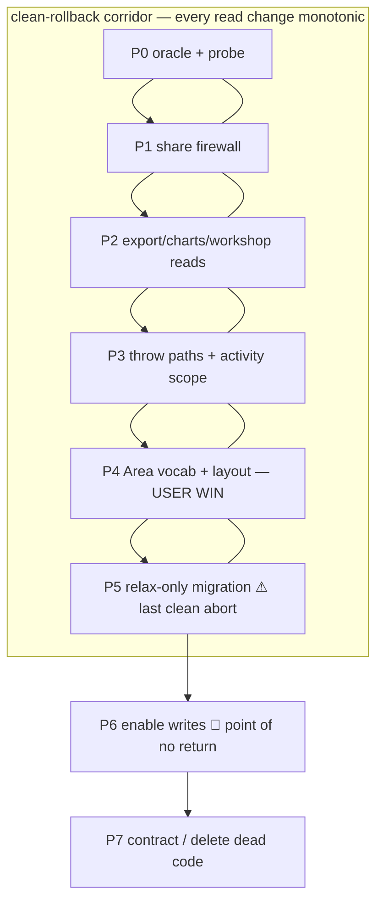

# 03 — Implementation Route

**Route: "Reads-First, Migration-Late" (Silent-Drop Firewall).** Selected via a 3-route judge panel ([scorecards](../../13_research/single-node-type-sheet-tree-2026-06-13/implementation-research/R-scorecards.md)) — it won all three judges decisively (8.4 / 9.0 / 8.4) over big-bang variants, on data-safety, rollback, and reviewability. Full synthesis: [R0](../../13_research/single-node-type-sheet-tree-2026-06-13/implementation-research/R0-final-recommended-route.md).

> **The invariant that orders everything.** Rows vanish only when **(1)** the DB allows a row on a node with children **AND (2)** a read path still gates on `kind==='area'`. Today (1) is false. We drive **(2) to false everywhere first** (each fix is a *provable prod no-op* — no mixed node exists yet for the deleted gate to affect), *then* flip **(1) relax-only with writes withheld**, and only *last* enable the writes that create a mixed node. The window's conjunction is never satisfiable.

Each phase is its own PR (or small PR set). Phases 0–5 are a **clean-rollback corridor**; **Phase 6 is the single point of no return.**

---

## Phase 0 — Oracle + brittle-test demolition + prod probe
**Ships:** test infra only. No product behavior. **User value:** none (safety capital).

- **Neutralize the two brittle source-string tests** so later phases don't re-churn them: [`tests/vitest/live-estimate-node-route.test.ts`](../../../tests/vitest/live-estimate-node-route.test.ts) (138 source-string asserts) and [`tests/vitest/supabase-performance-migrations.test.ts`](../../../tests/vitest/supabase-performance-migrations.test.ts). Replace two-kind *string* asserts with behavioral assertions deferred to the oracle.
- **Stand up the golden-master numeric oracle:** for a representative all-area tree, snapshot totals + share-reconstruct output + proposal-export model + chart aggregates + activity-scope cache keys. Every later phase reproduces these **byte-for-byte** (reads) or with documented monotonic deltas (post-migration). *This is the proof mechanism that no row or dollar is lost.*
- **Prod integrity probe (read-only early warning):** `SELECT count(*) FROM estimate_nodes n WHERE n.kind <> 'area' AND EXISTS (SELECT 1 FROM estimate_row_items r WHERE r.node_id = n.id)` and the `estimate_template_nodes` equivalent — must be 0. (Re-run as a *blocking gate* in P5.)
- **Provision the Supabase verification branch** (MCP `create_branch`) for later dry-runs; **dry-run the logical-dump restore** to prove the dump is restorable (an untested dump is not a rollback artifact).

**Data-safety:** zero schema/read/write change. **Rollback:** trivial revert. **Gate:** `bun run validate` + oracle green on all-area data.

---

## Phase 1 — Public share firewall (HIGHEST RISK, STANDALONE)
**Ships:** kind-agnostic public share read path. Prod no-op. **User value:** none visible (but the client-facing total firewall is now permanent).

- [`share/reconstruct-share-tree.ts:297`](../../../src/lib/share/reconstruct-share-tree.ts) — delete the `node.kind==="area" ? … : []` gate; emit `rowsByNodeId.get(node.id) ?? []` for every node.
- [`share/ShareEstimateTreePanel.tsx:85,148`](../../../src/components/share/ShareEstimateTreePanel.tsx) + [`ShareEstimateTreeView.tsx:87`](../../../src/components/share/ShareEstimateTreeView.tsx) — delete the render gates.

**Why standalone:** this is the **live public/publication path** that understates client-facing money (V1's critical finding). It's the single most important PR — isolating it lets a reviewer verify it against the oracle with nothing else in the diff. Gate-removal is **monotonic**: it can only ever *add* rows, never drop — safe to keep even if a later phase reverts.
**Data-safety:** DB still enforces two kinds ⇒ `rowsByNodeId.get(id)` is empty for any non-area node ⇒ byte-identical share output today.
**Rollback:** clean revert. **Gate:** oracle share output unchanged on real data; synthetic mixed-node fixture proves rows now survive (forward proof); gated e2e share smoke.

**Test scenarios:** (a) real all-area snapshot → share totals + rowCount byte-identical to oracle; (b) synthetic node with children **and** rows → its rows appear in the reconstructed share tree and in the rollup total; (c) a row whose node isn't in the tree still lands in "Unassigned" (unchanged).

---

## Phase 2 — Remaining silent-drop reads (export + charts + workshop render)
**Ships:** kind-agnostic export/charts/workshop reads. Prod no-op. **User value:** none yet.

- [`proposal-export/build-proposal-export-model.ts:265`](../../../src/lib/proposal-export/build-proposal-export-model.ts) — emit rows on any node; delete the obsolete `collectNonAreaRows` warning path. **Do not** let consolidation silently merge a container-owned row with a descendant-owned row (V2 CE2) — add `sourceNodeId`/leaf-marker to the consolidation key or forbid cross-provenance merges.
- [`project-charts/aggregate-project-charts.ts:175,256,309`](../../../src/lib/project-charts/aggregate-project-charts.ts) + [`project-charts-repository.ts:213`](../../../src/lib/repositories/project-charts-repository.ts) — switch leaf detection to **leaf-or-has-rows**; `:256` uses a **raw** `row.kind==="area"` sum that must move too (V4). Header roll-up and any "own" sibling must not both be summed in a column a consumer totals (V2 CE1) — header carries direct-only counts, or the "own" sibling is omitted.
- [`estimate-sheet/rows/branch.tsx:79`](../../../src/components/workshop/estimate-sheet/rows/branch.tsx) — `canReceiveRows` → always true (the row table already renders unconditionally).

**Data-safety / rollback:** same no-op logic; monotonic; clean revert.
**Gate:** oracle export model + chart aggregates byte-identical on all-area; mixed-node fixtures prove parity and **no double-count**; `bun run validate`.

**Test scenarios:** mixed tree `BuildingA(ownRow 100) → Level2(ownRow 50) → Room201(row 30)` → export grand total 180 (no double-count), chart series total 180, every row appears exactly once with correct provenance label; consolidation does not merge a container row into a leaf row.

---

## Phase 3 — Throw paths + activity-scope stabilization
**Ships:** the two crash/error paths fixed + the activity-scope landmine defused. Prod no-op on all-area data. **User value:** none visible (but the scope-cache bug is defused before any history accrues).

- [`domain/estimate-mutations.ts:12`](../../../src/lib/domain/estimate-mutations.ts) — remove the `canNodeReceiveRows` **throw** in `moveEstimateRowItem` (optimistic row-drag would crash on a non-area target). *(V4 — was unlisted.)*
- [`estimate-tree-data.ts:409`](../../../src/components/workshop/estimate-tree-data.ts) — `validateEstimateTreeHierarchy` stops erroring on rows-on-non-area. *(V4.)*
- [`EstimateSheetContent.tsx:413,427`](../../../src/components/workshop/EstimateSheetContent.tsx) — make `includeDescendants` a **stored, stable user choice**, never derived from `kind==="group"`/has-children; decouple row *emission* (`:427`) from kind. **Critical timing:** do this *now*, while trees are all-area, so the cache key `node:{id}:{desc|direct}` (`~:1006`) never becomes time-varying and no activity history is poisoned. Cannot be retrofitted cleanly later (V3 B2).
- Verify row-event RPCs stamp `estimate_node_id` (so the "this node only" scope shows own-row edits — V3 B1); repair if not.

**Why split from P2:** a crash-on-drag is a worse failure than a silent miscount — isolating it makes a regression independently attributable.
**Data-safety / rollback:** pre-migration, all-area; the persisted-scope default reproduces today's behavior; the new `includeDescendants` storage is additive/back-compatible.
**Gate:** oracle activity cache keys **stable across a child-add**; row-move no longer throws on the mixed fixture; `bun run validate`.

---

## Phase 4 — "Area" vocabulary + mixed-content layout (THE USER WIN — fully reversible)
**Ships:** the visible simplification, on existing all-area trees, **inside the clean-rollback corridor.** **User value: HIGH.**

- **Layout** ([`branch.tsx`](../../../src/components/workshop/estimate-sheet/rows/branch.tsx), `node-visuals.tsx`, `row-table.tsx`, `drop-zones.tsx`): rows-first ordering, one icon, conditional caret, unified empty state, **sticky-offset cascade** (V3 B3), **own-rows-vs-child-rows distinction** (V3 C1).
- **Vocabulary** → "Area" everywhere; drop "Group"/"Node"; the ~40-string table in [research 05](../../13_research/single-node-type-sheet-tree-2026-06-13/implementation-research/05-naming-and-create-flow.md); delete the onboarding group-vs-area tour step; build-breaker fix (`activity-history.tsx`, `node-visuals.tsx` lose `getEstimateNodeDisplayKind`).

**Promise-gap mitigation:** hold suggestive empty-state copy (e.g. "Add a row or a sub-area") until P6 enables creating mixed content — don't show an affordance that doesn't work yet.
**Data-safety:** pure presentation + copy; zero data semantics, zero schema. **Rollback:** clean revert.
**Gate:** gated e2e smokes on the new layout; visual parity on all-area trees; sticky-stacking verified with a 20+-row node followed by children; `bun run validate`.

**Test scenarios:** rows-first render for a node with rows + children; caret hidden on a leaf, shown on a parent; unified empty state on an empty node; no "Group"/"Node" string in any rendered tree/menu/toolbar; sticky headers don't collide on deep scroll.

---

## Phase 5 — Relax-only migration (estimate + template LOCKSTEP) ⚠️ approaches the line
**Ships:** DDL that *permits* mixed content; **zero write capability** (create/write flow withheld to P6). **User value:** none new (deliberately value-less).

**Apply procedure (runbook rigor):**
1. **HARD-GATE integrity pre-flight (BLOCKING):** re-run the P0 probe against *current* prod — both tables must return **0** mixed nodes. Non-zero ⇒ ABORT (the reversible-until-first-write guarantee is void).
2. **Dry-run the full migration on the Supabase branch** (MCP `apply_migration`); restore-drill the dump on the branch; run the oracle against branch data.
3. **Freeze writes** (brief maintenance window — acceptable for the cohort).
4. **Take the fresh manual logical dump** immediately pre-apply (the ONLY rollback artifact; PITR off).
5. **Apply to prod.**

**The DDL** (full text in [research 01](../../13_research/single-node-type-sheet-tree-2026-06-13/implementation-research/01-migration-and-data-safety.md); see [02 §B](02_BLAST_RADIUS_AND_DESIGN.md)): drop active-kind checks + area-row triggers on **both** `estimate_nodes` and `estimate_template_nodes`; rewrite both validators to cycle/cross-tab/missing-parent only; relax the row-insert + both template-insert group-target guards + the reorder hierarchy block; replay grants; end with the integrity assertion block.

**Template MUST move in this same migration** (R7): `save-as-template` ([`component-library/actions.ts:768`](../../../src/lib/component-library/actions.ts)) copies estimate subtrees into template tables and calls `validate_estimate_template_tree`. If the estimate side allowed rows-on-(former-group) while template triggers still rejected, save-as-template would break the instant a relaxed estimate is templated. **Template-editor UI parity (f) ships in this same release** so editor and schema never disagree.

Also here: rewrite the two brittle migration-contract tests to their final **one-kind** positive assertions (neutralized in P0; asserted here exactly when the migration text changes). Add migration data-integrity tests (row counts unchanged, orphan scan, DDL match) + **cycle + cross-tab regression tests** (the preserved checks share a body with the removed ones — a sloppy edit could silently drop them, I1/I2).

**Why still data-safe — the decisive point:** relax-only + no write path. Every read is already kind-agnostic (P1–P3, oracle-proven). So (1) becomes true but no code can *create* a mixed node, and (2) is already false everywhere — the conjunction is never satisfied. **And the DDL is still cleanly reversible** because no row violates the old constraints yet.
**Rollback:** abort = restore the fresh dump + revert app; re-adding old constraints *succeeds* (no violating data). **This is the last clean abort point.**
**Gate:** branch dry-run + restore drill green; post-apply integrity check; oracle reproduced with only documented monotonic deltas; `bun run validate` + targeted vitest + gated e2e (incl. `e2e/workshop-template-insert-smoke.spec.ts`).

---

## 🚨 Phase 6 — Enable writes / create flow. THE SINGLE POINT OF NO RETURN.
**Ships:** the ability to *create* a mixed-content node. **User value: feature fully live.**

- Remove `canNestEstimateNodeKind`, the "select a group first" guard, the area-row write guards.
- Single **"Add Area"** flow; delete the wrap-template machinery and now-dead helpers (`canNodeReceiveRows`, `getEstimateWrapGroupName`, …).

**Point of no return:** the **first production save of a mixed-content node** (possible only after P5 **and** P6 are live). From that instant the old constraints fail to re-apply on real data and the dump goes stale — recovery becomes forward-fix only.
**Why this is the safest possible moment to cross it:** every read is already kind-agnostic and oracle-proven (P1–P3); the layout/vocab is shipped and validated (P4); the schema is relaxed and integrity-checked in isolation (P5); templates are in lockstep; the cohort is tiny. A failure here is attributable to the **write flow alone**.
**Rollback:** revert the P6 PR to **re-close write capability** (stops *new* mixed nodes immediately); any mixed nodes already created are read correctly by the shipped kind-agnostic paths — **no data loss even mid-rollback.** Schema rollback is gone; data integrity is intact.
**Gate:** end-to-end mixed-content create → share → export → chart → snapshot parity vs the oracle (now with intentional mixed deltas); single-Add e2e; cycle + cross-tab regression on the rewritten validators; `bun run validate`.

**Test scenarios:** create a sub-area under an area that has rows (no wrap, no error); add a row to a node that has children; drag a row onto a node with children (no throw); create a cycle is rejected; cross-tab move is rejected.

---

## Phase 7 — Contract (delete dead code)
**Ships:** removal of now-unreachable code. **User value:** none (hygiene).

- Delete the dead wrap/nesting helpers, `correctKinds`, `collectNonAreaRows`, `EmptyGroupMessage`, the dead AI-adjacent gates' app references (not AI files), and any vestigial two-kind branches confirmed unreachable.
- Optional, deferred: a later migration to drop the `kind` column once nothing reads it.

**Data-safety:** removing unreachable code only. **Rollback:** clean revert. **Gate:** `bun run validate`; full vitest + e2e suite.

---

## Dependency & rollback map

**Cross-cutting that rides specific phases:** template DB+UI lockstep → **P5**; brittle-test neutralization → **P0** (final assertions P5); the golden-master oracle → **P0**, enforced every phase; pre-migration dump + branch dry-run + blocking integrity gate → **P5** (probe seeded P0).

**Why this beats the alternatives** (full reasoning in [R0](../../13_research/single-node-type-sheet-tree-2026-06-13/implementation-research/R0-final-recommended-route.md)): big-bang routes fuse the irreversible migration into the least-reviewable PR (the one you can never undo) or reduce safety to a single high-pressure human cutover gate. This route makes reads-before-writes a **structural property of shipped, verified prior phases**, isolates the highest-risk public-share fix, lands the user win early *and reversibly*, and crosses the trapdoor with a small value-less step — the longest clean-rollback corridor and smallest per-deploy blast radius of the three.
