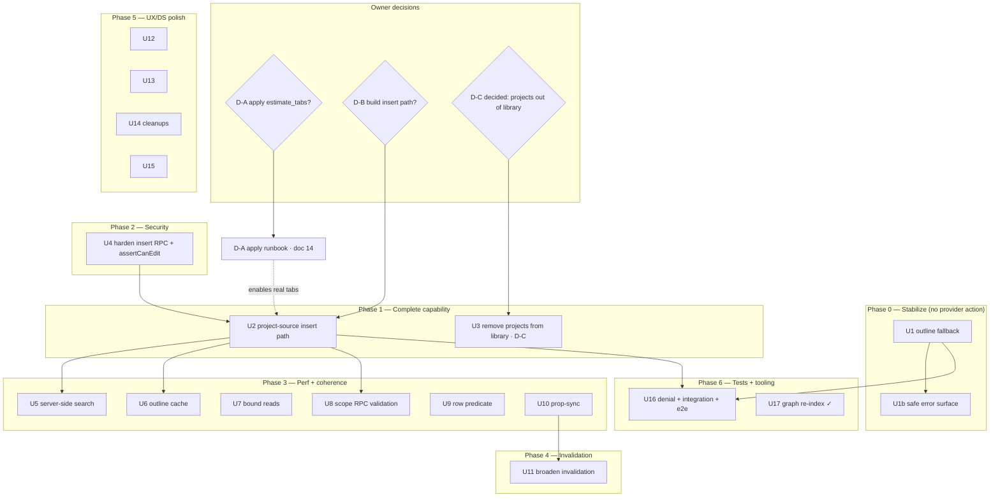

# 11 — Requirements Traceability & Sequencing

**What this is:** The execution spine — every finding traced to a fix unit, its files, its tests, its risk, its phase, and its dependency order. Use this to track implementation to `done` and to sequence safely.

---

## 1. Traceability matrix (finding → unit → tests → risk → phase)

| Finding | Sev | Unit | Primary files | Tests / proof | Blast-radius risk | Phase | Status |
|---|---|---|---|---|---|---|---|
| DEF-1 outline 500 | P0 | U1 | `lib/repositories/workspace-repository.ts` (`getEstimateTabs`, `getDefaultEstimateTab`, `getEstimateTabTree`) | new integration test on unmocked outline path; fallback unit test | LOW (contained) | 0 | planned |
| UX-6 raw error leak | P2 | U1b | `component-library/index.tsx`, `templates-browse/TemplatesBrowseManager.tsx` | error-state renders friendly copy + `role="alert"` | LOW | 0 | planned |
| SEC-1 / DEF-4 viewer-can-insert | P1 | U4 | new migration (port `assert_can_edit_estimate_for_history`); `lib/estimates/actions.ts` (`insertEstimateTemplateIntoEstimate`, `wrapEstimateAreaAndInsertTemplate`) | RLS harness viewer-denied; package-builder regression | HIGH (3 RPC call sites incl. AI) | 2 | planned |
| DB-1 estimate_tabs unapplied | P1 | D-A (runbook: doc 14) | `supabase/migrations/20260612094734…`; `lib/supabase/types.ts` | P1–P5 proofs ([14](14_MIGRATION_APPLY_AND_ROLLBACK_RUNBOOK.md)) | HIGH (export, AI, publication, node-route) | owner-gated | decision |
| DEF-2 insert path not built | P1 | U2 | new migration (subtree RPC); `lib/reusable-sources/actions.ts`; `component-library/index.tsx`; tree drop handler; `lib/supabase/types.ts` | denial 4–7; whole-tab/area insert; re-read-at-insert ([13](13_INSERT_PATH_DESIGN_SPEC.md)) | MED (additive; must not disturb template RPC) | 1 | decision (D-B) |
| DEF-3 / UX-1 inert route sources | P1 | U3 (remove, D-C) | `templates/page.tsx`, `TemplatesBrowsePageClient.tsx`, `TemplatesBrowseManager.tsx`, delete `project-source-browse-tree.tsx` | library shows custom only; in-estimate unchanged | LOW | 1 | planned |
| UX-2 surface divergence | P1 | U3 (intentional, D-C) | (as U3) | library has no Projects section | LOW | 1 | planned |
| PERF-1 search fan-out | P1 | U5 | `lib/reusable-sources/actions.ts` (`searchReusableProjectSources`); new SQL/RPC + trigram index | round-trip-count test | HIGH (perf) | 3 | planned |
| DATA-1 stale in-estimate templates | P1 | U10 | `component-library/index.tsx:704` | two-surface coherence test | LOW | 3 | planned |
| PERF-2 unbounded reads | P2¹ | U7 | `workspace-repository.ts`, `component-library-repository.ts`, editor route | large-workspace fixture; limit-state | MED | 3 | planned |
| PERF-3 outline uncached | P2¹ | U6 | `templates-browse/TemplatesBrowseManager.tsx`, `project-source-browse-tree.tsx` | no-refetch-on-re-expand | LOW | 3 | planned |
| PERF-6 RPC whole-estimate validation | P2 | U8 | subtree/template insert RPC migrations | large-estimate insert latency | MED | 3 | planned |
| PERF-7 row predicate | P3 | U9 | `workspace-repository.ts:1779-1784` | EXPLAIN (manual-proof-pending) | LOW | 3 | planned |
| DATA-2/3 invalidation gaps | P2 | U11 | `lib/component-library/actions.ts`, `template-editor-actions.ts` | cross-surface freshness | LOW | 4 | planned |
| UX-4/5 editor reorder + a11y | P2 | U12 | `template-editor/TemplateStructureTree.tsx`, `ui/tree.tsx` | keyboard reorder + announce | LOW | 5 | planned |
| UX DS violations | P2/P3 | U13 | `component-library/index.tsx`, `ui/badge.tsx`, `TemplateGallery.tsx`, `TemplatePreviewDock.tsx` | `lint:design-system` | LOW | 5 | planned |
| UX-7/8/9/10 cleanups | P3 | U14 | `templates.ts`, `NewTemplateModal.tsx`, gallery/dock | unit + no-dead-export grep | LOW | 5 | planned |
| UX-11 insert-picker prevalidation | P3 | U15 | `InsertIntoEstimatePicker.tsx` | picker validation test | LOW | 5 | planned |
| DEF-6 test gaps | P1 | U16 | new `*-insert-action.test.ts`, `*-denial.test.ts`; extend RLS harness; e2e | denials 1–8; unmocked outline; e2e | — | 6 | planned |
| 06 stale graph | P2 | U17 | tooling (code-review-graph rebuilt; gitnexus CLI broken) | `list_graph_stats` | — | 6 | **done** (code-review-graph; see [15](15_VERIFICATION_LOG_AND_ASSUMPTIONS_CLOSURE.md)) |
| PERF-9 panel over-fetch (3–6s skeleton) | P1 | U18, U19, U20 | `component-library-repository.ts:522-616`, `EstimateSheetContent.tsx:722`, `providers.tsx`, `[nodeId]/page.tsx` | lite-loader round-trip count; prefetch warm-cache; panel-interactive <800ms | LOW | 3b | planned |
| PERF-10 node-route waterfall | P2 | U21 | `[nodeId]/page.tsx:34-62`, `workspace-repository.ts:1691-1715` | one-fewer round-trip | LOW | 3b | planned |
| Suppliers blocked at data/RLS/RPC (S-1/S-2/S-3) | P1 | U22 | `20260522091621_component_library_templates.sql:6,250-252,583-620`; cache key `EstimateSheetContent.tsx:723` | decision doc | — | before U2/U4 | decision |
| Loading UX: spinner-on-every-expand (no client store/cache) | P1 | U6, U23 | `component-library/index.tsx:1735,1769`, `use-prefetch-on-hover.ts`, TanStack | cached re-expand 0-refetch; prefetched expand spinner-free; skeleton-in-place no shift | LOW | 3b | planned |
| Error handling + toasts (raw-error leak / layout shift) | P1 | U1b | `component-library/index.tsx:808/982/1747/1776/1110`; reuse `ui/toast.tsx` | toast not banner; no `{code…}`; no layout shift | LOW | 0 | planned |
| Spec correctness (U2-1 P0, U4-1/4-4, U1-1, U14-1 …) | P0/P1 | [16](16_IMPLEMENTATION_RISK_AND_EDGE_CASE_CATALOG.md) catalog | specs 12/13/14 corrected in place | per-unit must-fix list + tests | — | pre-impl | **corrected** |

¹ P2 today / P1 at scale (see [03](03_PERFORMANCE_AUDIT.md)).

`Status` legend: `planned` = ready to build · `decision` = gated on D-A/D-B · `done` = completed in this pass.

---

## 2. Dependency & sequencing graph

**Reading it:** U1/U1b/U4 are the **independent first slice** (no decision, no upstream). U2 depends on U4 (hardened gate) and on D-B; it benefits from D-A (real tabs) but works on the fallback. Perf/coherence (Phase 3) follow the insert path. Tests (U16) gate every phase exit.

---

## 3. Phase gates (exit criteria)

| Phase | Exit criteria |
|---|---|
| 0 Stabilize | Live outline loads with 0 × HTTP 500; no raw error in UI; integration test green |
| 1 Complete | Project-source insert works in the in-estimate panel (drag/menu/bulk) with provenance; library route shows custom only (projects removed, D-C); denials 4–7 proven |
| 2 Security | Viewer-denied proven (harness + action); package-builder regression green |
| 3 Perf+coherence | Search round-trips bounded; outline cached; editor honors load limits; cross-surface template freshness |
| 4 Invalidation | All template mutations invalidate every dependent surface |
| 5 Polish | `lint:design-system` green; keyboard reorder + announce; no dead exports |
| 6 Tests/tooling | denials 1–8 tested; unmocked outline integration test; e2e un-skipped & green; graph reliable |

## Truth & integrity

- **VERIFIED:** every row maps to a finding proven in docs 02–07/15 and a unit in [08](08_SOLUTIONS_AND_OPTIMIZATIONS.md); U17 status `done` is evidenced in [15](15_VERIFICATION_LOG_AND_ASSUMPTIONS_CLOSURE.md).
- **DECISION-GATED:** D-A and D-B rows are owner calls; their dependent units stay `decision` until resolved.
