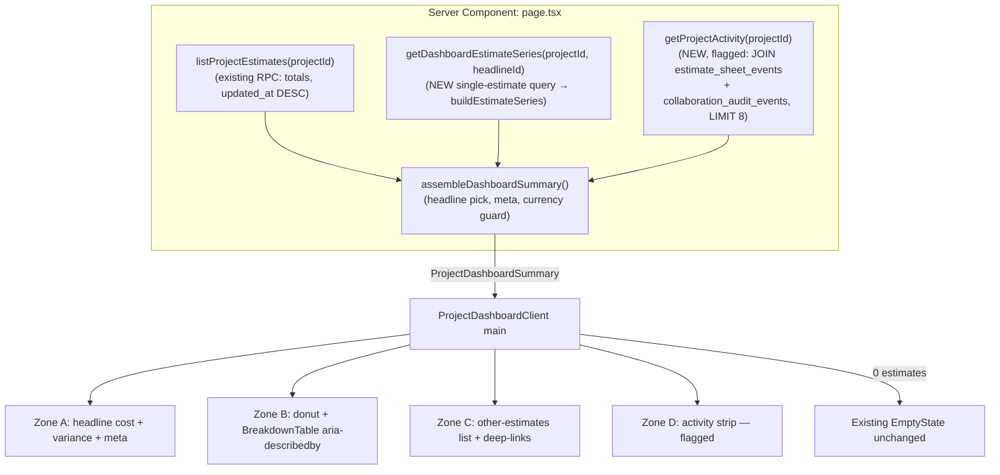
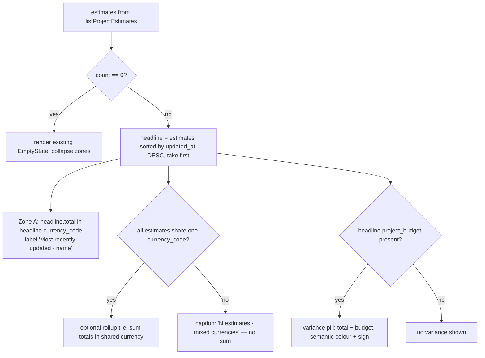

# Implementation Plan — Project Dashboard Overview ("Honest Hero")

**Date:** 2026-06-14
**Type:** `feat`
**Depth:** Deep
**Status:** Plan / readiness only — no code in this pack.
**Origin:** This pack (`00-current-state-audit.md`, `01-research-and-benchmarking.md`, `02-design-directions-and-decision.md`).
**Target surface:** `src/app/workshop/projects/[projectId]/page.tsx` → the `<main>` element of `src/components/workshop/ProjectDashboardClient.tsx` (lines ~174-200). The left 274px `aside` (lines ~134-173) is out of scope and stays unchanged.

---

## Summary

Turn the project dashboard's empty `<main>` into a minimalist, at-a-glance cost overview. A single hero figure (the most-recently-updated estimate's total, with a budget-variance pill) leads; a cost-mix donut paired with a mandatory accessible breakdown table explains the composition; a lean list links to the project's other estimates; and a feature-flagged recent-activity strip shows what changed. Cost ships first using data that already exists; activity ships second behind a flag because it requires new event instrumentation. The design reuses the existing charts pipeline, palette, formatters, and financial-card primitive so the dashboard reads as the same product as the estimate grid and never drifts from the Compare tab.

---

## Problem Frame

The project home wastes 70–80% of its width on empty-state guidance even when the project has estimates worth millions. A user opening a project cannot answer the three questions that brought them there — *what does it cost, how is that cost composed, what changed* — without navigating to `/estimates` or `/charts`. Meanwhile the codebase already computes all the cost data and ships a CVD-safe donut; the only thing missing is a surface that composes it at the project's entry route. The constraints are real but bounded: there is no `is_primary` flag, currency is per-estimate, and project activity is not yet instrumented — so the plan must be honest about the "latest" anchor, guard mixed-currency math, and flag-gate activity.

---

## Requirements

Traceability IDs (`R#`) are referenced by implementation units.

- **R1** — The dashboard `<main>` shows the headline cost (the most-recently-updated estimate's `total_cost`) as the single dominant figure, formatted in that estimate's currency.
- **R2** — The headline anchor is labelled honestly as "Most recently updated · {estimate name}" (never "Primary"), because no `is_primary` flag exists.
- **R3** — When the headline estimate has a `project_budget`, a variance indicator (± amount/%, semantic colour + sign/arrow) appears; absent a budget, no variance is shown (no fabricated zero).
- **R4** — Supporting facts (estimate count, freshness) appear as a single quiet meta line, **not** as co-equal stat cards. No standalone Currency or Last-updated tile.
- **R5** — A cost-mix donut shows the headline estimate's breakdown, capped at ≤5 named segments + a neutral "Other", with the total in the centre, using the existing Okabe–Ito `colorForBucket` palette.
- **R6** — The donut is **always** accompanied by a breakdown data table (swatch · label · amount · share) wired via `aria-describedby` (DESIGN.md hard rule; WCAG 1.1.1/1.4.4/1.4.10).
- **R7** — A grouping toggle (Space / Category / Supplier) controls the donut; default is **Category** (cheapest path). The toggle is a shared primitive used by both the dashboard and Compare.
- **R8** — A lean list of the project's other estimates (name · total · over-budget badge) links each row to its sheet ("open") and to Compare pre-selected with the headline ("compare"); shows ≤6 rows then "View all".
- **R9** — Any cross-estimate cost rollup renders **only** when every estimate shares one `currency_code`; otherwise it degrades to a "mixed currencies" caption. The default model never sums mixed currencies.
- **R10** — A recent-activity strip (≤8 curated rows, actor · action · relative time, day-grouped) appears behind a feature flag; when the flag is off or there is no activity, a single muted "No recent activity" line shows (no large empty box).
- **R11** — Project metadata edits emit an audit event so "Project renamed/…"-class rows can appear in the feed (new instrumentation).
- **R12** — The zero-estimate state renders the existing `EmptyState` (current copy + 3 links) unchanged; cost/activity zones collapse.
- **R13** — Every zone has a skeleton loading state (no spinners); the dashboard matches app density (8–12px type, 3px radius, hairline borders, flat white, spacing tokens, no centered max-width).
- **R14** — The donut/breakdown/formatters are visually identical to the Compare tab (same `colorForBucket`, `formatChartMoney`, `formatChartShare`) so colours and figures never diverge across surfaces.

---

## Key Technical Decisions

- **KTD-1 — Dedicated single-estimate cost query, not a `getProjectChartsData` wrapper.** Verified: `getProjectChartsData` runs `all-estimates` mode at ≤20 estimates and ignores `selectedEstimateIds`, loading every estimate's rows/nodes. The dashboard needs a new repository function that loads one estimate's row/node facts (+ global category facts + workspace supplier facts) and calls the already-pure `buildEstimateSeries(input, estimateId)`. *(see `00-current-state-audit.md` §4.1)*
- **KTD-2 — "Most recently updated" anchor, labelled, not "Primary".** No `is_primary`/`marked_primary_at` column exists; `updated_at` DESC is the only signal. Ship it labelled honestly; file the column as the real fix (deferred). *(R2; audit §4.2)*
- **KTD-3 — Reuse the charts pipeline wholesale.** `CostDonutChart`, `collapseProjectChartBuckets`, `colorForBucket`, `formatChartMoney/Share` are consumed as-is so the dashboard and Compare cannot drift (R14). New code is limited to the single-estimate query, the breakdown table, the two extracted primitives, and the (flagged) activity layer.
- **KTD-4 — Single-currency guard on any rollup.** Currency is per-estimate; summing across differing codes is meaningless. The headline-estimate model is the safe default; the optional project-wide tile renders only under one shared currency, else a caption. *(R9; audit §4.3)*
- **KTD-5 — Cost-first, activity-flagged delivery.** Cost data is free; activity requires a JOIN through `estimates.project_id` (no `project_id` on `estimate_sheet_events`), a new `composeCollaborationActivity`, and new project-metadata instrumentation. Ship Phases 0–1 (cost) first; Phase 2 (activity) behind a flag. *(R10–R11; audit §4.4–4.6)*
- **KTD-6 — Default grouping = Category; lazy Space.** Space mode walks the raw node tree (bounded by `ESTIMATE_NODE_LIMIT`); Category/Supplier are cheaper pre-bucketed reads. Default to Category on first paint. *(R7; audit §4.10)*
- **KTD-7 — Extract `SegmentedControl` + add `SectionHeading` as shared primitives before composing.** Both are currently embedded/absent; extracting first prevents two drifting toggles. *(R7; audit §4.8)*
- **KTD-8 — Reuse `en-PH` formatters as-is for v1.** Acceptable (matches Compare); parameterize locale later (deferred). *(audit §4.9)*

---

## High-Level Technical Design

### Data flow (server → client zones)



### Headline + currency-guard decision flow



*Diagrams are authoritative design intent, not implementation specification; prose requirements govern on any disagreement.*

---

## Output Structure (new/changed files)

```
src/
  app/workshop/projects/[projectId]/
    page.tsx                                  # MODIFY: fetch dashboard summary, pass to client
  components/
    ui/
      segmented-control.tsx                   # NEW (U1): extracted shared primitive
      section-heading.tsx                     # NEW (U2): 11px/500 app-subtitle heading
    workshop/
      ProjectDashboardClient.tsx              # MODIFY: replace <main> body with zones
      dashboard/
        DashboardHeadline.tsx                 # NEW (U5): Zone A
        DashboardCostMix.tsx                  # NEW (U6): Zone B donut + toggle
        DashboardBreakdownTable.tsx           # NEW (U6): aria-describedby data table
        DashboardEstimateList.tsx             # NEW (U7): Zone C
        ProjectActivityList.tsx               # NEW (U11): Zone D (flagged)
        DashboardSkeletons.tsx                # NEW (U8): per-zone skeletons
  lib/
    util/relative-time.ts                     # NEW (U2): en-PH relative time
    repositories/
      project-dashboard-repository.ts         # NEW (U3,U4): single-estimate series + summary assembly
      project-activity-repository.ts          # NEW (U10): flagged activity query
    activity/
      activity-composer.ts                    # MODIFY (U10): + composeCollaborationActivity
    projects/
      actions.ts                              # MODIFY (U9): emit project_metadata_updated event
    workshop/
      dashboard-types.ts                      # NEW (U4): ProjectDashboardSummary type
      compare-href.ts                         # NEW (U7): buildCompareHref(projectId, ids)
```
*The per-unit `Files` lists are authoritative; this tree is the expected shape only.*

---

## Implementation Units

### U1. Extract shared `SegmentedControl` primitive
- **Goal:** Move the Space/Category/Supplier toggle out of `ProjectChartsClient` into a reusable `src/components/ui/segmented-control.tsx` used by both Compare and the dashboard, so the toggle is pixel-identical on both.
- **Requirements:** R7, R14 · **Dependencies:** none
- **Files:** `src/components/ui/segmented-control.tsx` (new), `src/components/workshop/project-charts/ProjectChartsClient.tsx` (refactor to consume it), `src/components/ui/segmented-control.test.tsx` (new), Storybook story if the repo's `storybook:check-components` requires one for new `ui/` components.
- **Approach:** Lift the existing toggle markup/keyboard handling verbatim; expose `options`, `value`, `onChange`, `size`. Keep it controlled. Confirm `ProjectChartsClient` behaves identically after the swap.
- **Patterns to follow:** existing `ui/` primitives (`button.tsx`, `dropdown-select.tsx`) for prop shape and class composition; DESIGN.md component-reuse contract.
- **Execution note:** characterization-first — snapshot/interaction-test the current Charts toggle behaviour before extracting, then prove the extracted primitive matches.
- **Test scenarios:**
  - Renders all provided options; the `value` option is marked `aria-pressed`/selected. *(happy)*
  - Click/Enter/Space on an option fires `onChange` with that option's id. *(happy)*
  - Arrow-key navigation moves selection per existing Charts behaviour. *(edge)*
  - `ProjectChartsClient` grouping still switches Space/Category/Supplier after refactor. *(integration)* Covers R14.
- **Verification:** Compare tab toggle visually/behaviourally unchanged; dashboard can import the primitive.

### U2. Add `SectionHeading` primitive + `relative-time` util
- **Goal:** A tiny `SectionHeading` (11px/500 app-subtitle) for zone titles and a locale-consistent relative-time helper ("2 days ago", "3h").
- **Requirements:** R13, R4, R10 · **Dependencies:** none
- **Files:** `src/components/ui/section-heading.tsx` (new), `src/lib/util/relative-time.ts` (new), `src/lib/util/relative-time.test.ts` (new).
- **Approach:** `SectionHeading` is a semantic `<h2>`/`<h3>` with the app-subtitle token. `relative-time` returns relative strings under 7 days and an absolute `formatDate`-style string beyond; **first verify no existing helper** (grep `formatDistance|timeAgo|fromNow`), keep locale `en-PH` to match `formatChartMoney`.
- **Patterns to follow:** `src/lib/projects/...` util style; `formatDate` at `ProjectDashboardClient.tsx:36`.
- **Test scenarios (relative-time):**
  - "just now" for < 60s; "23 minutes ago"; "3 hours ago"; "Yesterday"; "4 days ago". *(happy/edge)*
  - ≥ 7 days → absolute date ("12 Jun 2026"). *(edge)*
  - Future timestamp (clock skew) → clamps to "just now", does not render "in 3 hours". *(error)*
  - Null/invalid input → "—". *(error)*
- **Test scenarios (SectionHeading):** `Test expectation: none — presentational; covered by zone component tests.`
- **Verification:** util unit tests green; heading renders at correct token.

### U3. Single-estimate cost-series repository query
- **Goal:** `getDashboardEstimateSeries(projectId, estimateId)` returning a `ProjectChartEstimateSeries` for **one** estimate without over-fetching the project.
- **Requirements:** R5, R7, R14 · **Dependencies:** none (KTD-1)
- **Files:** `src/lib/repositories/project-dashboard-repository.ts` (new), `src/lib/repositories/project-dashboard-repository.test.ts` (new).
- **Approach:** Load `estimate_row_items` + `estimate_nodes` for the single `estimate_id`, plus the global category facts and workspace supplier facts that `buildEstimateSeries` needs; then call `buildEstimateSeries(input, estimateId)` (already exported, pure). Apply a per-estimate node limit (re-derive — do **not** inherit the shared `ESTIMATE_NODE_LIMIT=1500` across-estimates cap) and surface a truncation flag. Do **not** call `getProjectChartsData`.
- **Patterns to follow:** the fact-loading + `buildSeriesByEstimate` flow in `src/lib/repositories/project-charts-repository.ts`; `security_invoker`/RLS posture of `project_estimate_list_summaries`.
- **Execution note:** start with a failing repository test asserting it loads exactly one estimate's facts.
- **Test scenarios:**
  - Returns `{ space, category, supplier }` series with a correct `total` matching `listProjectEstimates` totalCost for that estimate. *(happy)* Covers R14.
  - Loads facts for **only** the requested estimate (assert query filters on `estimate_id`, not all). *(integration)* Covers KTD-1.
  - Estimate with zero rows → empty buckets, total 0, no throw. *(edge)*
  - Node count over the single-estimate limit → truncation flag true. *(edge)*
  - Unknown/foreign estimate id (RLS) → null/empty, no leak. *(error)*
- **Verification:** series totals reconcile with the estimates table; no project-wide row load occurs.

### U4. Dashboard summary assembly + types
- **Goal:** A server assembler that picks the headline estimate, computes the meta line, applies the currency guard, and shapes a `ProjectDashboardSummary` for the client.
- **Requirements:** R1, R2, R4, R9 · **Dependencies:** U3
- **Files:** `src/lib/workshop/dashboard-types.ts` (new), `src/lib/repositories/project-dashboard-repository.ts` (extend), `src/app/workshop/projects/[projectId]/page.tsx` (modify to call it), repository test (extend).
- **Approach:** From `listProjectEstimates`, headline = first (already `updated_at` DESC). Build `{ headline: {id,name,total,currency,updatedAt,budget?}, estimateCount, otherEstimates[], rollup: {kind:'single-currency'|'mixed', total?, currency?} }`. `computeProjectCostRollup` is a pure JS fold gated by single-currency (KTD-4). No new query beyond U3.
- **Patterns to follow:** `ProjectEstimatesListResult` typing; pure-fold style of `computeEstimateRowLineTotal`.
- **Test scenarios:**
  - Headline = most-recently-updated estimate. *(happy)* Covers R1/R2.
  - All same currency → rollup `single-currency` with summed total. *(happy)* Covers R9.
  - Mixed currencies → rollup `mixed`, no `total`. *(edge)* Covers R9/KTD-4.
  - One estimate → `otherEstimates` empty; rollup equals headline. *(edge)*
  - Zero estimates → summary flags empty (drives R12). *(edge)*
- **Verification:** summary shape consumed by client without client-side refetch.

### U5. Zone A — headline cost card + variance + meta line
- **Goal:** Render the single dominant figure, the honest anchor label, the variance pill, and the quiet meta line.
- **Requirements:** R1, R2, R3, R4, R13 · **Dependencies:** U2, U4
- **Files:** `src/components/workshop/dashboard/DashboardHeadline.tsx` (new), `src/components/workshop/dashboard/DashboardHeadline.test.tsx` (new).
- **Approach:** One **primary (dark)** `FinancialTotalCard` (`value=formatChartMoney(total, currency)`, subtitle "Most recently updated · {name}"). Variance pill reuses `ProjectTotalHeader` health logic (semantic colour + sign/arrow). Meta line ("4 estimates · updated 2 days ago") at app-label 9px. **No** Currency tile, **no** Last-updated tile.
- **Patterns to follow:** `FinancialTotalCard` variants; `ProjectTotalHeader.tsx` health/colour derivation; DESIGN.md §Financial total cards.
- **Test scenarios:**
  - Headline value rendered in correct currency glyph; subtitle shows estimate name with "Most recently updated". *(happy)* Covers R1/R2.
  - Budget present & over → red pill with "▲ X% over"; under → green "▼"; non-colour cue present. *(happy/edge)* Covers R3.
  - No budget → no variance pill (not a zero). *(edge)* Covers R3.
  - Meta line shows count + relative freshness; renders no Currency/Updated tile. *(happy)* Covers R4.
  - Single estimate → meta reads "1 estimate". *(edge)*
- **Verification:** only one figure has hero weight; visual review confirms hierarchy.

### U6. Zone B — cost-mix donut + accessible breakdown table + grouping toggle
- **Goal:** The donut (≤5 + Other, centre total) always paired with an `aria-describedby` data table, controlled by the shared toggle (default Category).
- **Requirements:** R5, R6, R7, R13, R14 · **Dependencies:** U1, U2, U3
- **Files:** `src/components/workshop/dashboard/DashboardCostMix.tsx` (new), `src/components/workshop/dashboard/DashboardBreakdownTable.tsx` (new), tests for both (new).
- **Approach:** Client picks active mode from the U3 series; `collapseProjectChartBuckets(allBuckets, 5)` → top-5 + Other; render `CostDonutChart` (compact, centre = total) with `colorForBucket` colours; render `DashboardBreakdownTable` (swatch · label · `formatChartMoney` · `formatChartShare`) and wire the donut's `aria-describedby` to the table's id. Verify donut legibility at the actual cell width; prefer donut-with-side-table layout. Default toggle = Category; lazy Space.
- **Patterns to follow:** `ProjectChartsClient` donut usage; DESIGN.md §Data visualization (11px SVG floor, table-is-the-a11y-surface).
- **Test scenarios:**
  - Donut renders ≤5 segments + a neutral "Other" when >5 categories exist. *(happy/edge)* Covers R5.
  - Breakdown table lists every segment with amount + share; donut `aria-describedby` points to the table id. *(happy)* Covers R6.
  - Toggling Category→Supplier re-renders both donut and table from the same series. *(integration)* Covers R7.
  - Bucket colours equal `colorForBucket(id)` — same as Compare. *(integration)* Covers R14.
  - Estimate with one category → single full-ring segment, table one row, no "Other". *(edge)*
  - Zero-cost estimate → donut empty-state, table shows "—", no NaN shares. *(error)*
- **Verification:** screen-reader/zoom path reads the table; colours match Compare.

### U7. Zone C — other-estimates list with open/compare deep-links
- **Goal:** A lean read-only list of the remaining estimates with per-row deep-links into the sheet and into Compare (pre-selected).
- **Requirements:** R8, R9, R14 · **Dependencies:** U2, U4
- **Files:** `src/components/workshop/dashboard/DashboardEstimateList.tsx` (new), `src/lib/workshop/compare-href.ts` (new), tests (new).
- **Approach:** Rows: name · `formatChartMoney(total)` · `StatusBadge` when over budget. "open" → estimate sheet via `firstNodeId` oracle; "compare" → `buildCompareHref(projectId, [headlineId, rowId])`. **First confirm** the exact URL params `ProjectChartsClient` reads on mount, then build the href. Show ≤6 rows then "View all N → /estimates". Reuse only the estimates table's peso/variance **formatters**, not the table.
- **Patterns to follow:** `ProjectEstimatesTable` formatters (`ProjectEstimatesTable.tsx:64-160`); `ProjectMiniSidebar` link styling.
- **Test scenarios:**
  - Lists estimates excluding the headline; ≤6 shown; "View all" appears when >6. *(happy/edge)* Covers R8.
  - Over-budget row shows `StatusBadge`; on-budget does not. *(edge)*
  - "compare" href contains both headline + row id in the params `ProjectChartsClient` consumes. *(integration)* Covers R8.
  - "open" href targets the row's first node. *(integration)*
  - Mixed currencies → per-row currency rendered correctly; no cross-row sum here. *(edge)* Covers R9.
- **Verification:** clicking compare lands on Compare with both estimates pre-selected.

### U8. Compose zones into `<main>` + skeletons + empty states
- **Goal:** Replace the `EmptyState`-only `<main>` with the zone stack; preserve the zero-estimate path exactly; add per-zone skeletons.
- **Requirements:** R12, R13 · **Dependencies:** U5, U6, U7
- **Files:** `src/components/workshop/ProjectDashboardClient.tsx` (modify `<main>` only), `src/components/workshop/dashboard/DashboardSkeletons.tsx` (new), `src/app/workshop/projects/[projectId]/page.tsx` (pass summary), client test (new/extend).
- **Approach:** Single scroll column (`p-lg`, `gap-lg`, no max-width). If `estimateCount === 0`, render the **existing** `EmptyState` unchanged and skip zones. Per-zone `Skeleton` shapes (no spinners). Left `aside` untouched.
- **Patterns to follow:** existing `ProjectDashboardClient` structure; `Skeleton` primitive; DESIGN.md §Layout (authenticated app).
- **Test scenarios:**
  - 0 estimates → existing EmptyState renders with current copy + 3 links; zones absent. *(happy)* Covers R12.
  - ≥1 estimate → Zones A/B/C render in order; left aside still present. *(happy)*
  - Loading → zone skeletons, no spinner. *(edge)* Covers R13.
  - Only `<main>` changed — left aside markup identical (snapshot). *(integration)*
- **Verification:** dashboard renders end-to-end with real data; empty path unchanged.

### U9. Instrument project-metadata audit events
- **Goal:** Emit a `project_metadata_updated` event inside `updateProjectDetails` capturing changed fields, so project edits can appear in the feed.
- **Requirements:** R11 · **Dependencies:** none (independent; precedes U10/U11)
- **Files:** `src/lib/projects/actions.ts` (modify `updateProjectDetails`, lines ~279-353), migration if a new event type/row is needed (prefer reusing `collaboration_audit_events`, which already has `project_id`), repository/action test (new/extend).
- **Approach:** After the successful row update, insert an audit event (actor, project_id, changed field names, before/after where safe) using the existing collaboration audit insert path. Diff only changed fields. Do not block the user action on the event insert (best-effort).
- **Patterns to follow:** `insertCollaborationAuditEvent` (`src/lib/collaboration/actions.ts`); existing estimate event emission in `src/lib/estimates/actions.ts`.
- **Execution note:** test-first — assert an event is written on a real field change and **not** written on a no-op submit.
- **Test scenarios:**
  - Changing the client name writes one event with `changed_fields=['client_name']`. *(happy)* Covers R11.
  - No-op save (no field changed) writes no event. *(edge)*
  - Event insert failure does not fail the profile update (best-effort). *(error)*
  - Event carries `project_id` and actor. *(integration)*
- **Verification:** event row appears and is project-queryable.

### U10. `composeCollaborationActivity` + project-activity query
- **Goal:** A new composer for collaboration/project events and a flagged query that merges sources into a curated ≤8-row feed.
- **Requirements:** R10, R11, R14 · **Dependencies:** U9
- **Files:** `src/lib/activity/activity-composer.ts` (add `composeCollaborationActivity`), `src/lib/repositories/project-activity-repository.ts` (new `getProjectActivity(projectId)`), tests (new).
- **Approach:** Query = `estimate_sheet_events` JOIN `estimates.project_id` UNION `collaboration_audit_events WHERE project_id`, `ORDER BY created_at DESC LIMIT 8`, **no cursor** v1. Compose each row via the matching composer (`composeEstimateActivity` / new `composeCollaborationActivity`); apply the curation filter (suppress auto-saves, aggregate bursts). Resolve `actor_user_id → display name` (confirm/build a resolver; fall back to "Unknown user"). Suppress noisy event types per `01-research-and-benchmarking.md` §5.
- **Patterns to follow:** `composeEstimateActivity` shape; `SharedLinkActivityFeed` data flow; `ActivityViewModel` type.
- **Test scenarios:**
  - Merged feed is reverse-chronological across both sources, capped at 8. *(happy)* Covers R10.
  - `composeCollaborationActivity` renders invite/role-change/removal as actor·verb·object. *(happy)* Covers R11.
  - Auto-save / suppressed event types excluded. *(edge)*
  - Burst of identical edits aggregated into one row. *(edge)*
  - Unknown actor → "Unknown user", no throw. *(error)*
  - Project with no events → empty array (drives R10 empty state). *(edge)*
- **Verification:** query returns curated rows scoped to the project.

### U11. Zone D — `ProjectActivityList` UI behind feature flag
- **Goal:** Render the curated activity strip when the flag is on and data exists; otherwise a single muted line.
- **Requirements:** R10, R13 · **Dependencies:** U2, U8, U10
- **Files:** `src/components/workshop/dashboard/ProjectActivityList.tsx` (new), wiring in `ProjectDashboardClient.tsx`/`page.tsx` behind the flag, test (new).
- **Approach:** ≤8 rows (actor · action · relative time), day-grouped sticky headers, hairline dividers, 9px rows; "View all →" to the log route when >8 exist. Flag off **or** empty → one muted "No recent activity" line (no large EmptyState). Read the flag via the project's existing config/flag mechanism.
- **Patterns to follow:** `SharedLinkActivityFeed` (reference only — do not pull in cursor pagination); `relative-time` util (U2).
- **Test scenarios:**
  - Flag on + events → ≤8 rows, day-grouped, newest first. *(happy)* Covers R10.
  - >8 events → "View all" link present. *(edge)*
  - Flag off → single muted "No recent activity" line, no rows, no big box. *(edge)* Covers R10.
  - Flag on + zero events → same muted line. *(edge)*
  - Relative timestamps render via U2 util. *(integration)*
- **Verification:** strip is slim, never a third of the canvas; degrades gracefully.

---

## Phased Delivery

- **Phase 0 — Prerequisites (design system):** U1, U2. Independent; unblocks the rest.
- **Phase 1 — Cost-first (ships value with no new backend beyond one query):** U3 → U4 → U5, U6, U7 → U8. This is a complete, shippable dashboard.
- **Phase 2 — Activity (flagged):** U9 → U10 → U11. Ships dark behind a flag; enable when instrumentation has accrued data.
- **Deferred:** see Scope Boundaries.

---

## Risks & Dependencies

| Risk | Severity | Mitigation |
|------|----------|------------|
| Reusing `getProjectChartsData` for one estimate over-fetches the whole project | High | KTD-1 / U3: dedicated single-estimate query. **Do not wrap the charts repo.** |
| "Latest" anchor flips when an old estimate is touched | Med | KTD-2 / R2: label "Most recently updated"; file `is_primary` (deferred). |
| Mixed-currency rollup shows a meaningless number | Med | KTD-4 / R9: single-currency guard, default headline-only model. |
| Donut callouts crowd at the actual cell width | Med | U6: verify legibility; prefer donut-with-side-table; the table is the a11y path regardless. |
| Activity instrumentation slips → empty feed on launch | Med | KTD-5: flag-gated; cost-first; "No recent activity" fallback. |
| `SegmentedControl` extraction regresses Compare | Med | U1: characterization-first; verify Compare unchanged. |
| Space-mode node truncation on large estimates | Low | KTD-6 / U3: default Category; per-estimate node limit + truncation flag. |
| `en-PH` locale on non-PH deployments | Low | KTD-8: accept for v1 (matches Compare); parameterize later (deferred). |

**External dependencies / assumptions:** `ProjectChartsClient` URL-param contract must be confirmed before U7's `buildCompareHref`; an `actor_user_id → display name` resolver must be confirmed/built in U10; a project-level feature-flag mechanism must exist for U11 (confirm during Phase 2).

---

## Scope Boundaries

**In scope:** the `<main>` overview of `ProjectDashboardClient.tsx`; the single-estimate cost query; the two extracted primitives; flagged activity layer + its instrumentation; audit-level integration notes for adjacent surfaces.

**Out of scope (this product's identity / other surfaces):** redesign of the left details `aside`; redesign of the Estimates table or the Compare tab; fleet/portfolio dashboards.

### Deferred to Follow-Up Work
- **`is_primary` / `marked_primary_at` column on estimates** — the clean fix for the headline anchor (replaces the `updated_at` heuristic).
- **Denormalized `project_id` + index on `estimate_sheet_events`** — only if the activity feed proves hot (the JOIN is fine at `LIMIT 8`).
- **Locale parameterization of `formatChartMoney/Share`** — for non-PH deployments.
- **Cursor pagination + full activity log page** (`/…/activity`) — v1 caps at 8 with "View all".
- **Fleet KPIs on `/workshop/projects`** — reuse the rollup helper to show per-project cost/health in the index.
- **Bullet-chart variance affordance** — the literature's preferred budget-vs-actual element; evaluate vs. the simple pill after v1.
- **Project-wide rollup tile** beyond the single-currency caption — only if users ask for it.

---

## Open Questions

1. **Variance affordance:** simple semantic pill (planned) vs. an inline bullet chart? Pill ships in U5; bullet chart deferred pending feedback.
2. **"View all activity" destination:** a new `/…/activity` log route vs. reusing an existing surface? Resolve at Phase 2 (U11) — does not block Phase 1.
3. **Feature-flag mechanism** for activity: confirm the project's flag system during Phase 2.
4. **Rollup tile inclusion:** ship the single-currency project-wide tile in v1, or caption-only? Default: caption-only; promote to a tile only if requested (keeps Zone A to one hero).

---

## Sources & Research
- Codebase audit with file/line evidence: `00-current-state-audit.md`.
- External research (dashboards, donut appropriateness, activity feeds) with URLs: `01-research-and-benchmarking.md` §7.
- Route comparison, scorecard, and adversarial critiques: `02-design-directions-and-decision.md`.
