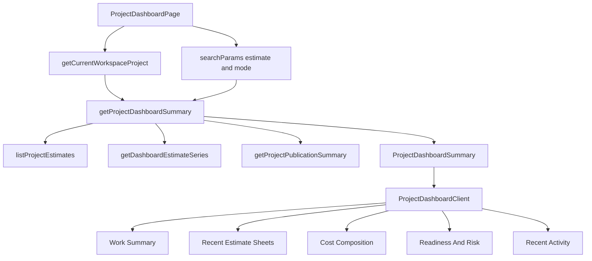

# Project Cockpit Implementation Plan

> **For agentic workers:** REQUIRED SUB-SKILL: Use superpowers:subagent-driven-development (recommended) or superpowers:executing-plans to implement this plan task-by-task. Steps use checkbox (`- [ ]`) syntax for tracking.

**Goal:** Replace the current cost-overview dashboard main area with the Project Cockpit specified in `06` through `10`: recent estimate sheets, selected-estimate cost composition, proposal readiness, risk states, and curated recent activity.

**Architecture:** Keep the authenticated project route and editable left aside. Extend the server dashboard summary so it selects one estimate from URL state, assembles cockpit-safe view models, and passes only summarized data to client components. Compose the dashboard body from small workshop-native zones that reuse existing chart, table, select, status, link, and formatting patterns.

**Tech Stack:** Next.js 16 App Router, React 19, TypeScript, Tailwind v4, Supabase/Postgres through existing repositories, Vitest, Testing Library, D3-backed `CostDonutChart`, existing Archestimator UI primitives.

---

## Copy-Paste Prompt For The Codebase AI

Implement the Project Cockpit dashboard for Archestimator. This is code implementation work, not another planning pass. Read the files below first, preserve the stated constraints, then implement the units in dependency order with focused tests.

Primary target route: `/workshop/projects/delafuentehouse`

Required plan-pack read order:

1. `.ai/03_plans/2026-06-14-Projects-Dashboard-UX-UI/06-cockpit-revision-plan.md`
2. `.ai/03_plans/2026-06-14-Projects-Dashboard-UX-UI/07-requirement-coverage-and-evidence-matrix.md`
3. `.ai/03_plans/2026-06-14-Projects-Dashboard-UX-UI/08-decision-brief-for-next-implementation-pass.md`
4. `.ai/03_plans/2026-06-14-Projects-Dashboard-UX-UI/09-screen-spec-and-test-contract.md`
5. `.ai/03_plans/2026-06-14-Projects-Dashboard-UX-UI/10-no-code-readiness-audit.md`
6. `DESIGN.md`
7. `AGENTS.md`

This implementation must not drift back to the old "Honest Hero" or generic KPI dashboard. The final screen is a compact contractor cockpit.

---

## Non-Negotiable Constraints

- Preserve the existing route shape: editable project details aside on the left and dashboard body inside `<main>`.
- Preserve Share and Teamspace ownership in header chrome. The dashboard may summarize readiness, but it must not recreate the Share modal or publication editor.
- Use shareable dashboard URL state: `?estimate=<estimateId>&mode=<category|space|supplier>`.
- Missing or invalid `estimate` falls back to the most recently updated estimate in the current project only.
- Missing or invalid `mode` falls back to `category`.
- Use `DropdownSelect` from `src/components/ui/dropdown-select.tsx` for estimate selection.
- Keep chart accessibility: donut data must have an adjacent visible table and `aria-describedby`.
- Do not create a fake `Open matching rows` action until the estimate route accepts and honors bucket filter params.
- Do not show a summed project-wide total when currencies differ.
- Do not fabricate zero variance when no positive budget exists.
- Do not add a generic KPI grid.
- Do not use marketing-scale type in workshop UI. Stay inside `DESIGN.md` app scale, max `12px`, unless a later named decision says otherwise.
- Use 3px radius, flat white panels, hairline borders, and no decorative shadows.
- No new package dependencies.
- No Supabase schema migration unless implementation proves one is strictly required. Prefer existing repository sources.
- No unrelated refactors.

---

## Current Source Surface

Use these files as the starting implementation surface:

| Path | Current role | Required change |
|---|---|---|
| `src/app/workshop/projects/[projectId]/page.tsx` | Loads project, fallback sample, dashboard summary, and activity. | Accept `searchParams`, validate selected estimate and mode through repository logic, and pass selected state to the dashboard. |
| `src/components/workshop/ProjectDashboardClient.tsx` | Renders editable aside plus current cost overview or first-run panel. | Replace main area with Project Cockpit zones while preserving aside and empty-state ownership. |
| `src/lib/workshop/dashboard-types.ts` | Defines headline, other-estimate, rollup, and cost-mix summary types. | Expand to cockpit view-model types: selected estimate, estimate sheets, readiness, risks, selected cost mix, activity flag metadata if needed. |
| `src/lib/repositories/project-dashboard-repository.ts` | Assembles current headline summary and single-estimate cost series. | Assemble selected-estimate summary, recent estimate sheets, readiness projection, risk list, and selected cost composition. |
| `src/components/workshop/dashboard/DashboardCostMix.tsx` | Shows grouping toggle, donut, and table for headline estimate. | Add estimate dropdown, URL sync, selected bucket details, and honest unsupported-filter actions. |
| `src/components/workshop/dashboard/DashboardBreakdownTable.tsx` | Shows the accessible cost table. | Make rows/selectable buckets keyboard-operable if needed by `DashboardCostMix`. |
| `src/components/workshop/dashboard/DashboardEstimateList.tsx` | Shows "Other estimates" and excludes the headline. | Convert to "Recent estimate sheets" including selected estimate, proposal markers, one-estimate state, open/compare/prepare actions. |
| `src/components/workshop/dashboard/DashboardHeadline.tsx` | Shows the cost-first headline card. | Demote into compact Work Summary or replace with a cockpit-specific summary component. |
| `src/components/workshop/dashboard/ProjectActivityList.tsx` | Shows activity rows or one generic empty line. | Distinguish flag-off from true no-activity and keep the feed concise. |
| `src/components/workshop/ProjectChromeAsync.tsx` | Fetches publication, collaboration, and estimate sheets for header chrome. | Keep ownership; do not move editing controls into dashboard. |
| `src/lib/repositories/workspace-repository.ts` | Owns project, estimates, collaboration, and publication summary sources. | Reuse existing publication summary and estimate list sources for readiness where practical. |
| `src/lib/workshop/compare-href.ts` | Builds estimate and Compare links. | Reuse for Open and Compare actions; add helpers only if existing helpers cannot express required URLs. |

Primary tests to update or add:

| Path | Required coverage |
|---|---|
| `tests/vitest/project-dashboard-repository.test.ts` | Selected-estimate fallback, estimate-sheet rows, readiness, risks, mixed currency, foreign estimate guard. |
| `tests/vitest/project-dashboard-client.test.tsx` | Cockpit zones, low-data states, sample fallback, no old cost-overview-only assumptions. |
| `tests/vitest/dashboard-cost-mix-ui.test.tsx` | Dropdown selection, grouping URL sync, bucket details, table accessibility, zero rows, truncation. |
| `tests/vitest/dashboard-estimate-list-ui.test.tsx` | Recent estimate sheets include selected estimate, one estimate renders, proposal marker, actions. |
| `tests/vitest/dashboard-activity-list-ui.test.tsx` | Flag-off and true no-activity copy are distinct. |
| `tests/vitest/cost-donut-chart-ui.test.tsx` | Preserve arcs-in-viewport regression. |
| `tests/unit/compare-href.test.ts` | Preserve existing Compare and estimate link contracts; extend only if new helpers are introduced. |

---

## Requirements

- R1. The dashboard first viewport answers: selected estimate, recent estimate sheets, where the selected estimate money goes, proposal readiness, and recent consequential activity.
- R2. The selected estimate is shareable through `?estimate=<estimateId>` and cannot leak or render estimates from another project.
- R3. The grouping mode is shareable through `?mode=<category|space|supplier>` and changing it does not reset the selected estimate.
- R4. Recent estimate sheets include the selected estimate and still render useful actions when there is only one estimate.
- R5. Cost Composition uses a project-native `DropdownSelect`, a grouping segmented control, a donut, a visible table, and selected bucket details.
- R6. Bucket actions are honest. Use `Open space` for supported space buckets, `Open estimate sheet` for unsupported filters, and never label an action `Open matching rows` until the estimate route supports it.
- R7. Proposal readiness summarizes export readiness and shared-link readiness without duplicating Share modal controls.
- R8. Needs Attention appears only when real issues exist and every item has a reason or action.
- R9. Activity is capped, curated, and distinct from raw audit history. Flag-off and no-activity states use different copy.
- R10. Low-data states cover sample fallback, zero estimates, one estimate, zero-row estimates, mixed currencies, truncated data, expired or revoked publication, and flag-off activity.
- R11. The dashboard stays inside `DESIGN.md`: max `12px` app text, 3px radius, hairline borders, flat panels, no generic KPI grid, no orange chrome, and no nested cards.
- R12. Implementation is complete only after focused automated tests pass and authenticated visual proof is captured for `/workshop/projects/delafuentehouse` at desktop, laptop, and tablet widths.

---

## Key Technical Decisions

- KTD1. Extend the existing dashboard repository instead of adding a parallel data loader. `getDashboardEstimateSeries(projectId, estimateId)` already scopes on project and estimate id, which is the right safety boundary.
- KTD2. Make the selected estimate a server-resolved view-model concern. The route reads query params, but repository logic decides whether the estimate belongs to the current project and falls back safely.
- KTD3. Keep grouping mode as URL-backed UI state. Client controls should update the URL with `router.replace` while preserving the other query param.
- KTD4. Use one `estimateSheets[]` model for Work Summary, Recent Estimate Sheets, dropdown options, and proposal markers. Do not maintain separate row shapes that can drift.
- KTD5. Project readiness is a projection. It summarizes existing export and publication signals, and actions route to existing owner surfaces.
- KTD6. The dashboard body may introduce small new components under `src/components/workshop/dashboard/`, but it should reuse existing primitives and formatters.
- KTD7. Browser proof is a completion gate, not a planning blocker. The app is auth-protected, so unauthenticated `curl` only proves redirect behavior.

---

## High-Level Technical Design

State rules:

- Route owns initial `estimate` and `mode` query params.
- Repository owns selected-estimate validation and fallback.
- Client owns transient selected bucket state.
- Client updates selected estimate and grouping by replacing URL search params.
- Server refresh recomputes selected cost composition from the URL state.

---

## Implementation Units

### U1. Expand Dashboard View Models And Repository Assembly

**Goal:** Build a server summary that can drive the cockpit without leaking raw row facts or foreign estimates.

**Files:**

- Modify: `src/lib/workshop/dashboard-types.ts`
- Modify: `src/lib/repositories/project-dashboard-repository.ts`
- Test: `tests/vitest/project-dashboard-repository.test.ts`

**Dependencies:** None.

**Approach:**

- Add `DashboardGroupingMode` using the existing `ProjectChartGroupingMode`.
- Add a selected-estimate input to `getProjectDashboardSummary`, such as `{ selectedEstimateId?: string | null; selectedGroupingMode?: ProjectChartGroupingMode | null }`.
- Keep invalid or missing mode fallback to `category`.
- Build `estimateSheets[]` from `listProjectEstimates(projectId)` using totals, `firstNodeId`, budget, variance, row count when available, updated time, sheet code, and publication inclusion when available.
- Set `selectedEstimateId` to a project-owned estimate id. If the incoming id is missing or foreign, select the most recently updated estimate.
- Attach `costMix` for the selected estimate, not necessarily the most recent estimate.
- Keep the existing single-currency guard for rollup totals.
- Add `readiness` and `risks[]` with enough fields for UI rendering, even if some values are initially derived from existing project and estimate data.
- Do not send raw row facts, node facts, supplier ids, or category facts to the client.

**Patterns to follow:**

- `getDashboardEstimateSeries(projectId, estimateId)` for scoped estimate series.
- `assembleDashboardSummary` for pure assembly and testability.
- `computeProjectCostRollup` for mixed-currency behavior.

**Test scenarios:**

- Missing selected estimate id selects the most recently updated estimate.
- A selected estimate id belonging to the project becomes `selectedEstimateId` and drives `costMix`.
- A foreign or unknown selected estimate id falls back to the most recent project estimate and does not call fact loaders for the foreign id.
- Missing mode yields `category`.
- Invalid mode yields `category`.
- `estimateSheets[]` includes the selected estimate and at least the next recent estimates.
- One-estimate projects produce one `estimateSheets[]` row and no empty worklist.
- Mixed currencies produce `rollup.kind = "mixed"` and no fake summed total.
- Positive budgets produce variance. Missing or non-positive budgets produce no variance.
- Zero-row selected estimate produces cost mix total zero and a readiness or risk item for no rows.
- Truncated cost data produces a risk item and preserves visible cost mix data.

**Verification:**

- Repository tests prove fallback, ownership, mode validation, estimate-sheet rows, and mixed currency behavior.
- No client component needs raw row facts to render the cockpit.

### U2. Read Query Params In The Project Dashboard Route

**Goal:** Make selected estimate and grouping mode shareable without changing route ownership.

**Files:**

- Modify: `src/app/workshop/projects/[projectId]/page.tsx`
- Modify: `src/components/workshop/ProjectDashboardClient.tsx`
- Test: `tests/vitest/project-dashboard-client.test.tsx`
- Test: `tests/vitest/project-dashboard-route-shell-ui.test.ts`

**Dependencies:** U1.

**Approach:**

- Before changing the route signature, read the relevant Next.js 16 docs under `node_modules/next/dist/docs/` because this project explicitly warns that this Next.js version differs from older assumptions.
- Accept `searchParams` in `ProjectDashboardPage`.
- Extract `estimate` and `mode` from the async search params shape supported by this Next.js version.
- Pass selected inputs to `getProjectDashboardSummary`.
- Keep sample fallback behavior. If there is no live project row, summary remains null and the dashboard must not imply live estimate data.
- Pass summary and activity through to `ProjectDashboardClient`.
- Update the main aria label from cost overview language to Project Cockpit language when a cockpit summary exists.

**Patterns to follow:**

- Existing `params: Promise<{ projectId: string }>` shape in `src/app/workshop/projects/[projectId]/page.tsx`.
- Existing sample fallback branch in the same file.

**Test scenarios:**

- Route passes `estimate` and `mode` query values into the dashboard summary loader.
- Missing query values call the summary loader with nullish selected values.
- Sample fallback still renders next-step content without calling the summary loader.
- Removed or unknown UUID project still redirects to the removed-project path.
- Unknown non-UUID project still triggers `notFound`.

**Verification:**

- Route-shell tests prove query extraction and existing fallback behavior.
- Client tests no longer assert the main surface is only a cost overview.

### U3. Convert Other Estimates Into Recent Estimate Sheets

**Goal:** Replace the current "Other estimates" list with a first-class recent estimate-sheet work queue.

**Files:**

- Modify: `src/components/workshop/dashboard/DashboardEstimateList.tsx`
- Modify: `src/lib/workshop/dashboard-types.ts`
- Test: `tests/vitest/dashboard-estimate-list-ui.test.tsx`

**Dependencies:** U1.

**Approach:**

- Rename the rendered section to `Recent estimate sheets`.
- Accept `estimateSheets[]` and `selectedEstimateId`.
- Include the selected estimate in the list.
- Show 5 to 8 rows.
- Keep the selected estimate marked as `Selected` wherever it appears in recency order.
- Show sheet code, name, total, currency, updated time, row count when available, budget state, and proposal inclusion marker when true.
- Keep actions compact: `Open`, `Compare`, and `Prepare` or `Review`.
- Use `buildEstimateSheetHref` and `buildCompareHref`.
- For one-estimate projects, render the single selected row.
- For zero estimates, let the parent cockpit render the next-step panel rather than returning an invisible section.

**Patterns to follow:**

- Current `DashboardEstimateList` compact row density.
- `formatChartMoney` for money display.
- `StatusBadge` for semantic markers.

**Test scenarios:**

- The section label is `Recent estimate sheets`.
- The selected estimate appears in the list.
- A one-estimate input still renders one row.
- A proposal-included sheet renders `In proposal`.
- An over-budget row renders semantic over-budget text.
- `Open` uses the estimate sheet href.
- `Compare` uses selected estimate plus row estimate in the Compare href.
- Empty estimate-sheet input renders no section and leaves empty-state ownership to the parent.

**Verification:**

- The old "Other estimates" expectation is removed or replaced.
- Test coverage proves the selected estimate is no longer excluded.

### U4. Make Cost Composition Estimate-Selectable

**Goal:** Let the user choose which estimate drives the donut, table, and selected bucket details.

**Files:**

- Modify: `src/components/workshop/dashboard/DashboardCostMix.tsx`
- Modify: `src/components/workshop/dashboard/DashboardBreakdownTable.tsx`
- Modify: `src/lib/workshop/compare-href.ts` only if existing helpers cannot express required links.
- Test: `tests/vitest/dashboard-cost-mix-ui.test.tsx`
- Test: `tests/unit/compare-href.test.ts` only if link helpers change.

**Dependencies:** U1, U2, U3.

**Approach:**

- Add a `DropdownSelect` populated from `estimateSheets[]`.
- The selected dropdown value equals `summary.selectedEstimateId`.
- Add initial grouping mode from `summary.selectedGroupingMode`.
- Changing estimate updates `?estimate=<id>` and preserves `mode`.
- Changing mode updates `?mode=<mode>` and preserves `estimate`.
- Keep `SegmentedControl` for Category, Space, Supplier.
- Keep top 5 plus Other collapsing.
- Keep donut `aria-describedby` pointing to the visible table.
- Add selected bucket state. Table rows and donut segments may select a bucket. If donut segment selection is not exposed by `CostDonutChart`, table row selection is sufficient for the first implementation.
- Selected bucket details show label, amount, share, row count when known, selected estimate name, grouping mode, and primary action.
- For `space` buckets with a known node id, primary action is `Open space`.
- For category, supplier, Other, or unsupported filters, primary action is `Open estimate sheet`.
- Add an honest limitation note for unsupported row filtering.
- Do not use `Open matching rows`.

**Patterns to follow:**

- Existing `DashboardCostMix` table and grouping behavior.
- Existing `DropdownSelect` API from `src/components/ui/dropdown-select.tsx`.
- Existing `SegmentedControl`.
- Existing chart and table accessibility tests.

**Test scenarios:**

- Dropdown renders project estimate-sheet options and marks the selected sheet.
- Changing estimate calls router replacement with the new estimate and existing mode.
- Changing grouping mode calls router replacement with the new mode and existing estimate.
- Default grouping mode is Category when no valid mode is present.
- The donut and table use the selected estimate series.
- The table still has the id referenced by donut `aria-describedby`.
- Selecting a table row renders bucket details with label, amount, share, and row count.
- Unsupported bucket details show `Open estimate sheet`, not `Open matching rows`.
- Space bucket with known node id shows `Open space`.
- Zero-cost estimate shows no `NaN` and keeps the visible table.
- Truncated cost data shows partial-breakdown copy.

**Verification:**

- Cost mix tests prove URL state preservation and accessibility.
- Manual inspection confirms dropdown popover is not clipped.

### U5. Add Proposal Readiness And Needs Attention

**Goal:** Summarize whether the project can become a proposal and what needs attention.

**Files:**

- Create: `src/components/workshop/dashboard/DashboardReadinessPanel.tsx`
- Modify: `src/lib/workshop/dashboard-types.ts`
- Modify: `src/lib/repositories/project-dashboard-repository.ts`
- Modify: `src/components/workshop/ProjectDashboardClient.tsx`
- Test: `tests/vitest/project-dashboard-repository.test.ts`
- Test: `tests/vitest/project-dashboard-client.test.tsx`

**Dependencies:** U1.

**Approach:**

- Build readiness from selected estimate, project name, client, location, currency, selected estimate row count, and existing publication summary if cheaply available.
- Reuse existing publication summary sources from `workspace-repository.ts` rather than duplicating Share modal logic.
- Readiness rows: `Estimate selected`, `Rows available`, `Client`, `Address`, `Shared link`, `Snapshot freshness`, `Recipient activity`, and `Email delivery`.
- Risk rows: over budget, missing budget, mixed currency, truncated data, zero rows, stale snapshot, expired publication, revoked publication, and sample fallback.
- Render `Proposal readiness` and `Needs attention`.
- Hide `Needs attention` when no real item exists.
- Each item must include a label, detail, severity, and either an action or informational reason.
- Use one primary action for the zone: `Prepare proposal`, `Review share settings`, or `Refresh shared link`.
- The action routes to the existing owner surface.

**Patterns to follow:**

- `ProjectPublicationHeader` for publication concepts and copy boundaries.
- Existing `StatusBadge` and app-scale text.
- Existing `EmptyState` only for true first-run panels, not normal cockpit risks.

**Test scenarios:**

- Ready selected estimate with rows, client, address, and healthy publication renders no `Needs attention`.
- Missing client produces a readiness item and a needs-attention item with an action or reason.
- Missing address produces a readiness item and a needs-attention item with an action or reason.
- Zero-row selected estimate produces a `No rows yet` risk.
- Mixed currency produces a mixed-currency risk and no summed rollup.
- Stale snapshot produces `Needs refresh`.
- Expired publication produces `Expired`.
- Revoked publication produces `Revoked`.
- Dashboard does not render Share modal fields or editable publication controls.

**Verification:**

- Repository tests prove normalized readiness and risks.
- Client tests prove the panel appears, hides empty risk lists, and uses existing owner routes.

### U6. Fit Recent Activity Into The Cockpit

**Goal:** Keep activity useful without making the dashboard a raw audit log.

**Files:**

- Modify: `src/components/workshop/dashboard/ProjectActivityList.tsx`
- Modify: `src/lib/repositories/project-activity-repository.ts` only if existing curated events need proposal or collaboration coverage that is already available.
- Modify: `src/lib/activity/types.ts` only if the view model needs a typed source or status already backed by data.
- Test: `tests/vitest/dashboard-activity-list-ui.test.tsx`
- Test: `tests/vitest/project-activity-feed.test.ts` if repository behavior changes.

**Dependencies:** U1, U5.

**Approach:**

- Keep the feed capped at 8 rows.
- Keep estimate and collaboration events curated.
- Include proposal events only when there is an existing reliable source for publish, refresh, revoke, expire, send, resend, comment, decision, or latest open summary.
- Do not show autosave, cursor, presence, repeated same-actor bursts, or raw audit dumps.
- Distinguish feature-flag-off from true empty activity.
- If activity is disabled, do not render a broken-looking panel. Show a compact informational line only when useful.
- If activity is enabled but empty, show `No recent activity yet`.

**Patterns to follow:**

- Current `ProjectActivityList` grouping and compact row density.
- `formatRelativeTime`.
- Existing activity composer filtering behavior.

**Test scenarios:**

- `activities = null` renders flag-off copy distinct from empty activity.
- `activities = []` renders `No recent activity yet`.
- More than 8 activities render only 8 rows.
- Rows remain grouped by day.
- Autosave-like events do not appear if repository filtering changes.
- Proposal event rows appear only when the repository source supports them.

**Verification:**

- UI tests prove flag-off and empty states are distinct.
- Repository tests, if changed, prove the feed stays curated.

### U7. Compose The Project Cockpit Shell

**Goal:** Replace the old cost-overview main composition with the final cockpit layout.

**Files:**

- Modify: `src/components/workshop/ProjectDashboardClient.tsx`
- Modify: `src/components/workshop/dashboard/DashboardHeadline.tsx` or replace with a new Work Summary component under `src/components/workshop/dashboard/`.
- Create: `src/components/workshop/dashboard/DashboardWorkSummary.tsx` if replacing `DashboardHeadline` is cleaner than mutating it.
- Modify: `tests/vitest/project-dashboard-client.test.tsx`
- Modify: `tests/vitest/project-dashboard-core-ui.test.ts`
- Modify: `tests/vitest/project-dashboard-side-panel-ui.test.ts`

**Dependencies:** U3, U4, U5, U6.

**Approach:**

- Main area aria label should describe a Project Cockpit, not a cost overview.
- Use a responsive cockpit layout:
  - left column: Work Summary, Recent Estimate Sheets, Recent Activity;
  - right column: Cost Composition, Readiness And Risk.
- Stack zones on narrow widths.
- Keep max width left-aligned.
- Do not place cards inside cards.
- Work Summary shows selected estimate code/name, total, budget variance when valid, updated time, safe rollup caption, and actions.
- Keep first-run next-step panel for real projects with zero estimates.
- Keep sample fallback honest. If no live project row exists, show project aside plus sample-safe next step and no fake live estimate data.
- Preserve editable project aside behavior and project metadata auto-submit.
- Preserve header Share and Teamspace ownership.

**Patterns to follow:**

- Existing `ProjectDashboardClient` aside structure.
- Existing `SectionHeading`, `StatusBadge`, `FinancialTotalCard` only if it can stay within app scale.
- `DESIGN.md` product/workshop tokens.

**Test scenarios:**

- Cockpit main renders Work Summary, Recent estimate sheets, Cost Composition, Readiness And Risk, and Recent Activity when summary exists.
- The old `Project cost overview` aria label is gone or replaced.
- The editable aside fields still render.
- A real project with zero estimates renders next-step actions.
- A sample fallback with no summary does not imply live estimates.
- Mixed-currency caption appears without a project total.
- Work Summary uses `No budget set` when no budget exists.
- No generic KPI-grid labels appear.

**Verification:**

- Client and shell tests pass.
- DOM inspection shows no nested card structures in the main cockpit zones.

### U8. Final Visual QA, Regression Sweep, And Completion Evidence

**Goal:** Prove the cockpit works in the real authenticated route and does not regress chart or dashboard behavior.

**Files:**

- Modify tests only if assertions need final alignment:
  - `tests/vitest/project-dashboard-client.test.tsx`
  - `tests/vitest/dashboard-cost-mix-ui.test.tsx`
  - `tests/vitest/dashboard-estimate-list-ui.test.tsx`
  - `tests/vitest/dashboard-activity-list-ui.test.tsx`
  - `tests/vitest/project-dashboard-repository.test.ts`
  - `tests/vitest/cost-donut-chart-ui.test.tsx`

**Dependencies:** U1, U2, U3, U4, U5, U6, U7.

**Approach:**

- Run the focused Vitest files that cover changed behavior.
- Run typecheck or the repo's narrow validation command if available and proportionate.
- Start the local app if it is not already running.
- Capture authenticated `/workshop/projects/delafuentehouse` at desktop, laptop, and tablet widths.
- Verify no text overlap.
- Verify dropdown panels are not clipped.
- Verify donut, table, and selected bucket all refer to the same selected estimate.
- Verify project aside remains usable.
- Verify Share and Teamspace header controls still own their interactions.
- If authentication blocks screenshots, report the blocker clearly and do not claim visual completion.

**Test scenarios:**

- Existing cost donut arcs remain inside the SVG viewport.
- Existing compare and estimate href tests still pass.
- New cockpit tests pass without removing coverage for mixed currency, zero rows, and foreign estimate ids.

**Verification:**

- Focused tests pass.
- Typecheck or targeted validation passes, or any skipped check is justified with a clear residual risk.
- Authenticated visual proof exists for the target route at three widths, or completion is withheld.

---

## Execution Checklist

- [ ] Read the required plan-pack files and `DESIGN.md`.
- [ ] Check the current branch and dirty worktree before editing.
- [ ] Preserve existing user changes. Do not revert unrelated dirty files.
- [ ] Implement U1 with tests first.
- [ ] Implement U2 with tests.
- [ ] Implement U3 with tests.
- [ ] Implement U4 with tests.
- [ ] Implement U5 with tests.
- [ ] Implement U6 with tests.
- [ ] Implement U7 with tests.
- [ ] Run U8 verification.
- [ ] Run a review pass focused on scope drift, visual constraints, data leakage, and test adequacy.
- [ ] Final report must list changed files, tests run, browser evidence, and any remaining risk.

---

## Scope Boundaries

In scope:

- Project dashboard main body.
- Dashboard summary repository and view models.
- Recent estimate sheets.
- Selected estimate cost composition.
- Proposal readiness projection.
- Needs-attention states.
- Recent activity fit.
- Focused tests and authenticated visual proof.

Out of scope:

- Rebuilding the Share modal.
- Rebuilding Teamspace.
- Adding row-level filtered estimate routes unless already supported by existing code.
- Creating a full activity page.
- Adding a generic project KPI dashboard.
- Changing landing page design.
- Adding dependencies.
- Making provider or production changes.

Deferred follow-up work:

- Filtered-row deep links from cost buckets after the estimate sheet route supports filtering or highlighting.
- Durable proposal event expansion if existing activity sources cannot support it cleanly.
- Seed/setup work for `delafuentehouse` if authenticated proof shows it has only sample fallback data locally.

---

## Completion Bar

The implementation is complete only when all of these are true:

- The dashboard renders the Project Cockpit, not the old cost overview.
- URL state selects estimate and grouping without foreign-estimate leakage.
- Recent estimate sheets include the selected estimate.
- Cost composition has dropdown, grouping, donut, table, and bucket details.
- Proposal readiness and needs-attention states are present and honest.
- Activity flag-off and no-activity states are distinct.
- Low-data states remain useful.
- The editable project aside still works.
- Header Share and Teamspace controls still own their functionality.
- Focused tests pass.
- Authenticated screenshots for `/workshop/projects/delafuentehouse` prove desktop, laptop, and tablet layout.
- The final report names any skipped validation or visual-proof gap.

