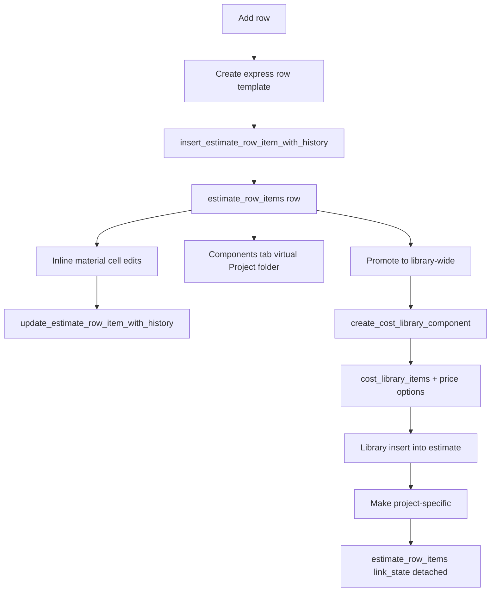

# Express Components Implementation Plan

## Summary

Add express components as inline-authored project estimate rows. `Add row` creates an editable project-scoped component in the material cell, project-specific/library conversion uses existing link-state semantics, and the Components tab gains a virtual Project folder projection for express and detached rows.

Day-0 scope is U1-U4 plus the minimum U9 gates in `00-scope-and-premise-decision.md`. U5 is a verification/normalization gate unless a real duplicate-instance failure is captured. U6 Project folder projection and U7 promotion are fast-follow slices specified for contract readiness, not first-ship scope.

## Problem Frame

The current Add row path creates a blank placeholder that can accept quantity and misc cost, but the component slot itself is not editable. Users need to author component name, description, unit, optional image, and pricing directly in the estimate row. They also need those project-local components visible from the Components tab and convertible to workspace library components later.

## Requirements

- R1. Clicking `Add row` creates an express row that can edit component name, description, unit, unit cost, misc cost, quantity, and optional image. Inline editing is the preferred path only after the spike in doc 00 passes; otherwise U4 pivots to the approved compact modal/popover fallback before coding.
- R2. Express rows persist through `estimate_row_items` with source, snapshot, metadata, link-state, revision, and history semantics intact.
- R3. Inline text and cost edits use optimistic row updates with ordered per-row commits and visible failed-save recovery.
- R4. Linked library rows show the make-project-specific action on every eligible instance, including duplicate instances of the same library component.
- R5. Detached/project-specific rows keep current row values, show project-specific state, and appear in the Project folder projection.
- R6. Express rows can later be promoted to workspace library components through a new atomic promotion RPC; this is fast-follow U7 unless reapproved for day-0.
- R7. The Components tab can later expose a Project folder/view containing express rows and unique project-specific rows without storing those rows in `library_folders`; this is fast-follow U6 unless reapproved for day-0.
- R8. Existing drag/drop replace, move, clear, delete, row selection, keyboard navigation, and row virtualization remain functional.
- R9. Supabase changes avoid a new table unless project-local reusable components become an explicit product requirement.
- R10. Add row and inline edits have a concrete pending-insert lifecycle: field edits may focus immediately, but server commits wait for persisted row readiness and row revision.
- R11. Promotion to library-wide is idempotent and relinks the originating row to the created library component unless a later product decision chooses a detached default.
- R12. Virtualization, keyboard navigation, focus, contrast, microcopy, and mobile/touch behavior follow doc 09 and have executable QA.
- R13. Realtime multi-client behavior is specified: peers, stale revisions, cursor anchoring, and reconnect/replay do not corrupt express rows.
- R14. Permission boundaries are explicit: viewers cannot author/edit express rows; estimate editors can author/edit; promotion also requires the strict workspace-library write permission used by current folder/item mutations.
- R15. Rollout is feature-flagged and reversible; persisted express rows render safely when the authoring flag is disabled.
- R16. Existing legacy blank rows and existing `row_blank_added` events remain readable and are not retroactively corrupted.

## Key Technical Decisions

- KTD1. Express rows use `estimate_row_items`: This matches the requested project-specific inline row authoring and avoids a third source of truth.
- KTD2. Express identity is row-lifetime metadata, not a new enum or catalog id: Use `metadata.expressComponent` and normal row source/link fields first, mint `metadata.expressComponent.id` as UUIDv4, keep it stable only for that row, and rekey it on project-source/template copies.
- KTD3. Project folder is a projection: The Components tab should render project-local rows as virtual tree data, not persist project rows as `library_folders`.
- KTD4. Promotion creates normal library components and relinks: The workspace-wide conversion path creates a `cost_library_items` component, creates the default price option, updates the source row with the new `source_library_item_id`, sets `link_state = "linked-clean"`, and records provenance.
- KTD5. Project-specific icon eligibility comes from persisted link fields, but the reported duplicate-instance bug is unreproduced. U5 starts with reproduction; if DB-backed duplicates already pass, U5 becomes fixture/input normalization hardening.
- KTD6. Project folder needs explicit project context and net-new plumbing. The workspace Components route has no project id today; the implementation must thread it deliberately or use the estimate-side component-library surface that already has project context.
- KTD7. JSON fields are preserved when omitted and replaced when sent. Routine express field edits omit `metadata` and `sourceSnapshot`; promotion, image changes, and express-metadata edits must server-merge complete JSON objects before sending them.
- KTD8. Promotion uses a new atomic RPC. A two-transaction create-then-relink flow is rejected for day-0 because create-then-crash can orphan or duplicate library components.

## High-Level Design

## Implementation Units

### U1. Define Express Row Domain Helpers

- **Goal:** Add shared helpers for blank, express, linked, detached, and project-local row classification.
- **Files:** `src/lib/repositories/estimate-repository.ts`, `src/components/workshop/estimate-sheet/activity-history.tsx`, `src/components/workshop/estimate-sheet/rows/cells.tsx`, `src/lib/estimates/types.ts` if needed.
- **Details:** Keep `isBlankEstimateRowItem` for legacy persisted placeholders, add express helpers based on `metadata.expressComponent` or tags, and centralize project-local inclusion logic.
- **Post-audit amendments:** Add `metadata`/`expressComponent` to the load-bearing estimate read path in `src/lib/repositories/estimate-repository.ts`, `ESTIMATE_ROW_ITEM_SELECT`, `toEstimateRowItem`, and the `EstimateRowItem` type. Workspace-repository mapping is mapper compatibility only, not the primary estimate-sheet source. Express helpers must win over blank heuristics: a row carrying `metadata.expressComponent.kind = "express"` is never rendered as the legacy blank placeholder, even if its name is empty. The express template uses a non-placeholder material default, `discipline = "Unspecified"`, `designation = ""`, and `categoryNodeId = null`; proposal/dashboard surfaces therefore use existing Uncategorized/Unspecified fallback buckets until the user chooses a category/designation.
- **Tests:** Unit tests for blank placeholder, express row, detached row, linked overridden row, and source-changed row classification.

### U2. Replace Add Row Template With Express Template

- **Goal:** Make `Add row` create an express component row instead of a passive blank slot.
- **Files:** `src/components/workshop/EstimateSheetContent.tsx`, `tests/vitest/estimate-sheet-library-insert.test.tsx`, `tests/vitest/estimate-sheet-cost-inputs.test.tsx`.
- **Details:** Replace or branch `createBlankEstimateRowTemplate()` with `createExpressEstimateRowTemplate()`. Preserve compatibility for old persisted placeholders so existing rows still render safely. Insert must return enough persisted row data, including row revision, for subsequent updates to be enabled.
- **Pending insert contract:** The UI may focus the new name field immediately, but blur/Enter commits from express fields are buffered until insert success returns persisted row readiness. If insert fails, keep a draft row with Retry and Delete actions. Retry reuses the same client row id or mutation correlation so duplicates are not created.
- **History contract:** The insert history path must classify only legacy blank placeholders as `row_blank_added`. Express inserts use the existing `row_added` activity unless a new composer-backed event is added.
- **Post-audit amendments:** The insert RPC already returns `row` with `rowRevision` and is idempotent by `correlation_id`; `insertEstimateRowItemFromLibrary` must read `data`, call the existing row-result reader, return the persisted row snapshot, and reconcile the optimistic row id/revision into the visible local tree and TanStack cache. Current insert failure rollback deletes the optimistic row; express insert must replace that with a kept draft state carrying retry/delete actions and a stable visible mutation/correlation id. `sort_order` allocation must move inside the locked insert RPC or the app action must retry the full insert with the same correlation id after a deferred `(node_id, sort_order)` collision. History reclassification is a required RPC migration, not a renderer-only change.
- **Tests:** Add row sends `source: "project"`, non-placeholder material default, express metadata, unit, zero cost, and no source library id. Update `tests/vitest/estimate-sheet-library-insert.test.tsx:~247` from "blank slot/manual placeholder insert" expectations to the express payload above. Update `tests/vitest/estimate-sheet-cost-inputs.test.tsx:220` from keyboard-created blank slot to keyboard-created express editor, while preserving `tests/vitest/estimate-sheet-cost-inputs.test.tsx:230` or a successor assertion that a legacy persisted blank row still renders as the blank placeholder with no thumbnail fallback. Fast edit before insert success is buffered, then sent after row revision is known. Insert failure shows draft recovery.

### U3. Widen Row Update Contract

- **Goal:** Persist express material fields through the existing row update queue.
- **Files:** `src/hooks/use-estimate-row-mutations.ts`, `src/lib/estimates/actions.ts`, `src/lib/estimates/estimate-row-tree-patch.ts`, `supabase/migrations/*` only if RPC payload validation needs a compatibility change.
- **Details:** Add typed patch fields for `material`, `description`, `supplier`, `unit`, `unitCost`, `miscCost`, `sourceSnapshot`, and `metadata`. Preserve expected revision checks and linked row override behavior. Do not send partial JSON blobs directly from the client; routine field edits omit JSON keys, and JSON-changing operations send complete server-merged `metadata` and `source_snapshot`.
- **Post-audit amendments:** Use canonical patch key `unitCost`, not `itemCost`, when calling the RPC. No update-path migration is needed: the live RPC already accepts the full express field set. Widen the app action input, optimistic patch, tree patch, result reader, and current-row validation SELECT. Existing linked-row override behavior needs an express-aware decision: after promotion, the first edit either intentionally moves the row to `linked-overridden` or preserves `linked-clean`; U7/doc 11 own that policy.
- **Tests:** Optimistic patch updates visible row fields, server result reconciles all changed fields, stale revision rolls back with failed state, and unrelated metadata/source snapshot keys survive an express edit.

### U4. Build Inline Express Material Editor

- **Goal:** Edit component fields directly inside the material cell.
- **Files:** `src/components/workshop/estimate-sheet/rows/cells.tsx`, `src/components/workshop/estimate-sheet/rows/row-table.tsx`, possibly a new local component under `src/components/workshop/estimate-sheet/rows/`.
- **Details:** Render express rows as compact inline editors. Keep drag/drop replace target handling and icon rail. Commit on blur/Enter, revert on Escape, and route field patches through U3. Optional image in the first pass is URL/source set-clear only; file upload waits for storage RLS scope. Supplier is inline text unless an existing picker can be reused without layout churn.
- **Accessibility:** Add polite live announcements for creating, saved, failed, retry, delete draft, and promotion outcomes. Failed fields use `aria-invalid` and `aria-describedby`.
- **Post-audit amendments:** Implement doc 09 exactly: express text fields do not use `handleEstimateCellKeyDown`; `pendingFocusRowId` branches to `data-express-field="name"`; day-0 disables virtualization while one active express editor is open unless the inline spike proves a safer measured path before coding; load-bearing express labels/placeholders/helper text/badges/values meet WCAG AA; all copy, labels, error ids, and live-region strings come from the state/copy table.
- **Tests:** User edits name, description, unit, and unit cost; blur commits; Escape reverts; failed update shows recovery; screen-reader status text changes for save and failure.

### U5. Verify And Harden Project-Specific Icon Eligibility

- **Goal:** Show the project-specific action for every eligible linked component instance and harden malformed fixture/input rows without claiming an unreproduced production bug fix.
- **Files:** `src/components/workshop/estimate-sheet/rows/cells.tsx`, `src/components/workshop/EstimateSheetContent.tsx`, `src/hooks/use-estimate-row-mutations.ts`, relevant insert/reconcile tests.
- **Details:** Verify `cloneLibraryItemForEstimate` and server reconciliation preserve `sourceLibraryItemId` and linked `linkState`. Add an explicit normalization step if library rows arrive without link state but have a source id.
- **Post-audit amendments:** U5 is reframed as verification plus normalization hardening unless `evidence/u5-duplicate-instance-repro-note.md` is filled with a real-project failing capture. Capture real duplicated row fields before any production bug-fix claim. If the only failing path is malformed fixture data such as non-UUID `lib-*` ids or missing source linkage, do not claim a production duplicate-instance fix; implement normalization hardening and name it that.
- **Tests:** First add the real-project repro or non-repro capture in `evidence/u5-duplicate-instance-repro-note.md`. Two same-library component rows both show the Cube action; detaching the first updates it to badge state immediately. If real DB-backed duplicates do not reproduce the bug, keep the test as eligibility coverage and scope the implementation to fixture/input normalization hardening.

### U6. Add Components Project Folder Projection

- **Goal:** Surface express and detached rows in Components as project-local components.
- **Scope:** Fast-follow, not day-0, unless `00-scope-and-premise-decision.md` is superseded.
- **Files:** `src/components/workshop/LibraryPageClient.tsx`, `src/components/workshop/component-library-manager/ComponentLibraryManager.tsx`, `src/components/workshop/component-library-manager/LibraryFolderTree.tsx`, new repository/action under `src/lib/reusable-sources/` or `src/lib/component-library/`.
- **Details:** Add a virtual Project node to folder mode only when a `projectId` is supplied by route/query/context. Place it before `All Components` with `Express` and `Project-specific` child groups. Load project-local rows through a dedicated project-scoped action that uses project/estimate access checks. Exclude blank placeholders and linked-overridden rows. Avoid writing projection nodes into `library_folders`.
- **Post-audit amendments:** Add `app/workshop/library/components/page.tsx` and `LibraryComponentsRoute` project-context plumbing to the file list if the workspace Components route hosts the projection. De-positionalize synthetic-root detection in `LibraryFolderTree`, add a non-reorderable/non-droppable virtual datum kind, and preserve workspace folder reorder behavior. Define dedupe for project-specific leaves by row id plus express stable id; never rely on material name alone.
- **Tests:** Project-aware Components renders Project with express and detached rows, excludes blanks and linked-overridden rows, supports selection/inspection, and does not mutate workspace folders. Workspace-only Components does not fetch or show project rows without a project context. A user without access to the selected project, or a route/query mismatch for an unauthorized project id, receives no project projection rows.

### U7. Promote Express Row To Library Component

- **Goal:** Convert an express row into a workspace library component on explicit user action.
- **Scope:** Fast-follow, not day-0, unless `00-scope-and-premise-decision.md` is superseded.
- **Files:** `src/lib/component-library/actions.ts`, `src/components/workshop/component-library-manager/ComponentLibraryManager.tsx`, material cell/project folder action surfaces.
- **Details:** Add a promotion wrapper around existing component-library create behavior. It checks project row access, rejects already-promoted rows unless retrying the same correlation id, creates the library item and price option, then relinks the source row to the new library item with fresh snapshot, `link_state = "linked-clean"`, and row metadata provenance. Prefer one Postgres RPC/transaction for the create-plus-row-update boundary; otherwise implement idempotent retry lookup before create.
- **Post-audit amendments:** Choose the RPC path: create `promote_express_row_to_library_component` so library creation, price option creation, metadata update, source snapshot update, row relink, and event logging happen atomically. The RPC must check both `can_edit_estimate` and the exact strict workspace-library write predicate used by current folder/item writes, require a non-empty material/name, require one default price option with all NOT NULL fields populated, require a valid target folder in the target workspace, and return the updated row snapshot plus library item id. The app-layer fallback saga is rejected for the fast-follow promotion slice.
- **Tests:** Promotion creates one library item with price option, relinks the source row, records promotion metadata, updates the active estimate-sheet row query from the returned row, invalidates the workspace component-library prefix including lite panel and full rows/editor datasets, invalidates active library route folder/item datasets for the target workspace, and retry after partial failure does not create a duplicate.

### U8. Verify History, Export, Dashboard, And Project Sources

- **Goal:** Ensure express rows remain visible and correct in downstream surfaces.
- **Files:** `src/components/workshop/estimate-sheet/activity-history.tsx`, `src/lib/repositories/project-dashboard-repository.ts`, proposal/export tests, reusable source tests.
- **Details:** Confirm source snapshots include image/pricing provenance, history titles do not call express rows blank rows, and project-source reuse rekeys both row ids and row-lifetime `metadata.expressComponent.id` UUIDs. If a new event type is added, update the activity composer in the same unit; otherwise use `row_added` for express insertion.
- **Post-audit amendments:** Add `src/lib/ai/read-context.ts`, `src/lib/ai/package-builder/apply.ts`, row-detail Component-tab copy, proposal section/division placement, charts cost-mix bucketing, publication snapshot image extraction, export consolidation behavior, cache fan-out after promotion, `clearRowComponent`, `moveRowComponent`, and `applyEditableValuesToLibraryItem` to the blast radius. Dashboard totals come from row-level fields; `source_snapshot` matters for image/category/supplier provenance, not totals. Express defaults are `discipline = "Unspecified"`, `designation = ""`, and `categoryNodeId = null`, so proposal sections and project charts intentionally use existing Uncategorized/Unspecified fallback buckets until the row is categorized. AI package-builder replacements must server-merge existing metadata/source snapshot or skip/block express-row replacement so `metadata.expressComponent` is not clobbered.
- **Tests:** Activity history for express creates/edits, proposal/export totals, project-source insert of express rows with fresh ids, dashboard aggregation from row fields, and publication of an estimate with an express image where the published snapshot row carries `source_snapshot.imageUrl`.

### U9. Shipability, Concurrency, Permissions, And Rollout

- **Goal:** Make the feature operationally safe before implementation starts.
- **Files:** `src/lib/collaboration/*`, `src/hooks/use-estimate-cursor-broadcast.ts`, `src/components/workshop/EstimateSheetContent.tsx`, feature flag definitions, migration files for U2/U7, docs 09-12.
- **Details:** Implement doc 11's two-client stale-revision behavior, role matrix, and cursor anchoring. Implement doc 12's feature flag, rollback behavior, migration sequencing, provider verification, observability, and static docs checks.
- **Tests:** Two-client stale edit, concurrent insert sort-order collision allocation/retry, viewer blocked, estimate editor cannot promote without workspace-editor role, feature flag off renders persisted express rows safely, docs static validation passes.

## Acceptance Examples

- AE1. Given an empty Kitchen node, when the user clicks `Add row`, then a new row appears with focused component name, default unit, zero unit cost, quantity one, and project express metadata.
- AE2. Given an express row, when the user edits name and unit cost then blurs, then the row saves through the row update queue and recalculates subtotal/total without opening a modal.
- AE2a. Given a user types and blurs before the insert request returns, when insert later succeeds, then the buffered field commit runs after persisted row revision is known; if insert fails, a draft recovery UI remains visible.
- AE3. Given two instances of the same linked library component, when the sheet renders, then both rows show the make-project-specific action before either is detached.
- AE4. Given the first duplicate linked component is detached, when the RPC succeeds, then that row shows `Project-specific`, the second row still shows the action, and row totals remain unchanged.
- AE5. Given an express row and a detached row in a selected project, when the user opens a project-aware Components surface, then both appear under Project and blank placeholders do not.
- AE6. Given an express row, when the user promotes it to the library, then exactly one normal library component and price option are created, the source row links to the new library component, and repeat promotion does not duplicate the library component.
- AE7. Given an estimate with at least 75 rows, when the user edits an express row in the middle of the list, then day-0 disables virtualization while the active editor is open and no row overlaps or scroll-jumps incoherently.
- AE8. Given an express text field, ArrowLeft/Right/Home/End move the caret, ArrowUp/Down do not move rows from text fields, Escape reverts, Enter commits a single-line field, Shift+Enter inserts a description newline, and Tab proceeds through express fields into numeric cells.
- AE9. Given a peer is viewing the same estimate, when another user creates an express draft, then the peer sees no phantom row until persistence; after insert success the row appears with a stable id and cursor anchoring remains valid.
- AE10. Given a viewer or read-only collaborator, Add row and express edit controls are disabled/hidden and server actions reject mutation attempts. Given an estimate editor without workspace-editor permission, promotion is blocked.
- AE11. Given the feature flag is disabled after express rows exist, Add row creates the legacy blank placeholder but persisted express rows still render as readable project rows with safe fallback copy.
- AE12. Given legacy blank rows/events exist before rollout, they remain blank placeholders/events and stay excluded from Project projection after the migrations.

## Sources

- `src/components/workshop/EstimateSheetContent.tsx:220` creates the current blank row template.
- `src/components/workshop/EstimateSheetContent.tsx:1700` handles optimistic row insertion.
- `src/components/workshop/estimate-sheet/rows/cells.tsx:179` renders the blank material slot.
- `src/components/workshop/estimate-sheet/rows/cells.tsx:79` gates project-specific conversion.
- `src/hooks/use-estimate-row-mutations.ts:49` limits current update inputs.
- `src/lib/estimates/actions.ts:2493` persists row insertion.
- `src/lib/estimates/actions.ts:2561` persists row updates.
- `src/components/workshop/component-library-manager/ComponentLibraryManager.tsx:1146` builds the Components folder tree.
- `src/components/workshop/component-library/tree/TemplatesTree.tsx:524` returns project-source row items.
- Supabase API security docs: <https://supabase.com/docs/guides/api/securing-your-api>
- Supabase RLS docs: <https://supabase.com/docs/guides/database/postgres/row-level-security>
- Supabase Storage access-control docs: <https://supabase.com/docs/guides/storage/security/access-control>
