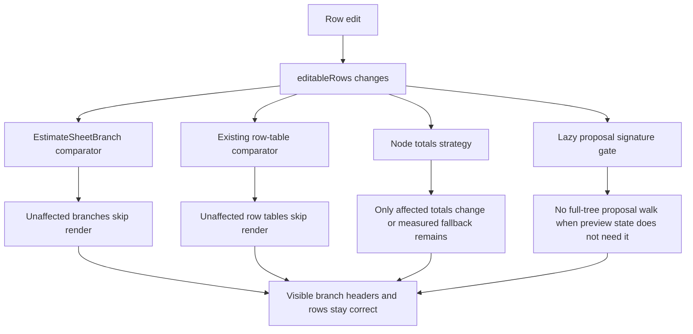

# perf: Tree and Estimate Sheet Memoization Strategy

## Summary

Virtualization now limits how many tree rows, branch sections, and estimate rows are mounted. Memoization should target the remaining CPU path: derived tree signatures, selected-node metadata, branch rerenders, and node-total recomputation during edits.

---

## Problem Frame

The current branch makes the high-cardinality UI render less at once. That solves a DOM pressure problem, but the estimate sheet still owns large derived-data structures in `EstimateSheetContent`. With thousands of nodes and row items, a single row edit can still trigger global work if broad objects such as `editableRows`, `estimateTree`, or `selectedRowIds` flow through component boundaries without slice-aware guards.

The plan therefore treats memoization as a correctness-sensitive performance change. Comparators must be narrow enough to skip unaffected branches, but broad enough to refresh totals, selected state, row values, collapse/search context, drag/drop affordances, and handler closures.

---

## Requirements

### Rerender Isolation

- R1. Editing a row rerenders the edited row, the owning row table, and any branch headers whose totals actually changed, without rerendering unrelated branch row tables.
- R2. Bulk selection rerenders only branches and tables that contain affected selected rows.
- R3. Remote cursor updates and command-palette state changes remain isolated from estimate row tables and branches.
- R4. Shared tree virtualization keeps mounted row count bounded when large node lists are expanded.
- R13. Component and template trees remain responsive with thousands or tens of thousands of component/template-derived nodes by bounding data-shaping work as well as rendered rows.

### Derived Data

- R5. Proposal-preview signature generation does not walk the full editable tree on every keystroke when the preview has never been built or is closed without a model that needs stale-state detection.
- R6. Node-code and ancestor-path calculations for the selected sheet node are memoized and stable across row edits.
- R7. Node totals remain correct for project totals, displayed branch totals, activity-scope totals, and proposal export preview decisions after memoization.
- R8. Full-row flattening remains guarded to inspector, row-details, and project-specific-row flows.

### Correctness and UX

- R9. Search, facets, group mode, collapse state, and nested row-first rendering behave exactly as before.
- R10. Drag/drop and template insertion handlers stay fresh; memoization must never preserve stale mutation closures.
- R11. Focus, keyboard navigation, virtual row measurement, and scroll-to-focused-row behavior stay stable under row and branch virtualization.
- R12. Feature flags remain default-on for virtualization and still support explicit opt-out during rollback.

---

## Key Technical Decisions

- KTD1. Memoize proven hot boundaries, not every component: React memoization has comparison cost and stale-prop risk. The plan starts with measured hot paths and existing probes, then expands only when the data says it helps.
- KTD2. Prefer lazy derived data before comparator complexity: the proposal-preview signature currently has the clearest avoidable full-tree walk, so it should be fixed before introducing many branch comparators.
- KTD3. Use slice-aware comparators for broad maps and sets: `editableRows` and `selectedRowIds` are intentionally broad. Comparators should inspect only row ids owned by the branch or table, plus node-total values that affect headers.
- KTD4. Treat node totals as a separate performance problem: `computeNodeTotals` is global by design. The first implementation should instrument it, then choose between a scoped recompute and an incremental totals index.
- KTD5. Keep shared `Tree` changes conservative: virtualization already limits mounted shared-tree rows. Extra tree memoization should focus on stable props and custom row label consumers only if probes show row-shell churn remains material.
- KTD6. Preserve handler identity discipline: existing render-relief work depends on identity-stable handlers. Any new memo comparator should fail open and rerender when handler identity changes.
- KTD7. Optimize component/template tree consumers before generic tree internals: `LibraryTree`, `TemplatesTree`, `TemplatesBrowseManager`, and `LibraryFolderTree` can spend most of their time building, filtering, sorting, and indexing `UiTreeNode` data before the shared virtualizer renders. Consumer-side memoized indexes and search caches should come before another generic row-shell abstraction.

---

## High-Level Technical Design

---

## Success Metrics

| Metric | Target Signal |
|---|---|
| Row edit isolation | Editing one row in a large fixture does not rerender unrelated row tables. |
| Branch isolation | Editing one row does not rerender branch components outside the edited branch's ancestor path. |
| Signature work | Proposal-preview signature builder is not called for ordinary row edits when no stale preview state is displayed. |
| Total work | `computeNodeTotals` calls are either scoped to the visible/affected subtree or replaced by an equivalent incremental path with parity tests. |
| DOM pressure | Branch and row virtualizer mounted counts stay bounded far below total item counts in synthetic large fixtures. |
| Component/template tree data shaping | Search, category grouping, and project-source expansion do not rebuild more of the component/template tree than the action requires. |
| Correctness | Totals, selection, search, collapse, drag/drop, preview stale state, and export preview stay behaviorally identical. |

---

## Assumptions

- A performance-first implementation should not change product behavior, copy, or layout.
- The current virtualization flags stay default-on and keep their explicit opt-out semantics.
- The implementation can add test-only probes to measure render and compute counts.
- Incremental totals may be deferred if probes prove current full recompute is not the limiting path after the lazy-signature and branch-boundary fixes.

---

## Scope Boundaries

### In Scope

- `EstimateSheetContent` derived-data memoization and lazy computation.
- `EstimateSheetBranch` memoization and comparator design.
- `EstimateRowItemsTable` comparator extensions only if new probes expose a gap.
- Shared `Tree` memoization analysis for existing virtualized tree consumers.
- Perf and regression tests that prove memoization does not create stale UI.

### Deferred to Follow-Up Work

- Replacing `EstimateSheetContent` with a smaller component architecture.
- Moving estimate sheet state to a normalized external store.
- Web workers for totals or proposal model generation.
- Server-side pagination/search for estimate sheet rows.
- New UI polish beyond preserving current behavior.

### Out of Scope

- Supabase schema changes.
- New dependencies.
- Proposal export file-format changes.
- Changes to cost formulas or row-value semantics.
