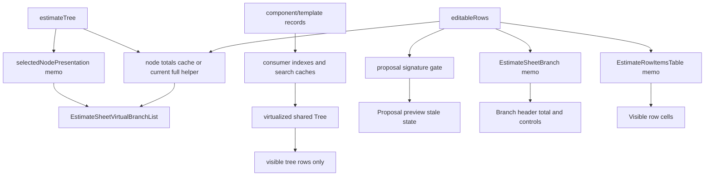

# perf: Memoization Architecture

## Summary

The memoization architecture uses three layers: lazy full-tree computations, stable presentation props, and slice-aware component comparators. Incremental totals are treated as a measured follow-up within the same plan because they change the data-flow shape more than ordinary memoization.

---

## Architecture Principles

- Memoization must be correctness-first: stale UI is worse than extra renders.
- Comparators should fail open when unsure.
- Broad objects must be compared through owned ids, not by whole-object identity.
- Context changes still rerender context consumers; do not fight React context for collapse/search state.
- Virtualization and memoization solve different problems and should be tested separately.

---

## Layer 1: Lazy Full-Tree Work

### Proposal Preview Signature

The proposal preview signature should be computed only when it has a visible job:

- when building or refreshing the preview model;
- when an existing preview model exists and the UI needs to know whether it is stale;
- when the preview dialog is open and the stale state is visible.

When no preview model exists, ordinary edits should not call the signature builder. If the dialog is closed with a previously built model, the implementation should choose an explicit stale-state policy and test it. The conservative policy is to compute a current signature only while the preview model exists; the more aggressive policy is to defer stale detection until the user opens the dialog again.

Recommended default: compute while a preview model exists, and do not compute before the first preview is built. This preserves stale detection for the existing model while removing the always-on cost from users who never open export preview.

### Current Rows Flattening

The existing `shouldBuildFlattenedRows` guard should remain. Flattening rows globally is only needed for inspector, row details, and project-specific row flows.

---

## Layer 2: Stable Presentation Props

### Selected Node Presentation

Create a memoized selected-node presentation object keyed by `estimateTree` and `resolvedSelectedNodeId`:

- selected node code;
- ancestor breadcrumb path;
- maybe selected node id and name if downstream props benefit.

The object should produce stable empty sentinels for no-selection cases so `EstimateSheetVirtualBranchList` does not receive a fresh empty array every render.

### Virtualization Config Objects

Virtualization config constants should stay module-level or memoized. Passing fresh config objects through memoized tables or trees would defeat existing comparators.

---

## Layer 3: Slice-Aware Component Boundaries

### EstimateSheetBranch

`EstimateSheetBranch` is the main new memo boundary. It should be exported through `memo(EstimateSheetBranchBase, areEstimateSheetBranchPropsEqual)` or an equivalent local pattern.

Comparator inputs should include:

| Concern | Comparator Rule |
|---|---|
| Node identity | Rerender if `node` reference changes. Filter/search/group can legitimately produce new nodes. |
| Node code and depth | Rerender if `nodeCode`, `depth`, `siblingIndex`, or `renderChildBranches` changes. |
| Ancestor path | Rerender if path reference changes, or if ids/names differ when a stable reference cannot be guaranteed. |
| Node total | Rerender if `nodeTotals.get(node.id)` changes. |
| Own rows | For each own row id, rerender if `editableRows[rowId]` identity changes. |
| Selection | For each own row id, rerender if selected membership changes. |
| Handler props | Rerender if any mutation or selection handler identity changes. |
| `setEditableRows` | Rerender if setter identity changes. |
| Context | Let collapse/search context rerender the component naturally. |

Open design point: child totals. If a parent branch renders child branches recursively in non-virtual mode, parent render can carry children. In virtual mode, each flattened branch renders with `renderChildBranches=false`, so branch memoization mostly protects visible branch headers and own table props. Tests should cover both paths.

### EstimateRowItemsTable

The existing row-table comparator is a model for branch comparison. It should stay as the trusted lower boundary.

Possible extension only if tests expose a gap:

- compare row id arrays rather than `items` identity when filter/group mode creates equivalent arrays;
- memoize `selectableRowIds` for virtual focus behavior;
- add table-level compute-count probes around selection derivation.

Avoid changing the table comparator unless a specific test fails; it already protects the most expensive row subtree.

### Shared Tree

Shared tree memoization is lower priority because virtualization limits mounted rows. The plan should first measure:

- default-row rerenders with no custom `renderRow`;
- custom row label rerenders in `EstimateSheetTree`, `LibraryTree`, `TemplatesTree`, `TemplatesBrowseManager`, `LibraryFolderTree`, and `TemplateStructureTree`;
- whether `selectedIds.includes(flat.id)` in row prop building matters at large selected sets.

Potential tree improvements:

- use `selectedSet` in row-prop derivation where possible;
- memoize custom row label components at consumer boundaries;
- introduce row state signatures only if a targeted test proves current visible-row churn is material.

### Component and Template Tree Consumers

Component/template trees are the likely first surface to reach tens of thousands of nodes. They already use the shared virtualizer, so the next layer is consumer-side data shaping:

- build reusable indexes for template category, project source ancestry, folder-to-component rows, and id-to-node lookup;
- avoid repeated full-array `filter`, `sort`, and nested `map` work when only selection, collapse, or a single item mutation changes;
- cache normalized search text per component/template/source row so search does not repeatedly lowercase and inspect the same large records;
- separate visible expansion state from full model construction so collapse changes do not rebuild the underlying UI-node model;
- measure `buildTemplatesTreeNodes`, `toUiNodes`, `buildComponentItemsByFolderId`, `filterFolderTree`, and browse-tree construction before changing shared `Tree` internals.

The shared `Tree` should still own row virtualization, keyboard/a11y state, and drag/drop state. It should not absorb component/template-specific indexing rules.

---

## Node Totals Strategy

### Phase A: Measure

Add probes around `computeNodeTotals` and row-total computation. The test should prove how many full tree visits happen for:

- typing in one row with preview closed;
- typing after preview has been built;
- typing while search/facets/group are inactive;
- typing while a filtered view is active;
- editing a row deep in a large nested branch tree.

### Phase B: Choose Strategy

| Strategy | When to Choose | Notes |
|---|---|---|
| Keep full recompute | Counts are low enough after H1-H3 fixes and tests pass within budget. | Simplest and safest. |
| Scoped visible recompute | Displayed subtree is small and project total can be deferred or computed from cached prior totals. | Needs careful project total semantics. |
| Incremental totals index | Full recompute remains hot in large fixtures. | Most complex, but best theoretical win. |

### Incremental Totals Direction

If required, build an index derived from `estimateTree`:

- row id to node id;
- node id to ancestor node ids;
- node id to own row ids;
- stable base totals from persisted row values;
- editable row overrides by row id.

On row edit, update only the edited row total delta and ancestor totals. On structural tree changes, rebuild the index from the updated tree. Parity tests must compare incremental totals against `computeNodeTotals` for nested, filtered, mixed-content, inserted, deleted, and moved-row fixtures.

---

## Data Flow After Planned Changes

---

## Do-Not-Do List

- Do not wrap all tree consumers in `memo` without measuring.
- Do not compare whole `editableRows` objects in branch or row comparators.
- Do not ignore `nodeTotals.get(node.id)` in the branch comparator.
- Do not preserve stale drag/drop handlers to save renders.
- Do not replace `computeNodeTotals` with incremental logic without parity tests against the current helper.
- Do not assume tree virtualization solves full-model construction for component/template trees.
- Do not change search, facet, grouping, collapse, proposal export, or cost formula behavior as part of this performance work.
