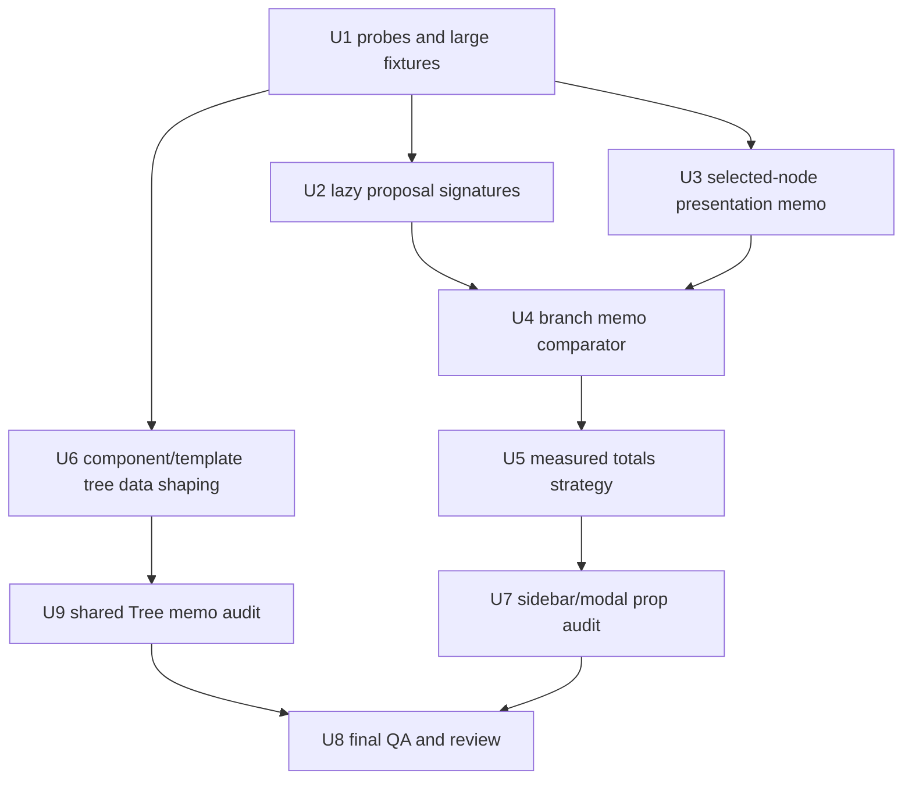

# perf: Memoization Execution Goal and Prompt

## Summary

This document is the execution handoff for the memoization plan pack. It gives an AI implementer a single prompt, the recommended implementation route, the rejected routes, and the testing gates needed to avoid stale UI bugs in virtualized and memoized estimate/tree surfaces.

---

## Copy-Paste Execution Prompt

Use this prompt when starting the implementation pass:

```text
You are implementing the full plan pack at `.ai/03_plans/2026-06-15-Tree-And-Estimate-Sheet-Memoization/`.

Goal: improve performance for large estimate sheets, estimate trees, component library trees, templates trees, template browse trees, folder trees, and template structure trees without introducing stale rows, stale totals, stale selection, stale drag/drop handlers, stale proposal-preview state, or broken virtualized focus/scroll behavior.

Read these files first, in this order:
1. `.ai/03_plans/2026-06-15-Tree-And-Estimate-Sheet-Memoization/00_INDEX.md`
2. `.ai/03_plans/2026-06-15-Tree-And-Estimate-Sheet-Memoization/01_strategy_and_success_criteria.md`
3. `.ai/03_plans/2026-06-15-Tree-And-Estimate-Sheet-Memoization/02_current_state_audit.md`
4. `.ai/03_plans/2026-06-15-Tree-And-Estimate-Sheet-Memoization/03_memoization_architecture.md`
5. `.ai/03_plans/2026-06-15-Tree-And-Estimate-Sheet-Memoization/04_implementation_plan.md`
6. `.ai/03_plans/2026-06-15-Tree-And-Estimate-Sheet-Memoization/05_test_and_probe_plan.md`
7. `.ai/03_plans/2026-06-15-Tree-And-Estimate-Sheet-Memoization/06_ultraqa_matrix.md`
8. `.ai/03_plans/2026-06-15-Tree-And-Estimate-Sheet-Memoization/07_risk_register_and_rollout.md`
9. `.ai/03_plans/2026-06-15-Tree-And-Estimate-Sheet-Memoization/08_code_review_checklist.md`
10. `.ai/03_plans/2026-06-15-Tree-And-Estimate-Sheet-Memoization/09_execution_goal_and_prompt.md`

Implement the plan in a characterization-first loop. Do not start by wrapping everything in `React.memo`. First add test-only probes and large deterministic fixtures. Then implement the smallest memoization or indexing change that makes a measured hot path cheaper while preserving visible correctness.

Recommended route:
1. U1: add render/compute/data-shaping probes and baseline tests.
2. U2 and U3: land low-risk `EstimateSheetContent` memoization for proposal signatures and selected-node presentation.
3. U6: optimize component/template tree data shaping because these trees are likely to hit tens of thousands of nodes first.
4. U4: add the `EstimateSheetBranch` memo boundary only after branch props and selected presentation are stable.
5. U5: decide totals strategy from probe evidence; keep `computeNodeTotals` as the test oracle even if render code adopts a cache or incremental helper.
6. U9 and U7: audit shared tree row memoization and sidebar/modal prop stability only after consumer-side work is measured.
7. U8: run final QA, reviewer checks, and the UltraQA matrix.

Constraints:
- Keep existing virtualization flags default-on and opt-out capable.
- Do not add new dependencies unless unavoidable and explicitly justified.
- Do not change database schema, Supabase provider settings, or production services for this work.
- Keep probes inert in production; test callbacks must default to null.
- Do not rely only on render counts. Every memoization test must also assert visible UI values or derived state that would catch stale skips.
- Do not deep-equal entire trees in comparators. Use narrow slice-aware comparisons.
- Do not optimize shared `Tree` internals before component/template consumer data shaping has been measured.
- Do not remove existing virtualization tests or render-relief tests.
- Preserve drag/drop, a11y attributes, keyboard focus, virtual scroll, bulk selection, filtered views, proposal preview stale-state behavior, and row editing.

Testing and verification:
- Start with failing or characterization tests that show the current cost.
- Add or update tests under `tests/vitest/perf/` for estimate-sheet and tree memoization probes.
- Add large deterministic fixtures for thousands and tens of thousands of tree/component/template nodes.
- Run targeted suites after each unit and record the output.
- Run typecheck, lint, and diff hygiene before the final report.
- Run build or browser smoke only if the implementation changes visible focus/scroll behavior or runtime integration.

Required final report:
- Changed files grouped by implementation unit.
- Probe counts before and after for each optimized hot path.
- Tests run, exact outcomes, and any skipped tests with reasons.
- UltraQA matrix status for every scenario.
- Chosen totals strategy and why.
- Any rollback-ready comparators, caches, or indexes.
- Residual risks and follow-up items.

Do not stop until every implementation unit is either implemented and verified or explicitly marked as evidence-gated/no-op with supporting test data.
```

---

## Execution Success Criteria

- Renders stay bounded for virtualized branch lists, row tables, and shared tree consumers.
- Full-tree proposal-preview signature work does not run during ordinary edits before preview use.
- Selected-node code and breadcrumb derivation do not rerun during row edits when selection is unchanged.
- `EstimateSheetBranch` skips unaffected sibling branches without hiding updated row values, totals, selection, drag/drop state, or child visibility.
- Node totals either remain full-recompute with evidence that the cost is acceptable or move to a scoped/incremental strategy with parity tests against `computeNodeTotals`.
- Component and template tree consumers stop repeating expensive grouping, filtering, sorting, indexing, and search normalization when only selection, collapse, or one item changes.
- Shared `Tree` internals are changed only if evidence remains after consumer-side fixes.
- All memoization tests assert visible correctness, not just reduced render counts.

---

## Affected Routes and Screens

The implementation should treat these as the primary user-facing surfaces:

| Route or Surface | Why It Matters |
|---|---|
| `src/app/workshop/projects/[projectId]/estimates/page.tsx` | Main estimate workspace entry where `EstimateSheetContent` and trees are used. |
| `src/app/workshop/projects/[projectId]/estimates/[nodeId]/page.tsx` | Deep-linked estimate-node view must preserve selection and focus behavior. |
| `src/app/workshop/library/page.tsx` and `src/app/workshop/library/components/page.tsx` | Component library tree and folder tree can grow to thousands of components. |
| `src/app/workshop/library/templates/page.tsx` and `src/app/workshop/library/templates/[templateId]/page.tsx` | Template browse and template structure trees can grow through templates and project-source nodes. |
| `src/app/workshop/templates/page.tsx` | Legacy or redirected templates surface should not regress if it still mounts shared tree/template components. |
| `src/components/ui/tree.tsx` consumers | Shared tree behavior affects estimate, component, templates, browse, folder, and editor trees. |

Non-goal: this is not a whole-app route-transition performance sweep. Keep the work scoped to estimate-sheet, row-table, and tree memoization/data shaping.

---

## Analyzed Implementation Paths

| Path | Description | Upside | Risk | Decision |
|---|---|---|---|---|
| A. Instrument-first targeted memoization | Add probes, measure hot paths, then memoize/index one bounded slice at a time. | Safest for correctness; produces evidence and rollback points. | Slower than blanket memoization. | Recommended. |
| B. Wrap broad component surfaces in `React.memo` | Memoize `EstimateSheetContent`, every tree consumer, and child rows broadly. | Quick initial diff. | High stale-state risk; comparators become unreviewable; may hide incorrect totals. | Reject. |
| C. Totals-cache first | Start with incremental totals before smaller render wins. | Could remove a major full-tree cost. | Hardest correctness problem; high drift risk without probes. | Defer until U1, U2, and U4 evidence exists. |
| D. Shared `Tree` internals first | Optimize generic row labels, flattening, and indexes before consumer data shaping. | Helps all consumers if proven hot. | Component/template consumers may still rebuild full models before `Tree` sees them. | Defer until U6 proves remaining shared-tree churn. |
| E. Consumer data-shaping first only | Optimize component/template grouping/search/indexing before estimate-sheet branch work. | Addresses the likely tens-of-thousands tree surface. | Leaves estimate row-edit hot paths untouched. | Run after U1 and in parallel with low-risk sheet memoization where safe. |
| F. New state store or data model rewrite | Normalize estimate/tree/component data into a new client store. | Could create long-term performance headroom. | Too broad for this plan; creates migration and behavior risk. | Reject for this slice; revisit only with separate plan. |

The best route is A with E pulled forward after U1. That keeps the delicate sheet comparator/totals work measured while also addressing Philip's concern that component/template trees may be the first truly huge data surface.

---

## Recommended Implementation Flow



Execution notes:

- U1 is mandatory and must run before any comparator work.
- U2 and U3 are low-risk wins and can be implemented independently after U1.
- U6 should start early because component/template trees are the likely first tens-of-thousands surface.
- U4 must fail open on any prop that affects visible branch state.
- U5 must be evidence-driven; keep `computeNodeTotals` as an oracle.
- U9 is allowed to conclude "no generic tree change needed" if virtualization plus consumer indexing is enough.
- U7 is allowed to be audit-only if probes show sidebar/modal churn is not material.

---

## Testing Built Into Execution

### Characterization Tests

Add or update:

- `tests/vitest/perf/estimate-sheet-memoization.test.tsx`
- `tests/vitest/perf/estimate-sheet-render-relief.test.tsx`
- `tests/vitest/perf/tree-memoization.test.tsx`
- `tests/vitest/templates-tree-performance.test.ts`

Expected coverage:

- branch render counts by node id;
- proposal signature call counts;
- selected-node path/code helper counts;
- node total compute counts;
- tree data-shaping counts for component/template grouping, search, maps, and UI-node construction.

### Correctness Regression Tests

Run and extend where the implementation changes behavior:

- `tests/vitest/estimate-sheet-node-totals.test.ts`
- `tests/vitest/proposal-export-preview.test.tsx`
- `tests/vitest/estimate-mixed-content.test.tsx`
- `tests/vitest/estimate-sheet-branch-header-ui.test.tsx`
- `tests/vitest/estimate-template-drop-zones.test.tsx`
- `tests/vitest/ui-tree.test.tsx`

Expected coverage:

- visible totals match after edit, insert, delete, move, filter, collapse, and expand;
- proposal preview stale policy remains correct;
- branch headers and row values do not become stale;
- drag/drop uses fresh target ids and handlers;
- shared tree a11y, keyboard focus, context menu, custom labels, and drag/drop remain current.

### Virtualization Interaction Tests

Run and extend:

- `tests/vitest/estimate-branch-virtualization.test.tsx`
- `tests/vitest/estimate-row-table-virtualization.test.tsx`
- `tests/vitest/ui-tree.test.tsx`

Expected coverage:

- mounted branch, row, and tree-row counts remain bounded;
- offscreen edited values and totals are correct when remounted;
- keyboard focus and scroll-to-focused behavior survive virtual unmount/remount.

### Suggested Targeted Commands

Use targeted commands during implementation:

```bash
bunx vitest run tests/vitest/perf/estimate-sheet-render-relief.test.tsx tests/vitest/perf/estimate-sheet-memoization.test.tsx --maxWorkers=1
bunx vitest run tests/vitest/perf/tree-memoization.test.tsx tests/vitest/templates-tree-performance.test.ts tests/vitest/ui-tree.test.tsx --maxWorkers=1
bunx vitest run tests/vitest/estimate-sheet-node-totals.test.ts tests/vitest/proposal-export-preview.test.tsx tests/vitest/estimate-mixed-content.test.tsx tests/vitest/estimate-sheet-branch-header-ui.test.tsx tests/vitest/estimate-template-drop-zones.test.tsx --maxWorkers=1
bunx vitest run tests/vitest/estimate-branch-virtualization.test.tsx tests/vitest/estimate-row-table-virtualization.test.tsx tests/vitest/ui-tree.test.tsx --maxWorkers=1
bun run type-check
bun run lint
git diff --check
```

Escalate to `bun run build` or browser smoke only when the implementation changes runtime integration, focus, scroll, or visible UI behavior beyond memoization/data shaping.

---

## Parallel Work Lanes

Use parallel agents or independent lanes only after U1 defines probes and fixture shape:

- **Sheet lane:** U2, U3, U4, U5 around `EstimateSheetContent`, `EstimateSheetBranch`, proposal signatures, selected-node presentation, and totals.
- **Tree lane:** U6 and U9 around `LibraryTree`, `TemplatesTree`, `TemplatesBrowseManager`, `LibraryFolderTree`, `TemplateStructureTree`, and shared `Tree`.
- **Verifier lane:** focused tests, UltraQA matrix, comparator review, and stale-state assertions.

Do not split a comparator or totals-cache change across agents unless one agent owns implementation and another remains read-only reviewer. Shared-file conflicts in `EstimateSheetContent.tsx` and `src/components/ui/tree.tsx` should be resolved by the lead implementer.

---

## Final Report Contract

The final implementation report must include:

- implementation units completed, skipped, or evidence-gated;
- changed files grouped by estimate-sheet, tree, tests, and docs/logs;
- probe deltas before and after each optimization;
- targeted test commands and pass/fail outcomes;
- whether `bun run type-check`, `bun run lint`, and `git diff --check` passed;
- whether build/browser smoke ran, or why it was not necessary;
- UltraQA matrix status with any safe substitutes;
- selected totals strategy and rollback criteria;
- remaining risks.

Write a concise evidence log under `.ai/05_logs/` so the next agent can verify what happened without scraping chat history.

---

## Stop Condition

Stop only when every unit in `04_implementation_plan.md` is implemented, verified, or explicitly closed as evidence-gated/no-op with probe data. A green typecheck alone is not sufficient. The implementation is done only when stale-state, virtualization, render-count, and visible-correctness tests all support the final claim.
