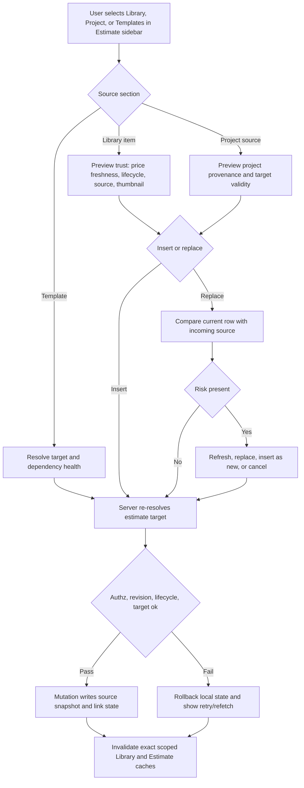

# Library To Estimate Trust Governance Plan

## Summary

Build the missing trust layer between the Library and the Estimate Sheet. The Library page can expose source trust, but estimates still need guarded insert/replace, clear source labels, stale-target recovery, cost-source stewardship, attachment review, and focused proof.

This plan starts after the active `.ai/03_plans/2026-06-20-Library-Page-Overall-Improvement/` implementation lands or reaches a stable handoff point. It does not modify that plan pack.

---

## Problem Frame

The current Library plan improves findability, source trust, route state, Quick Add, dense mode, and evidence gates for Library surfaces. The UX audit and code inspection show a separate risk: a user can reuse Library data inside an estimate without a complete user-facing decision point for stale pricing, source-changed rows, thumbnail mismatch, archived components, row revision conflict, mobile interruption, or supplier/spec-sheet governance.

The highest-risk moment is not browsing the Library. It is committing a Library-derived row into an estimate where the result affects cost, scope, and proposal history.

---

## Requirements

**Reuse Safety**

- R1. Replacing an Estimate Sheet row from a Library item must show a compare-before-replace decision when the source is stale, very stale, missing source data, archived/discontinued, thumbnail-mismatched, or link-state changed.
- R2. Inserting a Library item must preserve the selected target node, re-check target validity at submit time, and fail closed if the target node, estimate, project, workspace, or user role changed.
- R3. A row replacement must preserve intentional quantity, contingency, and misc-cost edits while making the incoming component identity, pricing source, lifecycle, and thumbnail explicit.
- R4. A failed insert, replace, promote, detach, or project-source add must restore local estimate state and leave the user with a visible retry/refetch path.
- R5. Archived Library components must not silently insert as fresh estimate rows.

**Source Vocabulary**

- R6. The UI must distinguish workspace Library components, project-specific rows, detached rows, express/project components, source-changed rows, and templates.
- R7. Pricing freshness language must stay separate from link/snapshot language: stale price means old pricing date; source changed means link drift.
- R8. Cache shape labels in the plan and tests must stay distinct: full Library dataset, lite Estimate Sheet sidebar dataset, rows management dataset, and templates dataset.

**Cost And Attachment Governance**

- R9. Supplier, brand, pricing source, source URL, source date, confidence, lifecycle, and attachments must not collapse into one generic "source trust" field.
- R10. The system must support an assigned stale-cost refresh queue before accepted cost is treated as current for reuse.
- R11. The accepted/current cost entry must have one clear owner state: proposed, needs review, accepted, rejected, or superseded, with lock represented as a modifier on accepted rather than a peer state.
- R12. Spec-sheet attachments must carry enough lifecycle metadata to identify uploaded version, applicable variant, reviewer status, current approved file, and older auditable revisions.

**Mobile, Accessibility, And Evidence**

- R13. Mobile/interrupted estimate editing must expose saved, pending, failed, retrying, and resumed states for Library-derived changes.
- R14. Invalid numeric edits and keyboard tree/reorder actions must remain recoverable and accessible during Library insert/replace workflows.
- R15. Completion evidence must be pack-local, targeted, and honest about known baseline reds; full `bun run validate` cannot be the only done gate while the repo baseline remains red.

**Cross-Cutting Readiness**

- R16. Every mutating Library-to-Estimate action must have a documented authz boundary, denial case, and evidence row.
- R17. Accepted-cost, lock-modifier, reviewed attachment, source snapshot, and public projection semantics must be explicit before implementation changes durable data.
- R18. Cache, payload, render, network, retry, and attachment-transfer budgets must be measurable before shipping broad sidebar/reuse changes.
- R19. High-conflict files must have a single active owner and integration order before parallel agents edit them.
- R20. Every requirement must trace to at least one implementation unit, QA row, adversarial row where relevant, evidence artifact, and owner lane.

---

## Key Technical Decisions

- KTD1. Guard reuse at the Estimate Sheet boundary: Library trust indicators are useful, but the destructive or cost-bearing decision happens in `EstimateSheetContent` and the right sidebar, so compare/confirm/retry belongs there.
- KTD2. Treat the right sidebar as a consumer, not a manager: the Estimate Sheet sidebar should load lite source data for fast reuse and hand off to Library management modals/drawers only when a user explicitly creates or edits source records.
- KTD3. Keep source states orthogonal and mostly derived: pricing freshness comes from `pricing_date`; lifecycle, link state, supplier identity, confidence, and attachment review each answer different questions and must remain testable separately.
- KTD4. Prefer app-layer governance first, then schema migration: stale queues, accepted-cost review, and attachment approval can start with existing version/history/cost/attachment structures only when the state is transient. Durable reviewer, approval, assignment, lock, or accepted-cost fields are migration-gated by `10-DATABASE-MIGRATION-AND-RPC-READINESS.md`.
- KTD5. Use focused proof by claim: Vitest/DOM tests prove reducers, action payloads, cache keys, labels, and a11y states; Playwright/browser proof is reserved for real routing, drag/drop, mobile viewport geometry, portal focus, and hosted/provider claims.
- KTD6. Keep exposure tiers separate: workspace Library details may show protected source evidence, but public/proposal snapshots remain frozen and redacted.
- KTD7. Canonical cost semantics: `accepted` is the lifecycle state; a lock is a modifier on an accepted cost, not a competing `locked` lifecycle state.
- KTD8. Source snapshots are versioned private estimate facts. Public/proposal projections use a separate allowlist and exclude raw source URLs, storage paths, filenames, confidence prose, and review notes.
- KTD9. The right sidebar lite dataset remains a bounded consumer shape. It must not carry full history, full attachment graphs, or public/proposal projection payloads.
- KTD10. Parallel implementation must follow the lock protocol in `08-BLAST-RADIUS-AND-INTEGRATION-MAP.md`, especially for `EstimateSheetContent.tsx`.

---

## High-Level Technical Design

---

## Scope Boundaries

In scope:

- Joined Library-to-Estimate insert, replace, promote, detach, project-source add, and template-source insert behavior.
- Estimate Sheet right sidebar source labels, source sections, stale/changed states, and recovery copy.
- Cost-source governance and attachment/spec-sheet lifecycle enough to make reuse decisions trustworthy.
- Targeted tests and evidence artifacts for the above.

Out of scope:

- Rewriting the active Library page visual/dense-mode implementation from the 2026-06-20 plan.
- Replacing all Library management routes with Estimate Sheet sidebar flows.
- Claiming provider, hosted, or production proof from local-only tests.
- Requiring broad `bun run validate` green while the current repo baseline is known red for unrelated reasons.

Deferred to separate work:

- External supplier self-serve portal.
- Full import/export marketplace workflow.
- A dedicated provider-backed cost ingestion pipeline.
- Public share display of live Library trust metadata. Public proposal snapshots remain frozen and redacted.

---

## Implementation Units

### U1. Compare-Before-Replace For Stale Library Sources

- **Goal:** Add an explicit review decision before a Library item replaces an Estimate Sheet row when trust, lifecycle, thumbnail, or link-state risk is present.
- **Requirements:** R1, R3, R4, R5, R6, R7, R16, R20.
- **Dependencies:** Active Library source-trust helpers are available or re-created locally from the current implementation.
- **Files:**
  - Modify: `src/components/workshop/EstimateSheetContent.tsx`
  - Modify: `src/components/workshop/component-library/index.tsx`
  - Modify: `src/components/workshop/estimate-sheet/rows/cells.tsx`
  - Test: `tests/vitest/estimate-sheet-library-insert.test.tsx`
  - Test: `tests/vitest/estimate-sheet-actions-authz.test.ts`
  - Test: `tests/vitest/library-source-trust.test.ts`
- **Approach:** Detect risk before calling `replaceRowItem`; show current row vs incoming Library item with pricing freshness, lifecycle, source URL/presence, supplier, confidence, thumbnail, and link state. Allow refresh source, replace selected row, insert as new row, or cancel. Preserve quantity/contingency/misc-cost semantics already passed through `row-table.tsx`.
- **Patterns to follow:** Current replace path at `src/components/workshop/EstimateSheetContent.tsx:2415`; drag replace payload at `src/components/workshop/estimate-sheet/rows/cells.tsx:476`; source trust helpers in `src/components/workshop/library/source-trust-model.ts:85`.
- **Test scenarios:** Stale price requires review; very stale price escalates copy; archived source blocks or requires an explicit non-fresh decision; source-changed with fresh price uses source-review copy; thumbnail mismatch is visible before replace; row revision conflict restores the previous row and shows retry/refetch.
- **Verification:** A stale or changed Library replacement cannot commit without a visible decision, and failure restores the previous row state.

### U2. Estimate Sheet Sidebar Source Taxonomy

- **Goal:** Make the right sidebar a first-class source consumer with clear `Library`, `Project`, and `Templates` semantics.
- **Requirements:** R2, R6, R7, R8, R13, R18, R20.
- **Dependencies:** U1 for replacement wording and risk states.
- **Files:**
  - Modify: `src/components/workshop/component-library/index.tsx`
  - Modify: `src/components/workshop/EstimateSheetContent.tsx`
  - Modify: `src/lib/component-library/project-component-projection.ts`
  - Modify: `src/lib/estimates/express-components.ts`
  - Test: `tests/vitest/estimate-sheet-library-lazy-load.test.tsx`
  - Test: `tests/vitest/project-component-projection.test.ts`
  - Test: `tests/vitest/estimate-component-drag.test.tsx`
  - Test: `tests/vitest/estimate-sheet-sidebar-library-consumers.test.tsx`
- **Approach:** Lock the terms: Library Component means workspace reusable source; Project Component means express or detached project-specific row; Template means reusable estimate structure. The sidebar may preview/create/edit, but its primary contract is browse/filter/insert into the selected estimate target.
- **Patterns to follow:** Sidebar tabs at `src/components/workshop/component-library/index.tsx:140`; source labels at `src/components/workshop/estimate-sheet/rows/cells.tsx:107`; sidebar mount at `src/components/workshop/EstimateSheetContent.tsx:3088`.
- **Test scenarios:** Library tab inserts workspace rows; Project tab inserts projected project rows only; Templates tab resolves template target; project-specific rows show promote action; source labels remain screen-reader visible; no workspace data leaks across project tab boundaries.
- **Verification:** Users can tell what each source section will do before adding anything to the estimate, using the visible labels and user-observable assertions in `07-UX-IA-COPY-AND-A11Y-CONTRACT.md`.

### U3. Scoped Cache And Stale Target Recovery

- **Goal:** Prove and preserve scoped cache behavior for the Library-to-Estimate consumer path, including stale target recovery.
- **Requirements:** R2, R4, R8, R15, R16, R18, R20.
- **Dependencies:** U2 source sections.
- **Files:**
  - Modify: `src/lib/component-library/query-keys.ts`
  - Modify: `src/components/workshop/EstimateSheetContent.tsx`
  - Modify: `src/hooks/use-estimate-row-mutations.ts`
  - Test: `tests/vitest/library-workspace-switch-cache.test.ts`
  - Test: `tests/vitest/library-components-cache.test.tsx`
  - Test: `tests/vitest/library-templates-cache.test.tsx`
  - Test: `tests/vitest/estimate-insert-target-authz.test.tsx`
- **Approach:** Re-verify current key factories before coding. Keep full, lite, rows, and templates keys separate, and keep the unscoped base key internal to the key factory. After Library mutations from the sidebar, invalidate the scoped prefix without eager heavy refetch unless the visible claim needs current data immediately. On target/role/revision mismatch, block mutation and show recovery.
- **Patterns to follow:** Query key factories at `src/lib/component-library/query-keys.ts:7`; lite sidebar key at `src/components/workshop/EstimateSheetContent.tsx:1279`; invalidation path at `src/components/workshop/EstimateSheetContent.tsx:1309`.
- **Test scenarios:** Workspace switch cannot show prior workspace details; stale estimate target is rejected; replace uses current row revision; sidebar mutation marks the lite cache stale; templates cache stays scoped by user/workspace.
- **Verification:** No cross-workspace Library data is observable and stale targets fail closed with recoverable UI.

### U4. Cost Source Refresh And Accepted-Cost Governance

- **Goal:** Turn passive source trust into an actionable stale-cost governance workflow.
- **Requirements:** R9, R10, R11, R15, R16, R17, R20.
- **Dependencies:** U2 vocabulary and U3 cache contracts.
- **Files:**
  - Modify: `src/lib/component-library/actions.ts`
  - Modify: `src/lib/repositories/component-library-repository.ts`
  - Modify: `src/components/workshop/component-library-manager/AddComponentModal.tsx`
  - Modify: `src/components/workshop/library/ComponentInspectorDock.tsx`
  - Test: `tests/vitest/component-library-versioning-schema.test.ts`
  - Test: `tests/vitest/component-library-cost-governance-actions.test.ts`
  - Test: `tests/vitest/library-source-trust.test.ts`
- **Approach:** Start with app-layer states over existing cost entries and append-only version/history tables only where the state is transient: proposed, needs review, accepted, rejected, superseded, with lock as a modifier on accepted. Add an assigned stale-cost queue and accepted-cost decision surface. Gate new schema behind `10-DATABASE-MIGRATION-AND-RPC-READINESS.md` if assignment, reviewer, accepted, lock, or review metadata must survive reloads or affect insert/replace decisions.
- **Patterns to follow:** Cost-entry validation at `src/components/workshop/component-library-manager/AddComponentModal.tsx:839`; action normalization at `src/lib/component-library/actions.ts:405`; repository detail graph at `src/lib/repositories/component-library-repository.ts:661`.
- **Test scenarios:** One active cost entry is enforced; stale item can be assigned for refresh; conflicting supplier/source costs require reconciliation; accepted cost cannot be silently overwritten; rejected/superseded costs remain auditable.
- **Verification:** A Library item reused into an estimate can point to a reviewed accepted cost or clearly warn that cost refresh is pending; durable trust changes pass the RPC/action and SQL gates in `09-SECURITY-AUTHZ-AND-DATA-EXPOSURE.md` and `10-DATABASE-MIGRATION-AND-RPC-READINESS.md`.

### U5. Attachment And Spec-Sheet Lifecycle

- **Goal:** Add lifecycle rules for spec-sheet attachments so files support trust decisions instead of being opaque uploads.
- **Requirements:** R9, R12, R15, R16, R17, R20.
- **Dependencies:** U4 accepted-cost states.
- **Files:**
  - Modify: `src/app/api/component-library/attachments/route.ts`
  - Modify: `src/components/workshop/component-library-manager/AddComponentModal.tsx`
  - Modify: `src/lib/component-library/actions.ts`
  - Modify: `src/lib/repositories/component-library-repository.ts`
  - Test: `tests/vitest/component-library-attachment-lifecycle.test.ts`
  - Test: `tests/vitest/library-add-component-modal-a11y.test.tsx`
  - Test: `tests/vitest/component-library-versioning-schema.test.ts`
- **Approach:** Preserve MIME/path/upload validation. Treat attachments as private evidence assets by default. Add reviewer status, variant applicability, approved/current marker, superseded history, and orphan cleanup criteria only where the workflow needs durable review state. Keep storage deletion scoped to owned paths only and follow the storage/redaction matrix in `09-SECURITY-AUTHZ-AND-DATA-EXPOSURE.md`.
- **Patterns to follow:** Upload API at `src/app/api/component-library/attachments/route.ts:125`; draft cleanup at `src/components/workshop/component-library-manager/AddComponentModal.tsx:1040`; attachment validation at `src/lib/component-library/actions.ts:299`.
- **Test scenarios:** PDF/XLS/XLSX accepted only by magic MIME; bad extension or wrong workspace path rejected; deleting draft removes only owned paths; approving a new file does not erase older revision; current approved attachment is visible to the reviewer.
- **Verification:** A component variant can show which spec sheet is current, who reviewed it, and which older files remain auditable.

### U6. Mobile, Interruption, Validation, And Accessibility

- **Goal:** Make joined Library-to-Estimate flows recoverable on mobile, poor networks, and keyboard/screen-reader paths.
- **Requirements:** R4, R13, R14, R15, R18, R20.
- **Dependencies:** U1 through U3.
- **Files:**
  - Modify: `src/components/workshop/EstimateSheetContent.tsx`
  - Modify: `src/components/workshop/component-library/index.tsx`
  - Modify: `src/components/workshop/estimate-sheet/rows/cells.tsx`
  - Test: `tests/vitest/estimate-sheet-cost-inputs.test.tsx`
  - Test: `tests/vitest/estimate-sheet-column-resize-a11y.test.tsx`
  - Test: `tests/vitest/library-add-component-modal-a11y.test.tsx`
  - Test: `e2e/workshop-library-routes.spec.ts`
- **Approach:** Define saved, pending, failed, retrying, and resumed states for insert/replace/promote. Use DOM tests for ARIA, visible errors, focus return, and preserved inputs. Use browser proof only for mobile geometry, drag/drop pointer behavior, route/back-forward, or portal focus claims.
- **Patterns to follow:** Lazy sidebar fallback at `src/components/workshop/EstimateSheetContent.tsx:3118`; source rail labels at `src/components/workshop/estimate-sheet/rows/cells.tsx:527`; current UX audit scenario `UX-030` and `UX-044` in `.ai/16_user-experience/2026-06-22-full-app-user-story-ux-audit/post-fix-scenario-tests.md:48`.
- **Test scenarios:** Mobile interruption preserves dirty row edits; failed insert retry uses the same intended target after revalidation; Escape/cancel returns focus; invalid numeric values show visible error; keyboard replacement path is equivalent to drag/drop.
- **Verification:** The user always knows whether a Library-derived estimate edit is saved, pending, failed, or needs retry.

### U7. Pack-Local Evidence, Telemetry, And Release Gates

- **Goal:** Create focused proof and telemetry requirements for this follow-up without overclaiming broad validation.
- **Requirements:** R4, R8, R15, R16, R18, R19, R20.
- **Dependencies:** U1 through U6.
- **Files:**
  - Create: `.ai/03_plans/2026-06-22-Library-To-Estimate-Trust-Governance/_evidence/README.md`
  - Modify: `src/lib/component-library/library-telemetry.ts`
  - Test: `tests/vitest/library-telemetry-emit.test.ts`
  - Test: `tests/vitest/share-snapshot-redaction.test.tsx`
- **Approach:** Add a pack-local evidence folder when implementation begins. Each claim gets command, date, files touched, result, residual risk, and whether it is local, browser, provider, or manual proof. Telemetry payloads must remain ID/metadata-only and must not include raw pricing source text, confidence prose, source URLs, file names, or user-entered row text.
- **Patterns to follow:** Evidence standards in `.ai/16_user-experience/2026-06-22-full-app-user-story-ux-audit/testing-loop-and-validation.md:50` and current baseline notes in `.ai/10_state/current-state.md:27`.
- **Test scenarios:** Insert/replace/cache/attachment rejection events emit once; telemetry sanitizer drops raw text and private fields; public share snapshot redaction still excludes source trust internals.
- **Verification:** Every implemented unit has fresh focused evidence, and skipped browser/provider proof is marked with risk instead of treated as pass. The final implementation report follows `12-IMPLEMENTATION-READINESS-CHECKLIST.md`.

---

## Risks And Mitigations

- **Risk:** The other Library implementation agent changes source-trust helpers or cache keys while this plan is being executed. **Mitigation:** Re-verify the anchors in `01-CURRENT-EVIDENCE.md` before coding and update this plan only if the meaning changes.
- **Risk:** Cost governance tries to solve supplier self-service and blocks the beta reuse path. **Mitigation:** Ship internal curator workflow first and defer external supplier portal work.
- **Risk:** Attachment approval metadata gets overloaded into untyped JSON. **Mitigation:** Use app-layer metadata only for reversible beta proof; use an additive migration when reviewer/approval fields become durable product state.
- **Risk:** Browser proof expands beyond the claim being proven. **Mitigation:** Use DOM/unit tests for most behavior and browser proof only for real viewport/routing/drag/focus claims.
- **Risk:** Broad validation remains red for unrelated lint debt. **Mitigation:** Report focused proof plus the known broad-validation gap; do not mark this work release-ready solely from local tests.
- **Risk:** Parallel agents make incompatible edits in high-conflict workshop files. **Mitigation:** Use the file lock and integration checkpoints in `08-BLAST-RADIUS-AND-INTEGRATION-MAP.md`.
- **Risk:** Implementers treat the repaired `100` score as code completion. **Mitigation:** `06-PLAN-QUALITY-SCORECARD.md` defines `100` as planning readiness only; implementation still needs fresh evidence.

---

## Sources And Research

- Existing Library plan front door: `.ai/03_plans/2026-06-20-Library-Page-Overall-Improvement/README.md:27`.
- Existing source trust and cache claims: `.ai/03_plans/2026-06-20-Library-Page-Overall-Improvement/README.md:83`.
- Planning repair scorecard: `06-PLAN-QUALITY-SCORECARD.md`.
- UX, security, DB, performance, QA, and blast-radius readiness artifacts: `07` through `12` in this pack.
- Current repo baseline and known validation reds: `.ai/10_state/current-state.md:27`.
- UX audit post-fix scenarios: `.ai/16_user-experience/2026-06-22-full-app-user-story-ux-audit/post-fix-scenario-tests.md:31`.
- Supplier and attachment governance gaps: `.ai/16_user-experience/agent-reports/second-pass/personas/supplier-vendor-use-cases.md:43`.
- Test-loop evidence quality gaps: `.ai/16_user-experience/agent-reports/second-pass/test-loop-completeness-review.md:39`.
- Current insert/replace source snapshot code: `src/lib/estimates/actions.ts:794` and `src/lib/estimates/actions.ts:2559`.
- Current Estimate Sheet sidebar lazy Library load: `src/components/workshop/EstimateSheetContent.tsx:1274`.
- Current Library sidebar tabs and preview: `src/components/workshop/component-library/index.tsx:140` and `src/components/workshop/component-library/index.tsx:259`.
