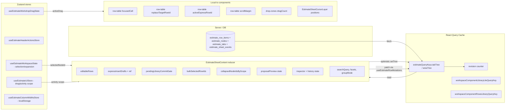
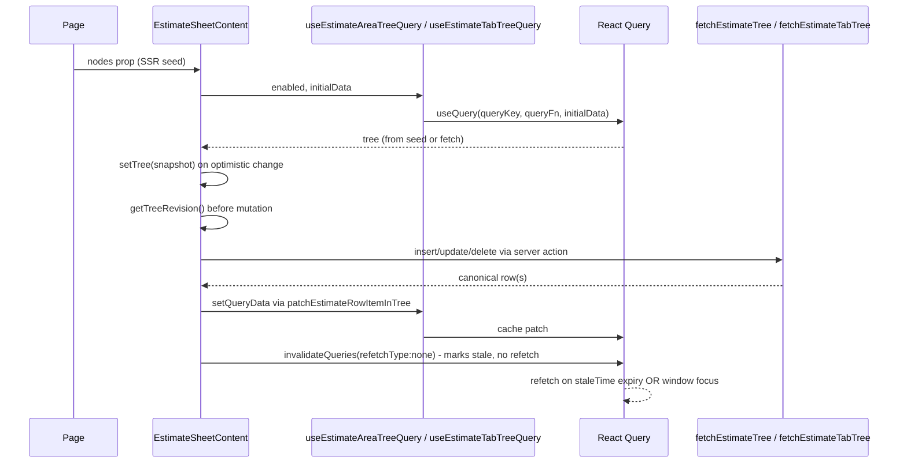
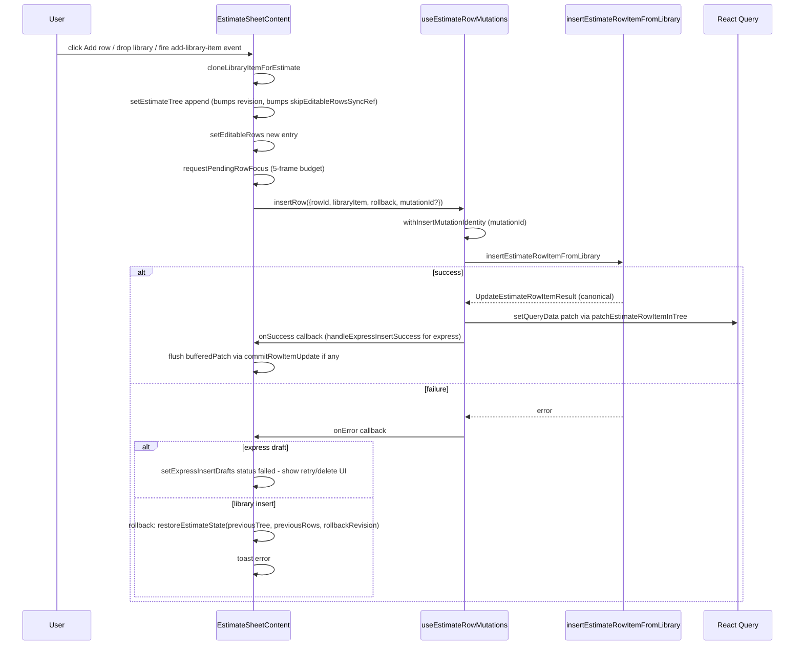
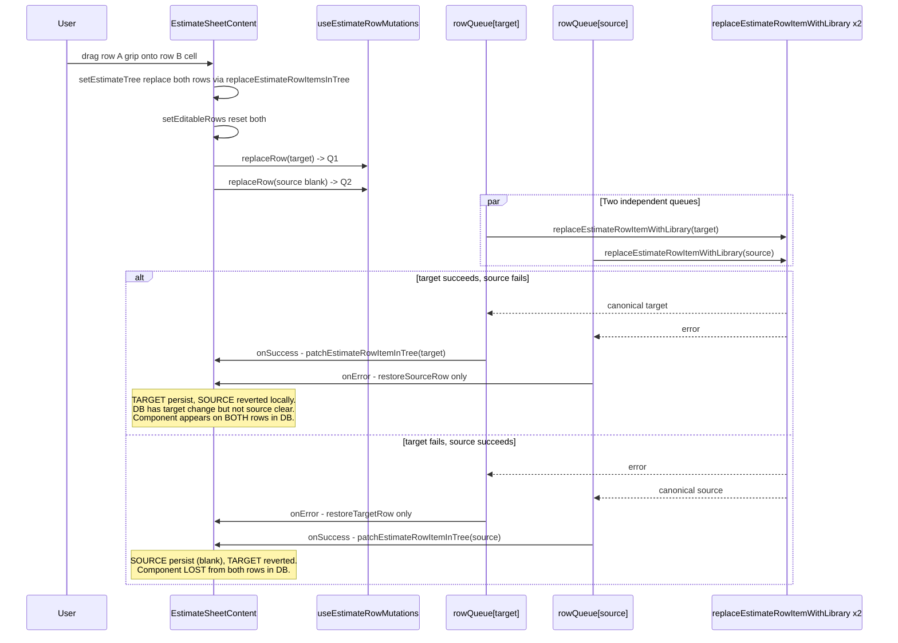

# 01 — Scope and System Map

## Branch / commit / status

- **Branch:** `main`
- **Commit:** `1166b16f6bda9a5ff0d01defd2f8fe922fc8ed79`
- **Working tree:** 7 unrelated modified files (landing/dashboard/projects page UI — none touching the audited surfaces); one untracked sibling audit dir `2026-06-24-Estimate-Sheet-Right-Sidebar-Analysis/`. Clean audit boundary.
- **Package manager:** `bun`
- **Scripts:** `bun run test` (tests/unit), `bun run test:dom` (tests/vitest), `bun run type-check`, `bun run lint`, `bun run build`, `bun run validate` (full gate), `bun run dev`.
- **Runtime availability:** App runnable locally via `bun run dev` once `supabase start` is up. **Not exercised in this audit.**
- **Authenticated session:** Not available. All persistence claims inferred from server-action source.

## Primary entry point

`src/components/workshop/EstimateSheetContent.tsx` (3,550 lines) — mounted by:
- `src/app/workshop/projects/[projectId]/estimates/[nodeId]/page.tsx` — production estimate page (RSC, async).
- Storybook and unit tests (via direct import).

## File inventory (center column + direct dependencies)

### Center orchestrator + render tree
| File | LOC | Purpose |
|------|-----|---------|
| `src/components/workshop/EstimateSheetContent.tsx` | 3,550 | Orchestrator: state, handlers, JSX. |
| `src/components/workshop/estimate-sheet/EstimateTabStrip.tsx` | 770 | Tab lifecycle UI (create/rename/duplicate/delete/reorder). |
| `src/components/workshop/estimate-sheet/rows/branch.tsx` | 488 | Recursive area renderer (one per node). |
| `src/components/workshop/estimate-sheet/rows/virtual-branch-list.tsx` | 165 | TanStack Virtual wrapper for branches. |
| `src/components/workshop/estimate-sheet/rows/row-table.tsx` | 781 | One per area — renders that area's rows. |
| `src/components/workshop/estimate-sheet/rows/cells.tsx` | 604 | Material cell + inline express editor + MoneyInput. |
| `src/components/workshop/estimate-sheet/rows/cells-model.ts` | 69 | canMakeProjectSpecific / canPromote / focus helpers. |
| `src/components/workshop/estimate-sheet/rows/drop-zones.tsx` | 177 | Dashed drop strips + quiet add-row button. |
| `src/components/workshop/estimate-sheet/rows/constants.ts` | 27 | MIME constants + estimate-component drag payload reader. |
| `src/components/workshop/estimate-sheet/rows/editable-row-model.ts` | 259 | EditableRowValue + tree math (totals, materialize, flatten). |
| `src/components/workshop/estimate-sheet/rows/expansion.ts` | 36 | Expansion context + collectAllNodeIds. |
| `src/components/workshop/estimate-sheet/rows/node-visuals-utils.ts` | 35 | groupGap, getNodeCode, name classes. |
| `src/components/workshop/estimate-sheet/rows/use-drag-edge-autoscroll.ts` | 122 | rAF auto-scroll loop during drag. |
| `src/components/workshop/estimate-sheet/rows/column-resize-handle.tsx` | 44 | Separator UI for column resizing. |
| `src/components/workshop/estimate-sheet/columns/use-estimate-column-resize-controller.ts` | 156 | Pointer + keyboard resize logic. |
| `src/components/workshop/estimate-sheet/activity-history.tsx` | (1233+) | Activity modal + RowDetails modal. |
| `src/components/workshop/estimate-sheet/activity-history-model.ts` | 157 | Activity scope + filter model. |
| `src/components/workshop/estimate-sheet/drag-types.ts` | 1 | ESTIMATE_TREE_DRAG_MIME_TYPE constant. |
| `src/components/workshop/estimate-sheet/events.ts` | 5 | REQUEST_ESTIMATE_TREE_NODE_CREATE_EVENT constant. |
| `src/components/workshop/ProposalExportPreviewDialog.tsx` | 523 | Modal: export scope, settings, download. |
| `src/components/workshop/EstimateHeaderActions.tsx` | 61 | Project chrome header buttons (Activity, Preview Excel). |
| `src/components/workshop/use-estimate-header-actions-store.ts` | 38 | Zustand bridge to chrome header. |
| `src/components/workshop/estimate-workshop-drag.ts` | 61 | Cross-panel drag state (Zustand). |
| `src/components/workshop/estimate-surface-class.ts` + `estimate-surface-variant.tsx` | — | Surface tone (paper/glass). |
| `src/components/workshop/estimate-tree-data.ts` | 416 | Sample estimate tree + sample library items. |
| `src/components/workshop/estimate-sheet-render-probe.ts` | 83 | Test-only render observability hooks. |

### Hooks (client)
| File | LOC | Purpose |
|------|-----|---------|
| `src/hooks/use-estimate-row-mutations.ts` | 562 | Per-mutation queues + optimistic cache patches + save state. |
| `src/hooks/use-estimate-query.ts` | 190 | Tree query hooks + tree-revision counter. |
| `src/hooks/use-estimate-workspace-state.ts` | 196 | Zustand store for selection + expansion per estimate/tab. |
| `src/hooks/use-stable-callback.ts` | 16 | useInsertionEffect-backed stable-callback wrapper. |
| `src/hooks/use-estimate-cursor-broadcast.ts` | 334 | Supabase Realtime cursor channel. |
| `src/hooks/use-media-query.ts` | — | Used by tab strip for prefers-reduced-motion. |

### Stores
| File | LOC | Purpose |
|------|-----|---------|
| `src/stores/estimate-ui-store.ts` | 51 | Drag state + activity scope + selected node id (note: legacy fields, some unused). |
| `src/stores/estimate-column-widths-store.ts` | 112 | Per-estimate + last-used column widths in localStorage. |

### Server actions / RPCs
| File | LOC | Purpose |
|------|-----|---------|
| `src/lib/estimates/actions.ts` | (1440+) | All estimate server actions (CRUD, tabs, history fetch, bulk delete sheets). |
| `src/lib/estimates/estimate-row-tree-patch.ts` | 133 | Pure tree-patching helpers used by mutation hook. |
| `src/lib/estimates/express-components.ts` | 240 | Express component metadata + classifier. |
| `src/lib/estimates/express-components-telemetry.ts` | 31 | Beta observability seam. |
| `src/lib/estimates/express-promotion-actions.ts` | — | `promoteEstimateRowToLibraryComponent`. |
| `src/lib/estimates/image-url.ts` | 16 | URL normalizer/sanitizer. |
| `src/lib/estimates/tree-hierarchy.ts` | 89 | Node-kind normalization + first-node selection. |
| `src/lib/estimates/types.ts` | 184 | Domain types. |
| `src/lib/estimates/tab-display.ts` | 17 | Tab name + sort helpers. |
| `src/lib/estimates/row-revision-conflict.ts` | — | Conflict-error class + code constant. |
| `src/lib/estimates/actions.ts` (continued) | — | Reorder, rename, delete nodes; create/rename/duplicate/delete tabs. |
| `src/lib/reusable-sources/actions.ts` | 451 | `insertProjectSourceIntoEstimate` + browse/search/outline actions. |
| `src/lib/reusable-sources/types.ts` | 87 | Project source types. |
| `src/lib/reusable-sources/source-collectors.ts` | 168 | Tree→source summarizer. |
| `src/lib/component-library/actions.ts` | (1255+) | Library CRUD + template CRUD + folder CRUD. |
| `src/lib/component-library/library-telemetry.ts` | 241 | Library telemetry with sanitization. |
| `src/lib/component-library/query-keys.ts` | 51 | Shared query keys for the library. |
| `src/lib/proposal-export/build-proposal-export-model.ts` | 492 | Pure model builder from tree + settings. |
| `src/lib/proposal-export/types.ts` | 208 | Proposal model types. |
| `src/lib/collaboration/colors.ts` | 83 | Cursor color palette + per-user hash. |
| `src/lib/estimates/load-limits.ts` | — | Tree load limit constants. |
| `src/lib/estimates/estimate-tree-edit.ts` | — | `planEstimateTreeDelete`, `renameEstimateTreeNode`. |
| `src/lib/estimates/estimate-tree-reorder.ts` | — | Tree reorder validators. |
| `src/lib/estimates/project-estimate-list-row.ts` | — | Project-level estimate list builder. |
| `src/lib/estimates/estimate-row-total.ts` | — | `sumEstimateRowLineTotals`. |
| `src/lib/domain/estimate-tree.ts` | — | Domain tree types. |
| `src/lib/domain/estimate-mutations.ts` | — | `moveEstimateRowItem` (NOT used by center sheet). |
| `src/lib/repositories/estimate-repository.ts` | — | Data-access layer. |
| `src/lib/repositories/workspace-repository.ts` | — | Workspace loaders. |
| `src/lib/repositories/component-library-repository.ts` | — | Library dataset loaders. |
| `src/lib/repositories/estimate-schema-compat.ts` | — | Legacy column-compat helpers. |
| `src/lib/supabase/server.ts` + `client.ts` | — | Supabase clients. |
| `src/lib/auth/session.ts` | — | `requireAuth`, `requireCurrentUserContext`. |
| `src/lib/ids.ts` | — | `isUuid`. |
| `src/lib/ui/cn.ts` | — | Tailwind classnames merge. |
| `src/lib/util/array.ts` | — | `filterMapBy`, `filterMap`. |

### Shared UI
| File | Purpose |
|------|---------|
| `src/components/ui/tree-panel-header.tsx` (285) | Sticky search/filter/group header. |
| `src/components/ui/bulk-action-toolbar.tsx` (208) | Bottom-dock bulk action toolbar. |
| `src/components/ui/tabs.tsx` (253) | Underline Tabs primitive. |
| `src/components/ui/control-input.tsx` + base + textarea | Labeled inputs. |
| `src/components/ui/dropdown-select.tsx` (474) | Select-semantics dropdown. |
| `src/components/ui/modal.tsx` + overlays/modal | AppModal / Modal. |
| `src/components/ui/toast.tsx` (225) | ToastProvider + useToast. |
| `src/components/ui/selection-checkbox.tsx` (72) | Mixed-state checkbox. |
| `src/components/ui/overlays/popover.tsx` (121) | FilterPopover etc. |
| `src/components/ui/button.tsx`, `skeleton.tsx`, etc. | Primitives. |

## Component hierarchy (Mermaid)

```mermaid
flowchart TD
  Page[app/workshop/projects/[projectId]/estimates/[nodeId]/page.tsx] --> ESC[EstimateSheetContent]
  ESC -->|renders| Header[EstimateSheetHeader]
  ESC -->|renders when estimateTabs| TabStrip[EstimateTabStrip]
  ESC -->|renders| Truncation[truncation warning]
  ESC -->|renders| TreeError[tree error UI]
  ESC -->|renders| Loading[loading skeleton]
  ESC -->|renders| Selected[Selected area branch]
  Selected --> PointerSurface[data-estimate-pointer-surface div]
  PointerSurface --> CursorLayer[EstimateSheetCursorLayer]
  PointerSurface --> ExpCtx[EstimateSheetExpansionContext.Provider]
  ExpCtx --> VBL[EstimateSheetVirtualBranchList]
  VBL -->|virtualized| Branch[EstimateSheetBranch per node]
  VBL -->|non-virtualized| Branch
  Branch --> RowTable[EstimateRowItemsTable per node]
  Branch --> DropTarget[ComponentDropTarget per node]
  Branch --> TemplateDropZone[TemplateDropZone when dragging]
  RowTable --> Row[EstimateRowItemTableRow per item]
  Row --> MaterialCell[EstimateMaterialCell]
  MaterialCell --> ExpressEditor[ExpressMaterialEditor when express/blank]
  MaterialCell --> Card[EstimateMaterialCardContent when library]
  Row --> MoneyInput[MoneyInput for misc cost]
  Row --> Selection[SelectionCheckbox]
  PointerSurface --> BulkBar[BulkActionToolbar bottom-dock]
  ESC -->|chrome bridge| HeaderActions[EstimateHeaderActions via Zustand store]
  ESC -->|conditional overlays| Palette[CommandPalette]
  ESC -->|conditional overlays| TrustModal[Library source-trust Modal]
  ESC -->|conditional overlays| ProposalDialog[ProposalExportPreviewDialog]
  ESC -->|conditional overlays| ActivityModal[ActivityHistoryModal]
  ESC -->|conditional overlays| RowDetails[RowDetailsModal]
  ESC -->|conditional overlays| ProjectSpecific[Make Project Component dialog]
  ESC -->|renders when renderSidebar| Sidebar[EstimateRightSidebar]
```

## State ownership (Mermaid)



## Sources of truth (Mermaid)

```mermaid
flowchart TD
  UserAction[User action] --> OptimisticUI[Optimistic UI patch]
  OptimisticUI -->|setEditableRows| EditableRows[editableRows reducer state]
  OptimisticUI -->|setEstimateTree via patch helpers| TreeCache[React Query tree cache]
  TreeCache --> RevCounter[Revision counter bumps]
  OptimisticUI --> ServerMutation[useEstimateRowMutations queue]
  ServerMutation --> ServerAction[Server action - src/lib/estimates/actions.ts]
  ServerAction --> RPC[Supabase RPC]
  RPC -->|canonical result| ServerAction
  ServerAction -->|history event| DB[(estimate_sheet_events)]
  RPC -->|canonical row(s)| ServerAction
  ServerAction -->|return| MutationHook[mutation.onSuccess]
  MutationHook -->|setQueryData patch| TreeCache
  MutationHook -->|check operation id / revision| Gate{newer op?}
  Gate -->|yes| Drop[drop response]
  Gate -->|no| Apply[apply canonical to cache]
  Apply -->|effect gated by skipEditableRowsSyncRef| EditableRows
```

## Tree-query lifecycle (Mermaid)



## Row create lifecycle (Mermaid)



## Move-component lifecycle (Mermaid — the ESC-P0-01 race)



## Tab switching and query-key scope (Mermaid)

```mermaid
flowchart LR
  User[User clicks tab B] --> OnChange[onActiveTabChange]
  OnChange --> Store[useEstimateWorkspaceState]
  Store --> ESC[EstimateSheetContent re-renders]
  ESC -->|reads dataTabId| TabHook[useEstimateTabTreeQuery tabId=B]
  TabHook --> RQ[React Query]
  RQ -->|cache hit estimate/ID/tab/B/area-tree| Tree[tree for B]
  RQ -->|cache miss| Server[fetchEstimateTabTree]
  Server --> RQ
  ESC -->|legacy (no tabs)| LegacyHook[useEstimateAreaTreeQuery]
  Note: Each tab has its OWN query key + revision counter. Mutations on tab A do NOT patch tab B cache.
```

## Query-key map

| Key shape | Source | Scope |
|-----------|--------|-------|
| `["estimate", estimateId]` | `estimateQueryKeys.detail` | Estimate metadata. |
| `["estimate", estimateId, "tabs"]` | `estimateQueryKeys.tabs` | Tabs list. |
| `["estimate", estimateId, "tab", tabId, "area-tree"]` | `estimateQueryKeys.tabTree` | One tab's tree. |
| `["estimate", estimateId, "area-tree"]` | `estimateQueryKeys.areaTree` | Legacy (no-tab) tree. |
| `["estimate", estimateId, "tab", tabId, "area-tree", "revision"]` | (composed in hook) | Tree revision counter (separate cache entry). |
| `["workspace-component-library", "workspace", workspaceId]` | `workspaceComponentLibraryQueryKey` | Full library dataset. |
| `["workspace-component-library", "workspace", workspaceId, "lite", "project", projectId]` | `workspaceComponentLibraryLiteQueryKey` | In-estimate panel library (slim). |
| `["workspace-component-rows-library", "workspace", workspaceId, "project", projectId]` | `workspaceComponentRowsLibraryQueryKey` | Project component projection. |
| `["workspace-estimate-templates", workspaceId, userId]` | `workspaceEstimateTemplatesQueryKey` | Templates. |

## Server-action map (selected; see 09 for full)

| Action | File:line | RPC | Authz | History |
|--------|-----------|-----|-------|---------|
| `fetchEstimateTree` | `actions.ts:1175-1180` | repository | `requireAuth` | none (read) |
| `fetchEstimateTabTree` | `actions.ts:1187-1192` | repository | `requireAuth` | none (read) |
| `insertEstimateRowItemFromLibrary` | (in actions.ts, post l.1440) | RPC | `assertCanEditEstimate` | row_added or row_blank_added |
| `updateEstimateRowItem` | same | RPC | `assertCanEditEstimate` | row_updated |
| `replaceEstimateRowItemWithLibrary` | same | RPC | `assertCanEditEstimate` + `assertCurrentLibrarySourceForEstimateCommit` | row_replaced |
| `deleteEstimateRowItem` | same | RPC | `assertCanEditEstimate` | row_deleted |
| `detachEstimateRowItemFromLibrary` | same | RPC | `assertCanEditEstimate` | row_updated (linkState) |
| `insertEstimateTemplateIntoEstimate` | same | RPC | `assertCanEditEstimate` | template_inserted (1/N) |
| `insertEstimateTemplatesIntoEstimate` | same | RPC | `assertCanEditEstimate` | template_inserted (one per template) |
| `insertEstimateTemplateNodeIntoEstimate` | same | RPC | `assertCanEditEstimate` | template_inserted |
| `reorderEstimateTreeNodes` | `actions.ts:1372+` | RPC | `assertCanEditEstimate` | tree_reordered |
| `renameEstimateNode` | same | direct update | `assertCanEditEstimate` | node_renamed |
| `deleteEstimateNode` | same | RPC | `assertCanEditEstimate` | node_deleted_with_children |
| `createEstimateTab` etc. | same | RPC | `assertCanEditEstimate` | tab_created etc. |
| `promoteEstimateRowToLibraryComponent` | `express-promotion-actions.ts` | RPC | `assertCanManageLibrary` + `assertCanEditEstimate` | row_updated + library events |
| `insertProjectSourceIntoEstimate` | `reusable-sources/actions.ts:382-451` | `insert_estimate_subtree_into_estimate_with_history` | `requireCurrentUserContext` + RLS (RLS-scoped client) | subtree events via RPC |

(Full per-action audit with authz + idempotency + transaction detail in `09-NETWORK-CACHE-AND-PERSISTENCE-AUDIT.md`.)

## MIME-type map

| MIME | Publisher | Reader(s) | Payload shape |
|------|-----------|-----------|---------------|
| `application/x-archestimator-library-item` | `LibraryTree` (component-library/tree/LibraryTree.tsx via `onItemDragStart`) | `ComponentDropTarget` (drop-zones.tsx:112-118 — **raw JSON.parse**), `EstimateRowItemsTable.handleDrop` (row-table.tsx:650-656 — **raw JSON.parse**), `EstimateMaterialCell.handleReplacementDrop` (cells.tsx:413-430 — **raw JSON.parse**) | `EstimateRowItem` JSON. |
| `application/x-archestimator-estimate-component` | `EstimateMaterialCell.handleComponentDragStart` (cells.tsx:432-436) | `readEstimateComponentDragPayload` (constants.ts:16-27 — try/catch + shape check) | `{ rowItemId: string, item: EstimateRowItem }`. |
| `application/x-archestimator-estimate-template` | `TemplatesTree.handleNodeDragStart` (component-library/tree/TemplatesTree.tsx:268-279) | `readEstimateTemplateDragPayload` (component-library/templates.ts:63-84 — try/catch + shape check) | `{ templateId? \| templateIds?: string[], templateNodeId? }`. |
| `application/x-archestimator-project-source` | Same TemplatesTree handler | `readProjectSourceDragPayload` (templates.ts:90-112 — try/catch + shape check) | `{ kind: 'project-tab' \| 'project-node', projectId, estimateId, tabId, nodeId? }`. |
| `application/x-archestimator-estimate-tree-item` | `EstimateSheetTree` (left tree) | `EstimateTabStrip.isEstimateTreeNodeDrag` (EstimateTabStrip.tsx:158-160) — only to **reject** cross-tab drops. | n/a (rejected). |

**Risk:** Library-item MIME is read with raw `JSON.parse` in three places (drop-zones.tsx:117, row-table.tsx:654, cells.tsx:429). A malformed payload throws inside the drop handler. The other MIMEs use guarded readers. This is **ESC-P2-09** and a probable P1 security finding (see 13-SECURITY).

## Event map (window CustomEvents)

| Event name | Publisher | Subscriber | Detail shape |
|------------|-----------|------------|--------------|
| `archestimator:add-library-item` | Right sidebar LibraryTree "+", command palette | `EstimateSheetContent` (l. 2682-2688) | `EstimateRowItem` — **raw, unvalidated**. |
| `archestimator:insert-estimate-template` | `EstimateSheetTree.treeExternalDrop.onDrop` (EstimateSheetTree.tsx:803-817) | `EstimateSheetContent` (l. 2695-2709) | `{ targetParentNodeId, templateIds? \| templateId+templateNodeId }` — partially validated. |
| `archestimator:insert-project-source` | Same EstimateSheetTree handler | `EstimateSheetContent` (l. 2713-2722) | `{ targetParentNodeId, source: { projectId, estimateId, tabId, nodeId } }` — validated by server. |
| `archestimator:request-estimate-tree-node-create` | Estimate header "Add Area" | `EstimateSheetTree` (l. 949-961) | `{ kind: 'group' \| 'area' }`. |
| `archestimator:create-template-from-node` | Estimate tree context menu | Right sidebar (not audited here) | `{ sourceNodeId }`. |

## Virtualization flags

`src/lib/workshop/virtualization-flags.ts` — `WORKSHOP_VIRTUALIZATION_FLAGS` exposes:
- `estimateRowVirtualization`: `{ enabled: true, minRows: 75, estimateRowHeight: 96, overscan: 6, ... }`
- `estimateMasterColumnVirtualization`: `{ enabled: true, minSections: 80, estimateSectionHeight: 192, overscan: 5, ... }`
- `estimateColumnResize`: boolean — gates column-resize feature.

## Open items deferred to other artifacts

- Per-operation detail → `04-ROW-CRUD-AUDIT.md`.
- Drag/drop source×target matrix → `05-DRAG-DROP-AND-INSERTION-AUDIT.md`.
- Test inventory → `14-EDGE-CASE-AND-TEST-MATRIX.md`.
