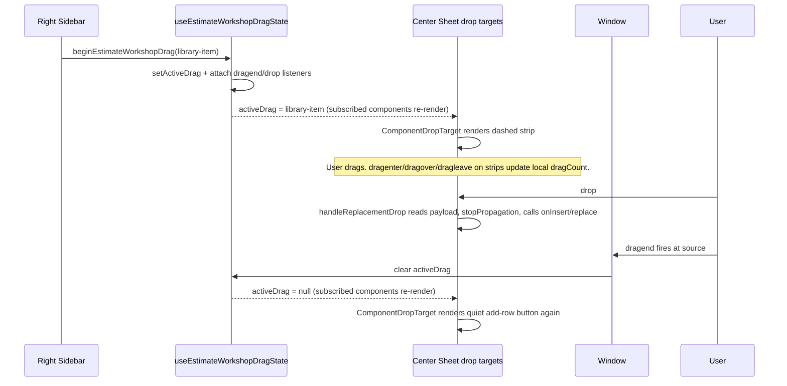

# 05 — Drag-and-Drop and Insertion Audit

## Source × target matrix

### Sources (where drags originate)

| Source | MIME | Publisher | Payload |
|--------|------|-----------|---------|
| Library component (right sidebar) | `application/x-archestimator-library-item` | `LibraryTree.handleNodeDragStart` (LibraryTree.tsx:492-499) → `onItemDragStart(event, item)` (sets MIME via `event.dataTransfer.setData`) | `EstimateRowItem` JSON |
| Estimate component (in-sheet grip) | `application/x-archestimator-estimate-component` | `EstimateMaterialCell.handleComponentDragStart` (cells.tsx:432-436) | `{ rowItemId, item }` JSON |
| Estimate template (single/category/node) | `application/x-archestimator-estimate-template` | `TemplatesTree.handleNodeDragStart` (TemplatesTree.tsx:268-279) → `onTemplateDragStart` / `onCategoryDragStart` / `onTemplateNodeDragStart` | `{ templateId \| templateIds, templateNodeId? }` JSON |
| Project source (tab/node) | `application/x-archestimator-project-source` | Same TemplatesTree handler → `onProjectSourceDragStart` | `{ kind, projectId, estimateId, tabId, nodeId? }` JSON |
| Estimate tree node (left sidebar) | `application/x-archestimator-estimate-tree-item` | `EstimateSheetTree` Tree | (used only to REJECT cross-tab drops in EstimateTabStrip) |

### Targets (where drops land in center column)

| Target | Component | Library item | Estimate component | Template | Project source |
|--------|-----------|--------------|--------------------|----------|----------------|
| Area add-strip (when expanded) | APPEND ROW | `ComponentDropTarget` (drop-zones.tsx:71-127) ✓ raw JSON.parse | — | — | — |
| Area drop strip (when collapsed) | APPEND ROW | `ComponentDropTarget` (branch.tsx:349-357 — collapsed state) ✓ | — | — | — |
| Row-table root | APPEND ROW | `EstimateRowItemsTable.handleDrop` (row-table.tsx:650-656) ✓ raw JSON.parse | — | — | — |
| Material cell (specific row) | REPLACE ROW | `EstimateMaterialCell.handleReplacementDrop` (cells.tsx:413-430) ✓ raw JSON.parse | MOVE (replace target + clear source) | — | — |
| Area section (branch) | — | — | — | `EstimateSheetBranch.handleTemplateDrop` (branch.tsx:259-267) ✓ `readEstimateTemplateDragPayload` | — |
| Template drop zone (in-area, when template drag active) | — | — | — | `TemplateDropZone` (drop-zones.tsx:136-177) ✓ `readEstimateTemplateDragPayload` | — |
| Estimate tab strip | — | — | REJECT (cross-tab move unsupported, toast) | SPRING-LOAD (change active tab) | SPRING-LOAD |

### Left tree → center sheet bridge

The EstimateSheetTree (left sidebar) catches `application/x-archestimator-estimate-template` and `application/x-archestimator-project-source` drops on tree rows (EstimateSheetTree.tsx:792-835), reads them with the guarded readers, and dispatches a window CustomEvent (`INSERT_ESTIMATE_TEMPLATE_EVENT` / `INSERT_PROJECT_SOURCE_EVENT`) for the center sheet to handle. This is because the center sheet owns the optimistic insert + rollback flow.

## MIME contracts and payload validation

| MIME | Reader | Validation | Throw on malformed? |
|------|--------|-----------|---------------------|
| `application/x-archestimator-library-item` | **NONE — three raw `JSON.parse` call sites** | NONE | **YES — throws inside drop handler** (ESC-P2-09, ESC-P3 security) |
| `application/x-archestimator-estimate-component` | `readEstimateComponentDragPayload` (constants.ts:16-27) | try/catch + shape check (`rowItemId: string, item: object`) | NO — returns null |
| `application/x-archestimator-estimate-template` | `readEstimateTemplateDragPayload` (templates.ts:63-84) | try/catch + discriminated shape | NO — returns null |
| `application/x-archestimator-project-source` | `readProjectSourceDragPayload` (templates.ts:90-112) | try/catch + shape check | NO — returns null |

**Recommendation:** Introduce `readLibraryItemDragPayload(rawString)` with try/catch + shape check (must have `material: string, source: string, itemCost: number, quantity: number` minimum), shared across the three call sites. Replace the raw `JSON.parse` calls in drop-zones.tsx, row-table.tsx, cells.tsx.

## Drop-zone reveal and active-drag store

`useEstimateWorkshopDragState` (estimate-workshop-drag.ts:32-44) is a Zustand store.

- `beginEstimateWorkshopDrag(drag)` (l. 51-61) sets `activeDrag` and attaches window `dragend` + `drop` listeners that clear it.
- `endEstimateWorkshopDrag()` clears if non-null.
- `useEstimateWorkshopDrag()` (l. 37-39) subscribes a component; returns the active drag or null.

Center-sheet drop zones render conditionally on `activeDrag?.kind === 'library-item'` (drop-zones.tsx:86, branch.tsx:206-207). When no drag is in flight, only the quiet "Add row" button shows (drop-zones.tsx:93-99).

## dragCount logic

Each `ComponentDropTarget` and `TemplateDropZone` maintains its own `dragCount` state incremented on `dragenter` and decremented on `dragleave`. When `dragCount > 0`, the strip is highlighted.

**ESC-P2-10:** Render-time correction exists (drop-zones.tsx:91 `if (!componentDragActive && dragCount !== 0) setDragCount(0);`) but does not cover all stale-highlight paths (e.g. window blur during drag).

**Recommended fix:** Use `event.relatedTarget` containment check like `useDragEdgeAutoScroll.handleDragLeave` (use-drag-edge-autoscroll.ts:84-102) does.

## Event propagation (drop handler ordering)

DOM bubble order for a drop on a material cell:

1. `EstimateMaterialCell.handleReplacementDrop` (cells.tsx:413-430) — innermost.
2. `EstimateRowItemsTable.handleDrop` (row-table.tsx:650-656) — on `
` parent.
3. `EstimateSheetBranch.handleTemplateDrop` (branch.tsx:259-267) — on `<section>` grand-parent.
4. `EstimateSheetContent` (no drop handler at the surface).

`handleReplacementDrop` calls `event.stopPropagation()` only inside handled branches (cells.tsx:417 for moved-component, l. 427 for library-item). If neither branch matches, the event bubbles up and `handleDrop` on the row-table root fires → **double-handle risk** (ESC-P2-09).

**Recommendation:** Always call `event.stopPropagation()` at the TOP of `handleReplacementDrop` regardless of payload match.

## Drag-edge auto-scroll

`useDragEdgeAutoScroll` (use-drag-edge-autoscroll.ts:47-122):

- Listens to `dragover` on the `[data-estimate-pointer-surface]` element (l. 104).
- `computeEdgeScrollSpeed` (l. 16-33): 72px edge zone, 18px/frame max speed, linear ramp.
- rAF loop (l. 117-119) carries scroll between intermittent dragover events.
- Stops on: `dragleave` (with `relatedTarget` containment check, l. 84-102), `dragend` (document, l. 109), `drop` (document, l. 110), `window.blur` (l. 111).

**Status:** VERIFIED WORKING. Cleanup is comprehensive.

## Tab spring-loading

`EstimateTabStrip.scheduleSpringLoadedTabTarget` (EstimateTabStrip.tsx:376-410):
- Only fires for `ESTIMATE_TEMPLATE_DRAG_MIME_TYPE` and `PROJECT_SOURCE_DRAG_MIME_TYPE` payloads.
- 450ms hover delay (SPRING_LOADED_TAB_DELAY_MS l. 149) before switching to the hovered tab.
- `clearSpringLoadedTabTarget` on dragleave, drop, dragend, component unmount.
- Cross-tab tree-node moves are **explicitly rejected** with a toast (l. 412-424: "Moving between tabs isn't supported yet").

**Status:** VERIFIED WORKING. Tested in `estimate-tab-strip.test.tsx:245-269, 271-286`.

## Non-pointer alternatives (accessibility)

| Operation | Drag/Drop path | Keyboard/click equivalent |
|-----------|----------------|---------------------------|
| Insert library component | Drag from sidebar | "+" on library row, double-click, command palette (Ctrl+K) |
| Replace row component | Drag onto material cell | **NONE** (Open Question #14) |
| Move component between rows | Drag from grip handle | **NONE** (Open Question #14) |
| Insert template | Drag from sidebar | Right-click → "Add to {area}" context menu, or click in sidebar |
| Insert template node | Drag from sidebar | Right-click → "Add to {area}" context menu |
| Insert project source | Drag from sidebar | Right-click → "Add to estimate" context menu |
| Reorder tabs | Drag (not in center) | Cmd/Ctrl+Shift+Arrow (EstimateTabStrip.tsx:650-661) |

**Gaps:** Replace and Move have NO keyboard equivalent. This is an accessibility barrier (ESC-P2-15 adjacent, and explicitly called out in spec hypothesis H31).

## Cross-panel drag state lifecycle

**Edge case — cancelled drag without dragend:** Per HTML5 spec, Esc-cancelled drags DO fire dragend. Window blur during drag may not. The store cleanup depends on dragend/drop firing. **Mitigation:** `dragCount` render-time correction (drop-zones.tsx:91) catches the common case where activeDrag cleared but local count stuck.

## Findings surfaced here

- **ESC-P2-09** — material-cell drop stopPropagation fragile.
- **ESC-P2-10** — dragCount underflow on cancelled drags.
- **ESC-P1-05 adjacent** — sidebar callback returns `true` before trust-gate confirmation.
- **Accessibility gap** — replace/move have no keyboard equivalent (informs Open Question #14).
- **Probable security finding** — raw `JSON.parse` on library-item MIME (3 call sites). See `13-SECURITY-AND-DATA-INTEGRITY-AUDIT.md`.
