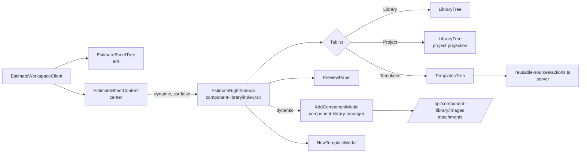
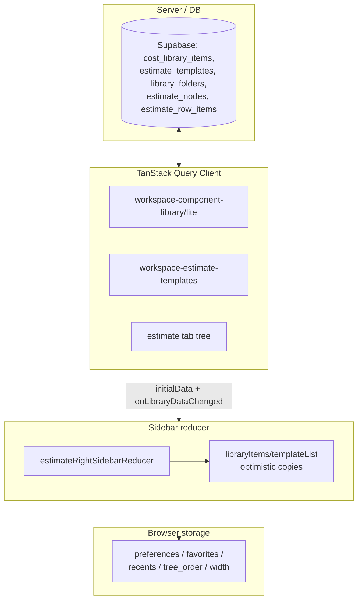

# 01 — Scope and Code Map

## Audit window

| Item | Value |
| --- | --- |
| Branch | `main` |
| HEAD commit | `9daa70d4f1ddfd2500bc28357cb8e6a07839d194` |
| Working tree | Dirty — **unrelated** files only: `src/components/workshop/dashboard/LibraryHubCard.tsx`, `src/components/workshop/projects-page-client.tsx`, `src/lib/repositories/workspace-repository.ts`, `tests/vitest/project-dashboard-core-ui.test.ts`, `tests/vitest/project-details-modal.test.tsx`. None are right-sidebar files; the audit does not touch them. |
| Package manager | **Bun** (scripts invoke `bun run …`) |
| Scripts | `dev` = `next dev`; `validate` = type-check + lint + lint:design-system + lint:design + test + test:dom; `build` = `next build`; `test` = `bun test tests/unit` |
| App runnable locally | Yes (`bun run dev`). Runtime authenticated verification of insert/drag flows is **not** performed this pass (read-only static + code-graph evidence only); flagged in [19-VALIDATION-PLAN.md](./19-VALIDATION-PLAN.md). |
| Authenticated runtime verification | **Not exercised** this pass. Environmental limitation: requires a logged-in Supabase session against project `ebxxqidacheyapmmzavr`. Static evidence (server-action auth guards, RLS, RPC `is_workspace_editor`/`can_edit_estimate` checks) is cited instead. |

## Feature boundary

The **Estimate Sheet Right Sidebar** is the right-hand panel of the three-pane Estimate Workshop (`EstimateWorkspaceClient` → `EstimateSheetTree` | `EstimateSheetContent` | `EstimateRightSidebar`). It mounts three top-level tabs and a progressive reusable-source browser:

```
Library  (components)   →  Project  (projection)   →  Templates  (custom + reusable project sources)
```

The sidebar is **dynamically imported** by `EstimateSheetContent` (`next/dynamic`, `ssr: false`) with a `ComponentLibrarySidebarFallback` placeholder, and its heavy library dataset is loaded **lazily** via the `loadProjectComponentLibraryLite` server action (U4/U18). The fallback reserves panel width so the center sheet stays usable while the chunk + data load.

## Primary entry points (verified file paths)

### Orchestrator + integration
- `src/components/workshop/component-library/index.tsx` — `EstimateRightSidebar` orchestrator. ~2,000+ lines; the giant reducer component (see react-doctor disable comment at line 934). **Single reducer** (`estimateRightSidebarReducer`) drives every field via `fieldChanged` actions.
- `src/components/workshop/EstimateSheetContent.tsx` — mounts the sidebar (dynamic import, line ~59), owns center-sheet insertion handlers, library-lite React Query cache, and the lazy-load gating.
- `src/components/workshop/EstimateWorkspaceClient.tsx` — three-pane shell; passes `libraryItems`/`libraryTemplates`/`libraryFolders`/etc. as server-provided props when available, else triggers lazy load.
- `src/components/workshop/EstimateSheetTree.tsx` — left tree; receives template/project-source drops via `INSERT_ESTIMATE_TEMPLATE_EVENT` / `INSERT_PROJECT_SOURCE_EVENT` window events and dispatches `CREATE_ESTIMATE_TEMPLATE_FROM_NODE_EVENT` for "Save as template".

### Tree implementations
- `src/components/workshop/component-library/tree/LibraryTree.tsx` — `LibraryTree` (component rows + folders, same-parent reorder, context menu, inline folder rename input).
- `src/components/workshop/component-library/tree/TemplatesTree.tsx` — `TemplatesTree` (templates + reusable project sources, skeleton injection).
- `src/components/workshop/component-library/tree/TemplatesTreeModel.ts` — pure tree builders, selection dedupe (`getCheckedTemplateUnits`, `getCheckedProjectSourceTargets`), skeleton injection, project-source query filter.
- `src/components/workshop/component-library/tree/buildLibraryTree.ts` — `buildLibraryTreeWithComponentRows`, `buildProjectComponentTree`, `splitSidebarComponentItems`, supplier/brand/custom tree builders.
- `src/components/workshop/component-library/tree/helpers.ts` — `applyLibraryTreeOrder`, `findLibrarySiblingOrder`, `filterTree`, `getAllNodeIds`.
- `src/components/workshop/component-library/tree/types.ts` — `LibraryTreeNode`, `LibraryTreeProps`.

### Sidebar subsurfaces
- `src/components/workshop/component-library/PreviewPanel.tsx` — component preview (image, price, trust chips, insert quantity, edit/duplicate/favorite/delete).
- `src/components/workshop/component-library/NewTemplateModal.tsx` — `createEstimateTemplate`/`FromEstimateNode`/`FromEstimateTab` flows.
- `src/components/workshop/component-library/NewComponentForm.tsx` — **legacy** lightweight create form (still wired for the non-modal `showNewComponent` path).
- `src/components/workshop/component-library/CommandPalette.tsx` — `Cmd+K`-style component search/insert.
- `src/components/workshop/component-library/templates.ts` — drag MIME types, window-event contracts, payload readers (`readEstimateTemplateDragPayload`, `readProjectSourceDragPayload`).
- `src/components/workshop/component-library/helpers.ts` — `createComponent` (client-side, local-only!), `searchComponents`, peso formatter, storage keys, staleness tone.
- `src/components/workshop/component-library/types.ts` — `LibraryPanelTab`, `NewComponentForm`, facet types.

### Shared component-library surfaces
- `src/components/workshop/component-library-manager/AddComponentModal.tsx` — the **canonical persisted** create-component modal (RPC `create_cost_library_component`), shared with the Components page. Dynamically imported by the sidebar.
- `src/components/workshop/component-library-manager/LibraryFolderTree.tsx` — `LibraryFolderTree` + `LibraryFolderTreeSurface` + `ComponentViewControls` + `LibraryFolderTreePicker`.
- `src/components/workshop/component-library-manager/library-folder-tree-shared.ts` — `COMPONENT_VIEW_MODES`, `ALL_COMPONENTS_FOLDER_ID`, `ComponentViewMode`, `CreateLibraryFolderHandler`, `ReorderStatus`.

### Facet + trust surfaces
- `src/components/workshop/library/component-facet-filter.tsx` — `ComponentFacetFilterPopover`, applied-chips strip.
- `src/components/workshop/library/component-facet-filter-model.ts` — `componentMatchesFacets`, `buildComponentFacetOptions`, deep-link search-param parser.
- `src/components/workshop/library/source-trust-chips.tsx` — `SourceTrustChips`.
- `src/components/workshop/library/source-trust-model.ts` — `getComponentSourceTrustChips`, `getLibraryCommitTrustGate` (insert/replace commit gate), `getTemplateDependencyHealth`, `getTemplateSourceTrustChips`.

### Sidebar shell + shared UI
- `src/components/workshop/ResizableSidePanel.tsx` — `ResizableSidePanel` (mouse + keyboard resize, collapse, cookie + localStorage width persistence, CSS-variable sync).
- `src/components/workshop/side-panel-widths.ts` — `SIDE_PANEL_WIDTH_CONFIGS` (incl. `estimate_component_library_width_v2` at 360–560px).
- `src/components/ui/tree.tsx` — in-house virtualized `Tree` (roving tabindex, ARIA tree roles, drag/drop, external drop, root edge zones).
- `src/components/ui/tree-panel-header.tsx` — sticky header with search disclosure, tabs, filter slot.
- `src/components/ui/bulk-action-toolbar.tsx` — floating dock + inline bulk toolbar.
- `src/components/ui/action-menu.tsx` + `context-menu.tsx` — Radix context menu wrappers.
- `src/components/ui/modal.tsx` → re-exports `overlays/modal`.
- `src/components/ui/toast.tsx` — `ToastProvider`, `useToast`.
- `src/components/ui/toolbar-icon-button.tsx` — `ADD_BUTTON_CLASSNAME` (orange add affordance).
- `src/components/ui/dropdown-select.tsx` — combobox-style select.
- `src/components/ui/control-input.tsx` — `ControlField`, `ControlInput`, `ControlTextarea`.

### State, queries, workspace integration
- `src/hooks/use-estimate-workspace-state.ts` — Zustand store: selected/expanded node ids per estimate and per tab, active tab.
- `src/hooks/use-estimate-query.ts` — `useEstimateAreaTreeQuery`, `useEstimateTabTreeQuery`, `useEstimateTabsQuery` (TanStack; revision-counter optimistic update helpers).
- `src/hooks/use-stable-callback.ts` — `useStableCallback` (insertion-effect-stable ref wrapper).
- `src/stores/estimate-ui-store.ts` — `useEstimateUiStore` (drag intent, focused cell, etc.).
- `src/lib/component-library/query-keys.ts` — `workspaceComponentLibraryQueryKey`, `…LiteQueryKey`, `…RowsLibraryQueryKey`, `workspaceEstimateTemplatesQueryKey` (workspace + user scoped).
- `src/lib/workshop/virtualization-flags.ts` — `WORKSHOP_TREE_VIRTUALIZATION` (env-gated; default on, min 150 rows).

### Server actions, repositories, transforms
- `src/lib/component-library/actions.ts` — `"use server"`; `createCostLibraryComponent`, `updateCostLibraryComponent`, `createLibraryFolder`, `renameLibraryFolder`, `deleteLibraryFolder`, `reorderLibraryFolders`, `moveCostLibraryComponentToFolder`, `createEstimateTemplateFromEstimateNode`, `…FromEstimateTab`, `renameEstimateTemplate`, `deleteEstimateTemplate`, `loadCurrentWorkspaceComponentLibrary(Lite)`, `loadProjectComponentLibraryLite`, bulk archive preview/execute. All gated by `assertCanManageLibrary` / `assertCanManageLibraryFolders` (RPC `is_workspace_editor`) and quota caps (`LIBRARY_COMPONENT_CAP = 10_000`, `LIBRARY_TEMPLATE_CAP = 2_000`).
- `src/lib/component-library/library-folder-reorder.ts` — `buildLibraryFolderReorderPlan`, `planLibraryFolderDelete`, `getUserLibraryFolders`.
- `src/lib/component-library/project-component-projection.ts` — `getProjectComponentRowsLibrary` (projects estimate rows into a virtual `project-components-<projectId>` folder hierarchy).
- `src/lib/component-library/estimate-templates.ts` — `EstimateTemplate` type, seed `estimateTemplates`, `summarizeEstimateTemplate`, `buildEstimateTemplatesFromRows`.
- `src/lib/component-library/taxonomy.ts` — `componentCategoryTree`, `buildComponentCategoryTreeFromRows`, `findComponentCategoryPath`.
- `src/lib/component-library/library-telemetry.ts` — `recordLibraryEvent` with sanitizing allow-list (strips URLs, paths, file names, free-text).
- `src/lib/reusable-sources/actions.ts` — `listReusableProjectSources`, `listReusableProjectEstimateSources`, `getReusableEstimateOutline`, `searchReusableProjectSources`, `insertProjectSourceIntoEstimate`. Search uses bounded ILIKE pre-filter + materialization caps. Insert uses deterministic `correlation_id` (SHA-256-derived UUID) + `insert_estimate_subtree_into_estimate_with_history` RPC.
- `src/lib/reusable-sources/types.ts` — `ReusableEstimateSource` discriminated union.
- `src/lib/reusable-sources/source-collectors.ts` — `collectProjectNodeSources`, `collectProjectNodeSearchSources`, `summarizeEstimateTreeNodes`.
- `src/lib/reusable-sources/display.ts` — `getProjectReusableSourceDisplayName`, `getProjectTabReusableSourceDisplayName`.
- `src/lib/repositories/component-library-repository.ts` — `getCurrentWorkspaceComponentLibrary(Rows)`, `buildEstimateTemplatesFromRows`, `getLibraryOverview`; the lite loader skips the unbounded audit-graph tables when `includeDetailGraph: false`.
- `src/lib/repositories/workspace-repository.ts` — `ensureDefaultWorkspace` (memoized via `cache()`), `listCurrentWorkspaceProjects`, `getEstimateTabs`, `getEstimateTabTree`, `getProjectEstimateTreeByEstimate`.
- `src/lib/estimates/actions.ts` — `"use server"`; estimate tree CRUD, tab CRUD, row mutations, template insertion (`insertEstimateTemplateIntoEstimate`, `…NodeIntoEstimate`, `…sIntoEstimate`), `reorderEstimateTreeNodes`, bulk delete. `assertCanEditEstimate` / `assertCanEditProject` RPC guards.
- `src/lib/estimates/express-components.ts` — express-component metadata + `readProjectComponentProjectionMetadata` (the marker that splits library vs projection items).
- `src/lib/estimates/image-url.ts` — `normalizeEstimateRowImageUrl`, `sanitizeEstimateRowSourceSnapshot`.

### Upload + storage routes
- Background agent `bg_3dfbe50b` is inspecting `src/app/api/component-library/images` and `…/attachments`. Findings will be merged into [15-SECURITY-AND-INTEGRITY-AUDIT.md](./15-SECURITY-AND-INTEGRITY-AUDIT.md) on completion.

### Tests located
- `tests/vitest/component-library-ui.test.tsx` — the largest behavior suite; covers tab contract (`["Library","Project","Templates"]`), folder create/rename inline, bulk add/delete + undo, slash shortcut, sanitized source URLs, thumbnails, project-tab template save.
- `tests/vitest/estimate-sheet-library-lazy-load.test.tsx` — U4 lazy-load contract (skeletons, cache reuse on remount, retry on failure, no-fetch when server-provided, `onLibraryDataChanged` invalidation call-site count ≥ 8).

> Additional tests (browser/e2e/a11y) covering sidebar behavior are enumerated in [16-EDGE-CASE-AND-TEST-MATRIX.md](./16-EDGE-CASE-AND-TEST-MATRIX.md).

## Query-key map

| Key | Scope | Owner |
| --- | --- | --- |
| `["workspace-component-library", "workspace", workspaceId]` | Full library dataset (with detail graph) | Library manager surfaces |
| `[…, "lite", "project", projectId]` | Slim library dataset for the in-estimate panel | Sidebar (U18/U19) |
| `["workspace-component-rows-library", "workspace", workspaceId, "project", projectId?]` | Components management tab shape (rows + tree + suppliers + brands + folders, **no** templates) | ComponentLibraryManager |
| `["workspace-estimate-templates", workspaceId, userId]` | Estimate templates (tenant + principal scoped) | Templates browse + sidebar |
| `["estimate", estimateId, "tabs"]` | Estimate tabs list | `useEstimateTabsQuery` |
| `["estimate", estimateId, "tab", tabId, "area-tree"]` | Tab-scoped estimate tree | `useEstimateTabTreeQuery` |
| `["estimate", estimateId, "area-tree"]` | Legacy whole-estimate tree | `useEstimateAreaTreeQuery` |

## Storage-key map (browser-local)

| Key | Purpose | File |
| --- | --- | --- |
| `archestimator_component_library_preferences_v1` | activeTab, componentViewMode (NOT search/facets/preview) | `helpers.ts` `LIBRARY_PREFS_KEY` |
| `archestimator_component_library_favorites_v1` | Favorites (device-local) | `LIBRARY_FAVORITES_KEY` |
| `archestimator_component_library_recents_v1` | Recents (device-local, written on insert) | `LIBRARY_RECENTS_KEY` |
| `archestimator_component_library_tree_order_v1` | Custom sibling order per parent (device-local) | `LIBRARY_TREE_ORDER_KEY` |
| `estimate_component_library_width_v2` | Right panel width (localStorage + cookie `archestimator_panel_width_estimate_component_library_width_v2`) | `side-panel-widths.ts` |

## Event + MIME map

| Channel | Direction | Payload |
| --- | --- | --- |
| `archestimator:add-library-item` (CustomEvent) | sidebar → sheet | legacy library-item insert (fallback when `onInsertComponent` not wired) |
| `archestimator:insert-estimate-template` | left tree / sidebar → sheet | `{targetParentNodeId, templateIds? \| templateId+templateNodeId}` |
| `archestimator:insert-project-source` | sidebar → sheet | `{targetParentNodeId, source:{projectId,estimateId,tabId,nodeId?}}` |
| `archestimator:create-template-from-node` | left tree → sidebar | `{sourceNodeId}` |
| `application/x-archestimator-estimate-template` (drag MIME) | sidebar → drop targets | `{templateId? \| templateIds?, templateNodeId?}` |
| `application/x-archestimator-project-source` (drag MIME) | sidebar → drop targets | `{kind, projectId, estimateId, tabId, nodeId?}` |

## Mermaid — component hierarchy



## Mermaid — state ownership


