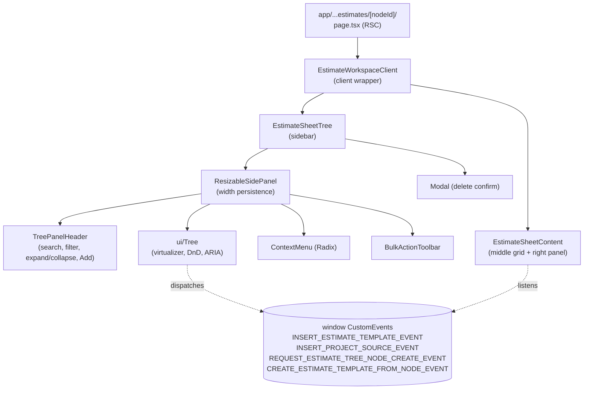
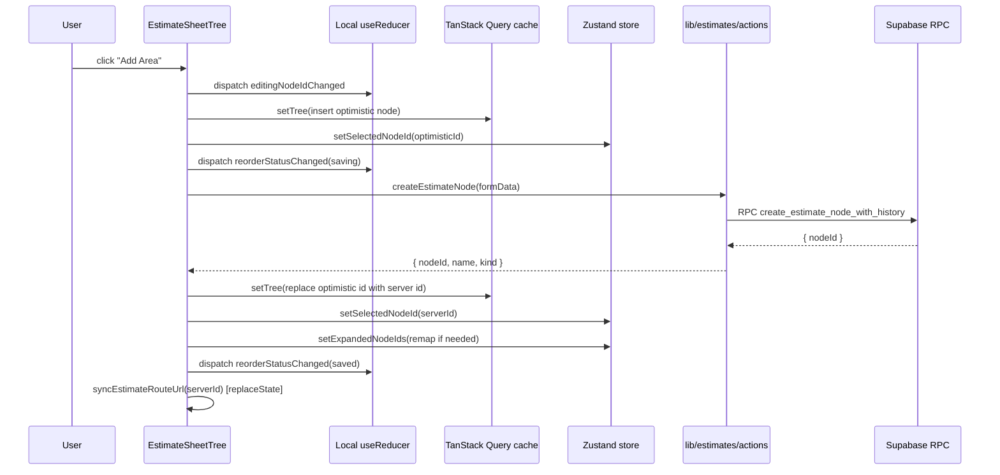

# 01 — System Map: Estimate Sheet Tree Sidebar

> Evidence-based. All file:line references verified by static read on 2026-06-24. Runtime behavior claims are flagged `STATIC` (read from source) or `INFERENCE` (concluded from surrounding code).

## 1. Primary Entry Point

- **File**: src/components/workshop/EstimateSheetTree.tsx — 1727 lines
- **Export**: `EstimateSheetTree` (line 372)
- **Role**: Renders the left sidebar of the Estimate Sheet page; owns local tree state, optimistic mutation lifecycle, rename inline editor, delete/bulk-delete modals, drag-and-drop for both intra-tree reorder and external inserts (templates + project sources).

## 2. Render Sites

`grep -rln "EstimateSheetTree\b"` returned **2 production render sites**:

| File | Props passed | Notes |
|---|---|---|
| src/components/workshop/EstimateWorkspaceClient.tsx:130 | `projectId, estimateId, activeTabId={resolvedActiveTabId}, initialTabId={activeTabId ?? undefined}, projectName, selectedNodeId={routeSelectedNodeId}, nodes, disableRouteSync` | Primary production parent |
| src/components/share/ShareEstimateTreePanel.tsx | (share-viewer variant) | Public share surface — read-only context |

Also referenced from src/components/workshop/estimate-sheet/EstimateTabStrip.tsx for event contract coordination.

## 3. Parent Data Flow (EstimateWorkspaceClient)

File: src/components/workshop/EstimateWorkspaceClient.tsx lines 63-176.

- `nodes: EstimateTreeNode[]` — server-fetched upstream (see §4), passed as prop.
- `selectedNodeId` — comes from URL param at the Next.js route segment, passed as prop.
- `activeTabId` / `initialTabId` — server-supplied; client falls back to default tab via `useEstimateTabsQuery` + `useEstimateActiveTab` (lines 91-110).
- `routeSelectedNodeId = resolvedActiveTabId === activeTabId ? selectedNodeId : null` (line 111) — **the URL's selectedNodeId is discarded when the user has client-switched tabs.** Selection then relies on the Zustand store only.
- `disableRouteSync` — true on public share surface, false on authenticated workshop.

## 4. SSR Origin

File: src/app/workshop/projects/[projectId]/estimates/[nodeId]/page.tsx:141 renders `<EstimateWorkspaceClient>` inside a React server component. The server fetches the estimate tree before render and seeds `nodes` (and `estimateTabs`) as initial server data. **Client-side TanStack Query uses `initialData: initialNodes` + `refetchOnMount: false`** (use-estimate-query.ts:44-49) so there is **no double-fetch on first paint** (VERIFIED WORKING).

## 5. Component Hierarchy Diagram

## 6. Data + State Ownership

| State | Owner | Location | Lifetime |
|---|---|---|---|
| Tree nodes (cache) | TanStack Query | `["estimate", estimateId, "area-tree"]` or `["estimate", estimateId, "tab", tabId, "area-tree"]` (use-estimate-query.ts:10-16) | Per-estimate, in-memory, 5min staleTime |
| Tree revision (optimistic version) | TanStack Query | `[...queryKey, "revision"]` integer (use-estimate-query.ts:40, 51-59) | Same as above |
| Selected node ID | Zustand `useEstimateWorkspaceState` | `selectedNodeIdByEstimateId` OR `selectedNodeIdByTabId` (use-estimate-workspace-state.ts:7,9) | In-memory, **never cleaned up** |
| Expanded node IDs | Zustand `useEstimateWorkspaceState` | `expandedNodeIdsByEstimateId` OR `expandedNodeIdsByTabId` (lines 8, 10) | In-memory, **never cleaned up** |
| Active tab ID | Zustand `useEstimateWorkspaceState` | `activeTabIdByEstimateId` (line 11) | In-memory |
| Inline rename editor (editingNodeId, name, error) | `useReducer` local to sidebar | EstimateSheetTree.tsx:216-306 | Component lifetime |
| Drag state | `useReducer` inside Tree primitive | tree.tsx:72-134 | Component lifetime |
| Bulk selection | Local reducer | EstimateSheetTree.tsx:225 | Component lifetime |
| Sidebar width | Browser cookie + localStorage | ResizableSidePanel.tsx:50-55 | Persistent |
| Optimistic ID reconciliation | `useRef` Maps in sidebar | EstimateSheetTree.tsx:392-395 | Component lifetime |
| Window event bus | DOM `window.dispatchEvent` | 4 events (see §9) | Process lifetime |

## 7. Mutation Flow Diagram

## 8. Files Touched by the Sidebar System

### Direct entry file
- src/components/workshop/EstimateSheetTree.tsx — 1727 lines (the audited component)

### Hooks (data + UI state)
- src/hooks/use-estimate-query.ts — 190 lines (TanStack cache, optimistic helpers)
- src/hooks/use-estimate-workspace-state.ts — 196 lines (Zustand store)

### Server actions + pure ops
- src/lib/estimates/actions.ts — 2598 lines (5 actions used: `createEstimateNode` L2035, `renameEstimateNode` L2130, `deleteEstimateNode` L2155, `deleteEstimateNodesBulk` L2187, `reorderEstimateTreeNodes` L1372)
- src/lib/estimates/estimate-tree-reorder.ts — 428 lines (drop evaluation, signature, merge)
- src/lib/estimates/estimate-tree-edit.ts — 140 lines (delete plan, rename)
- src/lib/estimates/types.ts — 184 lines (EstimateTreeNode shape)
- src/lib/estimates/tree-hierarchy.ts — 89 lines (kind normalization)
- src/components/workshop/estimate-tree-data.ts — `findEstimateNode` L395, `validateEstimateTreeHierarchy` L404 (now no-op post-P6)

### UI primitives consumed
- src/components/ui/tree.tsx — 1387 lines (virtualizer, native HTML5 DnD, ARIA tree)
- src/components/ui/context-menu.tsx — Radix wrapper
- src/components/ui/action-menu.tsx — `ContextActionMenuContent`
- src/components/ui/control-input.tsx — rename input base
- src/components/ui/modal.tsx — delete confirm
- src/components/ui/bulk-action-toolbar.tsx
- src/components/ui/tree-panel-header.tsx
- src/components/ui/overlays/popover.tsx — FilterPopover
- src/components/workshop/ResizableSidePanel.tsx — 244 lines (width persistence, mobile collapse)

### Bulk selection utilities
- src/lib/bulk-selection/tree-selection.ts — `dedupeSelectedRoots`, `pruneSelection`, `toggleCascadeSelection`

### Virtualization
- src/lib/workshop/virtualization-flags.ts — `WORKSHOP_TREE_VIRTUALIZATION` (default **enabled**, threshold 150 rows)

### Window event bus
- src/components/workshop/estimate-sheet/events.ts — `REQUEST_ESTIMATE_TREE_NODE_CREATE_EVENT`
- src/components/workshop/estimate-sheet/drag-types.ts — `ESTIMATE_TREE_DRAG_MIME_TYPE`
- src/components/workshop/component-library/templates.ts (or `.tsx`) — 3 template/source events

### Parent integration
- src/components/workshop/EstimateWorkspaceClient.tsx — 176 lines (primary parent)
- src/app/workshop/projects/[projectId]/estimates/[nodeId]/page.tsx — SSR entry (server component)

## 9. Window Event Bus Contract

| Event | Dispatcher | Consumer(s) | Payload |
|---|---|---|---|
| `REQUEST_ESTIMATE_TREE_NODE_CREATE_EVENT` | Empty-state "Add Area" button | `EstimateSheetTree` (line 949-961) | `{ kind: "group" | "area" }` |
| `INSERT_ESTIMATE_TEMPLATE_EVENT` | `TreeExternalDropOptions.onDrop` inside sidebar (L815) | `EstimateSheetContent` (listener) | `{ targetParentNodeId, templateId?, templateIds?, templateNodeId? }` |
| `INSERT_PROJECT_SOURCE_EVENT` | `TreeExternalDropOptions.onDrop` inside sidebar (L822) | `EstimateSheetContent` (listener) | `{ targetParentNodeId, source: { projectId, estimateId, tabId, nodeId? } }` |
| `CREATE_ESTIMATE_TEMPLATE_FROM_NODE_EVENT` | ContextMenu "Save as template" (L1350) | Template library code (out of scope) | `{ sourceNodeId }` |

**Ordering guarantees: NONE.** Events are dispatched synchronously via `window.dispatchEvent`, but consumers handle them asynchronously. If two drops happen in rapid succession, the second can race the first.

## 10. Database Surface (verified from action bodies)

| Action | Supabase RPC | Table writes (transitive) |
|---|---|---|
| `createEstimateNode` (L2102) | `create_estimate_node_with_history` | `estimate_nodes` INSERT, `estimate_sheet_events` INSERT (audit) |
| `renameEstimateNode` (L2141) | `rename_estimate_node_with_history` | `estimate_nodes` UPDATE name, `estimate_sheet_events` INSERT |
| `deleteEstimateNode` (L2167) | `delete_estimate_node_with_history` | `estimate_nodes` DELETE (cascading via FK?), `estimate_row_items` DELETE-or-REASSIGN, `estimate_sheet_events` INSERT |
| `deleteEstimateNodesBulk` (L2243) | `delete_estimate_nodes_bulk_with_history` | Same as above, batched |
| `reorderEstimateTreeNodes` (L1459) | `reorder_estimate_nodes_with_history` | `estimate_nodes` UPDATE parent_id/sort_order (multi-row), `estimate_sheet_events` INSERT |

**Transaction boundary**: each RPC is assumed atomic at the Postgres level. The action layer provides no retry, no client-side transaction wrapper, no optimistic-concurrency check (no version/etag).

## 11. Security Boundary

- All 5 server actions call `requireAuth()` and `getCurrentWorkspaceProject()` which enforce auth + workspace membership.
- `deleteEstimateNode` and `deleteEstimateNodesBulk` additionally rely on `estimates.project_id` join + RLS at the DB layer.
- `createEstimateNode` validates parent existence + same-estimate ownership (L2057-2072).
- **No explicit permission check** (`assertCanEditEstimate`) on the 5 tree-mutation actions — they rely entirely on RLS. **Contrast**: `insertEstimateTemplateIntoEstimate` (L2296) explicitly calls `assertCanEditEstimate`. This is an **inconsistency** (see Finding F-19 in `09-PRIORITIZED-FINDINGS.md`).
