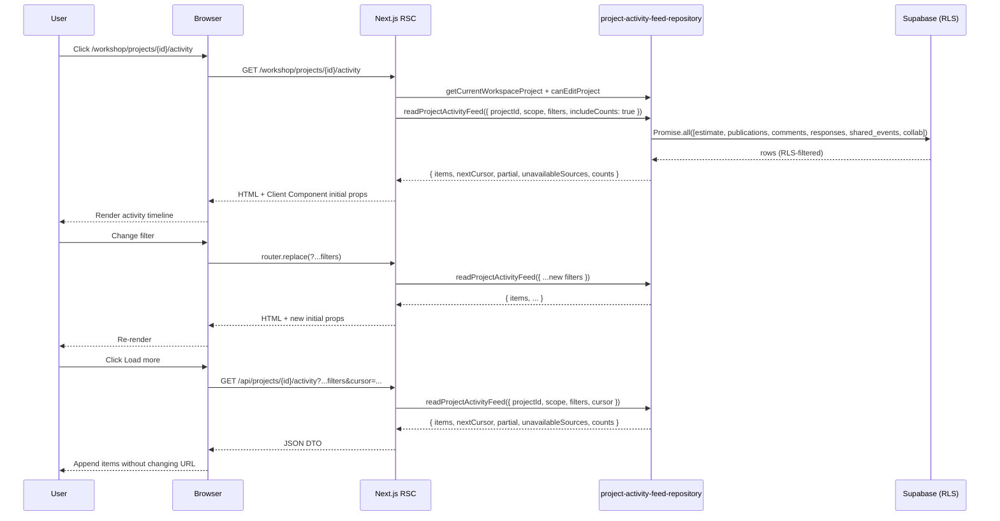

# 06 — Architecture and Technical Design

## Current-state architecture

```
Browser
  │
  ▼
Next.js 16 App Router (RSC)
  │
  ▼
src/app/workshop/projects/[projectId]/activity/page.tsx   (15-line placeholder)
  │
  ▼
WorkshopPageShell + ProjectMiniSidebar  (existing chrome)
  │
  ▼
ProjectActivityClient  (does not exist yet — to be created)
  │
  ▼
(empty — client renders nothing today)
```

Existing repositories:

- `listProjectActivityPage` (estimate-events-only, project-scoped) — used by `/workshop/projects/{id}` dashboard preview card.
- `readPublisherWorkspaceActivity` (six-source, workspace-or-project-scoped) — used by the Publisher surface.

## Target-state architecture

```
Browser
  │
  ▼
Next.js 16 App Router (RSC)
  │
  ▼
src/app/workshop/projects/[projectId]/activity/page.tsx   (Server Component)
  │  1. await params → projectId
  │  2. await getCurrentWorkspaceProject(projectId) → ownership check
  │  3. await canEditProject(projectId) → permission gate
  │  4. await Promise.all([
  │       readProjectActivityFeed({ projectId, scope, filters, limit, includeCounts: true }),
  │       listProjectEstimatesForDropdown(projectId),
  │       listProjectMembersForDropdown(projectId),
  │       listProjectRecipientsForDropdown(projectId),
  │     ])
  │  5. Render <ProjectActivityClient initialData={...} dropdowns={...} />
  │
  ▼
src/components/workshop/project-activity/ProjectActivityClient.tsx   ("use client")
  │  - Owns URL state (scope, action, actor, client)
  │  - Owns transient cursor/list state for Load more
  │  - Calls router.replace(...) when filters change → RSC re-fetch
  │  - Calls authenticated pagination loader for Load more
  │  - Receives initial data and counts from Server Component
  │
  ▼
src/app/api/projects/[projectId]/activity/route.ts   (Route Handler, authenticated GET)
  │  - Validates auth/project/cursor/filter DTO
  │  - Calls readProjectActivityFeed({ ..., cursor, includeCounts: true })
  │  - Returns display-safe ActivityViewModel page DTO with exact counts
  │
  ▼
src/lib/repositories/project-activity-feed-repository.ts   (server-only)
  │  - readProjectActivityFeed({ projectId, scope, filters, cursor, limit })
  │  - Internal: Promise.all over 6 source queries → merge → cursor slice
  │  - collaboration_audit_events read goes through read_project_collaboration_audit_events RPC
  │  - Returns { items, nextCursor, partial, unavailableSources, counts }
  │
  ▼
Supabase (RLS-protected)
```

## Component boundaries

| Layer | File (expected name) | Responsibility |
|---|---|---|
| Route (Server Component) | `src/app/workshop/projects/[projectId]/activity/page.tsx` | Auth, ownership, prefetch, render shell + client |
| Client component | `src/components/workshop/project-activity/ProjectActivityClient.tsx` | URL state, filter row, scope selector, timeline, pagination, refresh |
| Client subcomponents | `src/components/workshop/project-activity/{FilterRow,ScopeSelect,ActionMultiSelect,ActorSelect,ClientSelect,ActivityTimeline,ActivityItemCard,PartialDataBanner,EmptyState,ErrorState,PermissionDeniedState}.tsx` | Decomposed per state and control |
| URL-state helpers | `src/components/workshop/project-activity/url-state.ts` | parse/serialize `?scope=&action=&actor=&client=` |
| Pagination loader | `src/app/api/projects/[projectId]/activity/route.ts` | Authenticated GET for transient cursor Load more |
| Repository | `src/lib/repositories/project-activity-feed-repository.ts` | Multi-source read, filter, merge, paginate |
| Action-class derivation | `src/components/workshop/project-activity/action-classes.ts` | Maps `(source, event_type, target_kind, decision)` → action bucket |

## Server / Client boundary decisions

- The Server Component owns: auth check, ownership check, initial data fetch, dropdown data fetch, permission-denied render path.
- The Client Component owns: filter state, URL state, transient cursor/list pagination, "Refresh", dropdown open/close, focus management.
- The Client Component **never** imports Supabase or the repository directly. Initial/filter data arrives via props or RSC re-fetch; pagination data arrives from the authenticated loader.

## State ownership

| State | Owner | Why |
|---|---|---|
| `scope` | URL (`?scope=whole-project\|project-only\|estimate:<id>`) | Shareable; back/forward works |
| `action` (multi-select) | URL (`?action=created,deleted,...`) | Shareable |
| `actor` | URL (`?actor=<userId>\|me`) | Shareable |
| `client` | URL (`?client=<recipientId>`) | Shareable |
| `cursor` | Local component state + authenticated loader request body/query | Not shareable; avoids misleading `?cursor=` URLs that cannot reproduce appended pages |
| `loadedCount` | Local component state | Tracks appended pages |
| `filteredTotalCount` / `scopeTotalCount` | Server data from repository `counts` | Drives "Showing X of Y" and empty-state copy |
| Dropdown open/close | Local `useState` | UI-only |
| "Load more" pending | Local `useState` | UI-only |
| Refreshing | Local `useState` | UI-only |

## Data flow

1. User changes a filter → Client Component calls `router.replace(url, { scroll: false })`.
2. RSC re-renders the route on the server → Server Component re-reads URL search params → re-fetches via `readProjectActivityFeed`.
3. Server passes new initial data to Client Component.
4. Client Component renders the new timeline.

For "Load more":
1. User clicks → Client Component sends current filters + cursor to the authenticated GET loader.
2. Loader validates auth/project/filter/cursor and calls `readProjectActivityFeed` with `cursor`.
3. Client Component appends returned items to local state, updates `nextCursor` and `loadedCount`, and leaves the shareable URL unchanged.
4. Any filter/scope URL change resets local items, cursor, and loaded count from the new RSC payload.

## Data contract

`readProjectActivityFeed` returns:

```ts
type ProjectActivityFeedCounts = {
  loadedCount: number;        // number of items in this response page
  filteredTotalCount: number; // exact total after current scope + action/actor/client filters
  scopeTotalCount: number;    // exact total for the current scope before action/actor/client filters
};

type ProjectActivityFeedPage = {
  items: ActivityViewModel[];
  nextCursor: string | null;
  partial: boolean;
  unavailableSources: ProjectActivityFeedSourceName[];
  counts: ProjectActivityFeedCounts;
};
```

The client computes accumulated `shown = localItems.length` for the live count and displays `Showing {shown} of {filteredTotalCount}`. Empty-state copy uses `scopeTotalCount === 0` for "No activity yet" and `scopeTotalCount > 0 && filteredTotalCount === 0` for "No activity matches your filters."

## Action-class derivation (mapping)

```
source = estimate   + event_type row_added* / node_created / tab_created / sheet_metadata_updated (new) → created
source = estimate   + event_type row_updated* / node_renamed / tab_renamed / sheet_code_updated / sheet_metadata_updated (edit) → edited
source = estimate   + event_type row_deleted* / node_deleted* / tab_deleted* / tab_archived → deleted
source = estimate   + event_type tree_reordered / tabs_reordered → reordered
source = estimate   + event_type template_inserted → created (inserted_template)
source = estimate   + event_type sheet_version_created / sheet_restored_as_copy → versioned (DORMANT in v1)
source = publication+ event_type published / republished / revoked → shared
source = share      + event_type opened / viewed → viewed
source = comment    (any) → commented
source = decision   + decision approved → decided (approved)
source = decision   + decision declined → decided (declined)
source = decision   + decision requested_revision → decided (revision requested)
source = collaboration + event_type invite_email_attempted / invite_email_sent / role_changed / member_removed → invited
source = system     (any other) → system
```

The exact derivation table is to be implemented in `src/components/workshop/project-activity/action-classes.ts` and unit-tested.

## Decision: extend `readPublisherWorkspaceActivity` or create a new repository?

**Decision (DEC-01):** Create a new `src/lib/repositories/project-activity-feed-repository.ts` that borrows the multi-source merge pattern from `readPublisherWorkspaceActivity` but is purpose-built for the project page.

**Rationale:**
- `readPublisherWorkspaceActivity` is publisher-roster-scoped (`canReadPublisherRosterProject`). The project activity page must work for any project member who can edit, not just publisher readers.
- `readPublisherWorkspaceActivity` joins publications by `workspace_id` first; the project activity page needs strict `project_id` scoping without publisher-roster gating.
- `readPublisherWorkspaceActivity` returns `ActivityViewModel[]` with project-name facts. The project page doesn't need project-name facts (the user is already on a single project), and needs additional actor/recipient/client filter arguments that would be awkward to retrofit.
- Keeping the two separate preserves the existing Publisher surface against unintended regressions.

**Rejected alternatives:**
- **A:** Add an optional `projectActivityMode` flag to `readPublisherWorkspaceActivity`. Rejected: tight coupling; the function already has too many responsibilities.
- **B:** Generalize `listProjectActivityPage` to multi-source. Rejected: the existing dashboard preview card depends on its estimate-only contract; changing it risks regressions.

## Decision: filter at SQL or at compose time?

**Decision (DEC-02):** Filter at the source-query level (SQL `where` clauses) wherever the field is a column, and at compose-time only when the filter requires derivation (e.g. action class for estimate events).

**Rationale:**
- `actor_user_id`, `recipient_id`, `project_id` are columns → filter at SQL.
- `event_type` is a column → filter at SQL using a derived `event_type IN (...)` set.
- Action class is derived → compose-time filter post-merge, because different sources map to the same bucket.

## Decision: cursor strategy

**Decision (DEC-03):** One cursor per response, encoded as a small opaque JSON that stores `(created_at, id)` for each source's last-emitted row. The decoder is symmetric.

**Rationale:**
- Multi-source merges cannot use a single `(created_at, id)` because ids collide across tables.
- Per-source cursors survive a re-fetch accurately.
- The existing `sharedLinkActivityCursor` pattern in `src/lib/publication/activity-helpers.ts` can be reused or adapted.

## Decision: pagination vs infinite scroll

**Decision (DEC-04):** Explicit "Load more" button. No infinite scroll for v1.

**Rationale:**
- Predictable for screen readers and keyboard users.
- Avoids IntersectionObserver complexity and SSR hydration mismatches.
- Closed-beta scale doesn't justify infinite scroll.

## Decision: route-level `loading.tsx` specialization

**Decision (DEC-05):** Add a route-level `src/app/workshop/projects/[projectId]/activity/loading.tsx` with a project-activity-specific skeleton.

**Rationale:**
- The parent loading fallback is fine, but a specialized skeleton matches the dashboard tile rhythm and signals to the user what is loading.

## Cache and revalidation

- The repository may use request-scoped `React.cache` to deduplicate work inside one RSC request.
- No `use cache`, `cacheLife`, `cacheTag`, or `revalidateTag` for v1. Next.js 16 local docs say `searchParams` opts the page into dynamic rendering and cached functions cannot directly access request-time APIs such as cookies/headers/searchParams.
- After future mutations (not in v1), choose and test `router.refresh` or `revalidatePath`; do not add cache tags without a mutation/freshness owner.

## Failure boundaries

- Server Component error → parent `error.tsx`.
- Source-unavailable → repository returns `partial: true, unavailableSources: [...]` → client renders banner.
- Network/Supabase error → repository throws → Server Component catches and renders in-page error UI (or propagates to `error.tsx` for unrecoverable).

## Architectural alternatives considered

| Alternative | Status | Reason |
|---|---|---|
| Single SQL view union | Rejected | Premature; harder to evolve; harder to debug per-source failures |
| Supabase Realtime subscription | Rejected (v1) | Out of scope; closed-beta scale doesn't justify |
| Cross-project workspace feed | Rejected | Already covered by Publisher surface |
| Public/client-facing view | Rejected | The page is internal-only |
| Broad public Route Handler with custom DTO | Rejected | Pagination loader is authenticated and narrow; no public/unauthenticated activity API |
| Putting cursor in shareable URL | Rejected | A single `?cursor=` cannot reproduce appended pages without cursor-stack or refetch-all semantics |

## Mermaid: target data flow


