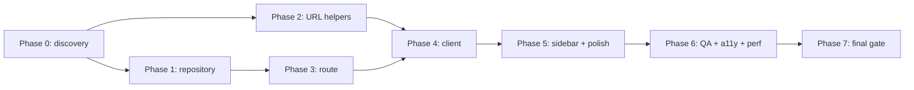

# Plan Pack — Project Activity Page

**Status:** `IMPLEMENTATION-READY`
**Plan profile:** `exhaustive`
**Verification mode:** `independent` (native council findings incorporated; final verifier `019f0e82-50d0-7940-a0c9-d59bd8d72f31` returned no P0/P1 findings)
**Started:** 2026-06-28 (Asia/Manila)
**Plan folder:** `.ai/03_plans/2026-06-28-Project-Activity-Page/`

## Master goal

Convert the brief: "fill out `/workshop/projects/{projectId}/activity` as the project's Activity History home, with scope selectors (whole project / project-only / specific estimate sheet), action-type filters (deletions, edits, etc.), per-user filters, and per-client (shared-link recipient) filters; adapt the project dashboard UI" into a planning package that an implementation agent can execute without re-discovering requirements, architecture, affected files, or validation gates.

This is **planning-only**. No application code, migrations, provider state, or tests were modified by this run.

## What an implementer should read first

1. **This README** — entry point.
2. `01_EXECUTIVE_SUMMARY.md` — the one-doc summary.
3. `02_FEATURE_BRIEF_AND_SCOPE.md` — what's in / out of scope, plus owner-delegated planning decisions.
4. `11_IMPLEMENTATION_PLAN.md` — the phased execution guide.
5. `12_TEST_AND_VALIDATION_STRATEGY.md` — the test execution + UltraQA matrix.
6. `17_FINAL_READINESS_REVIEW.md` — final verifier signoff and residual implementation risks.

## Implementation start document

**`11_IMPLEMENTATION_PLAN.md`** — phased plan with WP-1 through WP-15.

## Phase order

```
Phase 0 (discovery) →
Phase 1 (repository) →
Phase 2 (URL helpers) →
Phase 3 (route + skeleton) →
Phase 4 (client component) →
Phase 5 (sidebar + polish) →
Phase 6 (QA + a11y + perf) →
Phase 7 (final gate)
```

## Dependency graph



## Requirement/task/test traceability

See `16_REQUIREMENTS_TRACEABILITY_MATRIX.md` for the full mapping. 59 requirements, all traced with source-strength labels.

## Owner-delegated decisions and implementation-time proof

Philip delegated planning authority for this improvement pass. Reversible product defaults are resolved here as owner-delegated planning decisions rather than left as blockers.

| Item | Resolution | Implementation-time proof |
|---|---|---|
| Default scope | `whole-project` | URL/default-state tests |
| Actor filter boundary | Project members only | Dropdown fixture test |
| Client filter boundary | Recipients on active project publications only | Dropdown fixture test |
| Action filter mode | Multi-select | Client/filter tests |
| Activity page viewers | Editors/workspace members who satisfy `can_edit_project`; read-only project viewers see permission-denied | Denial tests |
| `collaboration_audit_events` access | Add a scoped security-definer RPC, keep direct table access denied | Migration/schema test + local/provider RLS proof |
| Pagination state | Filters/scope are shareable URL state; pagination cursor is transient client state | URL-state and load-more tests |
| Mini-sidebar Activity item | Already present in `src/components/workshop/ProjectMiniSidebar.tsx` | Verify unchanged before edit |

## Stale-plan revalidation checklist

Before resuming implementation after a pause, the implementer should re-verify:

- [ ] `.ai/10_state/current-state.md` FAST PATH still describes pre-launch closed-beta MVP.
- [ ] The 6 source tables and their columns still exist (re-read migrations and generated types).
- [ ] The deny policy on `collaboration_audit_events` is still active, so the scoped RPC remains required.
- [ ] The dashboard chrome (`src/app/workshop/projects/[projectId]/layout.tsx`) is unchanged.
- [ ] `src/lib/activity/` exports are unchanged.
- [ ] `src/lib/repositories/project-activity-repository.ts` and `src/lib/publisher/activity-repository.ts` still exist and have the same public contract.
- [ ] `git status` shows the plan folder untouched.

## Commands to run before the first edit

```bash
# Confirm branch
git status --short --branch

# Read the FAST PATH
# .ai/10_state/current-state.md (top block only)

# Confirm starting state
bun run type-check
bun run lint
```

## Files off-limits to implementation planning edits (already enforced)

- Application code, tests, migrations, provider state, generated files, package manifests, and runtime configuration.
- The only files outside this plan package intentionally edited by this improvement pass were the planning prompt guardrails in `.ai/08_prompts/000_Planning Prompts/`.

## Files that implementation v1 MAY touch

- `src/app/workshop/projects/[projectId]/activity/page.tsx` (rewrite).
- `src/app/workshop/projects/[projectId]/activity/loading.tsx` (new).
- `src/components/workshop/project-activity/` (new directory).
- `src/lib/repositories/project-activity-feed-repository.ts` (new).
- `tests/vitest/project-activity-page/` (new directory).
- `src/components/workshop/ProjectMiniSidebar.tsx` (verify or adjust Activity nav item).
- One scoped Supabase migration for `read_project_collaboration_audit_events(...)`, authenticated execute grants, rollback, generated types, and a narrow `collaboration_audit_events(project_id, created_at desc, id desc)` index if not already covered.

## Files and systems intentionally unaffected

- Public share routes and APIs (`/share/[token]/*`, `/api/share/[token]/*`).
- Auth, account, settings, billing.
- Other workspace routes (`/workshop`, `/workshop/projects`, `/workshop/library`, `/workshop/templates`).
- `src/lib/publisher/activity-repository.ts` (Publisher surface).
- `src/lib/repositories/project-activity-repository.ts` (existing dashboard preview card).
- `src/components/workshop/estimate-sheet/activity-history.tsx` (estimate-sheet activity history).
- All unrelated migrations and Supabase state.
- Any production deployment.

## External proof that remains required before production rollout

- Local/provider proof that the collaboration-audit RPC is callable only by authorized users and direct table reads remain denied.
- `EXPLAIN` verification of the multi-source fan-out query plan, including the collaboration-audit RPC path (Phase 1).
- Authenticated performance evaluator: 20-run TTFB chronometer on local production build (Phase 6).
- Manual browser QA on the real Lewis Residence project (Phase 7).
- Implementation-time verification of the RPC, direct-deny behavior, counts, authenticated performance timing, and browser QA before production rollout.

## Archive policy

Do not auto-archive. Archive to `.ai/09_archive/` only after Philip has approved the implemented feature in production.

## Loop engineering

This plan pack ships with a `LOOP_LEDGER.md` (master goal + lane allocation + iteration log + conflict log + skill ledger + cleanup status). The implementation run should reuse the loop contract: `DISCOVER → PLAN → EXECUTE → VERIFY → RECORD → DECIDE`.

## Loop surface selection for implementation

Per `AGENTS.md`, the implementation run can use any of: direct (for narrow, reversible work), `ultrawork`, `ultragoal`, `omo:ulw-loop`, `autopilot`, `ultraqa`, `omo:ultraresearch`, `vercel:agent-browser`, or an agent-neutral equivalent. For Phase 4 (the XL client component), consider `ultrawork` with parallel subcomponent lanes.

## Document index

| # | Document | Purpose |
|---|---|---|
| 00 | AGENT_COORDINATION.md | Master goal, authority, lane allocation, coordination ledger |
| 01 | EXECUTIVE_SUMMARY.md | One-doc summary |
| 02 | FEATURE_BRIEF_AND_SCOPE.md | Source brief, scope, non-goals, open questions, deletion criteria |
| 03 | SOURCE_AND_CODEBASE_AUDIT.md | Evidence-based inventory of every existing surface |
| 04 | REQUIREMENTS_SPECIFICATION.md | 56 traced requirements with stable IDs |
| 05 | UX_UI_ACCESSIBILITY_PLAN.md | State matrix, copy dictionary, a11y, responsive |
| 06 | ARCHITECTURE_AND_TECHNICAL_DESIGN.md | Current vs target, component boundaries, data flow, decisions |
| 07 | DATA_DATABASE_API_NETWORK_PLAN.md | Schema, RLS, indexes, cardinality, query plan |
| 08 | SECURITY_PRIVACY_THREAT_MODEL.md | 12-row threat catalog, PII minimization, denial tests |
| 09 | PERFORMANCE_RELIABILITY_OBSERVABILITY.md | Budgets, evaluator, N+1 prevention, runbook triggers |
| 10 | BLAST_RADIUS_AND_DEPENDENCIES.md | Required / probable / verification-only classification |
| 11 | IMPLEMENTATION_PLAN.md | 7-phase plan, WP-1..WP-15, exit gates |
| 12 | TEST_AND_VALIDATION_STRATEGY.md | Test execution matrix, UltraQA scenarios, TDD discipline |
| 13 | ROLLOUT_ROLLBACK_AND_OPERATIONS.md | Pre-deploy checklist, rollback steps, runbook |
| 14 | RISK_REGISTER.md | 20 risks with mitigations and owners |
| 15 | DECISIONS_ASSUMPTIONS_AND_ALTERNATIVES.md | 12 decisions, 10 assumptions, 14 rejected alternatives |
| 16 | REQUIREMENTS_TRACEABILITY_MATRIX.md | All 59 requirements traced with source strength |
| 17 | FINAL_READINESS_REVIEW.md | Scorecard, P0/P1 findings, residual risks, readiness status |
| 18 | STACK_CONTRACT_AND_PRODUCTION_STANDARDS.md | Cross-cutting production decisions |
| 19 | RESEARCH_REVIEW_AND_QA_EVIDENCE.md | Research, critique cycles, validation gaps |
| LOOP_LEDGER | LOOP_LEDGER.md | Loop contract + iteration log + conflict log |
