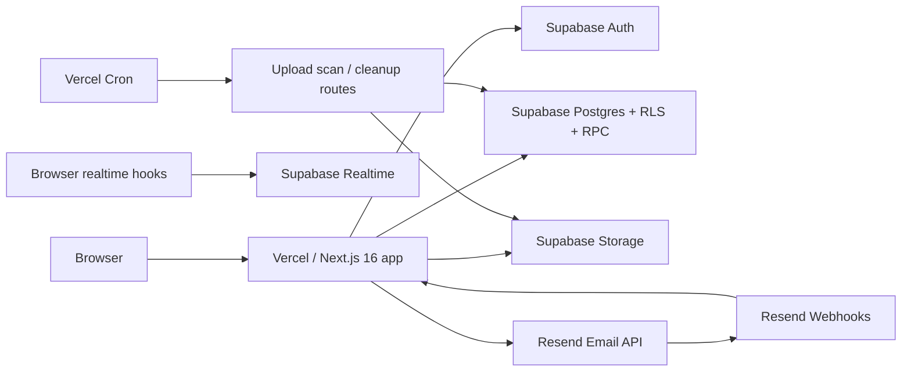
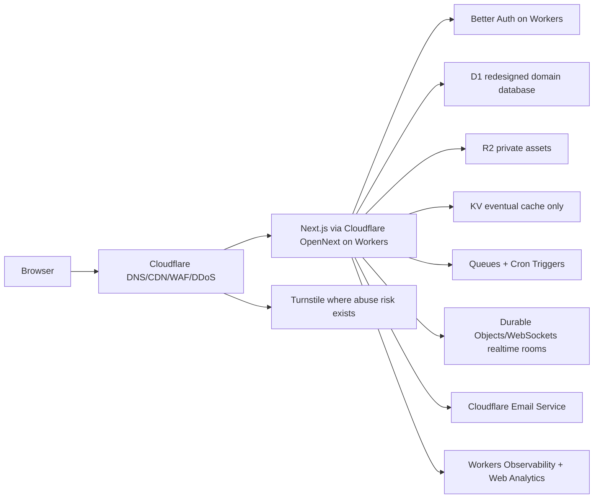
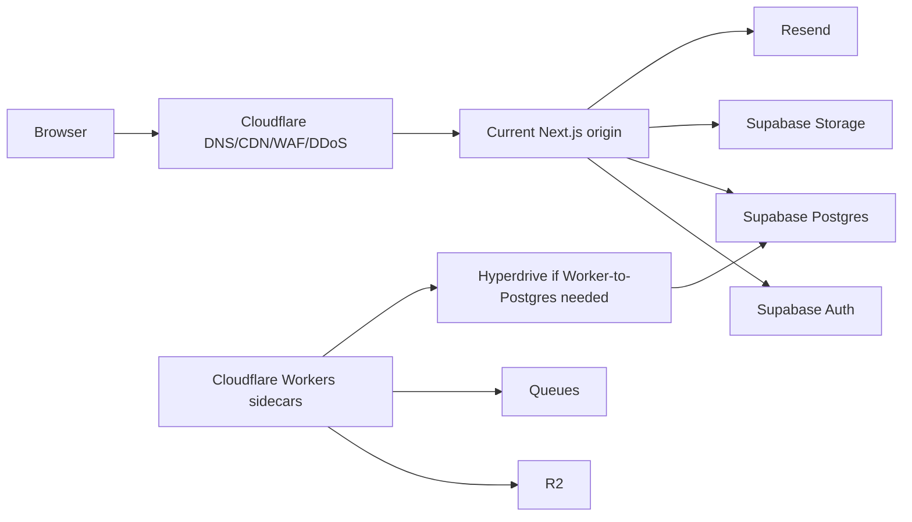

# Architecture And Technical Design

## Current Architecture

## Preferred Full Cloudflare-Native Target

The preferred prelaunch target is Cloudflare-native, subject to proof gates:

## Fallback Hybrid Architecture

Use hybrid only if full-native proof fails, is too slow, or is not cheaper enough:

This is a fallback and transition shape, not the preferred final target.

## Technical Design Principles

TD-001: Migration slices must be reversible.

TD-002: Keep data ownership clear. Cache and queues never own authorization truth.

TD-003: Replace one provider behavior at a time during proof, even when the preferred end state is full-native.

TD-004: Prove the primary Next.js runtime on Workers early because it determines the value of an all-Cloudflare path.

TD-005: Preserve the current server-actions-first model unless Next-on-Workers proof identifies required changes.

TD-006: Keep Postgres as the current baseline until D1 compatibility is proven through redesign and dry-run evidence.

TD-007: Any auth migration must preserve route gates before database migration.

TD-008: Realtime replacement is its own architecture project.

TD-009: Cloudflare product choices must be retrieval-first. Before implementation, refresh official docs, product changelogs, Wrangler schema, and relevant installed Cloudflare skill references for the exact products in the slice.

TD-010: Workers should use bindings, service bindings, generated `Env` types, environment-scoped config, and structured observability rather than ad hoc REST calls, hand-written binding interfaces, or hardcoded secrets.

## Cloudflare Component Fit

Workers:

- Good for sidecars, queue consumers, API aggregation, edge auth checks, webhooks, and selected Next.js hosting if OpenNext proof passes.
- Risk: Next.js 16 support is adapter-dependent. Cloudflare docs list broad support through OpenNext, but local Next docs require platform fidelity proof for non-verified adapters.
- Required proof: `wrangler.jsonc` schema alignment, generated Worker types, compatibility date/flags, `nodejs_compat` need, secret binding strategy, observability settings, startup check, and production-like preview under Cloudflare's runtime.

D1:

- Good for small SQLite-shaped datasets or new bounded domains.
- Risk: not a drop-in Postgres/RLS/RPC/realtime replacement.

KV:

- Good for eventually consistent cache, feature flags that tolerate propagation delay, static metadata, and low-criticality lookups.
- Risk: not suitable for sessions, locks, counters requiring precision, or authorization decisions.

R2:

- Good for assets, attachments, generated exports, and lower egress costs.
- Risk: signed access, image transformation, scanning, object-key collision, and data-retention behavior must be designed.

Queues:

- Good for upload scan/cleanup, webhook fanout, email retry tasks, and idempotent background jobs.
- Risk: message size, retry behavior, duplicate handling, and dead-letter strategy must be explicit.
- Required proof: message size and operation amplification from current docs, duplicate delivery handling, dead-letter route, consumer observability, and fallback to current scheduled route until the queue slice passes.

Hyperdrive:

- Good if Workers access external Postgres/MySQL.
- Risk: not useful for D1 and not a replacement for database optimization or origin DB limits.

Email Service:

- Potential replacement for outbound email, but currently must prove deliverability, domain setup, arbitrary-recipient plan eligibility, webhook/event parity, and analytics.

WAF/DDoS:

- Good first move if rules are carefully staged.
- Risk: false positives, fail-open rate limiting behavior, plan quotas, and body-inspection limits.
