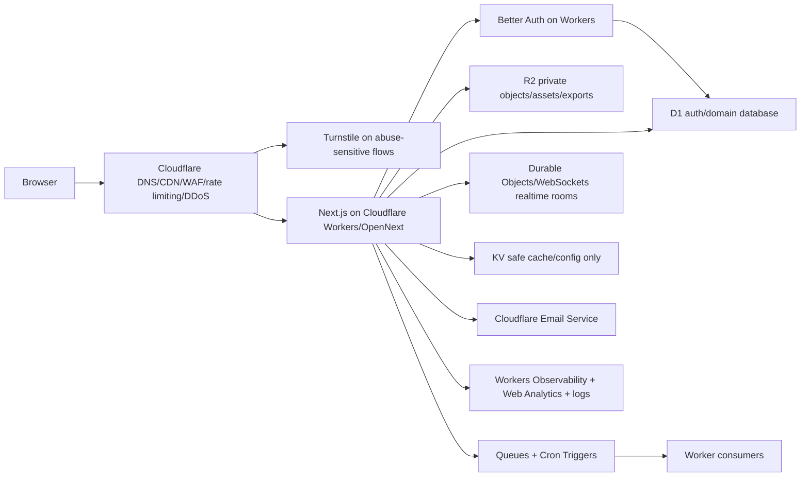

# Full Cloudflare Native Target

## Owner Direction

As of 2026-06-29, the preferred path is to prepare for the cheapest/full Cloudflare redesign because Archestimator has not launched and has time to absorb a deeper provider shift.

This document defines the target to prove. It does not authorize production cutover.

## Target Architecture

## Product Ownership

| Current responsibility | Cloudflare-native target | Proof required |
| --- | --- | --- |
| Vercel app hosting | Workers/OpenNext | Route/runtime/build/preview proof |
| Supabase Postgres | D1 redesigned schema | Data model, authorization, restore, performance proof |
| Supabase Auth | Better Auth | SSR/session/claims/OAuth/magic/invite proof |
| Supabase Realtime | Durable Objects/WebSockets | Presence/cursor/room/reconnect proof |
| Supabase Storage | R2 | Private access, signed URL/session, image, scan proof |
| Vercel cron | Queues + Cron Triggers | Idempotency, retry, dead-letter proof |
| Resend | Cloudflare Email Service | Deliverability, bounce/event, retry proof |
| Platform WAF/DDoS | Cloudflare WAF/rate limiting/DDoS | Rule staging and false-positive proof |
| Abuse friction | Turnstile where needed | Accessibility, bypass, false-positive proof |
| Vercel analytics/speed | Web Analytics + Workers Observability | Metrics replacement and speed proof |

## Required Proof Gates

Gate 1: source refresh.

- Refresh official Cloudflare docs, product changelogs, Wrangler schema, Workers types, and installed Cloudflare skill guidance on the execution date.

Gate 2: route/runtime proof.

- Prove App Router, RSC, Server Actions, proxy/middleware route gates, route handlers, headers/cookies, image handling, cache behavior, CSP, error/not-found routes, environment variables, bindings, and preview/runtime parity.

Gate 3: D1 redesign proof.

- Prove schema, authorization, RPC replacements, transaction boundaries, generated types, backup/export/restore, query count, latency, and data migration dry runs.

Gate 4: auth proof.

- Prove Better Auth SSR sessions, login/logout, OAuth/magic, closed-beta gates, legal terms gates, invites, admin/service operations, and authorization identity.

Gate 5: realtime proof.

- Prove Durable Object/WebSocket room ownership, authorization, reconnect, backpressure, latency, and persistence for critical collaboration flows.

Gate 6: storage/jobs/email proof.

- Prove R2, Queues/Cron, and Email Service against current Supabase Storage, Vercel cron, and Resend behavior.

Gate 7: speed and cost proof.

- Prove the target meets explicit performance budgets and is cheaper enough after observed operation counts.

## Fallback Triggers

Use hybrid/current-provider fallback if any of these remain unresolved after proof:

- Next.js route/runtime behavior differs in a way that would delay launch.
- D1 redesign cannot preserve data integrity or authorization.
- Better Auth cannot preserve session and identity semantics.
- Realtime replacement is slower or less reliable than current behavior.
- Cloudflare Email Service cannot match transactional requirements.
- Full-native cost is not materially better after operation counts.
- Critical flows miss performance budgets.

## Stop Condition

The full-native target is ready for implementation planning only when every product has an owner, proof gate, rollback/comparison path, cost input, and performance budget. It is ready for production cutover only after provider evidence passes.
