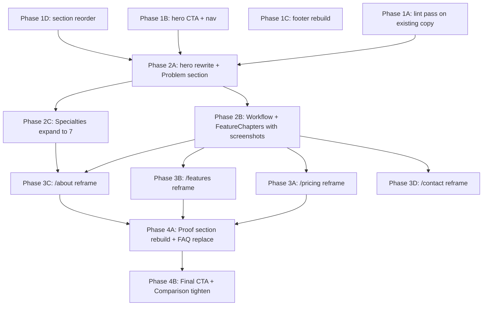

# 07 — Landing Page Sections (Target Architecture)

**Source authority:** `03_SOURCE_AND_CODEBASE_AUDIT.md` (current state), `06_BRAND_AND_COPY_DIRECTION.md` (recasts), `08_PRODUCT_DEFINITION_AND_FEATURES.md` (what ships today), `09_DESIGN_SYSTEM_AND_VISUAL_DIRECTION.md` and `20_DESIGN_AUDIT_AND_VISUAL_DIRECTION.md` (visual treatment).
**Implementation phase:** Phase 2A–4B in `11_IMPLEMENTATION_PLAN.md`.
**Founder sign-off required for:** true blockers only; see `15` §0.

---

## 0. 2026-07-06 section correction

This doc follows the corrected plan defaults:

- Preserve the hero estimate-sheet mockup and above-the-fold product composition.
- Use the short hero subhead and "Request access" CTA default in `19` §0.
- Use Precision Editorial, restrained precision frames, and 8px repeated-card radii per `09` §0 and `20` §0.
- Do not use fake metrics, fabricated proof, em-dash separators in visible copy, or a warm beige/cream/espresso visual repaint.

---

## 1. Target section order (the new altitude graph)

The current page's altitude drops after the hero (`03` §2). The target page **earns attention at every section** and leads with what ships today.

```
HIGH  ┌─ Hero ─────────────────────────────────────────────┐ ✅ preserved + recast
      │  Eyebrow + H1 + subhead + dual CTA + product mockup │
      │  + 3 metric cards (no fake counters)                │
      │  + brand-promise below-CTA line                     │
      └─────────────────────────────────────────────────────┘
       │
HIGH   ┌─ Problem ──────────────────────────────────────────┐ ✅ preserved + expanded
       │  "Spreadsheets calculate. They do not remember."   │
       │  + concrete AEC example                            │
       │  + canonical hook closer                           │
       └────────────────────────────────────────────────────┘
       │
HIGH   ┌─ Workflow ─────────────────────────────────────────┐ ✅ 4 steps + real screenshots
       │  Structure → Reuse → Propose → Decide              │
       │  Each step has a real product screenshot           │
       └────────────────────────────────────────────────────┘
       │
HIGH   ┌─ Feature Chapters (4) ─────────────────────────────┐ ✅ rebuild
       │  1. Reusable cost intelligence (Library dock)      │
       │  2. Proposal handoff (publication viewer)          │
       │  3. Revision + Activity history (Activity panel)   │
       │  4. NEW: Private by design (R10 wedge)             │
       └────────────────────────────────────────────────────┘
       │
HIGH   ┌─ Specialties (7) ──────────────────────────────────┐ ✅ expand from 3 → 7
       │  Architects / Engineers / GCs / Specialty / QS /   │
       │  Interior Designers / Project Managers             │
       └────────────────────────────────────────────────────┘
       │
MED    ┌─ Audience flow band ───────────────────────────────┐ ⚠️ recast (was AudienceBand)
       │  Input → Record → History, concrete anchors        │
       └────────────────────────────────────────────────────┘
       │
HIGH   ┌─ Comparison ───────────────────────────────────────┐ ✅ tighten
       │  5 paired rows, each Archestimator row links       │
       │  to a Live feature                                 │
       └────────────────────────────────────────────────────┘
       │
HIGH   ┌─ Proof ────────────────────────────────────────────┐ ✅ complete rebuild
       │  4 real screenshots + Cloudflare/Better Auth line  │
       │  + (when real) company proof via the gate          │
       └────────────────────────────────────────────────────┘
       │
MED    ┌─ FAQ (5 buyer-journey Qs) ─────────────────────────┐ ✅ replace 5 softballs
       │  Excel / enterprise tools / library import /       │
       │  data ownership / cancellation                     │
       └────────────────────────────────────────────────────┘
       │
HIGH   ┌─ Final CTA ────────────────────────────────────────┐ ✅ recast
       │  Brand-promise H2 + tagline body + cement anchor   │
       │  + dual CTA                                        │
       └────────────────────────────────────────────────────┘
       │
HIGH   ┌─ Footer ───────────────────────────────────────────┐ ✅ rebuild
       │  Copyright + company line + compliance line +      │
       │  value anchor + expanded link list                 │
       └────────────────────────────────────────────────────┘
```

**Removed sections:** AudienceBanner (flat role strip), video-walkthrough placeholder (unless founder supplies a real video), AI-on-the-roadmap dedicated section (was on /features only).

---

## 2. Section-by-section target architecture

### 2.1 Hero

**Source:** `ArchestimatorLandingPage.tsx:243-392`.
**Phase:** 1B (CTA cleanup), 2A (full hero rewrite).

| Element | Target |
|---|---|
| Section id | `landing-hero` (preserve) |
| Layout | Editorial split: copy left, visual right (preserve) |
| Eyebrow | "AEC construction cost estimating & proposal platform" (preserve) |
| H1 | "Where estimates become client‑approved proposals." (preserve) — **or** "Your cost intelligence layer." (`MASTER §0` hook). OPEN-DEC-001a. |
| Subhead | "Build estimates from reusable costs, send client-ready proposals, and keep revisions, comments, and approvals attached." |
| Primary CTA | "Request access" -> `/contact?intent=access` until `/signup` is verified self-serve |
| Secondary CTA | "See how it works" -> `#workflow` |
| Below-CTA line | "From cost proposal to client approval." |
| Visual | Mountain hero photo + product mockup + 3 HeroMetricCards (preserve) |
| HeroMetricCards | 3 cards: Estimate Smarter / Propose Better / Win Faster. Drop fake counters. Keep "01 / 02 / 03" ordinals and behavior-preview tooltips. |
| Below-hero | Drop "Video walkthrough" placeholder unless founder supplies real video (OPEN-DEC-006). |

### 2.2 Problem

**Source:** `ArchestimatorLandingPage.tsx:436-457`.
**Phase:** 2A.

| Element | Target |
|---|---|
| Section id | `problem` (preserve) |
| Heading | "Spreadsheets calculate. They do not remember." (preserve) |
| Body | 3 tight paragraphs: (1) copied estimates lose source, assumptions, feedback, and revision history; (2) the rate proved on the last project should not disappear into another copied sheet; (3) Archestimator keeps the commercial record attached to every line. |
| Closer | Replace "Archestimator keeps the commercial story connected." with: "Your cost intelligence layer." |
| Fragment pills | "Copied rate", "Unnamed attachment", "Email revision", "Overwritten version" (preserve) |

### 2.3 Workflow

**Source:** `ArchestimatorLandingPage.tsx:459-490`.
**Phase:** 2B (replace ProductStage placeholders with real screenshots).

| Element | Target |
|---|---|
| Section id | `workflow` (preserve) |
| Section header | "From first cost to final decision, nothing loses context." (preserve) |
| 4 steps | Structure → Reuse → Propose → Decide (preserve order, preserve copy in `landing-content.ts:20-53`) |
| Step state descriptions | Tighten to concrete behavior. Each step gets a real screenshot from the actual product: Step 1 → estimate tree; Step 2 → library dock + drag-drop; Step 3 → publication viewer; Step 4 → Activity panel with comment + decision. |

### 2.4 Feature Chapters (rebuild)

**Source:** `ArchestimatorLandingPage.tsx:492-516`.
**Phase:** 2B.

| # | Chapter | Copy | Visual |
|---|---|---|---|
| 1 | Reusable cost intelligence | Preserve current copy + callout ("The value is not simply saving a rate. It is remembering why the rate was trusted.") | Real screenshot of Library dock with component cards, supplier context, price history. |
| 2 | Proposal handoff | Preserve current copy + callout ("Client-facing clarity without internal context loss.") | Real screenshot of publication viewer (anonymous, password-protected share link, comment thread). |
| 3 | Revision and Activity history | Preserve current copy + callout ("A change should never erase the reason behind it.") | Real screenshot of Activity panel showing a comment thread + revision diff + recorded decision. |
| 4 (NEW) | Private by design | "Your data is yours, never pooled or anonymized across customers. Built on Cloudflare Workers, D1, R2, and Better Auth. We do not run cross-customer benchmarks." | Product screenshot, architecture proof, or terms/privacy proof that stays tied to real behavior. |

### 2.5 Specialties (expand from 3 → 7)

**Source:** `landing-content.ts:87-109` + `ArchestimatorLandingPage.tsx:543-568`.
**Phase:** 2C.

7 specialties, each with: label, copy, directed message, real screenshot. See `08` §7 for the persona table and `06` §4.8 for the directed messages.

### 2.6 Audience flow band (recast)

**Source:** `ArchestimatorLandingPage.tsx:394-434`.
**Phase:** 2A.

Recast: heading "From the first line item to the final approval." Replace abstract input/record nodes with concrete product anchors (per `06` §4.3). Move below the Specialties section so the audience has already seen the 7 personas before this flow.

### 2.7 Comparison (tighten)

**Source:** `ArchestimatorLandingPage.tsx:518-541`.
**Phase:** 4B.

Each "Archestimator" column row links to the actual Live feature in `/features`. Make the "Archestimator" column visually heavier. 5 rows preserved; copy tightened to concrete anchors.

### 2.8 Proof (complete rebuild)

**Source:** `ArchestimatorLandingPage.tsx:570-589`.
**Phase:** 4A.

| Element | Target |
|---|---|
| Section id | `proof` (preserve) |
| Kicker | "What ships today" |
| Title | "Built for the work you actually do." |
| Body | "Archestimator ships today. This is the product surface." |
| Content | 4 real screenshots (estimate tree, library dock, Activity panel, publication viewer). Each labeled with what it proves. + the line: "Private by design. Built on Cloudflare Workers, D1, R2, and Better Auth. Your data is yours, never pooled or anonymized across customers." |
| Company proof | Two-tier: gated by `getRenderableCompanyProofItems`. Until real customer proof exists, the line above stands alone. |

### 2.9 FAQ (replace 5 softballs)

**Source:** `landing-content.ts:119-145` + `ArchestimatorLandingPage.tsx:591-616`.
**Phase:** 4A.

5 buyer-journey Q&As (per `06` §4.10): Excel / enterprise tools / library import / data ownership / cancellation. Schema.org FAQPage JSON-LD preserved.

### 2.10 Final CTA

**Source:** `ArchestimatorLandingPage.tsx:618-632`.
**Phase:** 4B.

| Element | Target |
|---|---|
| Section id | `final-cta` (preserve) |
| H2 | "Start your next estimate from the ones you've already done." (brand promise surfaced) |
| Body | "From cost proposal to client approval." + "Free forever for the Solo tier. Priced in pesos." |
| Primary CTA | "Request access" -> `/contact?intent=access` until self-serve signup is verified |
| Secondary CTA | "Book a walkthrough" -> `/contact?intent=walkthrough` |

### 2.11 Footer

**Source:** `ArchestimatorLandingPage.tsx:634-661`.
**Phase:** 1C.

| Element | Target |
|---|---|
| Logo | Preserve |
| Links | Add `/trust`, `/changelog` (if exists), `/roadmap` (if exists) to current 9-link list |
| Copyright | "Copyright 2026 Archestimator. From cost proposal to client approval." |
| Company line | "Built in the Philippines. Built on Cloudflare." |
| Compliance line | "Private by design. Your data is yours, never pooled or anonymized across customers." |
| Value anchor | "Free forever for the Solo tier. Priced in pesos." |

---

## 3. Cross-section visual treatment

**Source authority:** `09_DESIGN_SYSTEM_AND_VISUAL_DIRECTION.md` and `20_DESIGN_AUDIT_AND_VISUAL_DIRECTION.md`.

These notes apply to every section on the homepage and the supporting pages. They are the visual layer that turns the copy recasts into a premium experience.

### 3.1 Universal rules

| Rule | Value |
|---|---|
| Max type size | `4rem` (hero H1). No heading may exceed it. |
| Section vertical spacing | Stepped spacing, not direct viewport-width font scaling. Start from current `--section-y` and only increase where sections feel cramped. |
| Card primitive | Precision frame: 8px repeated-card radius, 6px inner radius, 1px neutral hairline, restrained shadow, no nested cards inside cards. |
| Button primitive | Pill (`rounded-full`), `px-5 py-3`, button-in-button trailing icon island, active `scale(0.98)`. |
| Nav primitive | Floating glass pill, detached from viewport edge, hamburger-to-X morph on mobile. |
| Motion | Existing hero motion plus optional lightweight reveal only if it proves value; reduced-motion path required. |
| Texture | Optional and nearly invisible only if visual QA proves it improves the actual implementation. |

### 3.2 Per-section visual notes

| Section | Visual treatment |
|---|---|
| Hero | Preserve the product mockup and three feature cards. Recast cards to ordinals `01 / 02 / 03` + title + proof bullets (no fake counters). Add brand-promise micro-line below CTA. H1 max `4rem`. Remove the video placeholder unless a real video is supplied. |
| Audience band | Move below Specialties. Apply precision framing to the operating-map board. Tone down the 1px grid. Calm audience-list pills (`rounded-full`, `0.75rem`). |
| Problem | Editorial Split: large H2 left (`display` token, max `3.25rem`), fragment-board right. Fragment board is a precision-framed surface with floating fragments; soften 1px borders. |
| Workflow | Dark section (`--landing-night`). Precision-frame each step card. Step ordinal reduced to `1.5rem`. Replace abstract `ProductStage` with a real screenshot in a precision frame. |
| Feature chapters | Editorial Split: copy left, screenshot right; alternate order. Precision-frame the screenshot. Shrink the large floating chapter icon to a small eyebrow badge or remove it. New Privacy chapter uses real product or architecture proof. |
| Specialties | Expand to 7. Each specialty panel is precision-framed. Tabs become small pill chips. Real screenshots in precision frames. |
| Comparison | Precision-frame the whole table. Archestimator column is visually heavier (signal left border or signal-wash header). Each Archestimator row links to a `/features` anchor. |
| Proof | 4 real screenshots in an asymmetrical bento grid, each precision-framed. Cloudflare/Better Auth/R10 trust line below the grid. |
| FAQ | Clean accordion with hairline dividers instead of bordered boxes. Scroll-entry stagger. |
| Final CTA | Dark background (`--landing-night`). Display H2 max `3.25rem`. Dual CTA: primary "Request access" + secondary "Book a walkthrough". Brand-promise tagline + cement-anchor value line. |
| Footer | Restrained link list, small muted copyright, company/compliance/value lines. No dense grid. |

### 3.3 Responsive breakpoints

| Viewport | Behavior |
|---|---|
| `≥ 1440px` | Full asymmetrical bento hero; editorial split feature chapters; floating nav pill. |
| `1180px`–`1439px` | Hero metric cards collapse to horizontal cards; feature chapters remain split. |
| `768px`–`1179px` | Hero stacks vertically; feature chapters stack vertically (copy first, visual second). |
| `< 768px` | Single column, `w-full`, `px-4`, `py-8`. No rotations or overlaps. Comparison stacks with horizontal signal divider. Specialties horizontal scroll preserved (`min(320px, 85vw)` cards). |

---

## 4. Per-route target architecture (supporting pages)

### 3.1 `/pricing` — Phase 3A

| Section | Target |
|---|---|
| Meta title | "Pricing - freemium, seat-based, peso-denominated" |
| Meta description | "Freemium, seat-based, peso-denominated. Never metered on estimating, exports, or BOQ lines. A permanent free tier so your library can accumulate." |
| Hero heading | "Pricing built for the team that estimates every day." |
| Hero lead | "Freemium. Seat-based. Priced in pesos. Never metered on estimating, exports, or BOQ lines. The full Solo tier is free forever so your library can accumulate." |
| Cement anchor | Preserve heading. Drop "Concept · hypothesis" eyebrow. Drop "Hypothesis · pending discovery" status pill. |
| Tier shape | Preserve 4-tier visual. Lead "Free, Solo, Pro, Team". Drop "Names only; numbers are pending validation." |
| How we set the price | Move "How we are validating price" lower in the page. Reframe as "How we set the price" (not "How we are validating the price"). |

### 3.2 `/features` — Phase 3B

| Section | Target |
|---|---|
| Meta title | "Features - what ships today" |
| Meta description | "The estimate workspace, the reusable library, the revision record, and the proposal handoff. Each tagged Live, Building, or Planned." |
| Hero heading | "What Archestimator does today." |
| Hero lead | "The estimate workspace, the reusable library, the revision record, and the proposal handoff. Each tagged Live, Building, or Planned. The Live list leads; the boundary lines are stated plainly in the footer." |
| Ledger rendering | Live dominant (11 rows). Building 2 rows. Planned 3-4 selected (not the full 7). NotUs collapsed footer-style block. |
| AI section | Drop the dedicated "AI is on the roadmap, not in the product today." section. The fact stays in Claims Ledger NotUs footer and on `/trust`. |

### 3.3 `/about` — Phase 3C

| Section | Target |
|---|---|
| Meta title | "About - the cost intelligence layer for AEC teams" |
| Meta description | Preserve current. |
| Hero heading | "Built for teams who live in spreadsheets." (drop "a new company") |
| Intro paragraph 4 | "Archestimator is built by someone who has lived the gap — the design and cost side, and the software side. The product ships today; the roadmap is published; the boundary lines are stated plainly. That honesty is part of how we work." |
| Founder slot | Real founder block (OPEN-DEC-004). Until supplied: replace empty gradient box with the existing one-line copy + remove the "bio coming" caption. |
| Limitations | Reduce from 6 to 3 rows on /about. Move full list to `/trust`. |

### 3.4 `/contact` — Phase 3D

| Section | Target |
|---|---|
| Meta title | "Contact Archestimator" |
| Meta description | "Book a walkthrough around your own workflow, send a note, or start free. We work with a small number of teams directly — architects, engineers, contractors, estimators, and interior designers." |
| Hero heading | "Talk to us." |
| Hero lead | Same recast as meta description. |
| Design partners section | Eyebrow: "What we look for in a partner". Heading: "Teams who estimate, quote, or propose today." Drop "no payment or commitment." |
| Dual CTA | Add "Request access" -> `/contact?intent=access` alongside "Book a walkthrough". |

---

## 4. Section dependency graph (for implementation)



---

## 5. The screenshot capture plan (Phase 2B)

The plan needs 4 real product screenshots. Each must:
- Use **seed/demo data** only (no real customer data) — `data/local/seed.json` per README.
- Be captured at desktop resolution (1440×900 minimum) and mobile (375×667) for responsive variants.
- Be stored in `public/landing/screenshots/`.
- Be optimized via `next/image`.
- Have alt text that describes **what the screenshot proves**, not what it shows.

| Screenshot | Source route | What it proves |
|---|---|---|
| Estimate tree | `/workshop/projects/[seed-id]/estimates/[seed-node]` | L1: hierarchical estimate tree with drag-and-drop |
| Library dock | `/workshop/library` | L2: reusable cost component library with brands, suppliers, variants |
| Activity panel | `/workshop/projects/[seed-id]/estimates/[seed-node]` (Activity tab) | L6: comments, revisions, decisions attached |
| Publication viewer | `/share/[seed-token]` (anonymous view) | L8: shared proposal link with comments + decisions |

---

## 7. Mobile / responsive requirements

Per `DESIGN.md` §Layout Responsiveness and `09`/`20` visual direction:
- Hero stacks vertically on `< 768px`.
- Nav is a floating glass pill on desktop; on mobile it collapses to a hamburger that morphs into an `X` and opens a full-screen glass overlay with staggered links.
- Feature chapters stack on `< 768px` (copy first, visual second).
- Specialties (7) use horizontal scroll on `< 768px`, grid on `≥ 768px`.
- Comparison columns stack on `< 768px` with a horizontal signal divider.
- Footer stacks on `< 768px`.
- No section uses `h-screen` or `100vh`; use `min-height: 100dvh` where needed.

---

## 8. How this doc feeds the rest of the plan

| Section | Feeds |
|---|---|
| §1 Target altitude graph | `11` Phase 2A hero rewrite + `09` design-system direction |
| §2 Section-by-section | `11` Phase 2A-4B + `19` copy deployable pack |
| §3 Cross-section visual treatment | `11` WP-V visual-design package + `09` token refinement |
| §4 Supporting routes | `11` Phase 3A-3D |
| §5 Dependency graph | `11` §3 parallel-safe classification |
| §6 Screenshot capture | `11` Phase 2B + `12` test fixtures |
| §7 Mobile | `12` §3 adversarial QA matrix |
