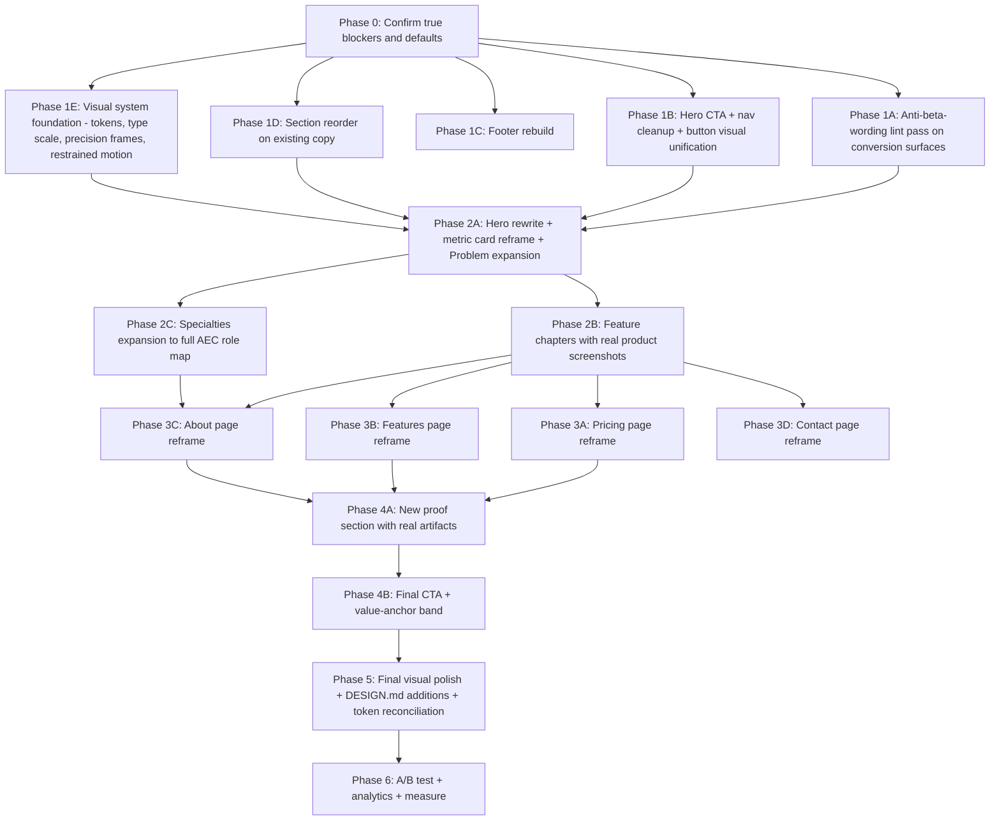

# Brand & Landing Page — Planning Package

**Plan date:** 2026-07-05 (Asia/Manila)
**Continuation revision:** 2026-07-06 (Asia/Manila)
**Plan path:** `.ai/03_plans/2026-07-05-Brand-And-Landing-Page/`
**Plan profile:** `standard`
**Readiness status:** `REVISED CONDITIONALLY READY` — see `17_FINAL_READINESS_REVIEW.md`
**Plan kind:** Planning-only. No code, no tests, no migrations touched.

---

## 2026-07-06 continuation correction

The continuation pass sharpens the plan around the user's newest direction:

- Preserve the visually strong above-the-fold hero and `HeroEstimateWorkspaceMockup`.
- Improve hero copy, CTA hierarchy, fake metric treatment, and Sign in/CTA consistency.
- Replace the earlier warm editorial-luxury / large-radius default with Precision Editorial: neutral/cool product backbone, restrained frames, 8px repeated-card radius, and no beige/cream/espresso repaint.
- Reduce founder blockers to true owner decisions: access CTA, founder bio, pricing numbers, proof screenshots, and explicit visual-archetype override.
- Make validation proportional: docs-only changes use `git diff --check`; browser/visual proof is implementation-time evidence only when it proves layout, interaction, or above-the-fold preservation.

Read first after this revision:

1. `20_DESIGN_AUDIT_AND_VISUAL_DIRECTION.md` §0.
2. `09_DESIGN_SYSTEM_AND_VISUAL_DIRECTION.md` §0.
3. `19_COPY_DEPLOYABLE_PACK.md` §0.
4. `11_IMPLEMENTATION_PLAN.md` §0.
5. `15_DECISIONS_ASSUMPTIONS_AND_ALTERNATIVES.md` §0.

---

## What this plan is

A codebase-grounded plan to **rebrand and rewrite the Archestimator public surface** so it reads as a legitimate, established AEC SaaS — without lying, without overclaiming, and without the founder's current "we have nothing and we're proud of it" voice bleeding onto conversion surfaces.

The user (Philip, founder) asked for four things, in one breath:

1. **Audit the current landing page** — list the good and the bad.
2. **Nail down the product** — list the features, concretely, in a way that sells.
3. **Drop the beta wording** — the public surface must read as a real product, not a hypothesis.
4. **Plan it comprehensively** — phased, traceable, ready for a future implementation pass.

The hero is good. Almost everything else is not.

---

## Master goal

> Convert Archestimator's public surface (landing, pricing, features, about, contact, footer, metadata, structured data) from a **founder-voice "we are an early product, please be kind" posture** into a **product-voice "this is what Archestimator does today, here is the proof" posture** — while preserving the brand's actual honesty principle (`MASTER §10.2`: "earn every claim") and without inventing customers, metrics, compliance badges, or roadmap features that do not exist.

The honesty principle stays. Where it lives on the public surface changes.

---

## Plan status — `CONDITIONALLY READY`

| Gate | Status | Evidence |
|---|---|---|
| Codebase audit | ✅ passed | `03_SOURCE_AND_CODEBASE_AUDIT.md` (file-by-file, line-by-line) |
| Brand + voice direction | ✅ passed | `06_BRAND_AND_COPY_DIRECTION.md` |
| Section architecture | ✅ passed | `07_LANDING_PAGE_SECTIONS.md` |
| Product definition | ✅ passed | `08_PRODUCT_DEFINITION_AND_FEATURES.md` |
| Design system direction | ✅ revised | `09` §0 + `20` §0 supersede the earlier warm-luxury direction |
| Competitive positioning | ✅ passed | `10_COMPETITIVE_AND_MARKET_POSITIONING.md` |
| Phased rollout | ✅ passed | `11_IMPLEMENTATION_PLAN.md` |
| Test & validation strategy | ✅ passed | `12_TEST_AND_VALIDATION_STRATEGY.md` |
| Risk + decisions register | ✅ passed | `14_RISK_REGISTER.md`, `15_DECISIONS_ASSUMPTIONS_AND_ALTERNATIVES.md` |
| Traceability matrix | ✅ passed | `16_REQUIREMENTS_TRACEABILITY_MATRIX.md` |
| External cited research | ⚠️ partial | `18_RESEARCH_AND_EVIDENCE.md` — `verification_mode: emulated` (librarian + explore ran in background; integration is the same agent) |
| Design audit + high-end visual direction | ✅ passed | `20_DESIGN_AUDIT_AND_VISUAL_DIRECTION.md` |
| Founder sign-off on voice recasts | ⛔ blocked | OPEN-DEC-001 in `15_DECISIONS_ASSUMPTIONS_AND_ALTERNATIVES.md` |
| Founder sign-off on pricing page reframe | ⛔ blocked | OPEN-DEC-002 |
| Founder sign-off on AI/deferred-roadmap framing | ⛔ blocked | OPEN-DEC-003 |
| Founder sign-off on founder-bio slot treatment | ⛔ blocked | OPEN-DEC-004 |
| Founder sign-off on visual archetype | ⚠️ defaulted | Precision Editorial is the default; only explicit override blocks |
| Founder sign-off on mono font replacement | ⚠️ defaulted | Existing configured mono/system mono; no new dependency |
| Founder sign-off on floating nav | ⚠️ defaulted | Use contained/floating nav treatment if accessible |

This package is **ready to enter implementation planning** for the safe-default slices in `11` §0. Work that still needs founder input is limited to the CTA access model, founder bio/photo, public pricing numbers, proof screenshot selection, and any explicit rejection of Precision Editorial.

**Verification mode:** `emulated` — the lead author also performed the audit and research passes. Readiness is capped at `CONDITIONALLY READY` for the parts of the package that touch brand voice, because an independent reviewer has not separately validated the recasts.

---

## How to read this plan

**Start here, then read in this order:**

1. **`01_EXECUTIVE_SUMMARY.md`** — the 5-minute TL;DR for founder review.
2. **`03_SOURCE_AND_CODEBASE_AUDIT.md`** — what the current landing actually says today (file-by-file).
3. **`06_BRAND_AND_COPY_DIRECTION.md`** — the new voice rules and the anti-beta-wording policy.
4. **`07_LANDING_PAGE_SECTIONS.md`** — the target section architecture + per-section copy intent.
5. **`08_PRODUCT_DEFINITION_AND_FEATURES.md`** — the product, nailed down.
6. **`20_DESIGN_AUDIT_AND_VISUAL_DIRECTION.md`** — the visual audit and the high-end design direction.
7. **`11_IMPLEMENTATION_PLAN.md`** — the phased, parallel-safe execution plan.

**For implementation, jump to:**

- `11_IMPLEMENTATION_PLAN.md` — phases, dependencies, durable goals.
- `19_COPY_DEPLOYABLE_PACK.md` — actual ready-to-paste copy strings.

**For audit and traceability:**

- `04_REQUIREMENTS_SPECIFICATION.md` — every REQ-* with source + acceptance criterion.
- `16_REQUIREMENTS_TRACEABILITY_MATRIX.md` — REQ × WP × AC × TEST.

**For decisions and risks:**

- `15_DECISIONS_ASSUMPTIONS_AND_ALTERNATIVES.md` — what we chose, what we rejected, what's still open.
- `14_RISK_REGISTER.md` — what could go wrong.

---

## Phase order (execution dependency graph)

Phases 1A–1D are **parallel-safe** (different file scopes, no shared content). Phases 2A onward are mostly **sequential** because they share the landing copy file `src/components/landing-v3/landing-content.ts`.

---

## Files this plan will touch (when implementation begins)

**Source files in scope** (none modified in this planning pass):

| Path | Phase | Reason |
|---|---|---|
| `src/app/page.tsx` | 1B, 2A | Landing route — hero CTA, A/B variant |
| `src/components/landing-v3/landing-content.ts` | 1A, 2A–2C, 4B | Single landing copy source |
| `src/components/landing-v3/ArchestimatorLandingPage.tsx` | 1D, 2A–2C, 4A–4B | Landing JSX + section order |
| `src/components/landing-v3/HeroEstimateWorkspaceMockup.tsx` | 2A | Hero metric card reframe |
| `src/app/pricing/page.tsx` | 3A | Pricing page reframe |
| `src/app/features/page.tsx` | 3B | Features page reframe |
| `src/app/about/page.tsx` | 3C | About page reframe |
| `src/app/contact/page.tsx` | 3D | Contact page reframe |
| `src/components/landing/claims-ledger/claims-data.ts` | 1A, 4A | Claims ledger recasts + status policy |
| `src/components/landing/company-proof-data.ts` | 4A | Real-proof slot policy |
| `src/components/landing/sections/FinalCtaSection.tsx` | 4B | Final CTA rebuild |
| `src/components/landing/shared/StatusPill.tsx` | 4A | Status pill visual review |
| `src/lib/landing/seo-metadata.ts` | 1A | Meta descriptions cleanup |
| `src/app/layout.tsx` | 1A | Global metadata |
| `src/app/sitemap.ts` | 5 | Sitemap review |
| `DESIGN.md` | 5 | Landing visual direction additions |
| `.ai/00_corpus/ARCHESTIMATOR_MASTER.md` | Post-impl | Reflect approved recasts back into canon |
| `.ai/10_state/current-state.md` | Post-impl | Append closeout entry |

**Files explicitly off-limits:**

- `migrations/**` — no schema changes
- `supabase/**` — historical archaeology only
- `src/lib/repositories/**`, `src/lib/auth/**`, `src/lib/collaboration/**` — backend untouched
- `src/components/workshop/**` — the authenticated app is not in scope
- `src/components/ui/**` primitives — the design system tokens are not renegotiated here; landing-specific styling only
- Any Cloudflare binding, `wrangler.jsonc`, package manifest, or provider surface

**Files intentionally unaffected:**

- `/workshop` route and below
- `/share/[token]` publication viewer
- `/invite/[token]` invite entry
- `/login`, `/signup`, `/auth/callback` auth flows
- All API routes under `/api/*`
- The Cloudflare Worker, D1, R2, DO, Queue, Email bindings

---

## Before the first edit (implementation-time checklist)

When this plan moves to implementation, the executor must:

1. **Re-validate the true blockers in `15` §0** with the founder. If unresolved, use the documented defaults for safe slices and block only the affected decision surface.
2. Run `git status --short --branch` and confirm a clean working tree on `main` (or the chosen branch).
3. Re-read the latest `src/components/landing-v3/landing-content.ts` and `ArchestimatorLandingPage.tsx` — landing content drifts fast.
4. Re-read `.ai/00_corpus/ARCHESTIMATOR_MASTER.md` §10.2 (voice principles) and §15 (claims discipline) — the canon controls copy.
5. Confirm the `claims-matrix-check` gate still reconciles `claims-data.ts` against the live Feature Inventory.
6. Run `bun run lint:design-system` once to confirm the enforcer is green before changing landing copy.

---

## Anti-goals (this plan will NOT)

- Invent customers, testimonials, adoption metrics, partner names, or compliance badges.
- Claim roadmap features are shipped.
- Recast the `MASTER` canon unilaterally — proposed recasts go to `15_DECISIONS_ASSUMPTIONS_AND_ALTERNATIVES.md` for founder sign-off.
- Touch the authenticated workshop, the publication viewer, the auth flow, the API routes, the Cloudflare bindings, the migrations, or the package manifest.
- Negotiate the SF Pro / Inter / Source Serif 4 type system or the core color tokens — those stay; this plan extends the landing-only token layer only.
- Delete the Claims Ledger system. The system stays; its copy and where its rows appear change.

---

## Authority and source-of-truth

This plan is **subordinate to**:

- `AGENTS.md` (workspace entry point)
- `.ai/00_corpus/ARCHESTIMATOR_MASTER.md` v4.3 (founder canon)
- `.ai/00_system/AGENT_OPERATING_PROTOCOL.md` (loop contract)
- `.ai/10_state/current-state.md` (live project state)
- Current source files in `src/components/landing-v3/`, `src/app/{pricing,features,about,contact}/`

If this plan and the MASTER corpus conflict, the MASTER wins; the plan must either align or escalate an OPEN-DEC.

---

## Contact

Plan author: Sisyphus (OpenCode orchestrator agent)
Plan owner: Philip (founder)
Review loop: see `00_AGENT_COORDINATION.md`
