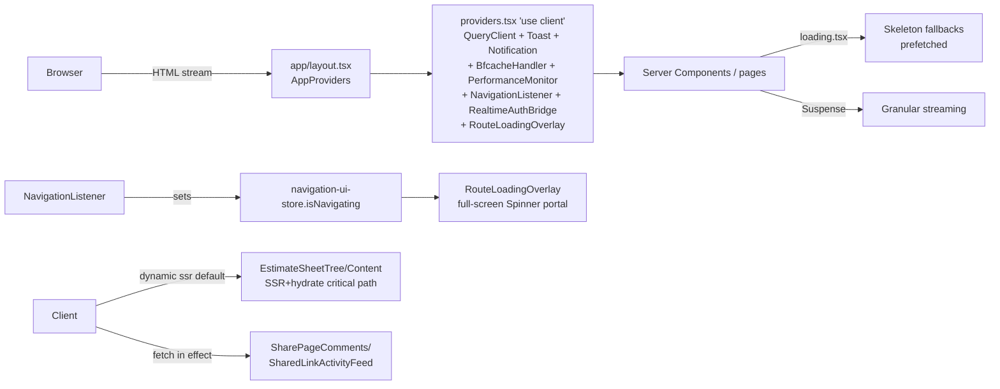
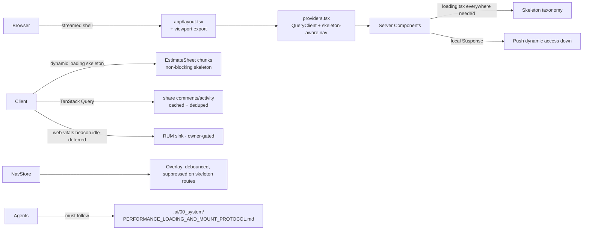

# Architecture and Technical Design

Target architecture for transition/loading UX, mount strategy, measurement, and agent rules. Current-state evidence is in `03_SOURCE_AND_CODEBASE_AUDIT.md`.

---

## 1. Current-state architecture (loading/transition/mount)

Key facts: Cache Components **off**; `staleTimes` tuned (dynamic 60s/static 180s); no `useSuspenseQuery`/`HydrationBoundary`; prefetch disabled on 15 links + hover-prefetch hook; overlay is the global fallback.

## 2. Target-state architecture

Principles:
- **Static shell first.** Maximize what paints before any async resolves; push dynamic access (`params`, `cookies()`, fetches) down into components wrapped in local `<Suspense>`.
- **Skeleton > spinner.** Spinners reserved for inline indeterminate actions and the debounced global overlay.
- **Heavy chunks off the critical path.** Where a skeleton exists, don't SSR+hydrate the giant subtree.
- **One cache/freshness mental model.** Today: TanStack Query (client) + `staleTimes` (router) + per-route `force-dynamic`/`force-static`. Future (owner-gated): Cache Components + `unstable_instant`.
- **Measure in production.** RUM beacon (owner-gated sink) + retained Playwright/Vitest evaluators.

## 3. Server/Client Component boundary policy (to codify)

- Default **Server Component**. Justify every `"use client"`.
- Smallest client boundary: push `"use client"` to the leaf interactive component, not the page.
- Server-only data/secrets/repos never cross into client bundles (existing repository-boundary pattern).
- New client boundary → state bundle impact (KB gzip) per `27-*.md` Rule 1/9.
- Data fetching owner decision tree:
  - Authoritative server read → Server Component or repository/data layer.
  - Client cache + invalidation → TanStack Query (`useQuery`; consider `useSuspenseQuery` + `HydrationBoundary` for SSR bridge).
  - Cross-component client UI state (not server data) → Zustand.
  - Shareable nav state → URL/search params.
  - Isolated interaction → local `useState`.

## 4. Streaming & Suspense law (codifies `13_research/...Bible...md` §6.5)

- Place `<Suspense>` **close to the dynamic access**. A high `loading.tsx` is valid but coarse.
- **LCP elements stay outside/above** Suspense (Next.js streaming guidance).
- Pass `params`/`searchParams` **promises** down; resolve inside a Suspense boundary (don't `await` at page top unnecessarily).
- Skeletons match content dimensions (CLS).
- For `notFound()`/redirect on token routes, call **before** the first `await`/Suspense to preserve HTTP status where needed (REL-01).

## 5. Mount strategy (the "quickest, most efficient" ask)

Ranked leverage:

1. **EstimateSheet{Tree,Content} non-blocking** (ARCH-02): `next/dynamic` with `loading: () => <EstimateSheetRouteSkeleton/>`; evaluate `ssr:false` for the tree pane (discovery: react-complex-tree hydration). Largest single win.
2. **Code-split heavy modules** (already partial): ExcelJS, D3, react-complex-tree, AI, PDF remain `ssr:false` dynamic. Agent rule enforces.
3. **Migrate share fetch-in-effect → TanStack Query** (ARCH-03): enables SSR prefetch bridge + cache.
4. **Virtualization** for large lists/trees (already in `13_research` bible; codify in rule).
5. **Hover-prefetch** pattern (already good; codify as the default for link-heavy dashboards, with `prefetch={false}` + `usePrefetchOnHover`).
6. **`useTransition`/`useDeferredValue`** for mutation feedback and expensive filtering (already used well; codify).
7. **Defer instrumentation to idle** (`requestIdleCallback`/`scheduler.postTask`) — `27-*.md` Rule 6.
8. **`next/font`** evaluation (currently CSS fonts) — opportunity, lower priority.

## 6. Cache/freshness contract (current model + future)

| Layer | Owner | Key | TTL | Invalidation | Read-your-writes |
|---|---|---|---|---|---|
| Router Cache (client) | Next.js | route | `staleTimes` dynamic 60s/static 180s | navigation, revalidation | yes (warm nav) |
| TanStack Query | `QueryClient` (5 min stale/gc, retry 1, no focus refetch) | query key | 5 min | `invalidateQueries` | yes after mutation invalidate |
| Route render | `force-dynamic`/`force-static` per route | — | per-route | n/a | n/a |

Future (owner-gated, ARCH-05): Cache Components → `"use cache"` + `cacheLife`/`cacheTag` + `revalidateTag`/`updateTag`; `unstable_instant` build-time validation; private/auth routes stay no-store.

## 7. Performance/measurement architecture

- **Evaluators** (PERF-01): one per budget-bearing route/operation, named in `09_PERFORMANCE...md`.
- **RUM** (PERF-02, owner-gated): client beacon → chosen sink; idle-deferred; PII-safe.
- **CI bundle gate** (PERF-03): strict mode after baselines stable.
- **Authenticated CI coverage** (PERF-04): safe seeded fixture.
- **Benchmark cadence**: capture baseline before a change, compare after; store in `metrics/`.

## 8. Component/hook quality bar (codifies `13_research` bible §7 + directive §8A)

- Derived state over mirrored state.
- Effects for synchronization only, with cleanup.
- Memoization only for real render-cost/referential-stability reasons.
- Stable keys for mutable lists.
- No `any`; exhaustive discriminated unions.
- Decomposition targets for large components (the 3000-LOC files are debt; agent rule discourages growth).

## 9. Reliability boundaries

- Every route subtree → error boundary (UX-02).
- Perpetual-skeleton escape → error after timeout (REL-02).
- bfcache: `BfcacheHandler` exists; cache headers on `/share/:path*` are `no-store` (mitigates bfcache issues). Verify persisted restore (known manual-Chrome gate from `27-*.md`).

## 10. Tailwind v4 / design-system

- `Skeleton` is the canonical primitive (`bg-muted/40`, `motion-reduce`).
- `Spinner` for indeterminate inline only.
- No new ad-hoc primitives when existing fit (roadmap rule).
- `lint:design-system` + `lint:design` (Impeccable) gates remain.

## F. Where new agent rules live (see also `03_..._AUDIT.md` §D)

- **RULES** → `.ai/00_system/PERFORMANCE_LOADING_AND_MOUNT_PROTOCOL.md` (flat file) + `AGENTS.md` pointer.
- **NUMERIC BUDGETS** → reference `01_roadmap/27-*.md` (do not duplicate).
- **ENGINEERING LAW** → reference `13_research/...Bible...md`.
- **OPERATIONAL PROCEDURE** (optional) → `.ai/11_skills/verify-loading-state-compliance.md` (Format B).
- **PER-AGENT** → no changes to `12_agents/payloads/*` (rules are universal).
- Validate with `bun run validate:agents`.

## Rejected alternatives

- **Fork rules into `.cursor/`/`.codex/`/`.commandcode/`.** Rejected: those are generic third-party packs, lower authority; canonical-map says universal rules go in `00_system/`.
- **Duplicate numeric budgets into the new protocol.** Rejected: single source of truth in `27-*.md`.
- **Mandate Cache Components now.** Rejected: cross-cutting, changes every uncached boundary; owner-gated future.
- **Replace `RouteLoadingOverlay` entirely with skeletons.** Rejected: cross-shell transitions still need a global fallback; keep + debounce + suppress-on-skeleton-route.
- **Mandate `useSuspenseQuery` everywhere now.** Rejected: introduce where it pays off (share surface, estimate); codify as an option in the rule.
