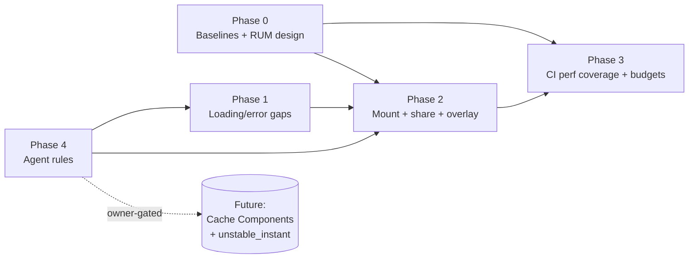

# Blast Radius and Dependencies

This is a planning-only pass — **zero code blast radius from the pass itself**. This document maps the blast radius of the *future implementation phases* it proposes, so implementers and reviewers know what each slice touches.

---

## 1. Phase-by-phase blast radius

| Phase | Touches | Files/systems affected | Risk | Classification |
|---|---|---|---|---|
| **Phase 0 — Measurement baseline + RUM design** | docs + scripts only | `metrics/`, `09_PERFORMANCE...md`, PERF-02 design doc; no source | Low | Documentation/evidence |
| **Phase 1 — Loading/error gap closure** | `src/app/**` route files | `/invite/[token]/{loading,error}.tsx`, `/workshop/{error.tsx,publisher/loading.tsx}`, `projects/**/error.tsx`, `settings/error.tsx`, `onboarding/error.tsx`, activity loading → `Skeleton`, `viewport` export in root layout | Low-Medium (UI only; per-route) | Probable change |
| **Phase 2 — Mount optimization + share migration + overlay tuning** | `src/components/workshop/EstimateWorkspaceClient.tsx`, `EstimateSheetTree/Content`, `src/components/share/*`, `route-loading-overlay.tsx`, `navigation-ui-store` | Medium-High (critical estimate route; share receiver) | High | Required change ( ARCH-02, ARCH-03, UX-03 ) |
| **Phase 3 — Perf coverage + budget gating** | CI, scripts, e2e | `.github/workflows/ci.yml`, `scripts/check-performance-budgets.mjs`, `route-transition-performance-budgets.json`, seeded auth fixture | Medium (CI/auth) | Required change (PERF-03/04) — owner-gated |
| **Phase 4 — Agent rules** | `.ai/00_system/` + `AGENTS.md` | New `PERFORMANCE_LOADING_AND_MOUNT_PROTOCOL.md`, one-line `AGENTS.md` pointer, optional `.ai/11_skills/verify-loading-state-compliance.md`; `bun run validate:agents` | Low | Required change (ARCH-01, DOC-01) — IMPLEMENTATION-READY |
| **Future — Cache Components + `unstable_instant`** | cross-cutting | Every uncached-data boundary; `next.config.ts` (`cacheComponents`); layouts/pages | Very High | Owner-gated, future |

## 2. Direct impact map

- **Users:** Phase 1/2 improve perceived speed; Phase 0/3/4 are internal. No user-visible regression intended; rollback per EV-* thresholds.
- **Routes:** Phase 1 adds files to ~10 routes; Phase 2 changes estimate + share routes.
- **Components:** Phase 2 touches `EstimateWorkspaceClient`, `EstimateSheetTree/Content`, `RouteLoadingOverlay`, share components.
- **APIs:** PERF-02 adds one internal beacon endpoint (additive).
- **DB/provider:** **None.**
- **Tests:** Phase 1/2 extend Playwright specs; Phase 3 adds CI gating.
- **CI:** Phase 3 modifies workflow + budget strictness.
- **Docs/agent rules:** Phase 4 adds the protocol + AGENTS.md pointer.
- **Backward compatibility:** preserved (additive).
- **Other active work:** `git status` shows activity-UX, brand/landing, `src/app/new/`, `landing-new/` in progress — **no overlap** with this plan's writes (all confined to the plan folder during this pass).

## 3. Dependency graph (phases)

- Phase 4 (rules) and Phase 0 (baselines) are independently startable and unblock the rest.
- Phase 2 depends on Phase 1 (skeletons exist) + Phase 0 (baselines to compare).
- Phase 3 (gating) depends on Phase 0/2 (stable baselines).
- Future Cache Components is owner-gated and separate.

## 4. Compatibility / migration

- No migrations. No schema changes. No breaking API changes.
- Agent-rule additions are additive policy; existing plans/docs cross-reference (not fork).

## 5. Affected documentation

- `AGENTS.md` (Phase 4 pointer).
- New `.ai/00_system/PERFORMANCE_LOADING_AND_MOUNT_PROTOCOL.md` (Phase 4).
- Optional `.ai/11_skills/verify-loading-state-compliance.md` (Phase 4).
- `09_PERFORMANCE...md` / `metrics/` (Phase 0).
- `.ai/01_roadmap/27-*.md` referenced, not modified.

## 6. Concurrent-agent safety (cross-ref `00_AGENT_COORDINATION.md`)

All Phase-4 writes are isolated to `.ai/00_system/` + one `AGENTS.md` line — declare ownership in the coordination ledger before editing; re-read `AGENTS.md` immediately before the one-line addition to avoid clobbering concurrent edits. Phase-1/2 edits are per-route/per-component (file-level ownership leases).
