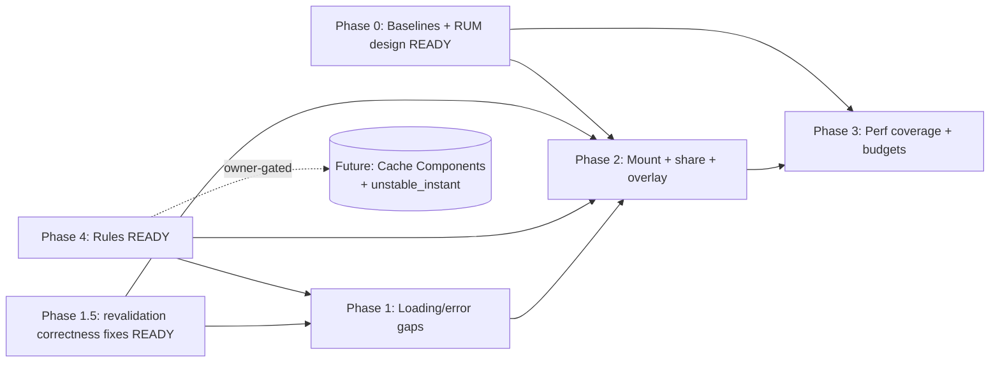

# Implementation Plan

**Authoritative execution guide for the future implementation AI.** This plan is `planning-only` until an owner approves a phase. Each phase is a **durable-goal contract** (per `Multi-Agent-Execution-Directive.md` §1/§4A and `ultragoal`-style discipline): completion requires the named evidence + a requirement-by-requirement audit, not merely "code changed."

Phase order: **Phase 4 (Rules)** and **Phase 0 (Baselines)** are independently startable and `IMPLEMENTATION-READY`. **Phase 1.5 (correctness fixes — release-blocking per Improve directive)** must precede broad Phase 1 UX work. Then 1 → 2 → 3. Future Cache Components is owner-gated and separate.

> **New in this improvement pass (2026-07-07):** deepened evidence surfaced **three correctness bugs** (ARCH-07a/b/c: stale/missing `revalidatePath`) that are sequenced into a new **Phase 1.5** *before* Phase 1 UX work, per the Improve directive's rule "release-blocking hardening before broad UX/refactor." Also added: ARCH-06 (double-fetch), SEC-09/10, and a refined PERF-02 defaulting to **Cloudflare Web Analytics (Tier-1)** instead of a custom beacon (see `23_CLOUDFLARE_COST_AND_RESOURCE_BUDGET.md`). Every task now references a Proof Contract ID (PC-*) from `22_PROOF_CONTRACTS_AND_KNOWN_RED_LEDGER.md`.

> **Execution boundary:** This document is an *implementation-readiness* guide produced by a planning-only pass. Starting source/test/migration edits from this pack requires a separate owner-approved execution scope (per the shared planning suite). The `IMPLEMENTATION-READY` label below means the *planning* for that phase is complete and unblocked — not that execution is auto-authorized.

---

## Phase 4 — Agent Rules (IMPLEMENTATION-READY, lowest risk, highest leverage)

**Durable-goal contract:**
- **Goal ID:** P4-RULES
- **Objective:** Author the single canonical performance/loading/mount protocol + AGENTS.md pointer + optional skill; enforce via `validate:agents`.
- **Scope:** `.ai/00_system/PERFORMANCE_LOADING_AND_MOUNT_PROTOCOL.md` (new), one line in `AGENTS.md`, optional `.ai/11_skills/verify-loading-state-compliance.md`.
- **Requirements covered:** ARCH-01, ARCH-04, ARCH-05(rule), DOC-01, PERF-05, A11Y-01(rule), UX-04(rule).
- **Required evidence:** (1) file exists at exact path with required sections; (2) `AGENTS.md` diff shows pointer in Core rules; (3) `bun run validate:agents` exit 0; (4) `git diff --check` clean; (5) doc review checklist signed.
- **Completion audit:** every requirement listed maps to a protocol section; no numeric budget duplicated from `27-*.md`; no forking into tool adapters.
- **Checkpoint artifacts:** the new protocol file, the AGENTS.md diff, validate:agents output.
- **Stop condition:** all evidence present + doc review pass.
- **Blocker condition:** owner rejects rule wording → record and iterate.
- **Review gate:** doc review (emulated independent pass).
- **QA gate:** `bun run validate:agents` + `git diff --check`.

### P4 Tasks

#### P4-T1 — Author the protocol file
- **Task ID:** P4-T1
- **Req IDs:** ARCH-01, ARCH-04, DOC-01, PERF-05, A11Y-01, UX-04, ARCH-05
- **Objective:** Create `.ai/00_system/PERFORMANCE_LOADING_AND_MOUNT_PROTOCOL.md`.
- **Why:** Single source of rule truth for all agents; canonical-map placement.
- **Target path (new):** `.ai/00_system/PERFORMANCE_LOADING_AND_MOUNT_PROTOCOL.md`
- **Required sections (content outline — the implementer fills prose, not invented policy):**
  1. **Status/authority:** universal rule; references `27-*.md` (budgets) and `13_research/...Bible...md` (law); `AGENTS.md` is the entry.
  2. **Server/Client boundary law:** default Server Component; smallest `"use client"`; server-only data out of bundles; state owner decision tree (URL → server → TanStack Query → Zustand → local). (ARCH-04)
  3. **Mount law:** heavy modules `next/dynamic({ ssr:false })`; modal/dialog `ssr:false`; critical-path chunks with a skeleton must use `loading:` and avoid default-SSR-of-giant-subtree; virtualize large lists/trees. (ARCH-02 rule)
  4. **Streaming/Suspense law:** static shell first; push dynamic access down; `<Suspense>` close to dynamic access; LCP outside/above Suspense; LCP-image `preload`; skeletons match dimensions (CLS); `notFound()`/redirect before first `await` on token routes.
  5. **Loading-state taxonomy + decision tree:** skeleton vs spinner vs overlay vs progress (from `05_UX...md` §2). Skeleton preferred; spinner for indeterminate inline + debounced global overlay.
  6. **Prefetch law:** default Next Link; link-heavy dashboards use `prefetch={false}` + `usePrefetchOnHover`; `staleTimes` rationale (dynamic 60s/static 180s) — don't change without measurement.
  7. **Cache/freshness law + future Cache Components:** current model table; `unstable_instant` future path + prerequisites; opt-in `instant=false` guidance.
  8. **No `fetch` in `useEffect` for server data:** use TanStack Query (`useQuery`/`useSuspenseQuery` + `HydrationBoundary` for SSR bridge).
  9. **Concurrency law:** `useTransition` for mutation feedback; `useDeferredValue` for expensive filtering; effects for sync only with cleanup.
  10. **Instrumentation law:** idle-deferred (`requestIdleCallback`/`scheduler.postTask`); no user-visible latency.
  11. **Bundle law:** state KB gzip impact per change; >10KB main-bundle regression flagged (Rule 9); heavy deps owner-approved (Rule 1).
  12. **Accessibility law:** loading UI `role=status`/`aria-live`/`aria-label`; reduced-motion; focus not trapped by overlay.
  13. **`viewport` + LCP-image preload discipline.** (UX-05)
  14. **"Add a page" checklist** (DOC-01): force-static/dynamic decision; loading.tsx; error.tsx; not-found; metadata + viewport; Suspense placement; prefetch choice; skeleton primitive; a11y states; bundle impact; EV-* evaluator touch.
  15. **"Add a component" checklist** (DOC-01): Server vs Client boundary; if Client, smallest boundary + bundle impact; if heavy, dynamic + skeleton; if data, TanStack Query; if list, keys/virtualize; a11y; reduced-motion; memoization only if justified.
  16. **Measurement handoff:** point to `09_PERFORMANCE...md` evaluators + `27-*.md` budgets + PERF-01 procedure.
- **Expected output:** one markdown file.
- **Failure cases:** duplicating `27-*.md` numbers; forking into tool adapters; vague "use best practices."
- **Tests/val:** `bun run validate:agents`; doc-review checklist.
- **Completion evidence:** file + validate:agents exit 0.
- **Parallelization:** Sequential (single owner file).
- **Complexity:** Medium.

#### P4-T2 — Add AGENTS.md pointer
- **Task ID:** P4-T2; Req: ARCH-01 (AC-ARCH-01b).
- **Objective:** One-line pointer in `AGENTS.md` Core rules → new protocol.
- **Target:** `AGENTS.md` (existing). Re-read immediately before edit (concurrency safety).
- **Validation:** `git diff --check`; `validate:agents`.
- **Complexity:** Small.

#### P4-T3 — Optional companion skill
- **Task ID:** P4-T3; Req: DOC-02 (P3/optional).
- **Objective:** If a repeatable procedure adds value, add `.ai/11_skills/verify-loading-state-compliance.md` (Format B).
- **Complexity:** Small. **May defer** if P4-T1 is sufficient.

---

## Phase 0 — Measurement Baselines + RUM Design (IMPLEMENTATION-READY as documentation)

**Durable-goal contract:**
- **Goal ID:** P0-MEAS
- **Objective:** Capture current baselines for EV-01..EV-10 into `metrics/`; finalize the PERF-01 evaluator table (already drafted in `09_...md`); produce the PERF-02 RUM design doc (sink left as owner decision).
- **Scope:** `metrics/` evidence files; PERF-02 design doc (inside this plan folder or a linked decision doc); no source.
- **Requirements:** PERF-01, PERF-02(design).
- **Required evidence:** baseline JSON/MD for each EV-*; RUM design doc with sink options + redaction schema + sampling + CSP note.
- **Stop condition:** baselines captured; design doc reviewed.
- **Blocker:** PERF-02 implementation blocked on OPEN-PERF-01 (sink).
- **QA gate:** baselines reproducible (re-run yields same median ± flake).

### P0 Tasks
- **P0-T1 (PC-15)** Run each `perf:*` / e2e evaluator; record `metrics/<ev-id>-baseline.<md|json>` with date+commit. Complexity: Medium.
- **P0-T2 (PC-15)** Run `ANALYZE=true bun run build` + `scripts/check-performance-budgets.mjs`; record per-route first-load JS baseline. Complexity: Small.
- **P0-T3 (PC-16)** Author PERF-02 RUM design doc. **Default recommendation (2026-07-07): Cloudflare Web Analytics Tier-1** (`beacon.min.js` snippet; free; reports LCP/INP/CLS; no Worker code). Tier-2 (custom Worker→Workers Logs beacon) only if custom dimensions needed. Paid APM rejected (free-tier posture). See `23_CLOUDFLARE_COST_AND_RESOURCE_BUDGET.md`. Complexity: Medium. **Owner confirms Tier 1 vs Tier 2 (OPEN-PERF-01).**

---

## Phase 1.5 — Route Revalidation Correctness Fixes (IMPLEMENTATION-READY; release-blocking)

**Durable-goal contract:**
- **Goal ID:** P15-REV
- **Objective:** Fix three server-side revalidation gaps discovered by the route-cache audit (ARCH-07a/b/c). These are **correctness bugs**, not polish: stale data on hard refresh / new tab after Server-Action mutations.
- **Requirements:** ARCH-07a, ARCH-07b, ARCH-07c.
- **Prereqs:** none (independent of Phase 4/0). May run in parallel with Phase 4.
- **Required evidence:** grep proofs (PC-11/12/13) show correct paths; targeted e2e confirms no stale data on refresh after mutation; `git diff --check`.
- **Stop condition:** all three PC-11/12/13 green.
- **QA gate:** `rg` proofs + targeted e2e (proposals/publisher/components refresh-after-mutation). Per `27-*.md`, run `NODE_OPTIONS=--max-old-space-size=8192 bun run type-check` (default-heap type-check is known-red — see `22_...md` ledger).

### P1.5 Tasks
- **P1.5-T1 (ARCH-07a, PC-11):** In `src/lib/component-library/actions.ts:309` and `src/lib/ai/package-builder/apply.ts:1896`, replace `revalidatePath("/workshop/components")` → `revalidatePath("/workshop/library/components")`. Grep proof: `rg 'revalidatePath\("/workshop/components"\)' src/lib` returns 0. Complexity: Small.
- **P1.5-T2 (ARCH-07b, PC-12):** Add `revalidatePath("/workshop/proposals")` to the Server Action(s) that mutate recipient-proposal-affecting data (audit which actions touch proposals data; at minimum the proposal/publication action paths). Grep proof: `rg 'revalidatePath\("/workshop/proposals"\)' src/lib` returns ≥1. **DISCOVERY-REQUIRED sub-step:** confirm which Server Actions actually mutate data shown on `/workshop/proposals` (read `listRecipientProposals` consumers) so the revalidation is added in the right place, not blanket-added. Complexity: Small-Medium.
- **P1.5-T3 (ARCH-07c, PC-13):** Same as P1.5-T2 for `/workshop/publisher` — add `revalidatePath("/workshop/publisher")` to actions mutating publications-roster data (audit `readWorkspacePublicationsRoster` consumers; e.g. publication publish/unpublish/recipient changes in `src/lib/publication/actions.ts`). Complexity: Small-Medium.

**Why this is its own phase before Phase 1 UX:** the Improve directive explicitly states that release-blocking data/correctness hardening must be sequenced before broad UX/refactor phases or marked as an explicit gate. These three are small, isolated, and unblock trust in the routes that Phase 1/2 then improve cosmetically.

---

## Phase 1 — Loading & Error Gap Closure (CONDITIONALLY READY; low-risk UI)

**Durable-goal contract:**
- **Goal ID:** P1-GAPS
- **Objective:** Close loading/error/viewport gaps on dynamic + authenticated routes.
- **Requirements:** UX-01, UX-02, UX-05, A11Y-01, A11Y-03, REL-01(audit).
- **Prereqs:** Phase 4 rule authored (so skeletons follow taxonomy).
- **Required evidence:** route table refreshed; Playwright route-transition + error-boundary specs extended & green; `rg "export const viewport"` shows root viewport; `git diff --check`.
- **Stop condition:** every named route has loading (where applicable) + error boundary; specs green.
- **QA gate:** Playwright specs; type-check; lint; design-system.

### P1 Tasks
- **P1-T1 (PC-01)** `/invite/[token]`: add `loading.tsx` (skeleton) + `error.tsx`; ensure `notFound()` called before first `await`. (UX-01, REL-01) Complexity: Small.
- **P1-T2 (PC-02)** `/workshop/publisher/loading.tsx` (skeleton). (UX-01) Small.
- **P1-T3 (PC-02)** `/workshop/projects/[projectId]/estimates/loading.tsx` (skeleton matching the in-page Suspense). (UX-01) Small.
- **P1-T4 (PC-03)** Add `error.tsx` to workshop subtrees missing one: `/workshop`, `/workshop/projects`, `/workshop/projects/[projectId]`, `/workshop/proposals`, `/workshop/settings`, `/workshop/onboarding`. (UX-02, SEC-10 keep no-store) Small-Medium.
- **P1-T5 (PC-04)** Migrate `workshop/projects/[projectId]/activity/loading.tsx` hand-rolled divs → `Skeleton` (or documented exception). (UX-04) Small.
- **P1-T6 (PC-05)** Add `export const viewport` to root layout. (UX-05) Small.
- **P1-T7 (PC-06)** Audit loading UIs for `role/aria-live/aria-label` + reduced-motion; fix gaps. (A11Y-01/03) Small.

---

## Phase 2 — Mount Optimization + Share Migration + Overlay Tuning (CONDITIONALLY READY; higher risk)

**Durable-goal contract:**
- **Goal ID:** P2-MOUNT
- **Objective:** Move heavy estimate chunks off critical path; migrate share fetch-in-effect to TanStack Query; tune overlay suppression.
- **Requirements:** ARCH-02, ARCH-03, UX-03.
- **Prereqs:** Phase 1 (skeletons exist), Phase 0 (baselines to compare).
- **Required evidence:** EV-04 (CRUD latency) not regressed; EV-09 (shell streaming) skeleton-first; EV-02 (share FMP) improved or unchanged; bundle analysis shows critical-path change; `rg "fetch(" in useEffect` empty for target files.
- **Stop/Blocker:** ARCH-02 has a **DISCOVERY-REQUIRED** sub-step (react-complex-tree hydration under `ssr:false`); UX-03 threshold is owner-decided (OPEN-UX-01).
- **QA gate:** Playwright shell-streaming + CRUD-latency + share-receiver specs; bundle analyzer; type-check; vitest perf.

### P2 Tasks
- **P2-T1 (DISCOVERY-REQUIRED first, PC-08)** Verify `EstimateSheetTree` (react-complex-tree) hydrates correctly under `dynamic({ ssr:false, loading })`. Scope: read `EstimateSheetTree.tsx` + react-complex-tree init; small spike. Stop condition: confirm drag-drop + selection still work client-only, or document the boundary that requires SSR.
- **P2-T2 (PC-08)** `EstimateWorkspaceClient.tsx:27,30`: add `loading: () => <EstimateSheetRouteSkeleton/>`; apply `ssr:false` to tree pane if P2-T1 confirms; keep content path explicit. (ARCH-02) Complexity: Medium-Large.
- **P2-T3 (PC-09)** Migrate `SharePageComments.tsx` + `SharedLinkActivityFeed.tsx` to TanStack Query (`useQuery` or `useSuspenseQuery` + `HydrationBoundary` if SSR-bridged). Remove fetch-in-effect. (ARCH-03, SEC-10 keep no-store) Medium.
- **P2-T4 (PC-09)** Remove hand-rolled focus-refetch in `proposals-page-client.tsx:79`; replace with documented revalidation (e.g., re-enable `refetchOnWindowFocus` for that query key, or manual invalidate on visibility). (ARCH-03) Small.
- **P2-T5 (PC-10)** Overlay suppression: suppress `RouteLoadingOverlay` on routes with a `loading.tsx`, with a debounced fallback threshold (OPEN-UX-01). (UX-03) Small-Medium. **Owner threshold decision.**
- **P2-T6 (PC-18, ARCH-06)** Eliminate `/workshop` dashboard double-fetch: pick one revalidation path (server `revalidatePath("/workshop")` OR client `router.refresh()`), document the choice, remove the other. Complexity: Small-Medium.

---

## Phase 3 — Perf Coverage + Budget Gating (CONDITIONALLY READY; owner-gated)

**Durable-goal contract:**
- **Goal ID:** P3-PERF
- **Objective:** Authenticated CI perf coverage; strict bundle budget; tightened route-transition budgets.
- **Requirements:** PERF-03, PERF-04.
- **Prereqs:** Phase 0 baselines; Phase 2 stable.
- **Required evidence:** ≥1 authenticated CI transition scenario posted; strict budget gate enabled (after owner approval); tightened `route-transition-performance-budgets.json`.
- **Blocker:** PERF-03 owner approval (OPEN-PERF-02); PERF-04 security review of CI auth fixture.
- **QA gate:** CI green with new gates.

### P3 Tasks
- **P3-T1** CI auth fixture: seeded dev-auth or storage state, CI-only, security-reviewed. (PERF-04) Medium.
- **P3-T2** Flip `PERF_BUDGET_STRICT=1` in CI after baselines stable + owner approval; tighten `PERF_BUDGET_KB` per `27-*.md` route table. (PERF-03) Small.
- **P3-T3** Tighten `route-transition-performance-budgets.json` medians from multi-second loose to near `27-*.md` targets, staged. Small.

---

## Future — Cache Components + `unstable_instant` (owner-gated, separate)

**Goal ID:** F-INSTANT
- **Objective:** Evaluate and (if approved) adopt Cache Components + `unstable_instant` for guaranteed instant navigations with build-time validation.
- **Prereqs:** Owner decision (OPEN-ARCH-01); audit every uncached-data boundary; migrate to `"use cache"` + local Suspense; private/auth routes stay no-store; add `@next/playwright` `instant()` regression tests; `experimental.instantNavigationDevToolsToggle`.
- **Risk:** Very High (cross-cutting). Separate plan pack recommended.

---

## Parallelization classification

- **Parallel-safe:** P4-T3, P0-T1/T2 (independent captures), **P1.5-T1/T2/T3** (distinct action files), P1-T1..T7 (per-route), P3-T3, P2-T6.
- **Sequential (dependency):** P4-T1 → P4-T2; P0-T1 → P3-T2; P2-T1(discovery) → P2-T2; **P1.5 → P1** (correctness before polish, per Improve directive).
- **Sequential (shared-file risk):** P4-T2 (AGENTS.md) — single owner, re-read before edit.
- **Not worth delegating:** P1-T6 (one-line viewport), P4-T2 (one-line pointer), P1.5-T1 (rename path).

## Dependency graph (updated 2026-07-07)

## Risks / rollback (per phase)

- **Phase 4:** rule wording rejected → iterate; rollback = revert file + AGENTS.md line.
- **Phase 1:** a skeleton causes CLS → match dimensions; rollback per file.
- **Phase 2:** `ssr:false` breaks estimate hydration → P2-T1 discovery prevents; rollback the `dynamic` options. CRUD regression → rollback (EV-04 gate).
- **Phase 3:** strict budget blocks merge unexpectedly → keep advisory until baselines stable; `continue-on-error` fallback.

## Documentation updates

- `AGENTS.md` (Phase 4).
- New protocol + optional skill (Phase 4).
- `metrics/` (Phase 0).
- `09_PERFORMANCE...md` evaluators live in this pack; `27-*.md` referenced not modified.
