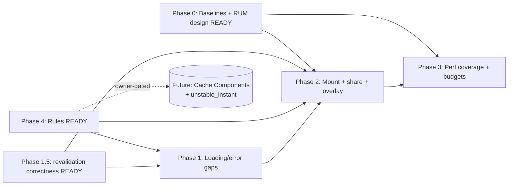

# Transition and Loading UX/UI — App-Wide Audit, Measurement Strategy, and AI-Agent Rules

**Plan status:** `CONDITIONALLY READY`
**Implementation-ready slices:** Phase 4 (Agent Rules) · Phase 0 (Measurement Baselines + RUM design) · **Phase 1.5 (Route Revalidation Correctness Fixes — release-blocking)**
**Verification mode:** `emulated` (caps overall at 97 and status at `CONDITIONALLY READY` for this exhaustive package; see `17_FINAL_READINESS_REVIEW.md`)
**Plan profile:** `exhaustive`
**Created:** 2026-07-06 (Asia/Manila) · **Improved:** 2026-07-07 (Asia/Manila)
**Plan folder:** `.ai/03_plans/2026-07-06-Transition-And-Loading-UX-And-UI/`

> **This is a planning-only pack.** It audits the app's transition/loading UX/UI, defines how performance will be measured and benchmarked, prescribes the fastest/best-practice mounting strategy for Next.js 16 + React 19 + Cloudflare/OpenNext, and codifies durable AI-agent rules. **No application code, tests, migrations, configs, or provider state were modified by this pass.**

---

## Start here

- **Implementation start document:** `11_IMPLEMENTATION_PLAN.md`
- **Phase order:** Phase 4 (Rules) ∥ Phase 0 (Baselines + RUM design) ∥ **Phase 1.5 (revalidation correctness — release-blocking)** → Phase 1 (Loading/error gaps) → Phase 2 (Mount + share + overlay) → Phase 3 (Perf coverage + budgets) → Future (Cache Components + `unstable_instant`, owner-gated).
- **Begin with Phase 4, Phase 0, and Phase 1.5** — all three are `IMPLEMENTATION-READY` and independent. **Phase 1.5 fixes three correctness bugs** (stale/missing `revalidatePath`) found during the improvement pass and must precede broad Phase 1 UX work per the planning-suite "release-blocking hardening first" rule. Do **not** start Phases 1–3 until the owner decisions below are resolved and a separate execution scope is approved.

## What's new in the 2026-07-07 improvement pass

This pack was deepened via the planning-suite `Improve-Plan-Prompt.md`. Four new evidence documents and upgrades to existing docs:

- **`20_ROUTE_BOUNDARY_AND_CACHE_CONTRACTS.md`** — per-route App Router boundary/cache/revalidation contract for every affected route (directive-mandated). **Surfaced 3 correctness bugs:** ARCH-07a (stale `/workshop/components` revalidatePath no-op), ARCH-07b (`/workshop/proposals` zero server revalidation), ARCH-07c (`/workshop/publisher` zero server revalidation) → new **Phase 1.5**.
- **`21_ATTACK_SURFACE_AND_CREDENTIAL_MATERIAL.md`** — credential-material taxonomy (raw-vs-hash verified for share/invite tokens, passwords, session cookies) + attack-surface inventory + the `/api/internal/client-error` safe pattern the proposed beacon must mirror (SEC-09/10).
- **`22_PROOF_CONTRACTS_AND_KNOWN_RED_LEDGER.md`** — PC-01..18 proof-contract rows + the known-red validation ledger (`bun run type-check` default-heap is known-red) + evidence-class table.
- **`23_CLOUDFLARE_COST_AND_RESOURCE_BUDGET.md`** — free-tier-first RUM cost model; **refined PERF-02 default to Cloudflare Web Analytics (Tier-1)** instead of a custom beacon (free, reports LCP/INP/CLS, no Worker code).
- React Compiler posture verified (**not configured**; keep manual memoization). Per-route contracts, full state matrix, action-level a11y proof matrix, directive-column traceability, per-doc scorecard, and adversarial resolutions added.

## Headline findings (full detail in `01_EXECUTIVE_SUMMARY.md` + `03_SOURCE_AND_CODEBASE_AUDIT.md`)

- 42 UI routes; loading/error coverage uneven (14 own `loading.tsx`, 8 own `error.tsx`). `/invite/[token]` has neither. `/workshop/publisher` + estimates list have `error.tsx` but no `loading.tsx`. No root `loading.tsx`/`error.tsx` (only `global-error.tsx`).
- Global transition UX is a client spinner overlay (`RouteLoadingOverlay`); the roadmap rule says "Skeleton not spinners" — overlay is a documented exception.
- Two heaviest estimate chunks (`EstimateSheetTree` 2165 LOC, `EstimateSheetContent` 2764 LOC) SSR+hydrate on the critical path via default `dynamic` with no `loading` — highest-leverage mount fix; skeleton already exists.
- `fetch` inside `useEffect` on the public share surface; no `useSuspenseQuery`/`HydrationBoundary`; no production RUM/CWV telemetry (dev-only `WebVitalsProbe`).
- Rich but fragmented perf tooling (Playwright route-transition suite, CI bundle gate advisory, `perf:*` scripts).
- Next.js 16 `unstable_instant` + Cache Components = future framework-supported instant nav (off today; owner-gated).

## Blocked decisions (owner)

| ID | Decision | Blocks | Recommended |
|---|---|---|---|
| OPEN-PERF-01 | RUM sink: Web Analytics Tier-1 vs Tier-2 custom Worker beacon vs paid APM | PERF-02 implementation | **Tier-1 (free, lowest risk)** |
| OPEN-ARCH-01 | Adopt Cache Components + `unstable_instant` now/later | ARCH-05 / Future | defer (post-launch) |
| OPEN-PERF-02 | Tighten CI bundle budget to strict + per-route numbers | PERF-03 | after Phase-0 baselines |
| OPEN-UX-01 | Global overlay threshold (ms) on skeleton routes | UX-03 | owner + design |
| OPEN-REL-01 | Token routes: real HTTP 404 vs soft-404 noindex | REL-01 remediation | current soft-404 ok for beta |

> **Not blocked (internally resolvable, IMPLEMENTATION-READY now):** Phase 1.5 correctness fixes (ARCH-07a/b/c), Phase 4 agent rules, Phase 0 baselines.

## Dependency graph

## Requirement/task/test traceability

- Requirements: `04_REQUIREMENTS_SPECIFICATION.md` (UX/​A11Y/​ARCH/​PERF/​REL/​TEST/​DOC, with shadow-path matrices).
- Tasks: `11_IMPLEMENTATION_PLAN.md` (P0–P4 + Future, each a durable-goal contract).
- Tests: `12_TEST_AND_VALIDATION_STRATEGY.md` (Test Execution Matrix).
- Full mapping: `16_REQUIREMENTS_TRACEABILITY_MATRIX.md`.

## Stale-plan revalidation checklist (before executing any phase)

1. Re-verify `next`/`react`/`@tanstack/react-query`/`zustand`/`@opennextjs/cloudflare` versions in `package.json`.
2. Re-verify Cache Components is still off (or note change) in `next.config.ts`.
3. Re-verify `experimental.staleTimes` values.
4. Re-verify the route/loading/error inventory (`03_..._AUDIT.md` §A) against current `src/app/`.
5. Re-verify `EstimateWorkspaceClient.tsx:27,30` dynamic options.
6. Re-verify `WebVitalsProbe` is still dev-only and no RUM sink exists.
7. Re-check `git status` + coordination ledger for concurrent-agent edits.
8. Re-read the relevant Next.js 16 local doc before framework-sensitive edits.

## Commands/checks to run before the first edit (future implementation)

- `git status` + `git diff --check`
- `bun run validate:agents` (Phase 4 rule authoring)
- `bun run type-check` / `bun run lint` / `bun run lint:design-system`
- `bun run test:dom` (focused) / `bun run test:e2e` (touched specs)
- `ANALYZE=true bun run build` + `node scripts/check-performance-budgets.mjs` (bundle baseline, Phase 0)
- Read the relevant `node_modules/next/dist/docs/01-app/...` guide

## Files explicitly off-limits (this planning pass)

All files outside `.ai/03_plans/2026-07-06-Transition-And-Loading-UX-And-UI/`. Specifically no edits to `src/**`, `tests/**`, `e2e/**`, `migrations/**`, `supabase/**`, `package.json`, `next.config.ts`, `wrangler.jsonc`, provider state, or other `.ai/` docs (only the new plan folder).

## Files/systems intentionally unaffected

- D1/R2/DO/Queue/Email/Workers state — no changes.
- Better Auth, app-authorization, repository boundaries — no changes.
- Existing numeric budgets in `27-*.md` — referenced, not modified.
- `DESIGN.md` (alpha) — not law; not modified.

## External proof still required before production rollout (future phases)

- Phase 0: hosted route probe + Workers Observability readback for beacon.
- Phase 2: Playwright shell-streaming + CRUD-latency + share-receiver green; bundle analyzer evidence.
- Phase 3: strict CI bundle gate green; authenticated CI perf posted.
- All phases: RUM p95/p75 within thresholds for 7 days (post PERF-02).
- bfcache manual Chrome DevTools gate (known, per `27-*.md`).

## Archive policy

Do **not** archive automatically. Archive (or mark slices complete) only after: (a) owner resolves the OPEN-* decisions, (b) Phase 0 baselines captured, (c) Phase 4 rule shipped + `validate:agents` green, and (d) the chosen implementation phases pass their EV-* gates. Phase 4 and Phase 0 may be archived independently once complete.

## Document index

| Doc | Purpose |
|---|---|
| `00_AGENT_COORDINATION.md` | Master goal, lanes, ledger, skills used |
| `01_EXECUTIVE_SUMMARY.md` | Headline findings, decisions, scores |
| `02_FEATURE_BRIEF_AND_SCOPE.md` | Brief, scope, non-goals, success criteria |
| `03_SOURCE_AND_CODEBASE_AUDIT.md` | Evidence backbone (routes, mount, tooling, agent-rules, Next.js docs) |
| `04_REQUIREMENTS_SPECIFICATION.md` | Requirements + shadow-path matrices + open decisions |
| `05_UX_UI_ACCESSIBILITY_PLAN.md` | State inventory, taxonomy, journeys, a11y |
| `06_ARCHITECTURE_AND_TECHNICAL_DESIGN.md` | Current/target arch, Suspense/cache/mount law |
| `07_DATA_DATABASE_API_NETWORK_PLAN.md` | Data ownership, beacon contract, no-DB-change boundary |
| `08_SECURITY_PRIVACY_THREAT_MODEL.md` | Threats (RUM/CI-auth/skeleton disclosure) |
| `09_PERFORMANCE_RELIABILITY_OBSERVABILITY.md` | Evaluator contracts EV-01..10, RUM design, gates |
| `10_BLAST_RADIUS_AND_DEPENDENCIES.md` | Phase impact map, dependency graph |
| `11_IMPLEMENTATION_PLAN.md` | Authoritative execution guide (Phases 0–4 + Future) |
| `12_TEST_AND_VALIDATION_STRATEGY.md` | Test Execution Matrix |
| `13_ROLLOUT_ROLLBACK_AND_OPERATIONS.md` | Rollout rings, gates, rollback |
| `14_RISK_REGISTER.md` | RISK-01..12 |
| `15_DECISIONS_ASSUMPTIONS_AND_ALTERNATIVES.md` | DEC-01..06, assumptions, rejected alternatives |
| `16_REQUIREMENTS_TRACEABILITY_MATRIX.md` | Full traceability |
| `17_FINAL_READINESS_REVIEW.md` | Scores, verifier search, residual gaps |
| `18_STACK_CONTRACT_AND_PRODUCTION_STANDARDS.md` | Cross-cutting stack production bar |
| `19_RESEARCH_REVIEW_AND_QA_EVIDENCE.md` | Research, adversarial matrix AQ-01..15, verifier evidence |
| `20_ROUTE_BOUNDARY_AND_CACHE_CONTRACTS.md` | Per-route App Router boundary/cache/revalidation contracts + ARCH-06/07 gaps |
| `21_ATTACK_SURFACE_AND_CREDENTIAL_MATERIAL.md` | Credential-material taxonomy + attack-surface inventory (token routes + beacon) |
| `22_PROOF_CONTRACTS_AND_KNOWN_RED_LEDGER.md` | PC-01..18 proof contracts + known-red validation ledger + evidence-class table |
| `23_CLOUDFLARE_COST_AND_RESOURCE_BUDGET.md` | Free-tier-first RUM cost model (Web Analytics Tier-1 default) |
