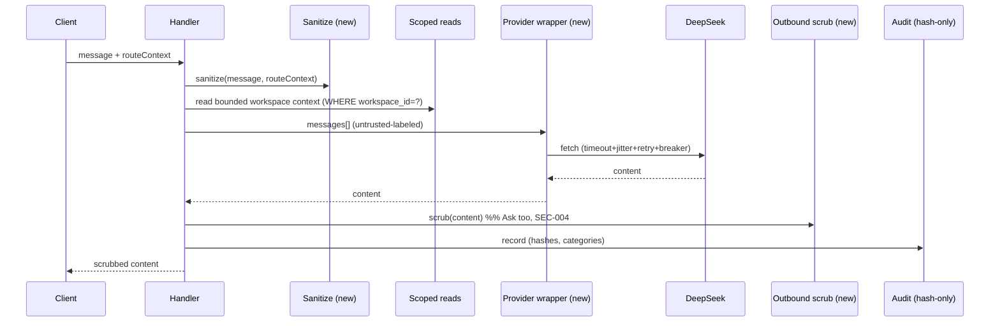

# 06 — Architecture and Technical Design

## Current-state architecture (evidence)

```mermaid
flowchart LR
  U[Client: EstimateCopilotFloatingButton] -->|POST| R1[/api/ai/ask/route.ts]
  U -->|POST| R2[/api/ai/package-builder/route.ts]
  R1 -->|isAiRoutesEnabled? no -> 404| H1[ask/handler.ts]
  R2 -->|isAiRoutesEnabled? no -> 404| H2[package-builder/handler.ts]
  H1 --> AUTH[ai/auth.ts: getAiRequestUserContext]
  H2 --> AUTH
  AUTH -->|requires authMode better-auth + workspaceId| SESS[getCurrentUserContext -> Better Auth on D1]
  H1 --> RL[rate-limit.ts -> security_rate_limit_events]
  H1 --> RC[read-context.ts: bounded, workspace-scoped]
  H2 --> RT[package-builder/read-tools.ts: bounded, workspace-scoped]
  H2 -->|draft| PR[provider.ts -> DeepSeek]
  H1 --> DS[deepseek.ts -> DeepSeek]
  DS --> AUD[audit-d1-store.ts -> ai_action_runs/tool_calls/data_access_events]
  PR --> AUD
  RC --> AUD
  RT --> AUD
  H2 -->|apply| DR[draft-token.ts HMAC verify]
  DR --> AP[apply.ts -> domain writes + estimate_sheet_events + ai_package_apply_commands]
  AP -->|revalidatePath| CACHE[Next cache]
```

Key invariants today:
- **Kill switch at the route edge** (`route.ts`) before dynamic import of handler → no provider call when off.
- **Identity at the handler** (`getAiRequestUserContext`) → Better Auth, rejects admin/dev bypass.
- **Server-only context** → client never constructs the prompt; context is built server-side from the session workspace.
- **Metadata-only audit** → hashes + categories, never raw prompts.
- **Apply is the only write** → token + hash + authz + idempotency.

## Target-state architecture (hardened)

Additive changes (no re-platform); preserve all current invariants:

1. **Sanitization layer** (`src/lib/ai/sanitize.ts`, new): neutralizes/flags prompt-injection patterns in user text + route context before they enter the prompt. Inputs: user message, route context strings. Output: sanitized strings + `tainted_flags`. Compose with the existing `redact.ts` injection patterns (reuse, don't duplicate).
2. **Outbound scrub** (`src/lib/ai/outbound-scrub.ts`, new or extend `assertNoForbiddenIdentityKeys`): applies identity/secret/SQL/ command scrubbing to **Ask output** before returning to client (Ask currently has none — SEC-004).
3. **Provider-resilience wrapper** (`src/lib/ai/provider-client.ts`, new): wraps DeepSeek `fetch` with configurable timeout + retry-with-jitter (capped) + circuit breaker (fail-closed). Both call sites use it (REL-001/REL-002). Deterministic fallback for package-builder preserved.
4. **Centralized scoped-query helper** (`src/lib/ai/scoped-query.ts`, new, optional but recommended): enforces `WHERE workspace_id = ?` binding for all AI reads, reducing the "forgotten clause" risk (SEC-001 mitigation against no-DB-safety-net).
5. **Package-builder rate limit**: reuse `rate-limit.ts` with a package-builder scope (REL-003).
6. **Structured logging fix**: route the bare `console.error` through the redacting logger (SEC-008).
7. **Env-config + docs**: `DEEPSEEK_REQUEST_TIMEOUT_MS`, document all flags, signing secret (OPS-001, REL-002).

## Component boundaries (unchanged unless noted)

- Routes remain thin (kill switch + dynamic import).
- Handlers own orchestration: auth → (rate limit) → sanitize → read context → provider (via wrapper) → outbound scrub → audit → respond.
- `package-builder/apply.ts` remains the single write path with its existing re-validation chain.
- No new Durable Object / Queue / KV for AI (free-tier constraint).

## Data flow (prompt payload)



## Control flow / state (apply)

Draft (deterministic or provider-assisted) → user confirm → `verifyPackageDraftToken` (HMAC + userId+workspaceId + hash + expiry) → `authorizeApply` (audit) → per-intent authz → idempotency `beginApplyCommand` → domain writes inside `estimate_sheet_events` chain → `completeApplyCommand` → `revalidatePath`. Any failure → `failApplyCommand` + rollback (estimate_sheet_events provides history; re-apply is idempotent).

## Architectural alternatives (evaluated)

| Option | Pro | Con | Decision |
|---|---|---|---|
| Store raw prompts for forensics | post-hoc reconstruction | DB breach exposes prompts; contradicts metadata-only principle | **Rejected** (DEC-005) |
| Multi-provider fan-out | resilience/quality | paid surface; complexity; violates no-paid-default | **Rejected** for launch (DEC-002) |
| D1 RLS-equivalent via views/triggers | DB safety net | D1 lacks RLS; triggers add cost/complexity; app-authz is the established pattern | **Rejected**; keep app-authz + scoped-query helper |
| Edge KV cache for provider responses | latency/cost | KV is eventually consistent; privacy/correctness risk for tenant-scoped outputs | **Rejected** for launch |
| Per-workspace AI opt-out in D1 | tenant governance | scope creep; all-or-nothing acceptable for beta | **Deferred** (DEC-008, OPEN-002) |

## Integration points

- DeepSeek HTTP API (external, single endpoint).
- Better Auth session (internal).
- D1 `ARCH_DB` (internal, AI audit + rate-limit + memory + apply tables; shared with app).
- Next.js cache via `revalidatePath` (internal).
- Observability logger + redaction (internal, reused).
- No webhooks, no Queue involvement for AI (Queue is upload-only).

## Decision rationale (summary; full in `15_*`)

Architecture stays additive and within the existing repository-boundary pattern. All hardening composes with current invariants; nothing requires re-platforming or a paid resource.
