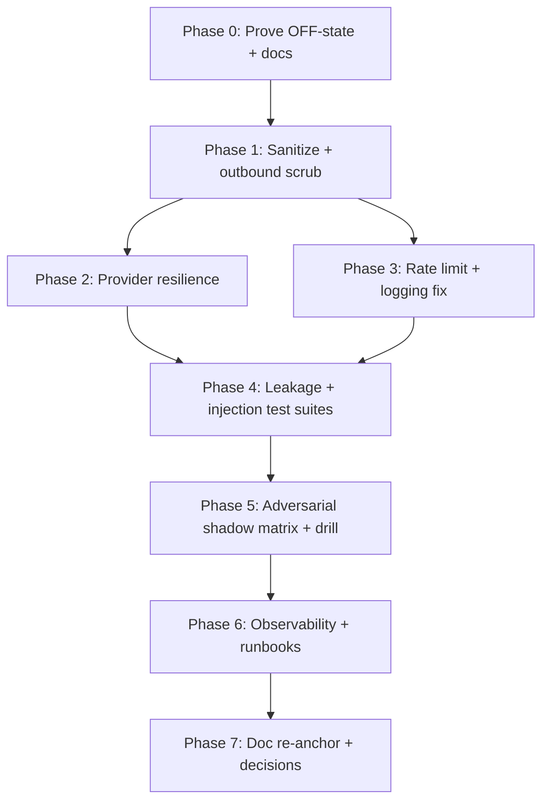

# 11 — Implementation Plan

Authoritative execution guide for the future implementation AI. **Read `README.md` first** for status and phase order. This plan covers the **hardening** path; the **gated-off (ship-with-AI-OFF)** path requires no code change beyond proof (Phase 0 only).

Profile reminder: free-tier only; no paid AI provider; planning was CONDITIONALLY READY pending owner decision OPEN-001 (off vs. on-at-launch). Implementation must not flip `ARCHESTIMATOR_AI_ENABLED` without owner approval.

## Phase dependency graph

Phases 0–7 are sequential at the phase gate level but tasks within a phase parallelize where file-disjoint.

---

## Phase 0 — Prove the OFF-state and stop-the-bleed fixes (no enablement)

Objective: make the conservative launch posture provable and close the cheapest gaps immediately.

### Durable-goal contract
- Goal ID: `G-P0`
- Objective: prove AI-off holds; fix the one unredacted console.error; document undocumented env vars.
- Requirements: FR-001, OPS-001, SEC-008.
- Required evidence: 404 tests pass; env-manifest test lists all AI env names; structured-log test.
- Completion audit: every Phase-0 task status = implemented+verified.
- Stop condition: OFF-state proof green + console.error fixed + env documented.
- Blocker: none.
- Review gate: `bun run test` (ai-* subset) green.
- QA gate: shadow-path "disabled" cell proven.

### Tasks

**T-P0-1 (FR-001, OPS-003): OFF-state proof test**
- Objective: assert routes 404 + UI hidden + no provider call when `ARCHESTIMATOR_AI_ENABLED=false`.
- Target: new test (placement `DISCOVERY-REQUIRED`: locate existing `ai-*-route.test.ts` siblings, e.g. `ai-package-builder-route.test.ts`, add alongside).
- Instructions: with flag false, POST both routes → 404; assert handler module not imported (dynamic import gate); assert `WorkshopPageShell` does not render the floating button.
- Tests to add: the above.
- Validation: `bun run test` (focused).
- Complexity: Small. Parallelization: parallel-safe (disjoint from T-P0-2).

**T-P0-2 (SEC-008): Route apply-handler error through redacting logger**
- Objective: replace `console.error("AI package Apply failed", error)` at `src/app/api/ai/package-builder/handler.ts:341` with structured logger call that redacts.
- Target: `src/app/api/ai/package-builder/handler.ts:341`; import `src/lib/observability/logger.ts`.
- Instructions: use `logAppError`/`emitLogRecord` with `redactForLog` on the error; keep the public stable message "Package Apply failed." (INFOSEC-APP-003).
- Tests to add: assertion that the log line does not contain raw user/estimate text (feed an error embedding synthetic content).
- Validation: focused log-output test.
- Complexity: Small. Parallelization: parallel-safe with T-P0-1.

**T-P0-3 (OPS-001, SEC-009): Document all AI env vars**
- Objective: add the 7 undocumented AI env vars to `.env.example` and `.dev.vars.example` (placeholders only, never values); document signing-secret requirement.
- Target: `.env.example`, `.dev.vars.example`.
- Vars: `DEEPSEEK_MODEL`, `DEEPSEEK_REQUEST_TIMEOUT_MS` (added in T-P2-1), `AI_PACKAGE_BUILDER_DRAFT_SIGNING_SECRET`, `AI_PACKAGE_BUILDER_READ_TOOLS_ENABLED`, `..._DRAFT_ENABLED`, `..._APPLY_SHELL_ENABLED`, `..._APPLY_TREE_ENABLED`, `..._APPLY_ROWS_ENABLED`, `..._MEMORY_ENABLED`.
- Tests: extend `closed-beta-env-manifest.test.ts` to assert presence.
- Validation: env-manifest test green.
- Complexity: Small.

---

## Phase 1 — Prompt-injection sanitization + Ask outbound scrub

Objective: close SEC-002 (sanitize) and SEC-004 (Ask output scrub) — the two highest provider-facing leakage gaps.

### Durable-goal contract `G-P1`
- Requirements: SEC-002, SEC-004, SEC-011.
- Required evidence: sanitize + outbound-scrub unit tests; injection corpus test (subset of TEST-002).
- Stop condition: provider payload contains only sanitized text; Ask response passes identity scrub.
- QA gate: shadow-path "invalid input" + "injection" cells.

### Tasks

**T-P1-1 (SEC-002): `src/lib/ai/sanitize.ts`**
- Objective: neutralize/flag prompt-injection patterns in user message + route-context strings before prompt assembly.
- New file: `src/lib/ai/sanitize.ts`. Export: `sanitizeAiUserInput(text, {maxLength}): { sanitized, tainted, truncated }`.
- Instructions: reuse the injection regex set from `src/lib/observability/redact.ts` (do not duplicate); additionally enforce length cap (Ask 8000 already; package-builder message cap). Return `tainted` flags; record in audit (`provider_send_categories` gains `sanitized_user_message`).
- Wire into `ask/handler.ts` (before building system prompt) and `package-builder/provider.ts` (before `messages`).
- Tests: `ai-sanitize.test.ts` — injection corpus, length cap, Unicode, path-traversal-like.
- Complexity: Medium. Parallelization: T-P1-1 must land before T-P1-2 wiring uses it (sequential).

**T-P1-2 (SEC-004): `src/lib/ai/outbound-scrub.ts` for Ask output**
- Objective: scrub identity/secret/SQL/command material from Ask model `content` before returning to client.
- New file: `src/lib/ai/outbound-scrub.ts`. Export: `scrubAskOutput(content): string`. Reuse/extend `assertNoForbiddenIdentityKeys` logic from `package-builder/schemas.ts:356-369` + `provider.ts:180-192`.
- Wire into `ask/handler.ts` around the response build (line ~220-225). Also strip obvious secret patterns (reuse `redact.ts` secret detectors) and SQL/command markers.
- Tests: `ai-ask-outbound-scrub.test.ts` — model echoes `workspaceId`/a hex secret/`DROP TABLE` → scrubbed.
- Complexity: Medium. Parallelization: parallel-safe with T-P1-1 (different files) until wiring.

---

## Phase 2 — Provider resilience wrapper

Objective: REL-001 (retry+jitter+breaker), REL-002 (env-config timeout/model).

### Durable-goal contract `G-P2`
- Required evidence: `ai-provider-resilience.test.ts` — retry on transient 5xx, no retry on 4xx, breaker opens after N fails, deterministic fallback preserved.
- Stop condition: both DeepSeek call sites use the wrapper; timeout env-configurable.
- QA gate: shadow-path "upstream/network error" + "retry/idempotency".

### Tasks

**T-P2-1 (REL-002): env-config timeout**
- Add `DEEPSEEK_REQUEST_TIMEOUT_MS` to `feature-flags.ts`/a shared config (default 20000); read in both call sites.
- Tests: env override test.
- Complexity: Small.

**T-P2-2 (REL-001): `src/lib/ai/provider-client.ts`**
- New file. Export: `callDeepSeek({ messages, temperature, maxTokens, signal? }): Promise<{content, usage}>`. Internals: configurable timeout, retry-with-jitter on 5xx/timeout (max 2, base 500ms, jitter), per-isolate circuit breaker (open after 5 consecutive fails in 60s, half-open probe), fail-closed error.
- Refactor `deepseek.ts` `askDeepSeek` and `provider.ts` createDeepSeekPackageBuilderProvider to delegate to `provider-client.ts`.
- Preserve: package-builder deterministic fallback (handler already swallows provider errors).
- Tests: `ai-provider-resilience.test.ts` (mocked fetch).
- Complexity: Large (cross-cutting). Parallelization: sequential (touches both call sites).

---

## Phase 3 — Package-builder rate limit + minor hardening

### Durable-goal contract `G-P3`
- Requirement: REL-003.
- Required evidence: `ai-package-builder-rate-limit.test.ts`.

**T-P3-1 (REL-003): package-builder quota**
- Reuse `src/lib/ai/rate-limit.ts`; add a `package-builder` scope (e.g., 10/min, 40/hour per user+IP — tune at implementation).
- Wire into `package-builder/handler.ts` before draft/refine/apply.
- Tests: quota denial + Retry-After.
- Complexity: Small/Medium.

**T-P3-2 (SEC-003): per-apply caps test (validation already exists)**
- Add denial tests to the existing `ai-package-builder-security-contract` suite: oversized arrays, unknown keys, identity keys in apply payload → rejected.
- Complexity: Small.

---

## Phase 4 — Cross-tenant leakage + prompt-injection suites (R-011 launch-blocker)

### Durable-goal contract `G-P4`
- Requirement: SEC-001, TEST-001, TEST-002.
- Required evidence: `ai-cross-tenant-leakage.test.ts` (two synthetic workspaces, foreign IDs), `ai-prompt-injection.test.ts` (full corpus incl. context-boundary tests).
- Stop condition: both suites green; this unblocks "AI ON" enablement.

**T-P4-1 (SEC-001, TEST-001): cross-tenant leakage suite**
- Setup: two D1 (or mocked-repo) workspaces A and B with disjoint data. Session = A.
- Cases: (a) Ask with routeContext pointing at B's project/estimate/node IDs → no B data in provider payload; (b) package-builder read-tools with B's ids → no B data; (c) apply referencing B's library item id → rejected by `validateLinkedLibraryRows`; (d) transitive `estimate_nodes WHERE id = ?` with B's node → returns null/no data.
- Assert by inspecting the provider payload (intercept `callDeepSeek`) and the audit `provider_send_categories`.
- Complexity: Large (fixture-heavy).

**T-P4-2 (SEC-002, TEST-002): prompt-injection + context-boundary suite**
- Cases: injection corpus (OWASP LLM01 examples) → sanitized; "ignore system prompt" variants → neutralized; model-output exfiltration attempt → outbound scrub catches identity; route-context-labeled injection → treated as data.
- Complexity: Medium.

**T-P4-3 (optional, SEC-006/DEC-007): platform-admin AI cross-tenant guard**
- Only if owner approves DEC-007. Add AI-side guard: even for platform admins, AI re-binds the session's `default_workspace_id` (already does) and explicitly does NOT use the `isPlatformAdmin` fast-path for reads. Test: admin user invoking AI sees only their workspace.
- Complexity: Small. Owner-gated.

---

## Phase 5 — Adversarial shadow-path matrix + disabled-state drill

### Durable-goal contract `G-P5`
- Requirement: TEST-003, OPS-002.
- Required evidence: `ai-adversarial-shadow-paths.test.ts` (full matrix), `cf:ai-disabled-check` script + runbook.

**T-P5-1 (TEST-003): adversarial shadow matrix**
- Cover for both routes: nil/empty/invalid/oversized/Unicode/path-traversal-like/injection/unauthorized/cross-tenant/duplicate/concurrent/timeout/partial-success/misleading-success. (See `12_*` matrix.)
- Complexity: Medium/Large.

**T-P5-2 (OPS-002): disabled-state drill script**
- `scripts/ai-disabled-check.mjs` (or `cf:ai-disabled-check`): assert deployed env has `ARCHESTIMATOR_AI_ENABLED=false` (or absent), routes 404, no key in client bundle. Runbook in `.ai/`.
- Complexity: Small.

---

## Phase 6 — Observability + runbooks

### Durable-goal contract `G-P6`
- Requirement: SEC-009, DATA-002, observability.

**T-P6-1 (SEC-009): key rotation + revocation runbook**
- New `.ai/.../ai-incident-runbook.md`: rotation cadence (~90d), revocation steps, disable-switch incident lever, rollback (re-apply idempotency). No secrets in doc.
- Complexity: Small.

**T-P6-2 (DATA-002): verify AI retention rules**
- Inspect `retention-core.ts`; confirm rule rows for `ai_action_runs/tool_calls/data_access_events`; add if missing (additive). Test: retention suite covers AI tables.
- Complexity: Small.

**T-P6-3 (observability): structured provider-call log line**
- Add one redacted structured log at provider-call boundary in `provider-client.ts`: `{ai_route, provider, outcome, duration_ms, error_class}`. No prompt content.
- Complexity: Small.

---

## Phase 7 — Documentation re-anchor + decisions

### Durable-goal contract `G-P7`
- Requirement: DOC-001, DOC-002, SEC-010.

**T-P7-1 (DOC-001): re-anchor AI docs to D1/Better Auth**
- Update: `10-ai-safety-readiness.md`, `ai-assistant-and-package-builder-spec.md`, `deep/architecture-overview.md`, `02-security-tenancy-data-protection.md` (`authMode==='better-auth'`), OWASP `12-ai-llm-security.md` (F-AI evidence to D1 migrations `0006/0019/0027` + `audit-d1-store.ts`), corpus §393.
- Complexity: Medium (many files, mechanical).

**T-P7-2 (DOC-002): decisions.md AI entries**
- Add decision IDs to `.ai/10_state/decisions.md`: DeepSeek-provider-choice, metadata-only-audit, kill-switch design, signed-draft-token, deterministic-fallback, no-RAG/no-stored-conversations.
- Complexity: Small.

**T-P7-3 (SEC-010): privacy notice + subprocessor**
- Ensure DeepSeek named in privacy notice + subprocessor list with purpose/data/location; AI copy truthfulness.
- Complexity: Small (doc). Owner/legal review.

---

## Tasks blocked or discovery-required

- **BLOCKED-EXTERNAL (OPEN-001):** whether to ship AI OFF (DEC-001) or ON after hardening. Owner: Philip. Impact: determines whether Phases 1–6 are pre-launch or post-launch. Phase 0 + Phase 7 are required either way.
- **DISCOVERY-REQUIRED (test placement):** exact test directory/file names for new suites — search for existing `ai-*-route.test.ts` / `ai-package-builder-security-contract` to match layout. Stop condition: found; no code change in discovery.
- **BLOCKED-EXTERNAL (DEC-007/SEC-006):** platform-admin AI cross-tenant guard is a behavior change requiring owner sign-off (T-P4-3).

## Performance/rollback gate per phase

- Gate: focused tests green; no increase in AI read query count; `bun run type-check` + `bun run lint` clean; build artifact confirms AI code stays in dynamic chunk when off.
- Rollback: each phase is independently landable; revert the commit. Disable switches remain the global lever.

## Files off-limits (planning boundary reminder)

This plan does **not** modify: legacy Supabase resources, the unrelated `archestimator` provider project, auth platform code (Better Auth config), D1 RLS (none exists), Durable Object collaboration logic, proposal XLSX export, cost-library pricing logic. Implementation must respect the same boundary.
