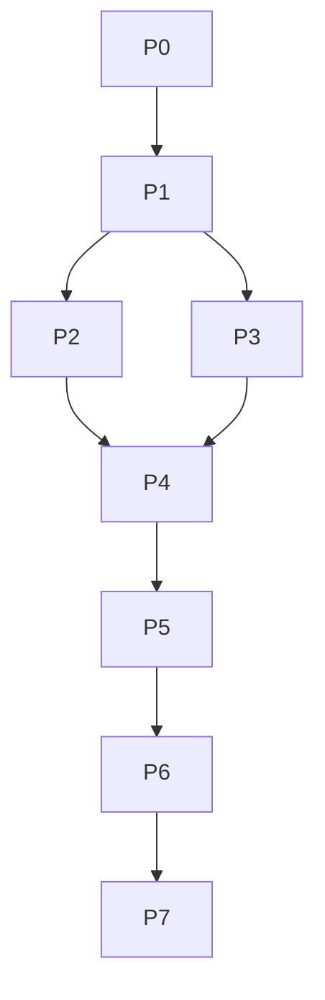

# README — AI Safety Leakage And Provider Resilience

Plan folder: `.ai/03_plans/2026-07-07-ai-safety-leakage-and-provider-resilience`
Date: 2026-07-07 (Asia/Manila). Profile: **exhaustive**. Mode: **planning only** — no application code changed.

## Plan status

**`CONDITIONALLY READY`** (`verification_mode: emulated`; high-blast-radius cap per the Suite Succession and Authority Contract).

- **Track A (ship-with-AI-OFF, recommended):** implementation-ready — Phase 0 + Phase 7 only; no flag flip; no paid resource.
- **Track B (enable-after-hardening):** conditionally ready — blocked on owner decision OPEN-001 and on Phases 1 + 4 (SEC-001/SEC-002/SEC-004) landing.

To lift the cap to `IMPLEMENTATION-READY`: owner or independent reviewer accepts the package (Track A then proceeds; Track B proceeds after its phases land).

## Implementation start document

`11_IMPLEMENTATION_PLAN.md` — authoritative execution guide with phase order, dependency graph, per-task exact paths/symbols, durable-goal contracts, and validation gates.

## Phase order (Track B; Track A = P0 + P7)

P0 (prove OFF + stop-the-bleed) → P1 (sanitize + Ask scrub) → P2 (provider resilience) → P3 (PB rate limit + apply caps test) → P4 (leakage + injection suites — **launch-blocker for enable**) → P5 (shadow matrix + drill) → P6 (observability + runbooks) → P7 (doc re-anchor + decisions + privacy).

Dependency graph and per-phase durable-goal contracts are in `11_*`.

## Dependency graph

## Requirement/task/test traceability

- Requirements: `04_*` (FR/SEC/REL/OPS/DATA/DOC/TEST/UX, stable IDs).
- Traceability matrix: `16_*` (every req → phase → task → code → AC → test → rollout).
- Tests: `12_*` (execution matrix + shadow-path + AQ).

## Blocked decisions table

| Decision | ID | Owner | Impact |
|---|---|---|---|
| Ship AI OFF (Track A) vs ON-after-hardening (Track B) | OPEN-001 | Philip | Determines whether P1–P6 are pre- or post-launch |
| Reject platform-admin AI cross-tenant bypass | DEC-007/SEC-006 | Philip | Behavior change; T-P4-3 owner-gated |

## Stale-plan revalidation checklist (before implementing)

- Re-read `src/lib/ai/**` and `src/app/api/ai/**` (confirm DeepSeek-only, 2 routes, no new provider).
- Confirm `ARCHESTIMATOR_AI_ENABLED` default false and dynamic-import gate intact.
- Confirm `authMode === "better-auth"` in `ai/auth.ts`.
- Confirm no new AI D1 migration since `0038`.
- Recheck `git status` (concurrent-agent safety).
- Confirm test runner/placement (`ai-*` siblings) before adding suites.

## Commands / checks before the first edit

- `git status` (no concurrent AI edits).
- `bun run type-check && bun run lint`.
- `bun run test` (establish baseline; note any pre-existing reds in `ai-*`).
- `bun run build` (confirm AI handler is a dynamic chunk when off).

## Files explicitly off-limits (planning + implementation boundary)

Legacy Supabase project `ebxxqidacheyapmmzavr`; unrelated `archestimator` provider project; Better Auth platform config; D1 RLS (none); Durable Object collaboration logic; proposal XLSX export; cost-library pricing logic; agent-framework model-routing policy.

## Files/systems intentionally unaffected

R2, DO `COLLAB_ROOMS`, Queue `UPLOAD_JOBS_QUEUE`, Images, Email; cost-library pricing; proposal export; agent-framework adapters.

## External proof still required before production rollout

- DeepSeek subprocessor disclosure (SEC-010) — legal/privacy review.
- Hosted p95/error-rate metrics post-enable (Track B) — Workers Observability.
- Retention-cron hosted proof that AI tables are purged (DATA-002).
- Independent or owner review of this pack to lift the `CONDITIONALLY READY` cap.

## Archive policy

Do **not** archive automatically. Archive after full Track completion (A or B) and post-release verification; or archive only named completed slices (Phase 0, Phase 7) if Track A is chosen and Track B deferred.

## One-line summary

Archestimator's AI surface is narrow (DeepSeek-only, disabled-by-default, 2 routes) and already has strong controls (workspace scoping, metadata-only audit, signed-token apply, deterministic fallback); this pack proves the safe gated-off launch path and specifies the exact hardening (sanitization, outbound scrub, cross-tenant leakage suite, provider resilience) required before any enablement.
