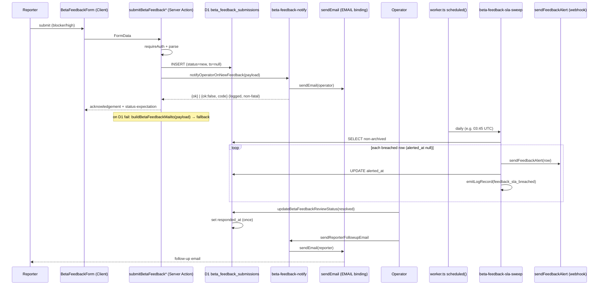

# 06 — Architecture and Technical Design

## Current-state architecture

```
[Reporter] --(modal/page)--> BetaFeedbackForm (Client, useActionState)
   |-- form action --> submitBetaFeedback / submitBetaFeedbackInline ("use server")
   |                    |-- requireAuth() / requireCurrentUserContext()
   |                    |-- parseBetaFeedbackSubmission (manual, no zod)
   |                    |-- saveBetaFeedbackToD1 (server-only)
   |                    |       |-- D1: beta_feedback_submissions (status='new')
   |                    |-- on fail: redirect ?fallback=1 (static mailto — DROPS payload)  <-- GAP
   |
[Operator (platform admin)] --/workshop/settings/feedback--> BetaFeedbackReviewPage (SSR)
   |-- readBetaFeedbackReviewQueue (LIMIT 50)  <-- GAP (no pagination)
   |-- per-row <select> --> updateBetaFeedbackReviewStatus ("use server")
   |                          |-- canReviewBetaFeedback (isPlatformAdminRole)
   |                          |-- updateBetaFeedbackReviewStatusInD1
   |                          |       |-- UPDATE status + INSERT beta_feedback_status_events
   |                          |-- revalidatePath

[NO operator notification]  <-- GAP
[NO SLA tracking / sweep]   <-- GAP
[NO reporter follow-up]     <-- GAP
[NO retention TTL]          <-- GAP
```

## Target-state architecture

```
[Reporter] --> BetaFeedbackForm (Client, useActionState)  [+ a11y labels, live region, focus, ack copy]
   |-- submitBetaFeedback* ("use server")
   |     |-- requireAuth() / requireCurrentUserContext()
   |     |-- parseBetaFeedbackSubmission
   |     |-- saveBetaFeedbackToD1  --> D1 beta_feedback_submissions (status='new', ts columns null)
   |     |-- [NEW] notifyOperatorOnNewFeedback(payload)  (blocker/high only)
   |     |        |-- sendEmail (transactional-email-client, circuit-breaker)
   |     |        |-- emitLogRecord event:"feedback_operator_notified" (redacted)
   |     |        '-- graceful: failure never blocks submit
   |     '-- on fail: buildBetaFeedbackMailto(payload) --> ?fallback=1 (payload preserved)  [FIX]
   |
[Operator] --> BetaFeedbackReviewPage (SSR)  [+ pagination + SLA badge + breach filter]
   |-- readBetaFeedbackReviewQueue(page, status)  (paginated)
   |-- updateBetaFeedbackReviewStatus ("use server")
   |     |-- canReviewBetaFeedback
   |     |-- updateBetaFeedbackReviewStatusInD1  --> sets first_response_at / responded_at (guarded, once)
   |     |-- [NEW] if status=='resolved' && responded_at was null --> sendReporterFollowupEmail
   |     '-- revalidatePath

[Cron worker.ts scheduled()]  [+ new branch, e.g. cron "45 3 * * *"]
   '-- runFeedbackSlaSweep(env)
        |-- readBetaFeedbackReviewQueueFromD1 (all non-archived)
        |-- computeSlaStatus(row, now, slaConfig)  (business-day math)
        |-- for each breached row where alerted_at is null:
        |      |-- sendFeedbackAlert(row)  (clone of sendUploadOperationalAlert)
        |      |-- updateBetaFeedbackAlertedAt(id)  (idempotent)
        |      '-- emitLogRecord event:"feedback_sla_breached"
        '-- emitLogRecord event:"feedback_sla_swept" {processed, breached, alerted}

[Cron 30 3 * * * retention pass]  [+ feedback rule (P3)]
   '-- purge archived beta_feedback_submissions older than TTL=365d  (non-archived NEVER purged)

[Readiness] scripts/check-beta-feedback-loop-readiness.ts
   '-- proves: operator email env set, alert webhook reachable OR operator-email-only, queue live, sweep cron registered
```

## Component boundaries

| Module | Layer | New/extend | Responsibility |
|---|---|---|---|
| `src/components/workshop/BetaFeedbackForm.tsx` | client UI | extend | a11y labels, live region, focus, ack copy |
| `src/app/workshop/feedback/page.tsx` | server route | extend | ack copy (redirect mode) |
| `src/app/workshop/settings/feedback/page.tsx` | server route | extend | pagination, SLA badge, breach filter |
| `src/lib/workshop/beta-feedback.ts` | shared lib | extend | copy constants, SLA config |
| `src/lib/workshop/beta-feedback-actions.ts` | server actions | extend | operator notify hook, payload-preserving fallback |
| `src/lib/workshop/beta-feedback-review-actions.ts` | server actions | extend | follow-up email on resolve |
| `src/lib/workshop/beta-feedback-review.ts` | server-only | extend | pagination, breach filter |
| `src/lib/workshop/beta-feedback-d1-store.ts` | server-only | extend | pagination, timestamp setters, alerted_at update |
| `src/lib/workshop/beta-feedback-notify.ts` | server-only | **new** | `notifyOperatorOnNewFeedback`, `sendReporterFollowupEmail` (wraps `sendEmail`) |
| `src/lib/workshop/beta-feedback-sla.ts` | shared lib | **new** | SLA config + `computeSlaStatus` business-day math + badge classification |
| `src/lib/workshop/beta-feedback-sla-sweep.ts` | server-only | **new** | `runFeedbackSlaSweep(env)` cron handler |
| `src/lib/workshop/beta-feedback-alert.ts` | server-only | **new** | `sendFeedbackAlert` (clone of `sendUploadOperationalAlert`) |
| `worker.ts` | worker entry | extend | new `scheduled()` cron branch |
| `wrangler.jsonc` | config | extend | add cron trigger (e.g. `"45 3 * * *"`) + alert env (vars/secrets) |
| `migrations/0039_beta_feedback_sla_columns.sql` | migration | **new** | additive columns |
| `scripts/check-beta-feedback-loop-readiness.ts` | script | **new** | readiness check (P4) |

## Data flow / state ownership

- **Server-authoritative**: feedback rows live in D1; the queue is SSR (no client cache to invalidate beyond `revalidatePath`).
- **Client state**: `useActionState` for the inline form; no Zustand/TanStack Query needed (Server Actions own mutations). No new client state introduced.
- **Mutation invalidation**: `revalidatePath("/workshop/settings/feedback")` after status update (already done). The SLA badge is derived server-side from timestamps → no client invalidation needed.
- **Cache**: the feedback page is dynamic (auth-gated); no `use cache` boundary. Do not introduce one (would risk cross-user leakage).

## Server/Client boundary

- Only `BetaFeedbackForm` and `WorkshopFeedbackModal` are `"use client"` (smallest interactive boundary). All notify/sla/sweep modules are `"server-only"`. No secrets/client DTOs leak: the client receives only acknowledgement text + a mailto link; never the operator email or webhook URL.

## Failure boundaries

- **Email/alert failure** → caught + logged + non-fatal (`REL-01`). Circuit-breaker (`sendEmail`) and graceful `ok:false` (`sendFeedbackAlert`) both protect the request.
- **D1 failure on save** → fallback mailto (FR-ACK-02).
- **D1 failure on sweep** → cron logs non-zero; next-day retry (idempotent via `alerted_at`).
- **Sweep timeout** → bounded by per-row processing; the cron invocation is wrapped in `ctx.waitUntil`.

## Architectural alternatives considered

| Alt | Pros | Cons | Decision |
|---|---|---|---|
| Queue job for operator notify (instead of inline `sendEmail`) | decouples latency from submit | over-engineering at beta; widens `jobName` union; adds queue coupling | **rejected** — inline send is sufficient; failure is non-fatal |
| Dedicated `feedback_sla_violations` table | explicit breach history | CRM creep; `beta_feedback_status_events` + `alerted_at` suffice | **rejected** (ARCH-01) |
| Better Auth admin plugin for operator gate | standardized | codebase uses plain D1 role field; no BA admin plugin in use | **rejected** — reuse `isPlatformAdminRole` (OPEN-OPS-01) |
| Toast for acknowledgement | visible | auto-dismiss loses ack; wrong for a confirmation | **rejected** for reporter ack; toast reserved for possible future operator notifications |
| zod for validation | standardized | codebase has zero zod; introducing it is a cross-cutting change | **rejected** — match manual parse-union pattern |
| Unify `/contact` into D1 queue | single funnel | expands scope; public unauthenticated capture is a privacy/auth change | **deferred** (OPEN-FUNNEL-01) |
| Hourly SLA sweep | tighter detection | unnecessary for business-day SLA; more cron budget | **rejected** — daily is sufficient at beta scale |
| Webhook-only alerting (no operator email) | simple | single point of failure; email is the lowest-common-denominator operator channel | **rejected** — hybrid (email always; webhook optional) (OPEN-ALERT-01) |

## Mermaid — target-state request/loop flow


