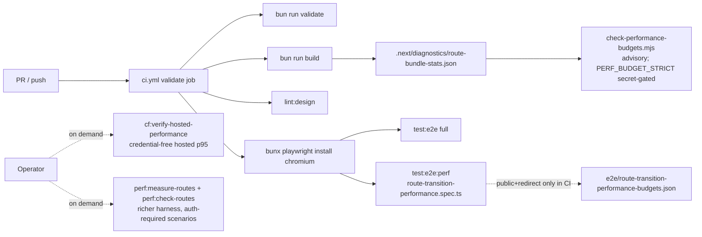
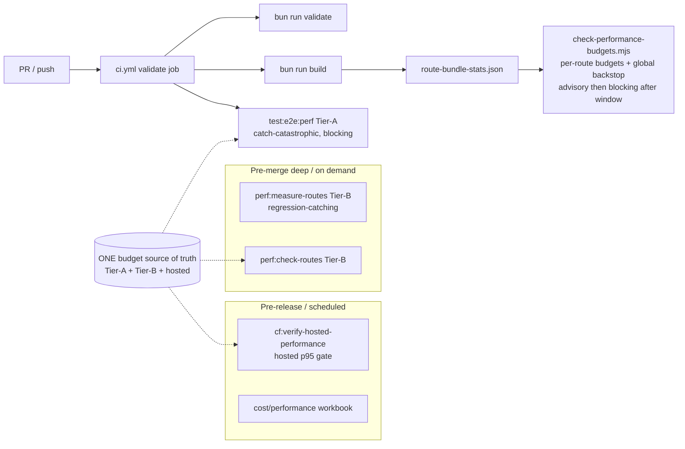

# Architecture And Technical Design

## Current-state architecture (performance gates)

**Components:**
- **CI bundle gate:** `check-performance-budgets.mjs` over `route-bundle-stats.json`; advisory by default.
- **CI route-transition smoke:** `route-transition-performance.spec.ts` over `e2e/route-transition-performance-budgets.json`; **blocking** but loose; authed scenarios skipped in CI.
- **On-demand deep harness:** `measure-route-transitions.ts` (18 scenarios, timeline telemetry) + `check-route-transition-readiness.ts` (per-scenario + timeline budgets); not in CI.
- **Hosted verifier:** `verify-cloudflare-hosted-performance.ts` (credential-free TTFB p95); operator-run.

## Target-state architecture

**Architectural changes proposed (future executor):**
1. **One budget source of truth** (DEC-03): a single file (or a primary file imported by both consumers) holds Tier-A, Tier-B, and hosted budgets, replacing the split between `e2e/route-transition-performance-budgets.json` and `check-route-transition-readiness.ts` defaults.
2. **Per-route bundle budgets** (DEC-02): `check-performance-budgets.mjs` reads a per-route map; global backstop retained.
3. **Layered triggers** (DEC-01): per-PR (Tier-A smoke + bundle) → pre-merge/on-demand (Tier-B deep) → pre-release (hosted p95).
4. **Authenticated Tier-B path** (PERF-04): either dev-auth-bypass in a localhost preview within CI, or a storage-state artifact; owner decision (OPEN-PERF-02).

## Component boundaries and ownership

| Component | Current owner | Future change owner | Boundary |
|---|---|---|---|
| `check-performance-budgets.mjs` | CI bundle gate | Executor (Phase 1) | Reads diagnostics; writes stdout; no network |
| `e2e/route-transition-performance-budgets.json` | CI smoke | Executor (Phase 2) | Pure data |
| `route-transition-performance.spec.ts` | CI smoke | Executor (Phase 2) | Playwright; reads budgets JSON |
| `check-route-transition-readiness.ts` | On-demand verifier | Executor (Phase 2) | Reads benchmark JSON; no network |
| `measure-route-transitions.ts` | On-demand harness | Executor (Phase 3) | Playwright; localhost/loopback-gated dev-auth |
| `verify-cloudflare-hosted-performance.ts` | Hosted verifier | Executor (Phase 4) | Credential-free HTTPS only; no mutation |

## Data flow (gate evidence)

- **Bundle:** `bun run build` → `route-bundle-stats.json` → `check-performance-budgets.mjs` → CI status.
- **Route-transition (CI):** Playwright in CI → `performance`/`resource` entries → `route-transition-performance.spec.ts` assertions → CI status.
- **Route-transition (deep):** `measure-route-transitions.ts` → benchmark JSON → `check-route-transition-readiness.ts` → readiness report.
- **Hosted:** `verify-cloudflare-hosted-performance.ts` → JSON + Markdown report → workbook aggregates `hostedPerformanceReady`.

## Reusable abstractions

- The route-transition timeline telemetry (`__routeTransitionTimeline` injected via `context.addInitScript`) is the shared mechanism for overlay/skeleton/sheet-content measurement. Phase 2 reuses it; Phase 3 extends scenario coverage.
- `buildCloudflareWorkerPreviewProbes` / `sampleCloudflareWorkerPreviewRoute` (from `verify-cloudflare-worker-preview-routes.ts`) are shared by the hosted verifier. No new abstraction needed.

## Coupling and dependency direction

- Budgets file ← consumed by (CI smoke spec, deep readiness checker). One-way.
- Diagnostics file ← consumed by (bundle script). One-way.
- Benchmark JSON ← produced by measure script, consumed by readiness checker. One-way.
- No circular dependencies. No new service boundaries.

## Architectural alternatives considered

| Alternative | Pros | Cons | Decision |
|---|---|---|---|
| Single global bundle budget (status quo) | Simple | Hides heavy routes; no per-route signal | **Rejected** — adopt per-route + backstop (DEC-02) |
| Move hosted p95 into per-PR CI | Strongest gate | Slow; location-sensitive; needs prod URL; slows every PR | **Rejected** — pre-release/scheduled only (DEC-01) |
| Run full Tier-B deep harness on every PR | Catches all regressions | Slow; auth fixture complexity; flake risk | **Rejected** — on-demand/pre-merge for Tier-B |
| New unified gate runner script | One entrypoint | Adds a layer; duplicates existing scripts | **Rejected unless** needed for the budget source-of-truth migration; prefer wiring existing scripts |
| Lighthouse-CI for CWV in CI | Real CWV | Heavy; needs deployed URL; overlaps hosted verifier | **Deferred** — RUM/CWV owned by sibling plan + observability plan |

## Decision rationale

The architecture deliberately keeps the **fast, static, per-PR** layer separate from the **slow, browser/hosted, pre-release** layer. This is the direct answer to the brief's "without slowing routine iteration unnecessarily" constraint: bundle diagnostics are a build artifact (free, already produced), the route smoke already runs, and the expensive proofs (deep harness with auth, hosted p95) are gated behind pre-merge/pre-release triggers.

## Server/Client Component boundary impact

None. This pack does not change any component boundary. Bundle budgets *measure* client JS, which is a function of `"use client"` boundaries owned elsewhere; the gate consumes the result, it does not dictate boundaries.

## Cache/revalidation impact

None directly. PERF-06/hosted proof observes TTFB which is affected by caching, but the cache contracts are owned by the sibling transition/loading UX plan (`20_ROUTE_BOUNDARY_AND_CACHE_CONTRACTS.md`). This pack treats cache behavior as an input to the gate, not something it changes.
