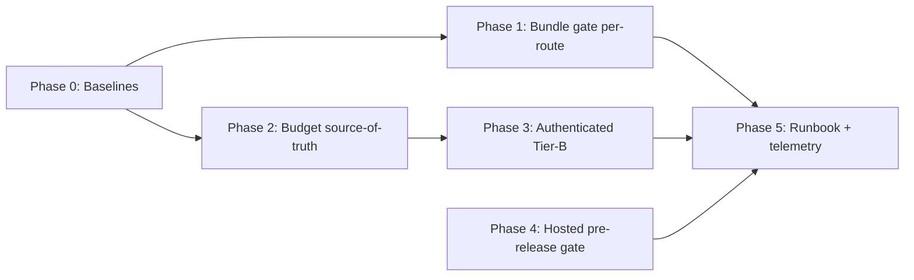

# Implementation Plan

**Execution entry document.** Phases are dependency-aware. Each phase is a durable-goal contract. Exact target paths/symbols are named; where owner decisions gate values, the task is marked `OPEN-*` and the executor proceeds with the recommended default or waits for the owner.

> **Planning-only pack.** No code is changed by this pack. The tasks below describe the **future executor's** work.

## Phase order

Phase 0 (baselines) → Phase 1 (bundle gate) → Phase 2 (route-transition reconciliation) → Phase 3 (authenticated Tier-B) → Phase 4 (hosted pre-release gate) → Phase 5 (runbook + telemetry links).

---

## Phase 0 — Baseline capture (P0)

**Objective:** Capture evidence-based baselines for bundle (per route) and route-transition (per scenario) so all later budgets are derived, not guessed.
**Requirements addressed:** PERF-05.
**Prerequisites:** None.
**Dependencies:** Sibling transition/loading UX plan Phase-0 (coordinate to avoid duplicate captures).

### Task P0-T1 — Capture bundle baseline
- **Requirement IDs:** PERF-05.
- **Objective:** Produce a per-route gz-KB baseline from the production build.
- **Target files (read/produce):** read `.next/diagnostics/route-bundle-stats.json` after `bun run build`; write baseline artifact (e.g. `.ai/03_plans/2026-07-07-bundle-and-route-performance-gate-hardening/evidence/phase0-bundle-baseline.json`).
- **Commands:**
  - `bun run build`
  - `bun run scripts/check-performance-budgets.mjs` (capture the table)
  - optionally `ANALYZE=true bun run build` for the heavy routes
- **Expected output:** per-route `{ route, gzKb, rawKb, chunks }`.
- **Validation:** artifact exists; every route in `route-bundle-stats.json` represented.
- **Completion evidence:** baseline JSON committed to evidence folder.
- **Parallelization:** parallel-safe with P0-T2 (different harness).
- **Complexity:** Small.

### Task P0-T2 — Capture route-transition baseline (Tier-B)
- **Requirement IDs:** PERF-05.
- **Objective:** Produce a per-scenario median/overlay/skeleton baseline.
- **Target files (produce):** benchmark JSON via `measure-route-transitions.ts`.
- **Commands:**
  - `bun run perf:seed-fixture` (if not already seeded)
  - `BASE_URL=http://127.0.0.1:3000 INCLUDE_AUTHENTICATED=1 ARCHESTIMATOR_DEV_AUTH_BYPASS=1 ARCHESTIMATOR_DEV_AUTH_BYPASS_SECRET=… RUNS=3 OUTPUT_FILE=.ai/03_plans/2026-07-07-bundle-and-route-performance-gate-hardening/evidence/phase0-route-transition-baseline.json bun run perf:measure-routes`
  - `ROUTE_TRANSITION_BENCHMARK_FILE=…phase0-route-transition-baseline.json OUTPUT_FILE=…phase0-route-transition-readiness.json bun run perf:check-routes`
- **Validation:** benchmark JSON has all scenarios; no skipped authenticated scenarios.
- **Completion evidence:** benchmark + readiness JSONs.
- **Parallelization:** parallel-safe with P0-T1.
- **Complexity:** Medium (fixture + localhost dev-auth setup).

**Phase 0 durable-goal contract:** Goal ID `G-PHASE-0`; completion = both baselines captured and committed; stop condition = baselines exist OR owner defers baselining; blocker = dev-auth secret unavailable (use storage-state fallback).

---

## Phase 1 — Bundle gate per-route + global backstop (P0)

**Objective:** Replace single global budget with per-route budgets + backstop; wire advisory→blocking.
**Requirements addressed:** PERF-02, PERF-01 (L1), REL-01.
**Prerequisites:** Phase 0 (P0-T1).
**Dependencies:** OPEN-PERF-01 (owner: promotion date/values).

### Task P1-T1 — Per-route budget map in `check-performance-budgets.mjs`
- **Requirement IDs:** PERF-02.
- **Objective:** Read a per-route budget map (and global backstop) instead of one `BUDGET_KB`.
- **Target file:** `scripts/check-performance-budgets.mjs` (symbols: `BUDGET_KB :18`, main loop `:42-75`).
- **New artifact:** a budget map source (e.g. extend `e2e/` budgets file or a new `scripts/performance-budgets.json`) — exact placement is the executor's, but it must be the **single** budget source consumed by both bundle and (Phase 2) route-transition where structurally possible. Bundle budgets and route-transition budgets are different units (KB vs ms), so they may remain separate files; the "single source of truth" in DEC-03 refers to the **two route-transition** consumers, not forcing KB and ms into one file.
- **Inputs:** Phase-0 baseline; 15% headroom rule.
- **Instructions:** compute per-route budget from baseline; keep global backstop ≥ 350 KB; log per-route verdict; strict mode fails on any per-route miss or partial read.
- **Expected output:** per-route PASS/OVER table; strict exit code.
- **Failure cases:** missing diagnostics, partial reads, budget map missing a route (warn + use backstop).
- **Tests to add/update:** a unit test for the budget map resolution (pure function) — repo pattern: `tests/unit/` (bun test) or `tests/vitest/`.
- **Validation:** `bun run build && bun run scripts/check-performance-budgets.mjs --strict`; unit test passes.
- **Completion evidence:** strict run output; unit test green.
- **Parallelization:** sequential after P0-T1.
- **Complexity:** Medium.

### Task P1-T2 — CI advisory→blocking wiring
- **Requirement IDs:** PERF-02, REL-01.
- **Objective:** Promote bundle gate to blocking after the advisory window, with `continue-on-error: false` when `PERF_BUDGET_STRICT=1`.
- **Target file:** `.github/workflows/ci.yml` (the "Performance budget advisory" step, `:26-36`).
- **Instructions:** after owner approval (OPEN-PERF-01), the secret-gated path already flips strictness; document the promotion date in the workflow comments and the OPS runbook. No code change needed if the secret path is used; if the owner wants unconditional blocking, remove `continue-on-error`.
- **Validation:** CI run with `PERF_BUDGET_STRICT=1` fails on a deliberately over-budget route (synthetic proof) — or static review if synthetic proof is not feasible.
- **Complexity:** Small.

**Phase 1 durable-goal contract:** Goal ID `G-PHASE-1`; completion = per-route budgets live, CI strict path verified, global backstop retained; stop = gate live; blocker = OPEN-PERF-01 unresolved (proceed with advisory default).

---

## Phase 2 — Route-transition budget source-of-truth (P0)

**Objective:** Reconcile the two route-transition budget sources into one Tier-A/Tier-B structure.
**Requirements addressed:** PERF-03, PERF-07, PERF-01 (L1/L2).
**Prerequisites:** Phase 0 (P0-T2).
**Dependencies:** OPEN-PERF-04 (Tier-B tightened values).

### Task P2-T1 — Unified budget structure
- **Requirement IDs:** PERF-03.
- **Objective:** One file (or one primary + typed imports) holds Tier-A (CI smoke) + Tier-B (deep) budgets; both consumers read from it.
- **Target files:** `e2e/route-transition-performance-budgets.json` (Tier-A consumer: `route-transition-performance.spec.ts:64`); `scripts/check-route-transition-readiness.ts` (Tier-B consumer: env defaults `:145-170`).
- **Instructions:** extend the JSON to include a `tierB` block (or add a sibling typed module the TS checker imports); have `check-route-transition-readiness.ts` read tier-B values from the same source (with env override preserved); keep Tier-A values as-is unless owner tightens post-Phase-0.
- **Expected output:** both consumers reference one source; no value drift.
- **Tests to add/update:** a unit test asserting the TS checker imports the same JSON the spec reads.
- **Validation:** `bun run type-check`; `bun run test:e2e:perf` (Tier-A still passes); `bun run perf:check-routes` against Phase-0 benchmark.
- **Complexity:** Medium.

### Task P2-T2 — Flake policy codified
- **Requirement IDs:** PERF-07.
- **Objective:** Document and enforce median-of-N + min-runs + (median>budget AND max>budget) in the readiness checker (already partly present; ensure the AND semantics are explicit) and in the OPS runbook.
- **Target files:** `scripts/check-route-transition-readiness.ts` (review `maxDurationBudgetPassed` logic `:273-277`); OPS runbook (P5).
- **Complexity:** Small.

**Phase 2 durable-goal contract:** Goal ID `G-PHASE-2`; completion = one source of truth, both consumers, flake policy explicit; stop = reconciled; blocker = OPEN-PERF-04 (proceed with current Tier-B defaults).

---

## Phase 3 — Authenticated Tier-B path (P1)

**Objective:** Enable authenticated workshop Tier-B measurement in a CI-runnable or pre-merge-runnable way.
**Requirements addressed:** PERF-04, SEC-01.
**Prerequisites:** Phase 2.
**Dependencies:** OPEN-PERF-02 (auth mode decision).

### Task P3-T1 — Choose + wire auth mode
- **Requirement IDs:** PERF-04, SEC-01.
- **Objective:** Implement the chosen auth path (recommended: dev-auth bypass against a localhost preview in CI; fallback: storage-state).
- **Target files:** `.github/workflows/ci.yml` (new optional job or dispatch); possibly `scripts/measure-route-transitions.ts` (no behavior change expected — it already supports both modes).
- **Instructions:** add a CI job (manual dispatch or `perf` label trigger) that starts a localhost preview, sets `ARCHESTIMATOR_DEV_AUTH_BYPASS=1` + a CI secret, runs `perf:measure-routes` + `perf:check-routes`. Keep it **off the per-PR critical path** (REL-01).
- **Security:** dev-auth bypass is localhost-only by code (`:397-408`); CI secret hygiene; SEC-01.
- **Validation:** Tier-B readiness JSON produced with authed scenarios not skipped.
- **Complexity:** Medium.

### Task P3-T2 — Peak-load profile integration
- **Requirement IDs:** PERF-04.
- **Objective:** Ensure `perf:profile-peak-load` (`tests/vitest/route-transition-peak-load-profile.test.tsx`) is referenced as the component-level analog to the route-level Tier-B harness.
- **Complexity:** Small (documentation/wiring).

**Phase 3 durable-goal contract:** Goal ID `G-PHASE-3`; completion = authenticated Tier-B runs with a chosen auth mode; stop = authed readiness JSON produced; blocker = OPEN-PERF-02 unresolved.

---

## Phase 4 — Hosted pre-release gate (P1)

**Objective:** Promote hosted p95 from operator-only to a defined pre-release gate (advisory → blocking on owner decision).
**Requirements addressed:** PERF-06, SEC-01.
**Prerequisites:** Production/preview URL stable.
**Dependencies:** OPEN-PERF-03.

### Task P4-T1 — Pre-release hosted gate wiring
- **Requirement IDs:** PERF-06.
- **Objective:** Wire `cf:verify-hosted-performance` into a pre-release/scheduled context (GitHub Action schedule/dispatch, or a release runbook step), credential-free.
- **Target files:** new/scheduled workflow or runbook; `scripts/verify-cloudflare-hosted-performance.ts` (values unchanged).
- **Instructions:** keep credential-free posture; record JSON+Markdown in evidence folder; route-contract fail = hard block; p95 miss = watch → blocking on owner decision.
- **Validation:** a hosted run produces a report; route-contract gate works.
- **Complexity:** Small–Medium.

**Phase 4 durable-goal contract:** Goal ID `G-PHASE-4`; completion = hosted gate defined and runnable pre-release; stop = gate live; blocker = OPEN-PERF-03, prod URL instability.

---

## Phase 5 — Runbook + telemetry links (P0/P1)

**Objective:** Regression-triage runbook + explicit links to sibling RUM/observability plans.
**Requirements addressed:** OPS-01, DOC-01, REL-01.

### Task P5-T1 — Regression triage runbook
- **Requirement IDs:** OPS-01.
- **Objective:** Decision-tree runbook for bundle/Tier-A/Tier-B/hosted misses.
- **Target:** new doc under `.ai/` ops (exact path executor's; suggest `.ai/13_operations/performance-gate-triage.md` or sibling).
- **Complexity:** Small.

### Task P5-T2 — Link sibling plans
- **Requirement IDs:** DOC-01.
- **Objective:** Cross-link transition/loading UX plan (RUM `OPEN-PERF-01`, overlay policy) and Worker observability plan.
- **Complexity:** Small.

**Phase 5 durable-goal contract:** Goal ID `G-PHASE-5`; completion = runbook live, links present; stop = docs committed.

---

## Tasks with approximate placement (none)

All tasks above name exact paths/symbols or are owner-decision-gated (`OPEN-*`). No task is left at "likely". The only `DISCOVERY-REQUIRED` style work is Phase 0 baseline capture (a read-only characterization step with exact commands and stop conditions).

## Server/Client boundary, cache, bundle, DB, render-count impact

- **Server/Client boundary:** none changed.
- **Cache/revalidation:** none changed (owned by sibling plan).
- **Bundle:** measured, not changed, by this pack; the gate consumes `route-bundle-stats.json`.
- **DB/query count:** none changed.
- **Render-count/client-state:** none changed.
- **Tailwind/design-system:** none.
- **Cloudflare resource boundary:** hosted verifier targets bound Worker only, credential-free; no mutation.
