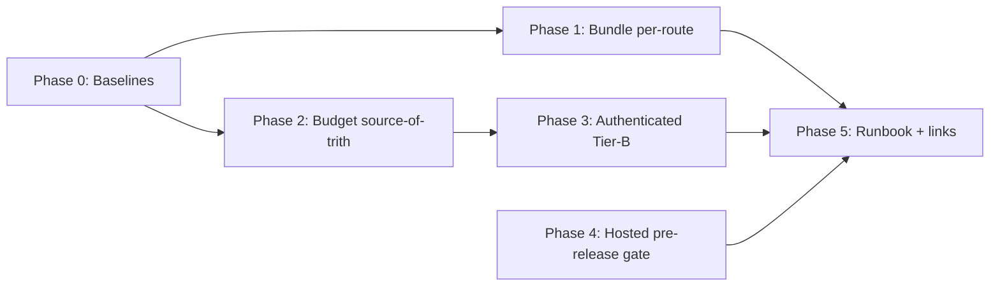

# Bundle And Route Performance Gate Hardening

**Plan status:** `CONDITIONALLY READY`
**Implementation-ready slices:** Phase 0 (baselines) is safe to start immediately; advisory parts of Phase 1/2 are safe once Phase 0 lands. Promotion/tightening steps are gated by owner decisions.
**Verification mode:** `emulated` (caps overall readiness at 97 and exhaustive-package status at `CONDITIONALLY READY` until an independent reviewer or owner accepts)
**Plan profile:** `exhaustive`
**Created:** 2026-07-07 (Asia/Manila)
**Plan folder:** `.ai/03_plans/2026-07-07-bundle-and-route-performance-gate-hardening/`

> **Planning-only pack.** Hardens the *posture* of Archestimator's performance gates — bundle size, route-transition latency, authenticated workshop routes, public share routes, CI enforcement — so a future executor can tighten them **without slowing routine iteration unnecessarily**. No application code, tests, migrations, configs, or provider state are modified by this pass.

---

## Start here

- **Implementation start document:** `11_IMPLEMENTATION_PLAN.md`
- **Phase order:** Phase 0 (baselines) → Phase 1 (bundle gate, per-route) → Phase 2 (route-transition budget source-of-truth) → Phase 3 (authenticated Tier-B) → Phase 4 (hosted pre-release gate) → Phase 5 (runbook + links).
- **Begin with Phase 0.** It is unblocked and everything else depends on its baselines. Phase 1/2 advisory work can proceed in parallel once baselines exist. Promotion/tightening waits on owner decisions.

## Layered gate posture (the one-sentence summary)

**L1 per-PR (fast):** static bundle budget (per-route + global backstop, advisory→blocking) + route-transition smoke (Tier-A, loose, blocking) — both already run in CI.
**L2 pre-merge / on-demand (slow):** deep route-transition harness (Tier-B, tight, median-of-N) with authenticated scenarios.
**L3 pre-release / scheduled (slow, hosted):** credential-free hosted Worker TTFB p95.

Browser automation is reserved for route-transition claims; bundle claims use static build output; hosted claims use the hosted verifier. This is the direct answer to the brief's "do not default to browser automation for every claim" constraint.

## Dependency graph



## Blocked owner decisions

| ID | Decision | Blocks | Recommended |
|---|---|---|---|
| OPEN-PERF-01 | Strict-bundle promotion date + per-route values | P1 promotion (blocking) | 2-week advisory window after Phase 0 |
| OPEN-PERF-02 | Auth mode for Tier-B in CI | P3 CI wiring | Dev-auth bypass (localhost preview) |
| OPEN-PERF-03 | Hosted p95 as pre-release gate (vs advisory) | P4 promotion | Advisory → blocking after stable URL |
| OPEN-PERF-04 | Tightened Tier-A/Tier-B values | P2 tightening | Phase-0-derived + 15% headroom |

None of these block **starting** Phase 0 or the advisory parts of Phase 1/2.

## Requirement/task/test traceability

- Requirements: `04_REQUIREMENTS_SPECIFICATION.md` (PERF/OPS/REL/SEC/TEST/DOC, with shadow-path matrices).
- Tasks: `11_IMPLEMENTATION_PLAN.md` (P0–P5, each a durable-goal contract).
- Tests: `12_TEST_AND_VALIDATION_STRATEGY.md` (Test Execution Matrix).
- Full mapping: `16_REQUIREMENTS_TRACEABILITY_MATRIX.md`.

## Stale-plan revalidation checklist (before executing any phase)

1. Re-verify `next`/`react`/`@opennextjs/cloudflare`/`wrangler` versions in `package.json`.
2. Re-verify Next 16 still emits `.next/diagnostics/route-bundle-stats.json` with `{ route, firstLoadChunkPaths }`.
3. Re-verify `scripts/check-performance-budgets.mjs:18` budget constant + `:42-75` loop shape.
4. Re-verify `.github/workflows/ci.yml` "Performance budget advisory" step + `continue-on-error`.
5. Re-verify `e2e/route-transition-performance-budgets.json` values + `scripts/check-route-transition-readiness.ts` env defaults have not drifted.
6. Re-verify `e2e/route-transition-performance.spec.ts:345-349` auth-skip conditions.
7. Re-verify `scripts/verify-cloudflare-hosted-performance.ts` `HOSTED_ROUTE_BUDGETS` + `MIN_P95_RUNS`.
8. Re-verify the sibling transition/loading UX plan's Phase-0 status (coordinate baselines).
9. Re-verify `next.config.ts` `experimental.staleTimes` + `ANALYZE=true` wiring.

## Commands to run before the first edit

```bash
git status                                   # confirm clean working tree / declare ownership
bun run validate                             # full local gate
bun run build                                # confirm diagnostics produced
bun run scripts/check-performance-budgets.mjs
```

## Files explicitly off-limits (this pack mutates nothing)

All source, tests, migrations, configs, `package.json`, `next.config.ts`, `.github/`, scripts, provider state. This pass writes only to this plan folder.

## Files and systems intentionally unaffected

- D1/R2/Durable Objects/Queues/Email/IMAGES — no data/provider work.
- `next.config.ts`, CSP, Server/Client boundaries, cache contracts — no change.
- Estimate sheet components, `RouteLoadingOverlay`, library/share UI — measured, not changed (owned by sibling UX plan).

## External proof that remains required before production rollout

- Phase-0 baseline capture (bundle per route + route-transition per scenario).
- Hosted p95 against a stable prod/preview URL (OPEN-PERF-03).
- Authenticated Tier-B run with the chosen auth mode (OPEN-PERF-02).

## Linked plans (read-only)

- `.ai/03_plans/2026-07-06-Transition-And-Loading-UX-And-UI/` — loading/error coverage, overlay policy, RUM (`OPEN-PERF-01`), bundle-strict (`OPEN-PERF-02`/`05`), route boundary/cache contracts.
- `.ai/03_plans/2026-07-07-cloudflare-worker-production-observability-and-budgets/` — Worker observability + budget posture (hosted p95 feeds its evidence).
- `.ai/03_plans/2026-06-29-Cloudflare-Migration-Codex/` — hosted performance evidence artifacts + cost/performance workbook.

## Archive policy

Archive after full completion (all phases landed, owner decisions resolved, gates live). Do not auto-archive partial completion.

## Document index

| Doc | Purpose |
|---|---|
| `00_AGENT_COORDINATION.md` | Master goal, ledger, skills, authority |
| `01_EXECUTIVE_SUMMARY.md` | Headline findings, decisions, blockers |
| `02_FEATURE_BRIEF_AND_SCOPE.md` | Brief, scope in/out, assumptions |
| `03_SOURCE_AND_CODEBASE_AUDIT.md` | Scripts/CI/routes/budgets inventory |
| `04_REQUIREMENTS_SPECIFICATION.md` | Stable-ID requirements + shadow-path matrices |
| `05_UX_UI_ACCESSIBILITY_PLAN.md` | Verification-only UX surface |
| `06_ARCHITECTURE_AND_TECHNICAL_DESIGN.md` | Current/target architecture, alternatives |
| `07_DATA_DATABASE_API_NETWORK_PLAN.md` | Auth/fixture + hosted network + credential taxonomy |
| `08_SECURITY_PRIVACY_THREAT_MODEL.md` | Threat model, mitigations, residual risk |
| `09_PERFORMANCE_RELIABILITY_OBSERVABILITY.md` | **Core:** layered posture, evaluators, budgets, flake policy |
| `10_BLAST_RADIUS_AND_DEPENDENCIES.md` | Direct + transitive impact |
| `11_IMPLEMENTATION_PLAN.md` | **Execution entry:** P0–P5 durable-goal contracts |
| `12_TEST_AND_VALIDATION_STRATEGY.md` | Test execution matrix, known-red ledger |
| `13_ROLLOUT_ROLLBACK_AND_OPERATIONS.md` | Sequencing, rollback triggers, gates |
| `14_RISK_REGISTER.md` | Risks with mitigation/contingency |
| `15_DECISIONS_ASSUMPTIONS_AND_ALTERNATIVES.md` | Decisions, assumptions, rejected alternatives |
| `16_REQUIREMENTS_TRACEABILITY_MATRIX.md` | Requirement → task → test → rollout |
| `17_FINAL_READINESS_REVIEW.md` | Scores, audit, emulated verifier |
| `18_STACK_CONTRACT_AND_PRODUCTION_STANDARDS.md` | Cross-cutting stack decisions |
| `19_RESEARCH_REVIEW_AND_QA_EVIDENCE.md` | Research, critique cycles, adversarial matrix |
