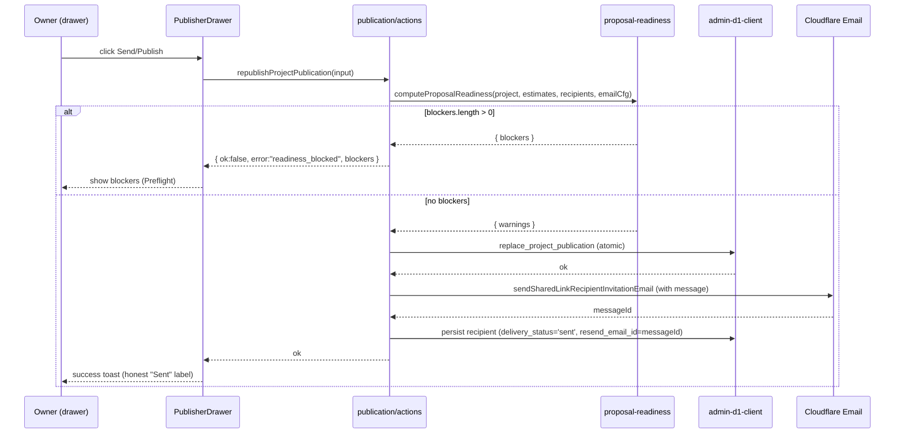

# 06 — Architecture and Technical Design

## Current-state architecture

Three independent surfaces (all built), each with its own data path:

```
[Estimate page] ── EstimateHeaderActions (Zustand store bridge)
                     └─ ProposalExportPreviewDialog ── useEstimateProposalPreview
                                                          └─ buildProposalExportModel (client + server parity)

[Project chrome] ── PublisherDrawer (React Query, usePublisherDrawer)
                      ├─ drawer-actions.readPublisherPublicationDrawerData
                      ├─ SheetPickerList (selected_estimate_ids)
                      ├─ RecipientEmailComposer (recipient emails)
                      ├─ PublisherProjectMembersPanel (RBAC)
                      └─ PublisherActivityFeed

[Publication lifecycle] ── publication/actions.ts
                            ├─ create/republish/rotate/revoke
                            ├─ add/remove/resend recipients
                            └─ admin-d1-client.callProcedure (atomic D1)
```

The **gap**: no shared readiness model; the export dialog and the publisher drawer each compute parts of "is this ready" independently (and mostly don't). Recipient email copy is hardcoded. `responded` is never written. Notifications aren't dispatched.

## Target-state architecture

```
                 ┌───────────────────────────────────────────┐
                 │  src/lib/proposal-readiness/ (NEW, P0)    │
                 │  computeProposalReadiness()  (server-only)│
                 │  - reuses buildProposalExportModel        │
                 │  - reuses readPublicationSnapshotStaleness│
                 │  - reuses countUnsavedEditableRows        │
                 │  - reuses applyAudiencePolicy (redaction) │
                 └───────────────┬───────────────────────────┘
                                 │ (read-only DTO, redacted for client)
            ┌────────────────────┼─────────────────────────┐
            ▼                    ▼                          ▼
   ProposalExportPreview    PublisherDrawer            publication/actions
   (warnings subset, UX-02) (Preflight panel, UX-01)   (FR-04 gate in
                                 │                      create/republish)
                                 ▼                            │
                    RecipientEmailComposer                    │
                    + owner message (FR-05) ◄──────────────────┘
                                 │
                                 ▼  (on decision)
                    submitSharedLinkDecision ──► flips `responded` (FR-07)
                                 │
                    publication_activity notification dispatch (FR-08)
```

### Component boundaries

- **`proposal-readiness`** is a **pure server-only module**. No client imports it directly; the client receives a DTO via a server action. This prevents leaking internal estimator detail (Source Breakdown, supplier names) into client bundles (SEC-02).
- **Readiness DTO** is intentionally a subset: `{ blockers: [{id,message,field?}], warnings: [{id,message}], summary: {ready: boolean, blockerCount, warningCount} }`. It never includes internal-only export settings or raw estimate data.
- **Owner message** flows through the existing `addSharedLinkRecipients`/`resendSharedLinkRecipientEmail` Server Actions (FR-05); persisted on `shared_link_recipients` for resend consistency (DATA-02, DEC-02).
- **`responded` write** happens inside the existing `submitClientResponse`/`submitSharedLinkDecision` transaction (FR-07) — no new endpoint.
- **Notification dispatch** is a new best-effort, non-blocking call (REL-03) from the existing action call sites.

### Data flow / control flow (publish with readiness)



### Reusable abstractions (reuse, not reinvent)

| Need | Reuse | Why not new |
|---|---|---|
| Snapshot staleness | `readPublicationSnapshotStaleness` (`roster-repository.ts`) | Already computed for the roster |
| Unsaved edits | `countUnsavedEditableRows` (`proposal-preview-model.ts`) | Already computed for the export preview |
| Export validation | `buildProposalExportModel.validationIssues` | Already emits `empty_estimate`/`cost_split_compatibility_mode` |
| Audience redaction | `applyAudiencePolicy` (`proposal-export/settings.ts`) | Already strips Source Breakdown/supplier for client |
| Snapshot redaction | `sanitizeProjectPublicationSnapshotForPublicRead` (`snapshot.ts`) | For any client-facing preview |
| Manager authz | `assertProjectPublicationManager` (`actions.ts`) | Existing rank-based gate |
| Read authz | `canReadPublisherRosterProject` (`permissions.ts`) | Existing role gate |
| Email send + circuit breaker | `sendEmail` (`transactional-email-client.ts`) | Existing provider abstraction |
| Action error shape | existing `withActionErrors` pattern | Consistency |
| Drawer data load | `readPublisherPublicationDrawerData` (`drawer-actions.ts`) | Extend with readiness block (one parallel load) |
| React Query cache | `publisherRosterQueryKeys` | Add readiness to drawer query, not a new query |

### Coupling / dependency direction

- `proposal-readiness` depends on: `proposal-export` (model builder), `publisher` (staleness helper), `estimates` (types), `email` (config read). It does **not** depend on React or any client component.
- Client components depend on the readiness **DTO type only** (via a re-export from a client-safe types file).
- `publication/actions` depends on `proposal-readiness` (server-to-server).
- No circular dependencies: `proposal-readiness` never imports from `publication/actions` or from React.

### Failure boundaries

- Readiness computation failure → `REL-02`: catch, log, and return a single `readiness_unavailable` warning (non-blocking) so a readiness bug never blocks a publish that would otherwise succeed. This is a deliberate fail-open for the warning path; the **hard blocker** path is fail-closed only for explicitly enumerated blockers (FR-02) that are cheap to compute (counts/config flags), not for the heavier model.
- Email send failure → existing behavior (recipient stays `pending`); composer shows retry.
- Notification dispatch failure → `REL-03`: swallow + log; never fail the parent action.

## Next.js / React decisions

| Decision | Choice | Rationale |
|---|---|---|
| Where does readiness run? | Server Action + Server Component data loader (`readPublisherPublicationDrawerData`) | Keeps internal detail server-side; no client bundle cost (SEC-02, PERF) |
| `"use client"` boundary | Only the existing drawer/composer/dialog client components get the new subcomponents; readiness DTO is passed in as props | Smallest client boundary; no new client-only data fetching |
| Cache/freshness | Readiness is computed fresh on each drawer open via the existing React Query drawer query (10s staleTime) | No stale readiness; matches existing drawer freshness model |
| Revalidation | After a successful publish/republish, existing `refreshPublisherSurface` invalidation covers readiness too (same query key) | No new invalidation logic |
| Server Action direct POST | `createProjectPublication`/`republishProjectPublication` already validate auth + authz + idempotency; readiness is an additional check, not a new endpoint | No new attack surface |
| Progressive enhancement | The composer Send remains a Server Action form (existing); readiness is enforced server-side regardless of JS | The gate is server-side, so no-JS still safe |
| Suspense/loading | Drawer skeleton extended to cover the readiness block | No new waterfall (parallel load) |
| Hydration | Readiness DTO is plain JSON-serializable; no hydration mismatch risk | — |

## TypeScript / validation

- `ProposalReadinessResult`, `ReadinessCheck`, `ReadinessSeverity` defined in `proposal-readiness/types.ts`.
- Runtime validation at the Server Action boundary: input already validated by existing zod/schema patterns; readiness input is derived server-side from already-validated inputs (no new client input surface except the owner message fields, which get length + sanitization validation).
- No `any`; exhaustive handling of the `ReadinessCheck.id` union in the UI (switch on id → message/hint).
- Owner message: `z.string().max(120)` for subject, `z.string().max(1000)` for body, both optional.

## Tailwind v4 / design-system

- No new design tokens. Reuse existing alert/status/card variants.
- No global style changes. Preflight panel uses existing drawer spacing/typography.
- Design-lint (`bun run lint:design-system`) should pass unchanged (verify in implementation; no new primitive violations expected).

## Diagrams

### State machine: publication status with readiness overlay

```mermaid
stateDiagram-v2
    [*] --> Unpublished: project has no publication row
    Unpublished --> Published: create (FR-04 gate passes)
    Published --> Published: republish (bumps snapshot_version; FR-04 gate)
    Published --> Revoked: revoke
    Published --> Expired: read-time (expires_at <= now)
    Published --> Published: rotate ("New link"; recipients reset to pending)
    Expired --> Published: republish with expiresAt=null
    note right of Published
        Readiness gate (FR-04) applies on
        create and republish transitions.
        Warnings surfaced in Preflight (UX-01).
    end note
```
