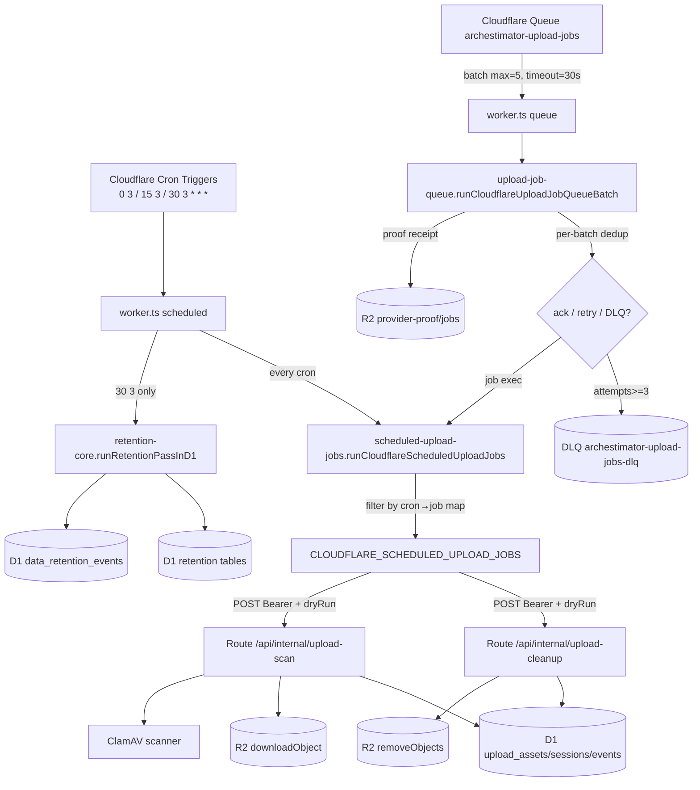

# 06 — Architecture and Technical Design

## Current-state architecture

**Note:** The cron path (`scheduled → runCloudflareScheduledUploadJobs → HTTP
route`) and the queue path (`queue → runCloudflareUploadJobQueueBatch →
runCloudflareScheduledUploadJobs → HTTP route`) **share the same job-execution
core**. The queue path adds per-batch dedup, retry/DLQ decisioning, and R2
proof receipts on top.

**Acknowledgement mode (grounded in official Cloudflare Queues docs):**
`runCloudflareUploadJobQueueBatch` calls **explicit per-message `ack()`/`retry()`**
on every message. This is *not* Cloudflare's default behavior (the default is
whole-batch retry when any message fails). Explicit ack means a failed message
is isolated — it does not force redelivery of the whole batch. The app's
`retry({delaySeconds:60})` overrides Cloudflare's default exponential backoff
with a flat 60s delay. The actual DLQ move is performed by Cloudflare infra at
`max_retries=3`; the app only computes a `deadLetterExpected` flag.

### Component boundaries (evidence)

- **Worker entrypoint** (`worker.ts`) — fetch/scheduled/queue routing. Owns no
  business logic; delegates to libs.
- **Cron dispatch lib** (`scheduled-upload-jobs.ts`) — cron→job registry,
  secret resolution, dryRun gating, request building. Stateless.
- **Queue runtime lib** (`upload-job-queue.ts`) — message schema, idempotency
  key, enqueue, consumer decision loop, proof receipts. Stateless except
  per-batch Set.
- **Retention engine** (`retention-core.ts`) — rule registry, select/apply,
  audit write. Stateless; reads rules from `DEFAULT_RETENTION_RULES`.
- **Route handlers** (`api/internal/upload-*`) — auth, dryRun, LIMIT, delegate
  to job runners (`cleanup-job.ts`, `scan-job.ts`) that own D1/R2 work.
- **Proof scripts** (`scripts/*`) — read-only generators/verifiers; write only
  to `evidence/` and R2 proof prefix.

### State ownership

- **Queue/DLQ message state:** Cloudflare Queues infra (not D1). App code only
  ack/retry/`deadLetterExpected` flag; the actual DLQ *move* is infra.
- **Job idempotency:** per-batch in-memory Set (ephemeral). No durable
  idempotency store.
- **Retention audit:** D1 `data_retention_events` (durable).
- **Upload row state:** D1 `upload_assets` (`status`, `scan_status`).
- **Proof receipts:** R2 `provider-proof/jobs/<id>.json`.

## Target-state architecture (what this plan drives toward)

No structural rewrite. The target state is the **same** architecture, hardened
and documented:

1. **Single cron SoT** enforced by a guard test (FR-001).
2. **Explicit idempotency contract** with boundary tests (FR-003) and an
   optional durable idempotency store decision (D-IDEMP).
3. **DLQ operator path** documented + a read-only peek capability (FR-005).
4. **Optional retention `created_at` indexes** (DATA-001) to keep purges cheap.
5. **Hosted proof reconciliation** so `productionJobsMessagingReady=true`
   reflects real provider state (FR-008).
6. **Shared auth helper** (ARCH-002) — optional follow-up to kill the 3+ inline
   copies.

## Architectural decisions (load-bearing)

See `15` for full option/rationale. Headline decisions:

- **D-CRONSOT:** Cron SoT = `wrangler.jsonc`; `scheduled-upload-jobs.ts` + a
  constant for the retention cron are the code mirror; a guard test pins the
  union. Rejected: making `scheduled-upload-jobs.ts` the SoT (it can't express
  the retention cron, which isn't a job).
- **D-IDEMP:** Keep minute-granularity, per-batch dedup (current) as the
  documented contract; add a durable idempotency store only if cross-batch
  duplicate work is observed in production. Rejected: D1-backed dedup table
  now (adds write-on-hot-cron-path cost without proven need).
- **D-RETPROC:** Retention stays in-process in `worker.ts scheduled()` (not a
  queue job, not an HTTP route). Rationale: it's a single daily bounded pass,
  no retry/DLQ need, and an HTTP route would add a new attack surface for no
  benefit. Rejected: routing retention through the queue (over-engineered for
  a once-daily bounded DELETE).
- **D-INDEX:** Add standalone `created_at` indexes on retention-target tables
  (blueprint DB-INDEX). Rejected: relying on composite indexes (leading column
  mismatch → full scan at scale).

## Failure boundaries

- Cron not firing → no upload cleanup/scan/retention that day. Detection:
  absence of `data_retention_events` rows / `upload_events` cleanup rows for
  the day; `cf:jobs-proof` hosted probe.
- Route returns 503/401 → cron records `missing_secret`/failed status; queue
  path retries to DLQ.
- Scanner outage → scan job records `scannerFailedCount`; rows stay
  `failed_transient`, retried next run.
- R2 partial delete → cleanup records `cleanup_failed`; objects remain,
  re-attempted next run (idempotent).
- Retention per-rule error → caught per-rule, other rules still run, error
  rule skipped with audit note.

## Coupling & dependency direction

`worker.ts` → `scheduled-upload-jobs.ts` → (HTTP) → route handlers → job
runners → D1/R2/scanner. `worker.ts` → `retention-core.ts` → D1.
`upload-job-queue.ts` → `scheduled-upload-jobs.ts` (reuses the job-exec core).
No cycles. Proof scripts import source constants (one-way).
