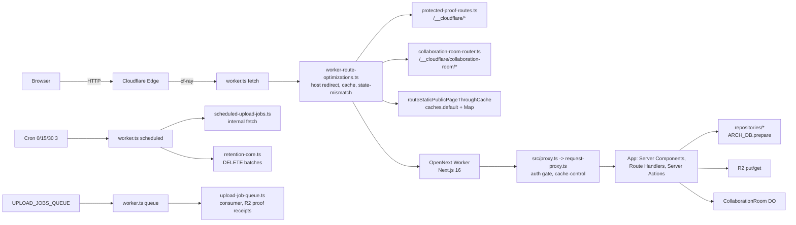
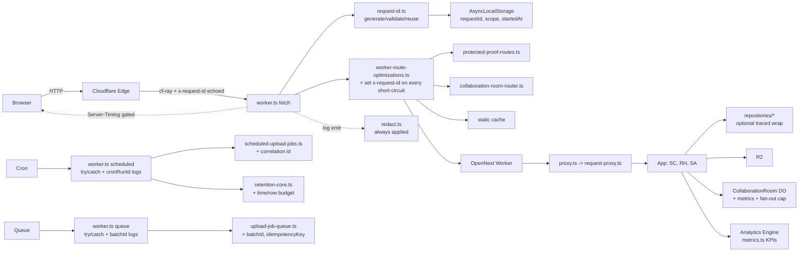

# 06 — Architecture and Technical Design

## 6.1 Current-state architecture

**Telemetry today** (dashed = partial/dev-only):
- `worker.ts` logs 3 summary `console.log` lines only.
- `App` errors → `logAppError` → `console.*` + dev `ndjson`; `route-error.ts`
  emits `err_*` trace id in the response body only.
- `server-timing.ts` `wsh_*` id + `[perf-json]` — **dev-only** (`PERF_TRACE=1`).
- `cf-ray` read in 2 auth paths; **never echoed**.
- **No metrics sink.** Realtime/express sinks stubbed, unregistered.
- **No try/catch** at `worker.ts` dispatch boundaries.

## 6.2 Target-state architecture

### Key architectural changes

1. **New module `src/lib/observability/request-id.ts`** — pure functions:
   - `generateRequestId(): string` → `crypto.randomUUID()`.
   - `readInboundRequestId(headers): string | null` → validate `^[A-Za-z0-9._:-]{1,128}$`.
   - `resolveRequestId(request): string` → inbound-or-generate.
   - `withRequestContext(requestId, scope, fn)` → `AsyncLocalStorage.run(...)`.
   - `getRequestContext()` → `{ requestId, scope, startedAt } | null`.
   This supersedes the dev-only `wsh_*` id for production; the perf-trace id can
   reuse this helper to avoid divergence.

2. **Worker `fetch()` wrapper** — wraps the entire dispatch chain:
   - Resolve id, set response header (on every return path incl. fast-paths),
     run dispatch inside `withRequestContext`, catch all → `logAppError` + 500.
   - The fast-path helpers in `worker-route-optimizations.ts` each take the id
     and attach the header before returning.

3. **Worker `scheduled()`/`queue()` wrappers** — `cronRunId` (already exists for
   retention) generalized; `batchId` added for queue; structured start/complete
   logs; try/catch.

4. **Propagation into OpenNext** — because OpenNext runs in the same Worker
   isolate, the `AsyncLocalStorage` set in the wrapper is visible to Next.js
   Server Components / Route Handlers / Server Actions / `onRequestError`.
   `route-error.ts` `readTraceId()` is updated to prefer
   `getRequestContext()?.requestId` (replacing the perf-trace lookup). The id is
   also passed as a request header into `openNextWorker.fetch()` so it survives
   even if the ALS context is lost (belt-and-suspenders).

5. **`Server-Timing` header** — new `server-timing-header.ts` builds the header
   from the request context's accumulated timings; gated by env var; label
   allowlist; suppressed on cacheable/auth responses.

6. **Metrics** — new `src/lib/observability/metrics.ts` wrapping
   `env.<AE_BINDING>.writeDataPoint({blobs:[...], doubles:[...], indexes:[...]})`
   with a dimension allowlist. The binding name is DEC-07 (owner); placeholder
   `ARCH_METRICS`.

7. **Retention budget** — `runRetentionPassInD1` gains `maxDurationMs` +
   `maxRowsDeletedPerTick` + per-rule progress logging.

8. **DO fan-out cap** — `collaboration-room.ts` broadcast loop capped; message
   length via `byteLength`/`Buffer.byteLength` (no double-encode).

## 6.3 Component boundaries and ownership

| Boundary | Owner module | Direction |
|---|---|---|
| Edge id generation/echo | `request-id.ts` + `worker.ts` | inbound → downstream |
| Async request context | `request-id.ts` (ALS) | read anywhere in the request |
| Structured logging | `logger.ts` (extended) | app → console/ndjson |
| Error taxonomy | `app-error.ts` (unchanged) | thrown → logged |
| Redaction | `redact.ts` (unchanged) | every emit path |
| Server-Timing | `server-timing-header.ts` | request → response header |
| Metrics | `metrics.ts` | request/event → Analytics Engine |
| Budgets | `retention-core.ts`, `collaboration-room.ts`, `admission-control.ts` | runtime guards |
| Proof/evidence | `src/app/api/internal/*` + `cf:*` scripts | provider readback |

## 6.4 Data flow for a request (target)

1. Edge assigns `cf-ray`; Worker resolves `requestId` (inbound `x-request-id` or
   UUIDv4); sets `AsyncLocalStorage`; calls dispatch.
2. Each fast-path attaches `x-request-id` to its short-circuit response.
3. OpenNext runs; Server Components/Route Handlers/Server Actions read
   `getRequestContext()`; `route-error.ts` uses it for `trace_id`.
4. On error, `logAppError({event, requestId, error})` emits one redacted NDJSON
   line; `problemDetailsResponse` returns `{requestId, code, ...}`.
5. `metrics.ts` emits ≤1 KPI data point per request (sampled if needed).
6. On success, `Server-Timing` (if enabled) is attached; response returns with
   `x-request-id`.
7. Cloudflare ingests `console.*` → Workers Logs (sampled). AE points → Analytics
   Engine (separate quota).

## 6.5 Architectural alternatives considered (summary — full in `15_…`)

- **W3C `traceparent` instead of custom id:** rejected for free-tier primary
  path (traces disabled to save quota); custom id is quota-free and sufficient
  for app correlation. Keep `traceparent` available when traces re-enabled.
- **KV-based request id store:** rejected (KV is eventually consistent; not
  needed for an in-request id).
- **Self-hosted metrics in D1:** rejected (costs rows-written/day quota; AE is
  free and purpose-built).
- **Middleware/proxy for id instead of Worker:** rejected (proxy runs after
  OpenNext bootstrap and cannot echo on short-circuits/DO/proof routes; Worker is
  the only place that sees every request).

## 6.6 State ownership

| State | Owner | Lifetime |
|---|---|---|
| `requestId` | `AsyncLocalStorage` in `request-id.ts` | one request |
| perf timings (dev) | `AsyncLocalStorage` in `server-timing.ts` | one request |
| domain `correlationId` | D1 `correlation_id` columns (unchanged) | durable (idempotency/activity) |
| cron `cronRunId` / queue `batchId` | local var + log line | one tick/batch |
| AE KPI points | Cloudflare Analytics Engine | retained per AE policy |
| Worker Logs | Cloudflare Workers Logs | 3 days (free) / 7 (paid) |

## 6.7 Failure boundaries

- Edge handler throws → caught by `worker.ts` try/catch → 500 + logged.
- OpenNext route throws → `onRequestError` (`instrumentation.ts`) + route-level
  `errorResponse` → 500 + logged with id.
- Server Action throws → `with-action-errors.ts` → logged with id (FR-05 fix).
- Cron/queue throws → caught → logged with `cronRunId`/`batchId`.
- DO throws → caught per-message; socket closed 1011; logged (new).
- Retention hits budget → `budget_reached` result; logged.
- AE write fails → swallowed (best-effort); does not fail the request.
- Redaction throws → fail-safe (redact everything / drop field).

## 6.8 Coupling / dependency direction

`request-id.ts` ← (used by) `worker.ts`, `route-error.ts`, `with-action-errors.ts`,
`logger.ts`, `metrics.ts`, `server-timing-header.ts`. No cycles. `metrics.ts`
depends on the AE binding (Cloudflare env), injected at call sites (not global) to
stay testable.
