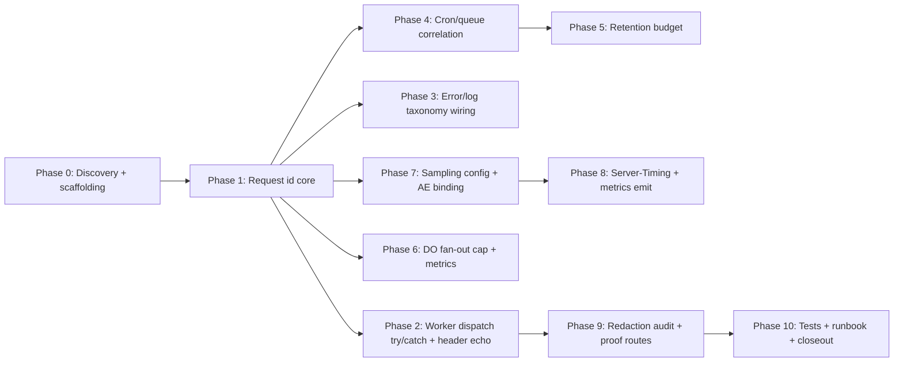

# 11 — Implementation Plan

This is the **initial execution guide** for the future implementation AI. It is
organized into dependency-aware phases. (If `Create-Implementation-Prompt.md`
later produces `IMPLEMENTATION_PLAN.md`, that file supersedes this one for
execution; README + readiness review will point executors there.)

Phase order is the safe dependency order. Within a phase, tasks marked
**parallel-safe** may run concurrently; **sequential** tasks must be ordered.
**Complexity**: S/M/L/XL.

## Phase graph

---

## Phase 0 — Discovery + scaffolding

**Objective:** confirm current files match this plan before editing; create test
scaffolding placeholders. **Requirements:** none (characterization).
**Prerequisites:** none.

### Task T-0.1 (S, sequential) — Verify current state
- **Objective:** confirm `worker.ts`, `wrangler.jsonc`, `src/lib/observability/*`,
  `src/lib/perf/server-timing.ts`, `src/lib/compliance/retention-core.ts`,
  `src/lib/cloudflare/collaboration-room.ts` match `03_…` line references.
- **Why:** the plan was written from a snapshot; re-verify before edit.
- **Paths (read-only):** all of the above.
- **Validation:** `git status` clean-ish; no unexpected diffs.
- **Parallelization:** sequential (gates all later edits).
- **DISCOVERY-REQUIRED?** No — characterization only, no code change.

---

## Phase 1 — Request id core

**Objective:** FR-01. **Requirements:** FR-01.

### Task T-1.1 (M, new file) — Create `src/lib/observability/request-id.ts`
- **Objective:** pure helpers + ALS context.
- **New file:** `src/lib/observability/request-id.ts`
- **Responsibility:** generate/validate/reuse request id; provide ALS context.
- **Public API:**
  - `MAX_INBOUND_REQUEST_ID_LENGTH = 128`
  - `INBOUND_REQUEST_ID_PATTERN = /^[A-Za-z0-9._:-]{1,128}$/`
  - `generateRequestId(): string` → `crypto.randomUUID()`
  - `readInboundRequestId(headers: Headers): string | null`
  - `resolveRequestId(request: Request): string`
  - `type RequestContext = { requestId: string; scope: string; startedAt: number }`
  - `withRequestContext<T>(ctx: RequestContext, fn: () => Promise<T>): Promise<T>`
  - `getRequestContext(): RequestContext | null`
- **Dependency direction:** none (leaf); depends only on `node:async_hooks` + Web `crypto`.
- **Why no existing file owns this:** `server-timing.ts` is dev-only/perf-named;
  `route-error.ts` is error-only. A pure id module keeps the contract reusable.
- **Acceptance:** unit tests pass (T-10.1).
- **Parallelization:** parallel-safe (new file, no shared edits).
- **Complexity:** M.

### Task T-1.2 (S, modify) — Reuse in `src/lib/perf/server-timing.ts`
- **Objective:** replace local `makeRequestId`/ALS with `request-id.ts` to avoid
  divergence (keep `PERF_TRACE` gating for the timing/`[perf-json]` behavior).
- **Paths:** `src/lib/perf/server-timing.ts:37` (remove `makeRequestId`), perf-trace context.
- **Symbols:** `makeRequestId`, `withPerfTraceRequest`, `PerfTraceContext`.
- **Acceptance:** `PERF_TRACE=1` still emits `[perf-json]`; id now from `request-id.ts`.
- **Parallelization:** sequential after T-1.1.
- **Complexity:** S.

### Task T-1.3 (M, new) — Inbound-id isolation (P1-5 / T-06)
- **Objective:** distinguish the **echo id** (may be attacker-supplied) from the
  **internal correlation id** (always internally generated) so durable audit
  rows never store an untrusted inbound value.
- **New contract in `request-id.ts`:**
  - `type ResolvedRequestId = { echoId: string; internalId: string; source: "inbound" | "generated" }`
  - `resolveRequestId(request): ResolvedRequestId` — `internalId` is always a
    fresh UUIDv4; `echoId` is the validated inbound id (or the internal id if none).
  - **Persistence rule (documented + enforced at call sites):** D1 audit writes
    (`account_security_events.request_id` via `account-audit.ts` /
    `account-audit-d1-store.ts`) use `internalId` only. The response header
    `x-request-id` uses `echoId`.
- **Why:** prevents an attacker from injecting a chosen, durable,
  account-scoped tracking/correlation key (P1-5).
- **Paths:** new `request-id.ts` (extend T-1.1); `src/lib/auth/account-audit.ts`,
  `src/lib/auth/account-audit-d1-store.ts`, `src/lib/auth/account-data.ts`,
  `src/lib/auth/actions.ts`, `src/app/auth/callback/route.ts` — change the id
  they pass to `recordAccountSecurityEvent` from `headersList.get("x-request-id")`
  to `getRequestContext()?.internalId ?? headersList.get("cf-ray")`.
- **Acceptance:** AC-FR-01b1; P-15.
- **Parallelization:** sequential after T-1.1.
- **Complexity:** M.

---

## Phase 2 — Worker dispatch try/catch + header echo

**Objective:** FR-01 (header echo), FR-03. **Requirements:** FR-01, FR-03.
**Prerequisites:** Phase 1.

### Task T-2.1 (L, modify) — Wrap `worker.ts` `fetch()`
- **Objective:** resolve id → set ALS context → wrap dispatch in try/catch → echo
  `x-request-id` on every return path (including fast-paths).
- **Paths:** `worker.ts:60-95` (`fetch()`).
- **Symbols:** `default.fetch`.
- **Inputs:** `request-id.ts` (T-1.1).
- **Instructions:**
  1. At top of `fetch`: `const requestId = resolveRequestId(request);`.
  2. Build a `Response` post-processing that ensures `x-request-id` header is set
     on every returned `Response` (use a helper `withRequestIdHeader(response, id)`).
  3. Run the dispatch chain inside `withRequestContext({requestId, scope:"worker.fetch", startedAt:Date.now()}, async () => ...)`.
  4. Wrap in try/catch: on throw, `logAppError(error, {event:"worker.fetch.unhandled", requestId})` and return `problemDetailsResponse(error, {requestId})` (or a minimal 500 JSON if `problemDetailsResponse` is unreachable from worker.ts — use the same safe shape).
  5. Pass `requestId` into each `routeXxx` fast-path so they can attach the header on short-circuit.
- **Expected output:** every response (200/3xx/4xx/5xx, fast-path or not) has `x-request-id`.
- **Failure cases:** fast-path returns before header set → helper covers it;
  OpenNext returns immutable Response → clone with new header.
- **Tests:** T-10.2 (integration).
- **Validation:** `bun run type-check`; manual `wrangler dev` + curl.
- **Parallelization:** sequential (single file, central).
- **Complexity:** L.

### Task T-2.2 (M, modify) — Fast-paths attach header
- **Objective:** each `routeXxx` in `worker-route-optimizations.ts` attaches the
  header to its short-circuit `Response`.
- **Paths:** `src/lib/cloudflare/worker-route-optimizations.ts` (`routeCanonicalHostRedirect:141`, `routeAuthStateMismatchRetry:236`, `routeAuthCallbackStateMismatchRetry:250`, `routeAuthStateResetLoginCompletion:263`, `routeCloudflareFastHealthRequest:127`, `routeMalformedShareTokenRequest:302`, `normalizeAuthStateMismatchRedirectResponse:285`, `routeStaticPublicPageThroughCache:320`).
- **Approach:** thread `requestId` param; each returns `withRequestIdHeader(resp, id)`.
  Alternatively, centralize in `worker.ts` after each call (cleaner, fewer
  signature changes) — **recommended**: post-process in `worker.ts` `fetch()`.
- **Acceptance:** curl shows header on a 308 redirect and on `/api/health`.
- **Parallelization:** sequential after T-2.1.
- **Complexity:** M.

### Task T-2.3 (M, modify) — Wrap `scheduled()` and `queue()`
- **Objective:** FR-02 (start/complete logs), FR-03 (try/catch).
- **Paths:** `worker.ts:97-129`.
- **Instructions:**
  - `scheduled()`: generate `cronRunId = crypto.randomUUID()`; log
    `{"event":"cron.start","cron":...,"cronRunId":...}`; wrap each `ctx.waitUntil`
    body in try/catch logging `{"event":"worker.scheduled.unhandled","cronRunId":...}`; pass `maxDurationMs`/`maxRowsDeletedPerTick` to retention (T-5.1).
  - `queue()`: generate `batchId`; log `queue.batch.start` (messageIds capped at
    10); wrap in try/catch; ensure consumer (T-4.2) logs `queue.batch.complete`.
- **Acceptance:** `wrangler tail` shows both events.
- **Parallelization:** sequential.
- **Complexity:** M.

---

## Phase 3 — Error/log taxonomy wiring

**Objective:** FR-05. **Requirements:** FR-05. **Prerequisites:** Phase 1.

### Task T-3.1 (M, modify) — `route-error.ts` reads context id
- **Paths:** `src/lib/observability/route-error.ts:28-33` (`readTraceId`).
- **Change:** prefer `getRequestContext()?.requestId` over `getCurrentPerfTraceSnapshot()?.requestId`; fall back to fresh `err_*` only if neither present.
- **Acceptance:** error response `trace_id` equals the edge `x-request-id`.
- **Complexity:** S.

### Task T-3.2 (M, modify) — `with-action-errors.ts` pulls context id
- **Paths:** `src/lib/observability/with-action-errors.ts`.
- **Change:** in the error branch, `const requestId = getRequestContext()?.requestId;` pass to `logAppError({event:"action_error", action, requestId})`.
- **Acceptance:** Server Action errors now carry the request id.
- **Complexity:** S.

### Task T-3.3 (M, modify) — `instrumentation.ts` edge branch — **redact path + add id (P1-2)**
- **Paths:** `src/instrumentation.ts:12-30` (edge runtime branch).
- **Problem (P1-2):** the edge branch emits `path: request.path` via raw
  `console.error`. Routes include `/api/share/[token]/**` and `/invite/[token]/**`,
  so `path` can be `/api/share/<SHARE_TOKEN>` or `/invite/<INVITE_TOKEN>` — a
  **capability leaked** into persisted Workers Logs unredacted. `redact.ts` is not
  applied on this path.
- **Change:**
  1. Route the emitted `path` through `redactMessage` (or a new
     `redactPath(path)` helper) so `/api/share/<token>` → `/api/share/[REDACTED_TOKEN]`
     and `/invite/<token>` → `/invite/[REDACTED_TOKEN]`. Reuse the existing
     `redact.ts` regex (it already handles `/share/` and `/invite/` segments).
  2. Add `request_id: getRequestContext()?.internalId ?? null` (guarded — ALS may
     be unavailable at edge instrumentation; wrap in try/catch, fall back to null).
  3. Do NOT introduce `node:fs` (edge runtime constraint — already why `logAppError`
     is lazily imported in the nodejs branch).
- **Acceptance:** P-13 (token redacted in edge error line); P-14 (corpus).
- **Complexity:** M.

---

## Phase 4 — Cron/queue correlation

**Objective:** FR-02. **Requirements:** FR-02. **Prerequisites:** Phase 2.

### Task T-4.1 (S, modify) — `scheduled-upload-jobs.ts` threads correlation id
- **Paths:** `src/lib/cloudflare/scheduled-upload-jobs.ts:71-85` (internal fetch headers).
- **Change:** add `x-archestimator-correlation-id: ${cronRunId}` header to the internal fetch (cronRunId passed from worker).
- **Complexity:** S.

### Task T-4.2 (M, modify) — `upload-job-queue.ts` batchId + receipt
- **Paths:** `src/lib/cloudflare/upload-job-queue.ts:329-410` (consumer), `:220-280` (receipt).
- **Change:** generate `batchId`; include in consumer log + in the R2 proof receipt JSON; preserve `idempotencyKey`.
- **Acceptance:** receipt JSON has `batchId`; log has `queue.batch.complete`.
- **Complexity:** M.

---

## Phase 5 — Retention budget

**Objective:** REL-02. **Requirements:** REL-02. **Prerequisites:** Phase 2.

### Task T-5.1 (L, modify) — `retention-core.ts` time + row budget
- **Paths:** `src/lib/compliance/retention-core.ts:180-268`.
- **Change:**
  - Add `maxDurationMs?: number` and `maxRowsDeletedPerTick?: number` to options.
  - Track `tickStartedAt = Date.now()` and `rowsDeletedThisTick = 0`.
  - Per-rule loop: check `Date.now() - tickStartedAt < maxDurationMs` and
    `rowsDeletedThisTick < maxRowsDeletedPerTick`; break with `budget_reached`
    in the result when exceeded.
  - Log per-rule `{"event":"retention.rule","class_name":...,"rowsAffected":...,"elapsedMs":...}` at info.
- **Acceptance:** T-10.5 (budget_reached on large fixture).
- **Complexity:** L.

### Task T-5.2 (S, modify) — `worker.ts` passes defaults
- **Paths:** `worker.ts:109-115`.
- **Change:** pass `{cronRunId, maxDurationMs: 120_000, maxRowsDeletedPerTick: 5_000}`.
- **Complexity:** S.

---

## Phase 6 — DO fan-out cap + metrics

**Objective:** REL-03, DO logging/metrics. **Requirements:** REL-03.
**Prerequisites:** Phase 1.

### Task T-6.1 (M, modify) — `collaboration-room.ts` cap + byteLength + metrics + log
- **Paths:** `src/lib/cloudflare/collaboration-room.ts:64-225`.
- **Change:**
  - Replace `TextEncoder().encode(message).byteLength` (`:108`) with a single
    length compute (`message instanceof ArrayBuffer ? message.byteLength : Buffer.byteLength(message)` — verify Worker runtime support; else `new TextEncoder().encodeInto` into a reused buffer). **Stop the double-encode.**
  - Add `MAX_BROADCAST_TARGETS` (256) to broadcast/presence loops; log
    `{"event":"do.broadcast_truncated","roomName":...,"targets":N,"cap":256}` when exceeded (roomName only — already safe).
  - Log `webSocketError` and auth-fail events via the logger (currently silent).
  - Emit a DO metric (connection count) — defer AE wiring to Phase 8; use a
    `recordRoomMetric` stub that no-ops until AE is wired.
- **Acceptance:** T-10.4 (broadcast under cap; oversized → 1011).
- **Complexity:** M.

---

## Phase 7 — Sampling config + AE binding

**Objective:** OBS-01, OBS-02. **Requirements:** OBS-01, OBS-02.
**Prerequisites:** Phase 1.

### Task T-7.1 (M, modify) — `wrangler.jsonc` sampling (all sampling keys)
- **Paths:** `wrangler.jsonc:83-96` — note there are **three** sampling knobs today:
  top-level `observability.head_sampling_rate: 0.1` (`:85`), nested
  `observability.logs.head_sampling_rate: 0.1` (`:88`), and
  `observability.traces.head_sampling_rate: 0.05` (`:94`). Also
  `observability.traces.enabled: true` (`:93`) today.
- **Change (P0 — do all three, or sampling stays silently at ~10% in prod):**
  1. Set **top-level** `observability.head_sampling_rate: 1.0` (pre-launch). The
     top-level key is the authoritative default applied to both logs and traces;
     nested keys override per-signal. Set it explicitly so the deployed config
     has exactly one effective rate.
  2. Set `observability.logs.head_sampling_rate: 1.0` (pre-launch) — or `0.5`
     with a comment if 1.0 feels risky for log volume.
  3. Set `observability.traces.enabled: false` **and**
     `observability.traces.head_sampling_rate: 0` — traces are currently **on**
     and consuming the shared logs+traces quota (Mar 2026 change); disable for
     pre-launch. Comment the re-enable path (`enabled: true, head_sampling_rate: 0.01`).
- **Rationale cited in comment:** "Traces share the Workers Logs quota since
  2026-03-01 (Open Beta). Pre-launch: logs 1.0, traces off. Walk down as traffic grows."
- **Acceptance (AC-OBS-02a strengthened):**
  - AC-OBS-02a1: `bun run cf:check-deploy-dry-run` passes.
  - AC-OBS-02a2: the resolved config has exactly one effective sampling rate
    (grep the wrangler-resolved config / dashboard for the sampling value);
    no `traces.enabled: true` remains.
- **Complexity:** M (multi-key, precedence-sensitive).

### Task T-7.2 (M, modify) — Add AE binding + typegen
- **Paths:** `wrangler.jsonc` (add `analytics_engine_bindings: [{ binding: "ARCH_METRICS", dataset: "archestimator-metrics" }]` — **name subject to DEC-07**).
- **Then:** `bun run cf:typegen` to refresh `cloudflare-env.d.ts`.
- **Acceptance:** `cloudflare-env.d.ts` has `ARCH_METRICS: AnalyticsEngine`.
- **Parallelization:** sequential (gates Phase 8).
- **Complexity:** M.

---

## Phase 8 — Server-Timing + metrics emit

**Objective:** FR-04, OBS-01. **Requirements:** FR-04, OBS-01.
**Prerequisites:** Phase 7.

### Task T-8.1 (M, new file) — `src/lib/observability/server-timing-header.ts`
- **New file:** `src/lib/observability/server-timing-header.ts`.
- **Public API:**
  - `SERVER_TIMING_LABEL_PATTERN = /^(total|db|r2|upstream|do|queue|cron)$/`
  - `buildServerTimingHeader(timings: {label:string; durMs:number}[]): string`
  - `shouldAttachServerTiming(response: Response): boolean` — false if `Cache-Control: public`/`no-store` or env flag off.
- **Acceptance:** CRLF injection rejected (T-10.6).
- **Complexity:** M.

### Task T-8.2 (M, modify) — Attach header in `worker.ts`
- **Paths:** `worker.ts` `fetch()` post-processing.
- **Change:** when `ARCH_OBSERVABILITY_SERVER_TIMING=1` and
  `shouldAttachServerTiming(response)`, attach `buildServerTimingHeader(...)` from
  the request context timings.
- **Complexity:** S (after T-8.1).

### Task T-8.3 (M, new file) — `src/lib/observability/metrics.ts`
- **New file:** `src/lib/observability/metrics.ts`.
- **Public API:**
  - `type MetricDimension = { index: string; blobs: string[]; doubles: number[] }`
  - `DIMENSION_ALLOWLIST: Record<string, string[]>` (route_class, outcome, code enums).
  - `writeMetric(env, metric: {name:string; dims: Record<string,string>}, value: number): void` — validates each dim value against allowlist; rejects PII-shaped; swallows errors.
  - `recordRequestOutcome(env, {routeClass, outcome, code, durationMs}): void` — emits one AE point (≤1/req).
- **Acceptance:** T-10.7 (PII dimensions rejected).
- **Complexity:** M.

### Task T-8.4 (S, modify) — Wire one representative KPI emit
- **Paths:** `worker.ts` `fetch()` finally-block (after response).
- **Change:** `recordRequestOutcome(env, {routeClass, outcome, code, durationMs})` (best-effort; ≤1/req).
- **Complexity:** S.

---

## Phase 9 — Redaction audit + proof routes

**Objective:** SEC-01, SEC-02. **Requirements:** SEC-01, SEC-02.
**Prerequisites:** Phase 8.

### Task T-9.1 (M, audit) — `console.*` audit
- **Objective:** grep every `console.*` in `src/`; classify each as
  logger-routed or user-data-free; fix any that emit user data without `redactForLog`.
- **Output:** artifact in `19_…` (table of file:line + classification).
- **Paths (read):** all of `src/`.
- **Complexity:** M.

### Task T-9.2 (M, audit/modify) — Proof routes redaction
- **Paths (read):** `src/app/api/internal/*-proof/**`, `src/lib/cloudflare/*-proof-router.ts`.
- **Change:** wrap any request-sample/header emit in `redactForLog`.
- **Complexity:** M.

---

## Phase 10 — Tests + runbook + closeout

**Objective:** TEST-01, DOC-01. **Requirements:** TEST-01, DOC-01.
**Prerequisites:** all.

### Task T-10.1..T-10.7 (see `12_…` test matrix)
New test files: `request-id.test.ts`, `worker-dispatch.test.ts`,
`retention-budget.test.ts`, `collaboration-room-broadcast.test.ts`,
`metrics.test.ts`, `server-timing.test.ts`, plus regression corpus for `redact.ts`.

### Task T-10.8 (S, doc) — Runbook + state entry
- **Paths (new):** `.ai/03_plans/<this pack>/RUNBOOK.md` (or extend `13_…`).
- **Paths (modify, at impl closeout):** `.ai/10_state/current-state.md` append entry.

---

## Durable-goal contract per phase (ultragoal-style)

| Phase | Goal ID | Objective | Required evidence | Stop condition | Blocker | Review gate | QA gate |
|---|---|---|---|---|---|---|---|
| 1 | G-1 | request-id core | unit tests green | helpers work | ALS unsupported (low) | type-check | T-10.1 |
| 2 | G-2 | worker dispatch + header + try/catch | integration test + curl | every response has header | OpenNext immutable response | type-check | T-10.2 |
| 3 | G-3 | error/log taxonomy | error logs carry id | all paths | n/a | grep proof | T-10.x |
| 4 | G-4 | cron/queue correlation | log lines present | events emitted | n/a | wrangler tail | manual |
| 5 | G-5 | retention budget | budget_reached test | guard works | n/a | unit | T-10.5 |
| 6 | G-6 | DO cap + metrics | broadcast test | cap enforced | runtime byteLength support | unit | T-10.4 |
| 7 | G-7 | sampling (all 3 keys) + AE binding | typegen + `cf:check-deploy-dry-run` + resolved-config grep | binding live; exactly one effective sampling rate | DEC-07 name | dry-run + grep | manual |
| 8 | G-8 | Server-Timing + metrics | header + AE point | gated emit | n/a | type-check | T-10.6/7 |
| 9 | G-9 | redaction audit | audit artifact | all console.* classified | n/a | grep | audit |
| 10 | G-10 | tests + runbook | test matrix green | full coverage | n/a | validate:agents | full |

## Parallelization classification summary

- **Parallel-safe:** T-1.1, T-8.1, T-8.3 (new files, disjoint), test files.
- **Sequential (dependency):** T-1.2 after T-1.1; T-2.x after T-1.1; T-7.2 before T-8.x; T-8.2 after T-8.1; T-8.4 after T-8.3.
- **Sequential (shared-file):** all `worker.ts` edits (T-2.1/2.3/5.2/8.2/8.4) must serialize.
- **Not worth delegating:** T-3.1/3.2/3.3 (tiny), T-9.x audits.

## Rollback

Each phase is independently revertible via `git revert`. The AE binding (T-7.2)
can be removed from `wrangler.jsonc` + typegen re-run; code calling it must guard
for absence (T-8.3 swallows errors, so a removed binding degrades gracefully).
