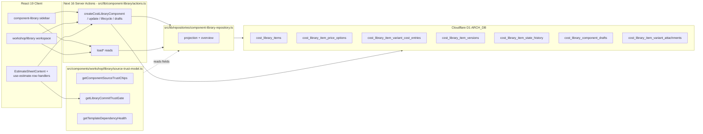
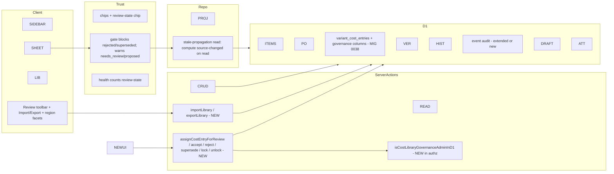
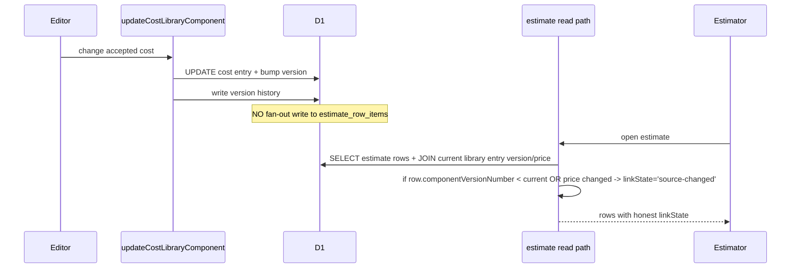

# 06 — Architecture and Technical Design

## Current-state architecture (verified from `SRC-AUDIT`)



**Key reality:** the active write path is D1 + Server Actions; Supabase governance RPCs are unreachable (`SRC-AUDIT` G1). Trust model reads pricing/confidence/lifecycle from denormalized item fields and estimate-row snapshots; the `source-changed` branch is read but never written (G3).

## Target-state architecture



## Component boundaries & ownership

| Boundary | Owner | Notes |
|---|---|---|
| Trust model (`source-trust-model.ts`) | UI model layer | Extend inputs, do not fork (`DEC-6`) |
| Server Actions (`actions.ts`) | Server data-access | New review/import actions co-located |
| Authz (`src/lib/authz/d1-access.ts`) | Security | New governance-admin helper |
| Repository (`component-library-repository.ts`) | Read projection | Add review-state columns to `SIDEBAR_COMPONENT_LIBRARY_ITEM_COLUMNS`; add stale-propagation read |
| Estimate repository (`estimate-repository.ts`) | Read path | Compute `source-changed` on read |
| D1 migration `0038` | Data | Additive only |

## Data flow — review accept

```mermaid
sequenceDiagram
  participant U as Reviewer (admin)
  participant C as Inspector
  participant A as acceptCostEntry (Server Action)
  participant Z as isCostLibraryGovernanceAdminInD1
  participant D as D1
  U->>C: Click Accept
  C->>A: {entryId, expectedReviewRevision, note}
  A->>Z: check workspace admin
  Z-->>A: ok
  A->>D: BEGIN; SELECT current revision
  D-->>A: row
  A->>A: compare expectedReviewRevision
  alt mismatch
    A-->>C: 409 conflict
  else match
    A->>D: UPDATE review_status=accepted, reviewed_by, reviewed_at, review_revision+1; INSERT review event
    D-->>A: ok
    A->>D: COMMIT
    A-->>C: success
  end
```

## Data flow — stale propagation (computed-on-read, `DEC-4`)



Rationale: computed-on-read is always honest, has no write fan-out cost, and avoids stale materialized flags. Optional async materialization (P4 stretch) can precompute overview counts via a Cron/Queue job for scale — deferred unless overview p95 regresses (`09`).

**Compare basis (pinned, ADV-10):** the read-side `source-changed` decision is derived from `componentVersionNumber` mismatch OR a price-hash compare (unit_cost + misc_cost + currency + pricing_source + pricing_date + confidence) between the estimate row snapshot and the current library entry. Wall-clock timestamps are **not** used for the drift decision (avoids timezone-skew false positives, RISK-12); `pricingDate` is part of the compare *input* (a changed pricing date flips the hash) but the comparison is equality-based, not time-based.

## Route-specific App Router boundary and cache contract

Every library/estimate route touched by this plan. (Cache Components posture: this plan does **not** introduce Cache Components; existing routes keep current behavior. If the repo later enables Cache Components repo-wide, the review/import actions must tag-invalidate library tags — noted as a future-proofing caveat, not a current requirement.)

| Route file (repo-relative) | Rendering | Data owner | `use client` boundary | Request-time APIs → dynamic? | Mutation revalidation |
|---|---|---|---|---|---|
| `src/app/(workshop)/workshop/library/...` (existing library workspace) | dynamic (auth-gated, per-workspace) | Server Component → `component-library-repository` | existing client surfaces (chips, facet, inspector, import dialog) | `cookies()` (session) → dynamic | `revalidateLibraryRoutes()` after review/import + TanStack invalidation |
| `src/app/(workshop)/workshop/library/overview/...` | dynamic | repository `getLibraryOverview` | existing overview client | `cookies()` → dynamic | `revalidateLibraryRoutes()` |
| `src/app/(workshop)/workshop/library/templates-browse/...` | dynamic | repository template reads | existing template client | `cookies()` → dynamic | `revalidateTemplateSurfaces()` |
| Estimate sheet route (existing) | dynamic | `estimate-repository` (gains stale-propagation compare) | existing estimate-sheet client | `cookies()` → dynamic | router refresh after library version bump is **not** required (computed-on-read on next load); TanStack invalidation on explicit re-link |
| `src/app/api/component-library/attachments/route.ts` | n/a (Route Handler) | route handler | n/a | auth header → dynamic | unchanged |
| `src/app/api/component-library/attachments/scan-override/route.ts`, `direct-upload/route.ts`, `images/route.ts` | n/a | route handler | n/a | auth → dynamic | unchanged |

Read-your-own-writes: every review/import Server Action returns the updated row and the caller does `setQueryData` on the active TanStack query. No Server Component calls an internal Route Handler. No new static routes. No new `"use client"` boundaries beyond the already-client surfaces (inspector toolbar, import dialog).

## Control flow & shared contracts

- **`review_revision`** integer, incremented on every state transition; passed as `expectedReviewRevision` from client (reads last-known value from the same query that renders the inspector).
- **`origin` enum** stored on cost entry; immutable except governance-admin.
- **Freshness** computed purely from `pricingDate` + `COMPONENT_FACET_STALE_DAYS`/`VERY_STALE` (single source in `source-trust-model.ts`).
- **Trust gate inputs** extended to include `reviewStatus`; existing `EstimateRowItem` carries it through the read projection.

## State ownership

| State | Owner | Mechanism |
|---|---|---|
| Review state | D1 `cost_library_item_variant_cost_entries.review_status` | mutation via review actions only |
| Optimistic revision | client last-known + server authoritative | conflict guard |
| Freshness | derived | computed from pricingDate |
| `source-changed` | derived on read | estimate read projection (`DEC-4`) |
| UI pending gate | Zustand local | existing `pendingLibraryCommitGate` |
| Import dry-run | TanStack Query cached preview | new query key |

## Architectural alternatives considered (`DEC-*` in `15`)

- **A1:** Reactivate Supabase governance RPCs from the app. Rejected: violates `DEC-1` (D1 is active runtime); re-introduces provider coupling; Supabase is exit archaeology.
- **A2:** Materialized `source-changed` flag written on every library update. Rejected as default: write fan-out cost + stale-flag drift; keep as P4 stretch.
- **A3:** New parallel review-event silo. Rejected: `DEC-3` extends existing history.
- **A4:** Free-text confidence unchanged. Rejected for first-user trust (`OPEN-3` → structured enum + note).

## Coupling, dependency direction, failure boundaries

- Trust model depends only on types, not on D1 — testable in isolation (existing `library-source-trust.test.ts`).
- Review actions depend on authz + D1; failures are 4xx/5xx with audit.
- Import depends on validation + D1; failures are per-row in dry-run, atomic on confirm.
- Estimate read path gains a library-version comparison; failure = degrade to existing behavior (no false `source-changed`).

## Server/Client boundary (`"use client"`)

- No new `"use client"` boundaries required except the new `LibraryImportDialog` and review toolbar in the inspector (already-client surfaces). Keep server-only: review actions, authz, import parse, D1 writes. No secrets or privileged objects in client bundles. Existing `actions.ts` is `"use server"`; new actions follow.

## Cache & revalidation

- After review/import mutations: call existing `revalidateLibraryRoutes()` + invalidate TanStack query keys (`query-keys.ts`) for library + estimate (estimate rows read library version).
- Read-your-own-writes: review action returns updated row; client updates cache.
- Cross-workspace isolation: queries scoped by `workspace_id`; no shared cache keys across workspaces (existing pattern).

## Tailwind v4 / design-system

- No new tokens. Reuse existing chip tone classes. Import dialog uses existing table/dialog primitives. (`DEC-6`.)

## Cloudflare resource boundary

- D1 `ARCH_DB` (bound, authorized). R2 `ARCH_UPLOADS_R2` for attachments (existing path). No KV source-of-truth. No new bindings required. Provider readback via `cf:d1-*` scripts (`13`).

## Legacy-provider boundary

- Supabase migration read-only reference. No Supabase runtime calls. Legacy exit evidence preserved. No mutation of `ebxxqidacheyapmmzavr`.

## Implementation-readiness of architecture

Architecture is fully specified from repo evidence. No `BLOCKED-ARCHITECTURE` items. `OPEN-4` (stale mechanism) is resolved by `DEC-4` (computed-on-read default). `OPEN-5` (reviewer role) affects authz helper naming only.
