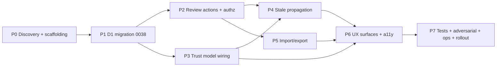

# 11 — Implementation Plan

Authoritative execution guide for the future implementation AI. Dependency-aware phases. Each task has exact paths/symbols, contract, tests, validation, completion evidence, parallelization, and complexity. Read current files before editing.

## Phase order and dependency graph

## Cross-phase shared contracts (establish before parallel work)

- `ReviewStatus` type: `'proposed'|'needs_review'|'accepted'|'rejected'|'superseded'` (in `src/lib/estimates/types.ts` or a shared `src/lib/component-library/review-types.ts`).
- `CostEntryOrigin` type: `'owner-accepted'|'imported'|'user-entered'|'supplier-quote'|'promoted-from-estimate'`.
- Conflict error code `'review_revision_conflict'` thrown via `throwActionError` (existing).
- Query keys for review-state reads.

---

## Phase 0 — Discovery + scaffolding (Sequential; gates P1)

**Objective.** Lock the contracts, confirm D1 SQL capabilities, add feature flag, create type scaffolding.
**Requirements addressed.** `REQ-1..16` (foundational).
**Prerequisites.** Owner confirms `OPEN-1` backfill mode (A default) and `OPEN-5` reviewer role (admin/editor).
**Ultragoal contract:** Goal `P0`; stop = types + flag + D1 SQL proof present; blocker = owner role/backfill undecided → continue schema work with documented assumption.

### `TASK-001` — Confirm D1 SQL capabilities for CHECK-on-ALTER
- **Objective:** Determine whether D1 accepts inline multi-column CHECK via `ALTER TABLE ADD COLUMN` or requires table-rebuild.
- **Why:** Migration `0038` correctness depends on it.
- **Target:** none (read-only discovery). Run a tiny local D1 apply with a CHECK constraint on a scratch table; record result.
- **Inputs/dependencies:** local D1 (`wrangler d1 execute archestimator-proof-db --local --command "..."`).
- **Instructions:** create scratch table, alter-add column with CHECK, attempt invalid insert, record accept/reject; clean up scratch table.
- **Expected output:** documented D1 CHECK behavior.
- **Tests:** none.
- **Validation:** command output recorded.
- **Completion evidence:** note in `19` + scratch cleanup.
- **Parallelization:** sequential (gates migration design).
- **Complexity:** Small.
- **Classification:** `DISCOVERY-REQUIRED` (bounded read-only D1 experiment).

### `TASK-002` — Shared review/origin types
- **Objective:** Add `ReviewStatus`, `CostEntryOrigin`, `ReviewEventRow`, conflict-error helper to a shared module.
- **Target path (new):** `src/lib/component-library/review-types.ts`.
- **Responsibility:** type source-of-truth for review state across actions, repository, trust model, UI.
- **Exports:** `ReviewStatus`, `CostEntryOrigin`, `REVIEW_STATUSES`, `COST_ENTRY_ORIGINS`, `ReviewActionErrorCode`.
- **Imports:** none external; re-exported by consumers.
- **Why no existing file owns this:** no review concept exists yet (`G2`).
- **Tests:** `tests/vitest/component-library-review-types.test.ts` (exhaustive enum + type guard).
- **Validation:** `bun run type-check`.
- **Completion evidence:** type-check green + test green.
- **Parallelization:** parallel-safe (no shared file).
- **Complexity:** Small.

### `TASK-003` — Feature flag
- **Objective:** Add a runtime flag `ARCHESTIMATOR_COST_REVIEW_GOVERNANCE_ENABLED` (env, default off) gating review actions/UI; schema lands inert.
- **Target:** read in `src/lib/component-library/actions.ts` (gate new actions) and a client helper for UI gating.
- **Tests:** unit test that flag-off → actions throw `feature_disabled`; flag-on → allowed.
- **Validation:** type-check + test.
- **Parallelization:** parallel-safe after `TASK-002`.
- **Complexity:** Small.

### `TASK-004` — Authz helper
- **Objective:** `isCostLibraryGovernanceAdminInD1(env, userId, workspaceId)` returning workspace-admin OR platform-admin.
- **Target:** `src/lib/authz/d1-access.ts` (extend).
- **Symbols:** new exported function; reuse existing role query pattern from `isWorkspaceEditorInD1`.
- **Tests:** `tests/vitest/authz-cost-library-governance-admin.test.ts` (admin=true, editor=false, platform-admin=true, cross-workspace=false).
- **Dependencies:** `OPEN-5` resolution (assumption: admin = workspace owner/admin role).
- **Validation:** test green.
- **Completion evidence:** test green + function exported.
- **Parallelization:** parallel-safe.
- **Complexity:** Small.

**Phase 0 exit criteria:** types + flag + authz helper landed; D1 CHECK behavior documented; no behavior change yet.

---

## Phase 1 — D1 migration `0038` (Sequential after P0; gates P2/P3)

**Ultragoal contract:** Goal `P1`; evidence = local D1 apply clean + constraint tests + readback; stop = migration applied locally; blocker = backfill mode undecided → default Mode A with `OPEN-1` recorded.

### `TASK-005` — Write migration `0038_cost_library_cost_review_governance.sql`
- **Objective:** Additive columns + CHECKs + indexes + state-history extension per `07` blueprint.
- **Target (new):** `migrations/0038_cost_library_cost_review_governance.sql`.
- **Ordering:** after the current D1 tip `0037_remove_preloaded_component_categories.sql`. (Earlier draft proposed `0037`; `0037` was taken 2026-07-07, so the slot moved to `0038`.)
- **Inputs:** `TASK-001` CHECK-behavior result (use table-rebuild if needed).
- **Instructions:** follow SQL sketch in `07`; parameterized; idempotent (`IF NOT EXISTS` where supported).
- **Tests:** `tests/vitest/component-library-review-schema.test.ts` — apply to temp SQLite, assert columns + CHECKs reject invalid (accepted without reviewed_by; superseded without superseded_by; locked_by/locked_at mismatch; duplicate accepted-current per option).
- **Validation:** `wrangler d1 migrations apply archestimator-proof-db --local`; `PRAGMA table_info(...)`.
- **Completion evidence:** local apply clean + schema test green.
- **Parallelization:** sequential (single migration file).
- **Complexity:** Medium.

### `TASK-006` — Backfill + readback
- **Objective:** Apply Mode A backfill (existing `is_current` rows → `accepted`, `reviewed_by='system-backfill'`); verify count.
- **Target:** within `0038` migration (UPDATE statement).
- **Tests:** backfill idempotency test (re-run updates 0 rows); count before/after recorded.
- **Validation:** local D1 `SELECT count(*) ... WHERE reviewed_by='system-backfill'`.
- **Completion evidence:** readback count.
- **Parallelization:** sequential with `TASK-005`.
- **Complexity:** Small.
- **Note:** owner may switch to Mode B (`OPEN-1`) — migration parametrized/commented.

### `TASK-007` — Repository read projection update
- **Objective:** Add `review_status, origin, region, version_label, assigned_to, review_due_at, locked_by, reviewed_by, reviewed_at, review_revision` to `SIDEBAR_COMPONENT_LIBRARY_ITEM_COLUMNS` and the row-detail read; mirror to `cost_library_items`/`price_options` denormalized fields on accept/supersede.
- **Target:** `src/lib/repositories/component-library-repository.ts`.
- **Symbols:** `SIDEBAR_COMPONENT_LIBRARY_ITEM_COLUMNS` (L264), `getCurrentWorkspaceComponentRowDetail`, dataset types.
- **Tests:** extend `component-library-versioning-schema.test.ts` / `component-library-templates-repository.test.ts` for new fields round-trip.
- **Validation:** type-check + test.
- **Completion evidence:** round-trip test green.
- **Parallelization:** parallel-safe after `TASK-005`.
- **Complexity:** Medium.

### `TASK-008` — Generated types refresh (if needed)
- **Objective:** If Worker Env types changed (they don't in this plan — no new bindings), run `bun run cf:typegen`. Otherwise, no-op with a note.
- **Target:** `cloudflare-env.d.ts` (only if bindings change — they don't).
- **Validation:** type-check.
- **Complexity:** Small (likely no-op).

**Phase 1 exit criteria:** migration applies locally; schema/constraint tests green; repository reads new fields.

---

## Phase 2 — Review Server Actions + authz wiring (after P1; parallel with P3)

### `TASK-009` — `assignCostEntryForReview`
- **Objective:** Admin-only assignment with audit.
- **Target:** `src/lib/component-library/actions.ts`.
- **Contract:** input `{entryId, assigneeUserId, dueAt?}`; authz `isCostLibraryGovernanceAdminInD1`; writes entry + review-event row; revalidates.
- **Tests:** `tests/vitest/review-assign-cost-entry.test.ts` (happy + denial + cross-workspace).
- **Validation:** test green.
- **Parallelization:** shared file `actions.ts` — serialize within phase.
- **Complexity:** Medium.

### `TASK-010` — `acceptCostEntry`
- **Objective:** Optimistic-revision accept with mirror update + audit.
- **Contract:** input `{entryId, expectedReviewRevision, note?}`; transaction UPDATE … WHERE `review_revision=expected`; 0 rows → conflict; insert event; update denormalized mirror; revalidate.
- **Tests:** `tests/vitest/accept-cost-entry.test.ts` (happy + conflict + denial + CHECK enforcement).
- **Validation:** test green; D1 transaction proof via `cf:d1-rpc-transaction-proof.ts` template.
- **Complexity:** Medium.

### `TASK-011` — `rejectCostEntry`, `TASK-012` — `lockCostEntry`/`unlockCostEntry`
- **Objective:** Remaining review transitions with constraints.
- **Contract:** per `04` matrices; lock sets `locked_by/at/reason`, blocks further mutation until unlock.
- **Tests:** `reject-cost-entry.test.ts`, `lock-cost-entry.test.ts`.
- **Complexity:** Medium each.

### `TASK-013` — `supersedeCostEntry`
- **Objective:** Atomic supersede (old→superseded+superseded_by; new→accepted+is_current) in one transaction; update mirror; audit both events.
- **Contract:** input `{oldEntryId, newEntryInput, expectedReviewRevision}`; conflict on stale; unique accepted-current index enforcement.
- **Tests:** `supersede-cost-entry.test.ts` (happy + conflict + terminal-state guard + index).
- **Complexity:** Large.

### `TASK-014` — Create/update paths set `origin`
- **Objective:** `createCostLibraryComponent` defaults `origin='user-entered'` (or `promoted-from-estimate` on promotion); admin-only setter for `owner-accepted`.
- **Target:** `actions.ts` create + promotion paths.
- **Tests:** `origin-defaults-and-admin-set.test.ts`.
- **Complexity:** Medium.

**Phase 2 exit criteria:** all review actions exist, denial-tested, conflict-guarded, audit-logged; feature-flag gated.

---

## Phase 3 — Trust model wiring (after P1; parallel with P2)

### `TASK-015` — Extend `getComponentSourceTrustChips`
- **Objective:** Add review-state chip + origin chip.
- **Target:** `src/components/workshop/library/source-trust-model.ts`.
- **Tests:** extend `tests/vitest/library-source-trust.test.ts`.
- **Complexity:** Small.

### `TASK-016` — Extend `getLibraryCommitTrustGate`
- **Objective:** Block on `rejected`/`superseded`; warn on `needs_review`/`proposed`; existing archived/discontinued unchanged.
- **Target:** same file.
- **Tests:** extend `library-source-trust.test.ts` (block/warn cases + telemetry ids).
- **Complexity:** Medium.

### `TASK-017` — `getTemplateDependencyHealth` review-state issues
- **Objective:** Add `needs_review`/`rejected`/`superseded` dependency counts.
- **Tests:** extend same.
- **Complexity:** Small.

### `TASK-018` — Region/version/confidence taxonomy
- **Objective:** Introduce optional structured confidence enum + note (per `OPEN-3`); region/version fields wired from `04`. Keep `confidenceChipCopy` for back-compat.
- **Target:** `source-trust-model.ts` + `quick-add-validation.ts` + `EditComponentDrawer.tsx`.
- **Tests:** `confidence-taxonomy.test.ts`.
- **Complexity:** Medium.
- **Status note:** gated by `OPEN-2`/`OPEN-3`; can phase.

### `TASK-019` — Export metadata enrichment
- **Objective:** Library export (and estimate proposal export, optional) includes `review_status`, `freshness tier`, `origin`.
- **Target:** new export module + `estimate-templates`/proposal export if in scope.
- **Complexity:** Medium.

**Phase 3 exit criteria:** trust model fully reflects review state; tests green.

---

## Phase 4 — Stale propagation (after P2 + P3)

### `TASK-020` — Compute `source-changed` on read
- **Objective:** In the estimate read path, compare row's captured snapshot to the current library entry; set `linkState='source-changed'` when drift detected (pure read-side derivation).
- **Target:** `src/lib/repositories/estimate-repository.ts` (or the row-mapping layer); the row already carries `componentVersionId/Number`, `priceOptionId`, `unitCost`, `pricingDate`, `pricingSource` snapshots (`EstimateRowItem` type `src/lib/estimates/types.ts:93`).
- **Contract (compare basis pinned, ADV-10):** derive `source-changed` from **(a) `componentVersionNumber` mismatch** OR **(b) a price-hash compare** of the captured snapshot vs the current `cost_library_item_variant_cost_entries` row (unit_cost + misc_cost + currency + pricing_source + pricing_date + confidence). **Do NOT use wall-clock timestamps** for the drift decision (avoids false positives from timezone skew — RISK-12). Only for rows with `sourceLibraryItemId` and `linkState` not already `detached`/`unlinked`. Read-side only; no fan-out write.
- **Tests:** `tests/vitest/stale-propagation.test.ts` (update accepted cost → bump version → estimate read returns `source-changed`; also: unchanged cost does NOT flag `source-changed` — false-positive guard).
- **Validation:** integration test + perf evaluator 2 (`09`).
- **Complexity:** Medium.

### `TASK-021` — Gate + health consume live `source-changed`
- **Objective:** Ensure gate/health now see real `source-changed` (no longer dead branch).
- **Tests:** extend `library-source-trust.test.ts` end-to-end.
- **Complexity:** Small.

### `TASK-022` — Library update path records version bump
- **Objective:** `updateCostLibraryComponent`/`upsertCostLibraryComponentPriceOption` bump `current_version_number` + version-history row so read-side comparison detects drift.
- **Target:** `actions.ts`.
- **Tests:** version-bump + read-sees-stale test.
- **Complexity:** Medium.

### `TASK-023` — (Stretch) Async overview materialization
- **Objective:** Optional Cron/Queue job precomputing overview counts if evaluator 3 regresses.
- **Status:** deferred unless perf gate fails.
- **Complexity:** Large.

**Phase 4 exit criteria:** stale propagation live end-to-end; dead branch closed; perf within budget.

---

## Phase 5 — Import/export safety (after P2)

### `TASK-024` — CSV/JSON import module
- **Objective:** Streaming parse + per-row validation reusing `validateQuickAddComponentInput` shape + formula neutralization + row cap + quota check + `origin='imported'` + `reviewStatus='proposed'`.
- **Target (new):** `src/lib/component-library/import-export.ts`.
- **Tests:** `tests/vitest/library-import.test.ts` (dry-run, commit, formula injection, quota, cross-workspace denial, no overwrite of accepted).
- **Complexity:** Large.

### `TASK-025` — `importLibrary` Server Action (dry-run + commit modes)
- **Target:** `actions.ts`.
- **Tests:** covered in `TASK-024` + denial tests.
- **Complexity:** Medium.

### `TASK-026` — CSV/JSON export
- **Objective:** Serialize with provenance/review/freshness; exclude internal ids unless requested.
- **Tests:** `tests/vitest/library-export.test.ts` (round-trip + denial).
- **Complexity:** Medium.

### `TASK-027` — Export round-trip parity
- **Objective:** Importing an export reproduces provenance (review resets to `proposed` by design).
- **Tests:** round-trip test.
- **Complexity:** Small.

### `TASK-028` — Import safety hardening
- **Objective:** Size cap (5 MB), row cap, malformed-CSV handling, unicode, oversized cells.
- **Tests:** adversarial import tests.
- **Complexity:** Medium.

**Phase 5 exit criteria:** safe import/export with denial + injection coverage.

**Note:** `OPEN-6` (format priority) — CSV first is the recommendation; Excel deferred.

---

## Phase 6 — UX surfaces + a11y (after P3, P4, P5)

### `TASK-029` — Review toolbar in `ComponentInspectorDock`
- **Objective:** Accept/Reject/Lock/Supersede/Assign buttons for admins; read-only provenance for editors; conflict toast.
- **Tests:** DOM test `inspector-review-toolbar.test.tsx`; a11y keyboard/focus test.
- **Complexity:** Medium.

### `TASK-030` — Facet filter extensions
- **Objective:** "Review state" facet + region/version facets when present.
- **Target:** `component-facet-filter*.ts(x)`.
- **Tests:** `library-applied-filters.test.tsx` extension.
- **Complexity:** Medium.

### `TASK-031` — `LibraryImportDialog` + `LibraryExportMenu`
- **Objective:** Upload → dry-run preview table → confirm; export format picker.
- **Tests:** DOM + a11y; browser proof for drag-drop + focus restoration (`12`).
- **Complexity:** Large.

### `TASK-032` — Overview widgets
- **Objective:** "Needs review", "Overdue assignments", "Stale costs" cards.
- **Tests:** `library-overview.test.tsx` extension.
- **Complexity:** Medium.

### `TASK-033` — EditComponentDrawer + AddComponentModal field additions
- **Objective:** region/version/confidence-note fields; admin-only origin selector.
- **Tests:** `library-add-component-modal-a11y.test.tsx` extension; `EditComponentDrawer` test.
- **Complexity:** Medium.

**Phase 6 exit criteria:** UI surfaces review/import/stale honestly; a11y tests green.

---

## Phase 7 — Tests, adversarial QA, observability, rollout gates

### `TASK-034` — Adversarial matrix execution
- **Objective:** Run the UltraQA matrix in `19`; cover all shadow-path cells.
- **Complexity:** Medium.

### `TASK-035` — Performance evaluators
- **Objective:** Implement evaluators 1–3 in `09`; capture baselines; prove within budget.
- **Complexity:** Medium.

### `TASK-036` — Telemetry extension
- **Objective:** `review_action_completed`, `import_completed` events with redaction.
- **Target:** `library-telemetry.ts`.
- **Complexity:** Small.

### `TASK-037` — Documentation updates
- **Objective:** spec doc, AGENTS migration count, user help.
- **Complexity:** Small.

### `TASK-038` — Rollout gate dry-run
- **Objective:** Apply migration to preview; run `cf:verify-preview-routes`, `cf:check-readiness`, `cf:provider-proof`; gate per `13`.
- **Complexity:** Medium.

**Phase 7 exit criteria:** all gates in `13` green; package `IMPLEMENTATION-READY` (or `CONDITIONALLY READY` if `OPEN-*` unresolved).

---

## Server/Client boundary, cache, render, bundle, RSC impact (cross-cutting)

- **Server/Client:** new actions are `"use server"`; new client components (`LibraryImportDialog`, review toolbar) are `"use client"` within already-client surfaces. No secret leakage.
- **Cache/revalidation:** `revalidateLibraryRoutes()` + TanStar invalidation after review/import; read-your-own-writes via returned row.
- **Streaming/Suspense:** existing library route Suspense unchanged.
- **Bundle/RSC payload:** +review-state bytes per item; negligible.
- **Query count:** +1 JOIN for stale propagation read; review actions ~5 queries each.
- **Render count:** +1 chip; memoization unchanged.
- **Tailwind/design-system:** no new tokens; reuse chips.
- **Cloudflare boundary:** D1 `ARCH_DB` only; R2 attachments unchanged.

## Performance measurement & rollback gate (per phase)

- P1: migration apply gate (local clean).
- P2: denial tests + conflict tests.
- P3: trust-model unit tests.
- P4: perf evaluator 2 within budget; fallback = hide computed `source-changed`.
- P5: import safety tests + size-cap.
- P6: a11y + perf evaluator 1.
- P7: hosted preview + readiness.

## Rollback considerations (per phase)

Detailed in `13`. Headline: additive migration (inert without flag); flag-off disables review/import UI/actions; data rollback via `reviewed_by='system-backfill'` filter or `0038` relax.

## Documentation updates

`current-project-estimates-component-library-spec.md`; `AGENTS.md` migration count; user help copy; `DESIGN.md` not required (alpha).

## No `BLOCKED-ARCHITECTURE` / `BLOCKED-EVIDENCE` tasks

All tasks have exact paths/symbols. `OPEN-*` decisions are owner inputs that affect defaults/naming, not whether a task is doable. `TASK-001` is the only `DISCOVERY-REQUIRED` (bounded D1 experiment).
