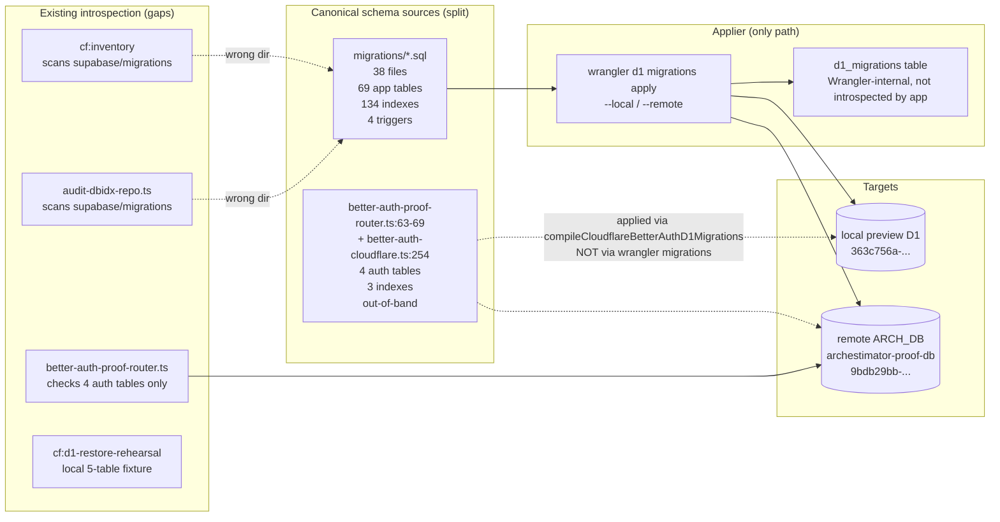
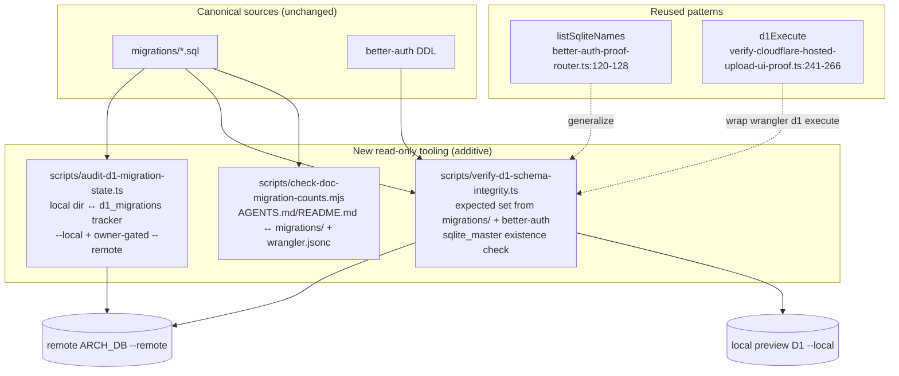

# 06 — Architecture And Technical Design

## Current-state architecture (migration + schema integrity surface)

**Key architectural facts:**
1. **Two canonical schema sources** (`migrations/` + Better Auth DDL) — must both be in the verifier.
2. **One applier** (Wrangler) with an **internal tracker** (`d1_migrations`) no app/script reads.
3. **Better Auth schema is applied out-of-band** — `compileCloudflareBetterAuthD1Migrations` (`src/lib/auth/better-auth-cloudflare.ts:254`) generates DDL consumed by the proof router, NOT by `wrangler d1 migrations apply`. This is a known split, not a bug, but it means the verifier must treat auth tables as a separate expected set.
4. **Inventory scripts point at the wrong directory** (`supabase/migrations/` instead of `migrations/`) — F-7.

## Target-state architecture (what the plan proposes)

## Architectural decisions

### AD-1: Read-only tooling only; Wrangler remains the sole applier
**Decision.** Do NOT build a migration runner. Build only read-only ledger/verifier/guard scripts.
**Rationale.** Wrangler's `d1 migrations apply` is the established applier (`README.md:66`); replacing it is abstraction sprawl and a coordination hazard. The gap is *introspection*, not *application*.
**Rejected alternatives.** (a) A custom migration runner with its own tracker — rejected: duplicates Wrangler, risks drift between two trackers. (b) Hand-maintaining an `applied_migrations` table in D1 — rejected: Wrangler already maintains `d1_migrations`; a second tracker would itself drift.
**Consequences.** The ledger script depends on `wrangler d1 migrations list` output format (a CLI contract). If Wrangler changes its output, the parser needs updating. Mitigation: keep the parser strict and the failure mode loud (non-zero exit on parse failure).

### AD-2: Generalize the existing `better-auth-proof-router.ts` pattern
**Decision.** The verifier uses the `SELECT name FROM sqlite_master WHERE type=? AND name IN (…)` pattern already proven in production for the 4 auth tables, generalized to the full schema.
**Rationale.** Existing-pattern reuse (REQ-ARCH-02); proven against the real remote D1.
**Rejected alternatives.** (a) `PRAGMA table_info(<table>)` per table — rejected: more round-trips, and `sqlite_master` IN-list is a single query. (b) A new typed schema-introspection library — rejected: unnecessary dependency.

### AD-3: Expected-set is generated from `migrations/` + `better-auth-proof-router.ts` at script build time
**Decision.** The verifier's expected table/index/trigger lists are derived by scanning `migrations/*.sql` (via `rg`-equivalent regex) and reading the Better Auth DDL constants, not hand-maintained.
**Rationale.** Hand-maintained lists drift (the exact problem being solved). Generation keeps the verifier in sync with the source of truth automatically.
**Rejected alternatives.** A hardcoded list — rejected: defeats the purpose; would itself become stale (RISK-003).

### AD-4: No edits to existing migrations
**Decision.** Existing migration files are immutable. Fix-forward only via NEW migrations or documented one-off reconciliation SQL run out-of-band.
**Rationale.** Editing migrations breaks the audit trail and the `d1_migrations` tracker; `AGENTS.md:41` spirit forbids extending legacy sets.
**Rejected alternatives.** Retroactively wrapping `ALTER TABLE` statements in `PRAGMA table_info` guards — rejected: SQLite migrations are plain SQL, not scripts (`21_DATABASE_CHANGE_BLUEPRINTS.md`).

### AD-5: Local-first, hosted-gated execution
**Decision.** All new scripts default to `--local` (preview D1). `--remote` is an explicit flag requiring owner awareness (and is the hosted-proof gate).
**Rationale.** Free-tier posture (`AGENTS.md` cost policy); prevents accidental remote mutation (scripts are read-only anyway, but the flag discipline matches repo convention).

## Component boundaries

- `scripts/audit-d1-migration-state.ts` — migration-state ledger (local dir ↔ Wrangler tracker). Owns: parsing `wrangler d1 migrations list` output and `ls migrations/`.
- `scripts/verify-d1-schema-integrity.ts` — schema existence verifier. Owns: expected-set generation + `sqlite_master` query. Depends on `audit-d1-migration-state.ts` for the applied-migration list (to distinguish "table missing because migration not applied" from "table missing despite migration applied = real drift").
- `scripts/check-doc-migration-counts.mjs` — doc drift guard. Owns: parsing `AGENTS.md`/`README.md`/`wrangler.jsonc` and comparing to `migrations/` reality. Independent of the other two.

## Shared contracts

- **Expected-schema-set contract** (between `verify-d1-schema-integrity.ts` and its sources): a `{ tables: string[], indexes: string[], triggers: string[], authTables: string[], authIndexes: string[] }` shape derived deterministically from `migrations/` + `better-auth-proof-router.ts:63-69`.
- **Ledger-diff contract**: `{ appliedBoth: string[], pendingRemote: string[], pendingLocal: string[], missingFromDir: string[] }`.

## Failure boundaries

- Script parse failure (Wrangler output format change) → loud non-zero exit; do not silently pass.
- Expected-set generation finds zero tables → fail (signals a regex/scanner bug, not a clean DB).
- Remote readback unreachable → fail-closed with "hosted-proof not run" (do NOT fall back to claiming local = remote).

## Integration points

- The verifier and ledger are dev/CI tools; they do NOT run in the Worker. No Worker bundle impact, no RSC payload impact, no client-JS impact.
- The doc guard is wireable into a restored `.github/workflows/` later; today it runs locally via `bun run`.

## Rejected architecture alternatives (summary)

| Alternative | Rejected because |
|---|---|
| Custom migration runner | Duplicates Wrangler; coordination hazard |
| Hand-maintained applied_migrations table | Second tracker that itself drifts |
| Hardcoded expected-schema list | Becomes stale (the problem being solved) |
| `PRAGMA table_info` per table | More round-trips than `sqlite_master` IN-list |
| Edit existing migrations for idempotency | Breaks audit trail; SQLite migrations aren't scripts |
| Provider-mutation scripts (auto-apply remote) | Owner-gated; standing auth is for scoped fixes, not auto-application |

## Diagrams note

The two Mermaid diagrams above clarify the current/target architecture and the
source-split (the single most important architectural insight: schema truth is split
across `migrations/` + Better Auth DDL). No other diagrams are needed — there is no data
flow, state machine, or deployment sequence complex enough to warrant one for a
read-only-tooling plan.
