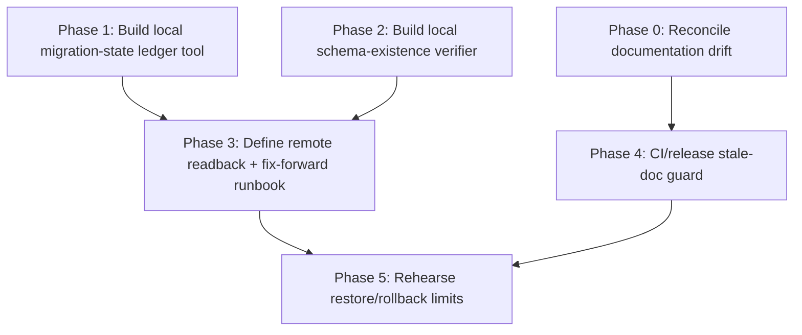

# D1 Migration State And Schema Integrity — Plan Pack

**Plan folder:** `.ai/03_plans/2026-07-07-d1-migration-state-and-schema-integrity/`
**Date:** 2026-07-07 (Asia/Manila)
**Plan profile:** `exhaustive` (D1 / migrations / schema integrity / release readiness — high blast radius)
**Plan status:** `CONDITIONALLY READY`

---

## Plan status and why

`CONDITIONALLY READY` — the planning package is internally complete, evidence-grounded, and
implementation-ready for the **internally resolvable** slices (documentation-drift repair,
local schema-verification tooling, fix-forward policy, CI/release checks). It is held at
`CONDITIONALLY READY` (not `IMPLEMENTATION-READY`) because the central objective —
**proving the *remote* `ARCH_DB` schema-integrity state** — requires hosted Cloudflare D1
readback that a planning-only task cannot execute, and because the PROMPT.md premise
("AGENTS.md still references an older latest migration count") is itself partly stale.

This matches the Creating-Plan-Prompt readiness contract: a package is `IMPLEMENTATION-READY`
only when no task has unresolved validation decisions and every score below 100 has an
implementation-safe path. The remote-D1 proof gap is a real evidence boundary, not a
planning defect, so the package isolates it as the explicit `BLOCKED-EXTERNAL` /
hosted-proof gate (see `17_FINAL_READINESS_REVIEW.md`).

**Verification mode:** `verification_mode: emulated` (separated review passes by the same
agent; no native independent verifier lane was available in-session). This caps overall
readiness at 97 and is the reason a high-blast-radius package stays at
`CONDITIONALLY READY` pending an owner/independent review pass.

---

## Goal (master `/goal`)

Reconcile local D1 migration files, remote `ARCH_DB` application state, schema drift,
migration safety, and fix-forward procedure before first users, so a future executor can
prove D1 migration state and schema integrity **without guessing which document or provider
state is canonical**.

Non-goals: changing application code, applying/rolling back migrations, touching legacy
Supabase, enabling paid Cloudflare tiers, or proving hosted performance/cost. This is
planning only.

Full master goal: `00_AGENT_COORDINATION.md` (§ Master Goal).

---

## Implementation start document

**`11_IMPLEMENTATION_PLAN.md`** — dependency-aware phases and exact task IDs.

If `Create-Implementation-Prompt.md` later produces an `IMPLEMENTATION_PLAN.md`, that file
supersedes `11_IMPLEMENTATION_PLAN.md` for execution; this README and `17_FINAL_READINESS_REVIEW.md`
must then point executors to the newer file.

---

## Phase order and dependency graph



| Phase | Title | Owner lane | Depends on | Blocked? |
|---|---|---|---|---|
| 0 | Reconcile documentation drift (`AGENTS.md`, `README.md`, `PROMPT.md` premise) | Lead | — | No |
| 1 | Local migration-state ledger (`migrations/` ↔ `wrangler d1 migrations list`) | Data lane | — | No |
| 2 | Local schema-existence verifier (tables/indexes/triggers/Better Auth) | Data lane | — | No |
| 3 | Remote readback + fix-forward policy + partial-apply reconciliation | Data + Ops | 1, 2 | Hosted proof gate (owner) |
| 4 | CI/release stale-doc guard (doc-count ↔ `migrations/` count) | Ops lane | 0 | No |
| 5 | D1 restore/rollback rehearsal limits (extend existing `cf:d1-restore-rehearsal`) | Ops lane | 3, 4 | Hosted proof gate (owner) |

---

## Requirement / task / test traceability

Full matrix in `16_REQUIREMENTS_TRACEABILITY_MATRIX.md`. Summary:

- 14 requirements (FR, DATA, ARCH, SEC, REL, OPS, TEST, DOC) — all traced.
- 11 implementation tasks (T-00 … T-10) — every task maps to ≥1 requirement.
- Test execution matrix in `12_TEST_AND_VALIDATION_STRATEGY.md` maps each requirement to a
  concrete local command or a documented hosted-proof gate.

---

## Blocked decisions table

| ID | Decision | Why blocked | Options | Recommendation | Owner | Unblocks |
|---|---|---|---|---|---|---|
| OPEN-DEC-001 | Remote `ARCH_DB` migration-applied state for `0033`–`0038` | Planning-only task cannot run `wrangler d1 migrations list ARCH_DB --remote` or schema readback against hosted D1 | (a) owner runs `bunx wrangler d1 migrations list ARCH_DB --remote` and pastes result; (b) owner authorizes a scoped read-only readback agent; (c) defer to deploy-time apply | (a) — cheapest, owner-gated, standing Cloudflare authorization covers read-only `ARCH_DB` queries | Philip | T-03, T-05, REQ-DATA-03, RISK-001 |
| OPEN-DEC-002 | Whether `0035` (HMAC table rebuild) was applied remotely before or after the `0033/0034/0035` "pending" snapshot in `current-state.md:271` | Same hosted-proof boundary; also depends on whether a later deploy ran `d1 migrations apply --remote` | resolve after OPEN-DEC-001 readback; if `0035` is absent remotely, follow the fix-forward rule in `07_DATA_DATABASE_API_NETWORK_PLAN.md` (do NOT re-run `0035` — it is non-idempotent) | resolve via OPEN-DEC-001 first | Philip | T-03, RISK-002 |
| OPEN-DEC-003 | Whether `0038` (resource-limit triggers) and `0036` (component drafts) were applied remotely | No explicit remote-apply evidence found in `current-state.md` (absence of evidence, not evidence of absence) | resolve via OPEN-DEC-001 readback | resolve via OPEN-DEC-001 first | Philip | T-03 |

No internally resolvable decision is left open.

---

## Stale-plan revalidation checklist

Before any implementation edit, re-validate these against current `main`:

1. `migrations/` count and latest filename (currently 38 / `0038_component_draft_resource_limits.sql`).
2. `wrangler.jsonc` cron count (currently **three**: `0 3 * * *`, `15 3 * * *`, `30 3 * * *`).
3. `AGENTS.md:40-41` (cron + migration count claims).
4. `README.md:36,39,211` (migration count + cron claims — known stale).
5. Whether `wrangler d1 migrations list ARCH_DB --remote` has been run since this plan (resolves OPEN-DEC-001/002/003).
6. Whether a new migration `0039+` has been added (re-runs the ledger diff).
7. Whether `src/lib/cloudflare/better-auth-proof-router.ts:63-69` Better Auth DDL still diverges from numbered `migrations/` (it does at plan time — Better Auth schema is applied out-of-band).

---

## Commands / checks to run before the first edit

```bash
# 1. Confirm clean shared-worktree state (do NOT branch — shared-worktree policy)
git status --short --branch

# 2. Confirm migration inventory is still current
ls -1 migrations/ | wc -l                                  # expect 38
ls -1 migrations/ | tail -1                                # expect 0038_...

# 3. Confirm wrangler cron reality
grep -A4 '"crons"' wrangler.jsonc                          # expect three crons

# 4. Confirm no script already applies/reads migrations (should be empty)
rg 'd1 migrations (list|apply)' scripts/ package.json src/  # expect no matches

# 5. Confirm Better Auth schema is out-of-band from numbered migrations
rg -n 'CREATE TABLE IF NOT EXISTS "(user|session|account|verification)"' migrations/  # expect no matches
```

---

## Files explicitly off-limits (for the implementation slices)

- `migrations/*.sql` — do NOT edit, reorder, rename, or retroactively idempotency-guard
  existing migrations. Fix-forward only via NEW migrations or documented one-off
  reconciliation (see `07_DATA_DATABASE_API_NETWORK_PLAN.md`).
- `supabase/migrations/**` — legacy archaeology; `AGENTS.md:41` forbids running/applying/extending.
- Any Cloudflare resource outside `wrangler.jsonc` bindings (`ARCH_DB`, `ARCH_UPLOADS_R2`,
  `COLLAB_ROOMS`, `UPLOAD_JOBS_QUEUE`, `EMAIL`, `IMAGES`). Never the historical Supabase
  project `ebxxqidacheyapmmzavr` or the unrelated `archestimator` provider project.
- No `git reset --hard`, `git clean`, force-push, branch/worktree creation, history rewrite.

---

## Files and systems intentionally unaffected

- Application source in `src/` (except the planned additive schema-verifier script and,
  optionally, a doc-count CI guard — both are NEW files or additive script edits).
- Existing `cf:d1-*` proof scripts — reused as patterns, not modified in the core slices.
- Better Auth runtime, R2 objects, Durable Object state, Queue messages, Email config.
- Legacy Supabase project state.

---

## External proof that remains required before production rollout

1. **Hosted D1 migration-applied readback** — `bunx wrangler d1 migrations list ARCH_DB --remote`
   (resolves OPEN-DEC-001/002/003). Local checks cannot prove remote state.
2. **Hosted D1 schema-existence readback** — `SELECT name FROM sqlite_master WHERE type IN ('table','index','trigger')`
   against remote `ARCH_DB`, compared to the verifier's expected set (resolves REQ-DATA-03).
3. **Hosted D1 restore rehearsal** — actual `wrangler d1 export` + `time-travel restore`
   against a staging DB (the existing `cf:d1-restore-rehearsal` is local-SQLite-only;
   `providerBacked: false` per `scripts/generate-cloudflare-d1-restore-rehearsal.ts:342`).

These are recorded as hosted-proof gates in `13_ROLLOUT_ROLLBACK_AND_OPERATIONS.md` and
`17_FINAL_READINESS_REVIEW.md`. Local tooling (Phases 1–2, 4) is implementation-ready now;
hosted proof (Phases 3, 5) is owner-gated.

---

## Archive policy

**Do not archive automatically.** Archive only after (a) the documentation-drift repair
(Phase 0) and the local tooling (Phases 1, 2, 4) are merged, AND (b) the hosted-proof
gates (Phases 3, 5) are either passed or explicitly accepted/deferred by the owner with
residual risk recorded. Move to `.ai/09_archive/<date>-d1-migration-state-and-schema-integrity/`
at that point.
