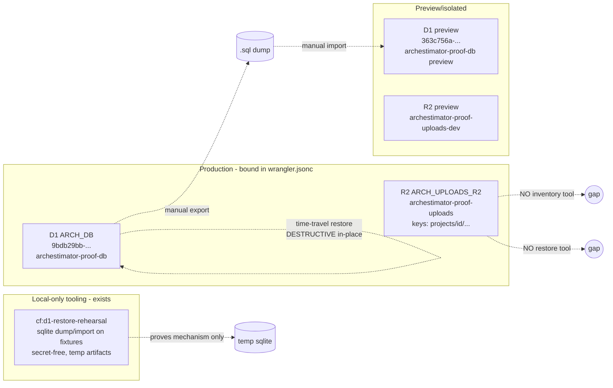
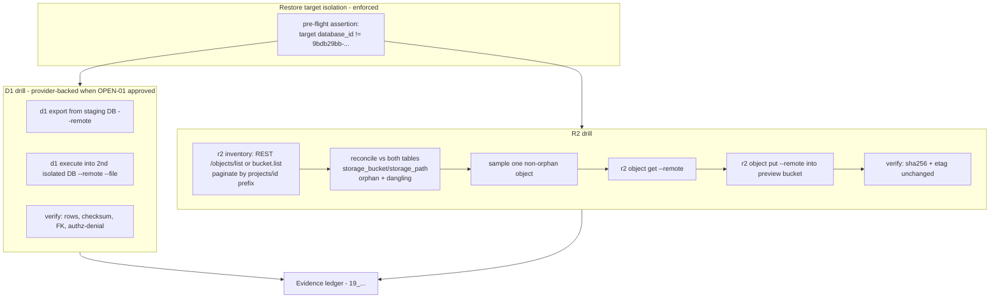

# 06 — Architecture and Technical Design

## Profile

`exhaustive` — touches D1, R2, Cloudflare bindings, data integrity. Planning-only.

## Current-state architecture (restore/recovery view)

**Current restore flow** is split and incomplete:
- D1: a local SQLite rehearsal proves the dump/import *mechanism*; manual
  `wrangler d1 export` + `execute --remote --file` + `time-travel restore` are
  documented in the script but **not rehearsed against a provider**.
- R2: durable storage exists, but **no inventory, no export, no restore tooling**.

## Target-state architecture (free-tier-safe recovery drill design)

**Target restore flow** adds three small, free-tier-safe tooling layers without
introducing a paid backup product:

1. **Target-isolation assertion** — a pre-flight that parses `wrangler.jsonc`,
   reads the destination `database_id`, and hard-aborts if it equals the
   production id. This is the single most important safety control.
2. **D1 provider-backed rehearsal** (OPEN-01 gated) — export from a *staging*
   DB, import into a *second* isolated DB, verify. Never imports into prod.
3. **R2 inventory + selective restore** — list (REST/S3/Worker), reconcile
   against `upload_assets`, sample one object, get→put into the **preview**
   bucket (`archestimator-proof-uploads-dev`), verify sha256/etag.

## Component boundaries

| Component | Boundary | Responsibility | Tech |
|---|---|---|---|
| Target-isolation pre-flight | CLI script, reads `wrangler.jsonc` only | Assert destination ≠ prod; print parsed ids | Bun + TS (mirrors existing script shape) |
| D1 local rehearsal (existing) | CLI, temp sqlite, no provider | Prove dump/import mechanism | `sqlite3` CLI + TS |
| D1 provider-backed rehearsal | CLI, `wrangler` subprocess, isolated DBs | Prove hosted round-trip (OPEN-01) | `wrangler d1 export/execute` |
| R2 inventory | CLI or Worker, REST/S3/`bucket.list()` | List + reconcile | REST `POST /objects/list` or Worker binding |
| R2 restore rehearsal | CLI, `wrangler r2 object get/put` | Sampled get→put into preview | `wrangler r2 object` with `--remote` |
| Evidence ledger | Markdown/JSON in `evidence/` | Durable proof artifacts | files |

## Data flow (D1 restore drill)

1. Operator runs `cf:d1-restore-target-isolation` → prints prod id + target id,
   aborts if equal.
2. (OPEN-01) Operator exports from staging DB:
   `wrangler d1 export <STAGING> --remote --output=./backups/staging-<ts>.sql`.
3. Operator imports into a *second* isolated DB:
   `wrangler d1 execute <TARGET> --remote --file=./backups/staging-<ts>.sql`.
4. Verify: row counts per table, SHA-256 of JSON snapshots, `PRAGMA
   foreign_key_check`, and an authorization-denial assertion (a denied query
   still denies after restore).
5. Emit report (existing shape) + append to evidence ledger.

## Data flow (R2 restore drill)

1. Inventory: paginate `projects/{id}/…` via REST `POST /objects/list` (or
   `bucket.list()` in a Worker), collecting key + size + etag + sha256 (where
   available).
2. Reconcile: join against `upload_assets` (non-deleted) → orphan set + dangling
   set; emit report.
3. Sample one non-orphan key; `wrangler r2 object get --remote <key>` to local.
4. `wrangler r2 object put --remote <preview-bucket>/<key> --file=…`.
5. Verify: re-head the preview object; compare sha256/etag to source; emit
   report. (Restore into the **preview** bucket, never prod, unless OPEN-03
   approves a real recovery.)

## Control flow and state ownership

- **No application state changes.** All drill state is ephemeral (temp files,
  isolated DBs, preview bucket) and cleaned up.
- **No Next.js cache/TanStack/Zustand interaction** — these are CLI/Worker
  tools outside the app runtime.
- **No Server Action / Route Handler changes** (out of scope; a future
  admin dashboard would be a separate plan).

## Architectural alternatives considered

| Alternative | Pros | Cons | Decision |
|---|---|---|---|
| Paid backup product (e.g., D1 paid plan for 30-day Time Travel; third-party R2 backup) | Longer retention, less manual | Violates free-tier cost posture without owner approval | **Rejected** (OPEN-02/03 would need to reopen) |
| Bulk-copy R2 bucket to a second bucket as "backup" | Simple story | Doubles Class A ops (writes) + storage; still no versioning for user-error | **Deferred** to OPEN-03; sampled-object drill is the free-tier default |
| Worker-based inventory vs CLI+REST | Worker reuses `bucket.list()` binding natively; no wrangler auth friction | A Worker route is a new runtime surface (deploy, authz); CLI+REST is simpler for a drill | **Recommend CLI+REST first**; Worker variant only if inventory must run on a schedule |
| `wrangler r2 object` vs S3 API (aws-cli/rclone) for restore | wrangler is already the toolchain; S3 API has bulk tools | `wrangler r2 object list` doesn't exist; `get/put` do | **wrangler get/put for sampled drill**; S3 API only if bulk is later approved |
| Time Travel vs export/import for restore | Time Travel is one command, fast | Destructive, in-place, no target isolation; 7-day free window | **Time Travel = production recovery only, runbook-gated**; export/import = drill default |

## Decision rationale

The design is deliberately **minimal and free-tier-safe**: it adds three small
tools (target-isolation assertion, R2 inventory, R2 restore rehearsal) and
extends one (D1 rehearsal) rather than introducing a paid product, a new
runtime surface, or a bucket-copy scheme. The most load-bearing decision is
the **target-isolation assertion** — it makes the catastrophic failure
(destructive restore against prod) a hard script abort, not advice.

## Cache/revalidation/streaming impact

None. No Next.js cache, no RSC payload, no streaming, no Suspense — this is
out-of-band operational tooling.

## Server/client boundary impact

None. No `"use client"`, no client bundle, no server-only data exposure.

## Cloudflare resource-boundary impact

Strictly inside the bound resources. The drills target:
- D1: the **preview** `database_id` `363c756a-…` (and, if OPEN-01 approves, a
  *second* named isolated DB in the same account) — never `9bdb29bb-…`.
- R2: the **preview** bucket `archestimator-proof-uploads-dev` for restore
  rehearsal — never `archestimator-proof-uploads` (prod) unless OPEN-03
  approves a real recovery.

Never `ebxxqidacheyapmmzavr`, never the `archestimator` provider project,
never other accounts.
