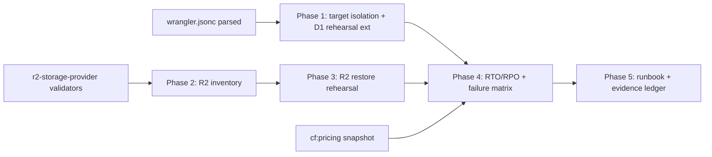

# 10 — Blast Radius and Dependencies

## Scope note

This is a **planning-only** pack. The "blast radius" analyzed here is the
blast radius of the **future implementation** (Phase 1–5 tooling), since the
planning task itself touches only files inside this folder.

## Impact classification key

`Required change` · `Probable change` · `Possible change` · `Verification only`
· `Explicitly unaffected`

## Direct impact of the future implementation

| Area | Impact | Notes |
|---|---|---|
| `scripts/generate-cloudflare-d1-restore-rehearsal.ts` | **Required change** (extend) | Phase 1: optional provider-backed variant (OPEN-01 gated); full-schema fixture option. |
| (new) `scripts/generate-cloudflare-d1-restore-target-isolation.ts` | **Required change** (new) | Phase 1: target-id assertion. |
| (new) `scripts/generate-cloudflare-r2-inventory.ts` | **Required change** (new) | Phase 2. |
| (new) `scripts/generate-cloudflare-r2-restore-rehearsal.ts` | **Required change** (new) | Phase 3. |
| `package.json` | **Required change** (add scripts) | New `cf:r2-inventory`, `cf:r2-restore-rehearsal`, `cf:d1-restore-target-isolation` entries. |
| `wrangler.jsonc` | **Verification only** (read) | Parsed by the assertion script; not modified. |
| `src/lib/uploads/r2-storage-provider.ts` (`assertSafeStoragePath`, `buildCloudflareR2ObjectKey`) | **Verification only** (reuse) | Imported by new R2 tools; not modified. |
| `migrations/*` | **Explicitly unaffected** | No schema change (the optional `backup_run_log` table in `07_…` is explicitly out of scope). |
| `src/**` (app runtime) | **Explicitly unaffected** | No route, action, repository, component change. |
| D1 prod (`9bdb29bb-…`) | **Explicitly unaffected** (by the drill) | The assertion prevents drill writes; only OPEN-01/owner-approved recovery would touch it. |
| R2 prod bucket | **Explicitly unaffected** (by the drill) | Restore drill targets the preview bucket; only OPEN-03/owner-approved recovery would touch prod. |
| D1 preview / R2 preview | **Possible change** (drill writes) | Disposable targets; cleaned up after drill. |
| Cloudflare account (quota) | **Possible change** (quota consumption) | Modeled in `20_…`; headroom is ample at launch. |

## Transitive impact

| Area | Impact | Why |
|---|---|---|
| `AGENTS.md` ("daily D1 backups" wording) | **Probable change** (future docs fix) | Wording is imprecise; this pack documents the truth. Fixing `AGENTS.md` is out of scope here but flagged. |
| Workers Observability (logs/traces) | **Explicitly unaffected** | CLI drills don't use the Worker runtime unless a Worker-variant inventory is added (not the default). |
| Existing `cf:d1-*-proof` / `cf:verify-hosted-upload-*` scripts | **Explicitly unaffected** | Independent proof scripts; not coupled to backup/restore. |
| Auth (Better Auth) | **Verification only** | The drill's authorization-denial assertion reuses existing app-authz; no auth change. |
| Durable Objects / Queues / Email | **Explicitly unaffected** | Out of scope (brief is D1 + R2). |
| Legacy Supabase / other providers | **Explicitly unaffected** | Never touched (resource boundary). |

## Dependency graph (what must exist before each phase)

- Phase 1 depends on: `wrangler.jsonc` (read), existing rehearsal script (extend).
- Phase 2 depends on: `r2-storage-provider.ts` validators (reuse), `migrations/0010` schema (read).
- Phase 3 depends on: Phase 2 (sample selection from inventory).
- Phase 4 depends on: Phases 1–3 evidence + `cf:pricing`.
- Phase 5 depends on: Phases 1–4.

## Compatibility / backward compatibility

- **No breaking change** to any runtime path. The new tools are additive CLI
  scripts.
- The existing `cf:d1-restore-rehearsal` continues to work unchanged unless
  Phase 1 explicitly extends it (backward-compatible: the local path stays the
  default; provider-backed is opt-in via env/flag).
- `package.json` script additions are purely additive.

## Affected documentation

| Doc | Change |
|---|---|
| This plan pack (`00–21`) | created (the deliverable) |
| `AGENTS.md` "daily D1 backups" line | **flagged for future fix** (out of scope here) |
| Operator runbook (`13_…` of this pack) | the new primary operator doc |
| Cloudflare official docs | none (consumed, not modified) |

## Affected tests

- **New unit tests** (Phase 1–3): target-id assertion, key-safety, redaction,
  no-env-read, reconciliation join logic. Test file paths proposed in `11_…`.
- **Existing tests**: none modified. The existing rehearsal script has no test
  file (it is itself a proof script); its behavior is asserted by its own
  gates.

## Concurrency / shared-worktree safety for the future implementation

- Multiple agents may be working in the repo. The future implementation must:
  declare file-scope ownership in a coordination ledger, re-`git status` before
  edits, keep diffs small, and never auto-create branches/worktrees.
- The new scripts are disjoint file scopes from app runtime work, so they are
  parallel-safe with most other in-flight packs (e.g., the D1 query-budget or
  R2 upload-memory packs) as long as neither edits the same file
  (`r2-storage-provider.ts` is read-only reused, not edited).

## Rollback of the future implementation

- New scripts can be deleted; `package.json` entries reverted. No migration to
  reverse. No provider state to restore (drills target disposable preview
  resources). The implementation is fully reversible.
