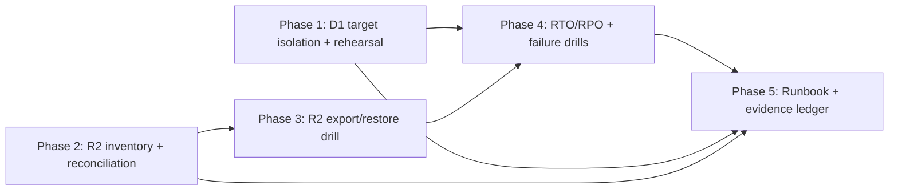

# D1/R2 Backup & Restore Operational Readiness

> **Planning-only package.** No application code, tests, migrations, config,
> scripts, or provider state were changed to produce it. It defines what a
> future executor must build and prove.

## Plan status: `CONDITIONALLY READY`

This is a **high-blast-radius** plan (D1 + R2 + data integrity + Cloudflare
bindings), so the readiness caps from the Multi-Agent Execution Directive apply:

- Verification mode is **`emulated`** (separated passes by the same lead agent;
  one native read-only research lane). Emulated verification caps overall
  readiness at **97** and package status at **CONDITIONALLY READY** for the
  high-blast-radius portions.
- The portions that **cannot** be marked `IMPLEMENTATION-READY` are the ones
  that require a **provider-backed restore drill** or **owner approval** (see
  Blocked decisions table). They are explicitly isolated, not silently smoothed.

The *planning task itself* is complete: the pack is internally consistent,
fully cited, and a future executor can follow it.

## What "complete" means here

The objective (PROMPT.md stop condition) is: *"The pack is complete when a
future executor can run or simulate a recovery drill and know exactly what
evidence proves restore readiness."* That is satisfied: every drill, command,
target-isolation step, RTO/RPO bound, failure scenario, and evidence artifact
is named, and the local-vs-provider proof boundary is explicit.

## Implementation start document

➡️ **`11_IMPLEMENTATION_PLAN.md`** — phased, dependency-aware execution guide
for the future implementation AI. Phases:

1. **Phase 1 — D1 restore target isolation + provider-backed rehearsal harness** (foundational; unblocks all D1 proof).
2. **Phase 2 — R2 object inventory + reconciliation** (parallel-safe with Phase 1's planning).
3. **Phase 3 — Selective R2 export/restore drill** (depends on Phase 2 inventory).
4. **Phase 4 — RTO/RPO contract + failure drill matrix + runbook** (depends on 1–3 evidence).
5. **Phase 5 — Operator runbook, cadence, and the local-vs-provider evidence ledger** (integration/closeout).

## Dependency graph

Phase 1 and Phase 2 are **parallel-safe** (disjoint file scopes: D1 export
tooling vs R2 inventory tooling). Phases 3, 4, 5 are sequential.

## Requirement / task / test traceability (summary)

- **Requirements**: `REQ-D1-01 … REQ-D1-04`, `REQ-R2-01 … REQ-R2-04`,
  `REQ-OPS-01 … REQ-OPS-04`, `REQ-SEC-01 … REQ-SEC-03`, plus `REQ-PERF-01`,
  `REQ-DOC-01`, `REQ-DOC-02` (18 total) — full table in
  `16_REQUIREMENTS_TRACEABILITY_MATRIX.md`.
- **Tasks**: `TASK-101 … TASK-503` mapped 1:1 to phases in `11_…`.
- **Tests/proof**: local SQLite rehearsal, isolated remote round-trip, R2
  inventory reconciliation, selective R2 restore, failure-drill matrix —
  full matrix in `12_TEST_AND_VALIDATION_STRATEGY.md`.

## Blocked decisions table

| ID | Decision needed | Owner | Why blocked | Unblocks | Safe interim |
|---|---|---|---|---|---|
| OPEN-01 | Approve a one-time **provider-backed D1 restore rehearsal** against an isolated staging D1 database (not `ARCH_DB` production) | Philip (owner) | Cannot prove hosted restore readiness from local-only SQLite rehearsal; emulated verification caps readiness | Phase 1 readiness; overall `IMPLEMENTATION-READY` | Local SQLite rehearsal + dry `--remote` export against staging preview DB only |
| OPEN-02 | Approve **automated daily D1 export to R2** via a Cloudflare Workflow/cron (consumes free-tier rows-read quota) vs relying on Time Travel only | Philip (owner) | Free-tier rows-read/day (5M) caps export cadence; decision affects RPO for data older than the 7-day free Time Travel window | Phase 4 RPO target | Keep manual `wrangler d1 export` on demand; document the 7-day free Time Travel RPO |
| OPEN-03 | Confirm whether a **second R2 bucket** (e.g. `archestimator-proof-uploads-backup`) is acceptable as a free-tier copy target, or rely on R2's 11-nines durability + app-level retention | Philip (owner) | R2 has no native versioning; cross-bucket copy is the only in-provider "backup." Adds Class A operations cost | Phase 3 R2 restore strategy | Sampled single-object export to local + restore-from-local drill; do not bulk-copy the bucket |

All three are **owner decisions**, not codebase-resolvable. Each has a safe
interim that keeps the plan usable without paid resources.

## Stale-plan revalidation checklist (run before any execution)

- [ ] Re-read `wrangler.jsonc` — confirm `ARCH_DB` `database_id` (`9bdb29bb-687e-4f51-ae81-7659c426ea5f`) and `preview_database_id` (`363c756a-7c4d-42fe-908f-6d328bfa4acb`), R2 `ARCH_UPLOADS_R2` (`archestimator-proof-uploads`), and the 3 cron triggers are unchanged.
- [ ] Re-read `scripts/generate-cloudflare-d1-restore-rehearsal.ts` — confirm command strings, fixture tables, and runbook steps still match.
- [ ] Re-confirm D1 free-tier Time Travel retention is still **7 days** (Workers Free) vs 30 days paid, and that no paid plan was enabled.
- [ ] Re-confirm R2 has **no** native object versioning and `wrangler r2 object list` is still absent (use REST/S3 API).
- [ ] Confirm no migration in `./migrations/` after `0038_component_draft_resource_limits.sql` changed the R2 reconciliation columns: `upload_assets(storage_bucket, storage_path, checksum_sha256, scan_status, status)` or `cost_library_item_variant_attachments(storage_bucket, storage_path, is_current_approved)`. Pre-flight: `rg -n 'storage_bucket|storage_path' migrations/ | sort`.
- [ ] Confirm the R2 reconciliation predicate is the composite `(storage_bucket, storage_path)` (NOT `object_key`, which exists only in the sanitized rehearsal fixture, not the real schema). Pre-flight: `rg -n 'object_key' migrations/` must return zero hits.
- [ ] Re-read `AGENTS.md` cost posture — still free-tier/bundled only.

## Commands/checks to run before the first implementation edit

These are **read-only characterization** commands the future executor runs to
confirm reality before building anything:

- `cat wrangler.jsonc` — resource boundaries.
- `rg -n 'd1 export\|d1 execute\|time-travel restore' scripts/generate-cloudflare-d1-restore-rehearsal.ts` — current documented commands.
- `bun run cf:d1-restore-rehearsal` — runs the existing local SQLite rehearsal (safe; temp artifacts only; no provider calls). Expected: `restoreRehearsalReady: true`.
- `bun run cf:pricing` — refresh the pricing snapshot against current free-tier facts.
- `git status --short --branch` — confirm clean shared worktree before editing.

## Files explicitly off-limits (for this planning task)

Any file outside
`.ai/03_plans/2026-07-07-d1-r2-backup-restore-operational-readiness/`. In
particular: `wrangler.jsonc`, `package.json`, `scripts/*`, `migrations/*`,
`supabase/migrations/*` (legacy — never extend), `src/**`, and any provider
state.

## Files and systems intentionally unaffected

- **Application runtime**: no Next.js route, Server Action, repository, R2
  provider, Durable Object, Queue, or email path is changed.
- **Provider state**: no D1 query, R2 put/delete, Worker deploy, DNS, or email
  config is mutated. The existing `cf:d1-restore-rehearsal` script is
  **read-only audited**, not executed against a provider.
- **Other providers**: Supabase `ebxxqidacheyapmmzavr`, the unrelated
  `archestimator` provider project, and any non-bound Cloudflare account are
  untouched.

## External proof that remains required before production rollout

These are *not* satisfiable by this planning task or by local checks:

1. A **provider-backed D1 restore** into an isolated staging DB (proves hosted
   `wrangler d1 export` → `wrangler d1 execute --remote --file=…` round-trip).
2. A **provider-backed R2 inventory + selective restore** against the real
   `archestimator-proof-uploads` bucket (proves list + get + put round-trip).
3. **Owner approval** for the free-tier quota consumed by any automated backup
   cron (rows-read/day, Class A operations/month).
4. A **real RTO measurement** of a Time Travel restore at production data volume
   (size-dependent; not publishable from local rehearsal).

Until these are closed, restore readiness is **`CONDITIONALLY READY`** for the
runtime portions, and the operator runbook must call out the local-only proof
boundary.

## Archive policy

Do **not** archive automatically. This pack should be archived to
`.ai/03_plans/_archive/` only after (a) the implementation phases land and pass
their validation matrix, and (b) the provider-backed drill evidence (OPEN-01)
is recorded in `19_RESEARCH_REVIEW_AND_QA_EVIDENCE.md`. Partial completion may
archive only the named completed slices.

## Document index

| Doc | Purpose |
|---|---|
| `00_AGENT_COORDINATION.md` | Master goal, skills, lanes, ledger, authority |
| `01_EXECUTIVE_SUMMARY.md` | One-page overview + verdict |
| `02_FEATURE_BRIEF_AND_SCOPE.md` | Brief, scope, non-goals, assumptions |
| `03_SOURCE_AND_CODEBASE_AUDIT.md` | Current restore/R2 tooling, file:symbol map |
| `04_REQUIREMENTS_SPECIFICATION.md` | `REQ-*` with acceptance + shadow paths |
| `05_UX_UI_ACCESSIBILITY_PLAN.md` | Operator-facing surfaces (runbook/dashboards), a11y N/A rationale |
| `06_ARCHITECTURE_AND_TECHNICAL_DESIGN.md` | Current vs target restore architecture |
| `07_DATA_DATABASE_API_NETWORK_PLAN.md` | D1 schema/target isolation, R2 object model, DB blueprint |
| `08_SECURITY_PRIVACY_THREAT_MODEL.md` | Restore target isolation, secret-free drills, redaction |
| `09_PERFORMANCE_RELIABILITY_OBSERVABILITY.md` | Export size, RTO/RPO, drill duration, quotas |
| `10_BLAST_RADIUS_AND_DEPENDENCIES.md` | Impact of the future implementation |
| `11_IMPLEMENTATION_PLAN.md` | Phased execution guide (the start doc) |
| `12_TEST_AND_VALIDATION_STRATEGY.md` | Test + drill + failure matrix |
| `13_ROLLOUT_ROLLBACK_AND_OPERATIONS.md` | Operator runbook, drill cadence, rollback of the drill |
| `14_RISK_REGISTER.md` | `RISK-*` with mitigation/contingency |
| `15_DECISIONS_ASSUMPTIONS_AND_ALTERNATIVES.md` | `DEC-*`, `ASSUMP-*`, rejected alternatives |
| `16_REQUIREMENTS_TRACEABILITY_MATRIX.md` | REQ → task → test → rollout |
| `17_FINAL_READINESS_REVIEW.md` | Verifier audit, scores, caps, residual gaps |
| `18_STACK_CONTRACT_AND_PRODUCTION_STANDARDS.md` | Cross-cutting D1/R2/Wrangler standards |
| `19_RESEARCH_REVIEW_AND_QA_EVIDENCE.md` | Official-doc research + adversarial QA |
| `20_COST_MODEL_AND_PRICING_INPUTS.md` | Free-tier cost model for the drills |
| `21_PROVIDER_PARITY_MATRIX.md` | D1/R2 capability vs needs parity |
