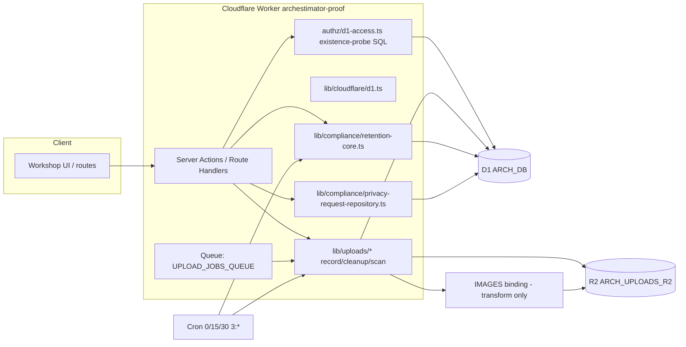
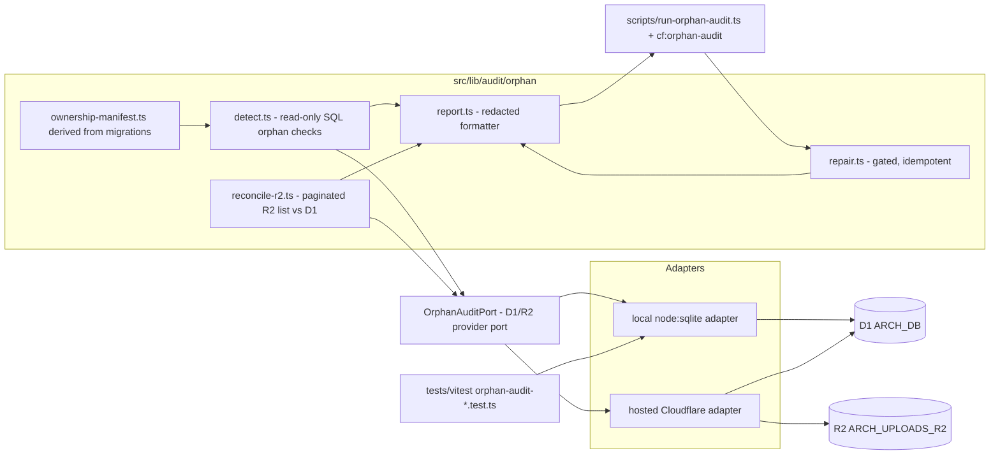

# 06 — Architecture and Technical Design

## Current-state architecture (integrity-relevant slice)

Integrity is enforced by three overlapping, non-transactional layers:
1. **Declared FKs** in migrations (unverified at runtime — `03` §0).
2. **Application batches** (`database.batch()` is atomic within D1, but D1↔R2 is never atomic).
3. **Scheduled crons** (upload cleanup, scan, retention) that reconcile *some* state some of the time.

There is no fourth layer that *proves* the three agree. That is the gap this pack fills.

## Target-state architecture

### Component boundaries

| Component | Responsibility | Port/contract |
|---|---|---|
| `ownership-manifest.ts` | Derive the parent→child edge list + R2-key columns from `migrations/`. Output a typed manifest. | Pure function of migration files; no runtime IO. |
| `detect.ts` | Run Class A (D1→D1) orphan checks + `PRAGMA foreign_key_check` + `PRAGMA foreign_keys` readback. | Takes a `ReadOnlyD1`; returns `OrphanFinding[]`. |
| `reconcile-r2.ts` | Run Class B/C (R2↔D1) reconciliation via paginated `R2.list()`. | Takes a `ReadOnlyR2` + `ReadOnlyD1`; returns `ReconciliationReport`. |
| `report.ts` | Format findings into the redacted JSON schema (FR-004). | Pure; takes findings; returns redacted report. |
| `repair.ts` | Apply per-class repair actions behind `--from-report` + `--confirm` + token. | Takes a `WritableD1`/`WritableR2` + report; returns before/after diff. |
| `OrphanAuditPort` | The provider port. Two methods of interest: `readOnlyD1()` and `readOnlyR2()`. | Interface; local + hosted adapters. |

### Key architectural decisions

**AD-1: Read-only-by-type, not by-convention.** Detection takes a `ReadOnlyD1` interface that exposes only `prepare(sql).all()`/`.get()` and `PRAGMA` helpers — no `.run()`. This makes the read-only guarantee (SEC-001) a type-level fact, not a runtime hope. Rejected alternative: a runtime flag checked in a wrapper (easy to bypass).

**AD-2: Manifest derived from migrations, not hand-maintained.** The ownership manifest is generated by parsing `migrations/*.sql` for `REFERENCES` and FK-like columns. This prevents drift (FR-001 acceptance). Rejected alternative: a hand-written JSON manifest (would rot).

**AD-3: Local-first via `node:sqlite`.** The same audit module runs against a local `DatabaseSync(":memory:")` (for tests and CI dry-run on seeded fixtures) and against hosted Cloudflare D1+R2 (for preview/prod), via the port. Rejected alternative: miniflare-only (heavier; the `node:sqlite` pattern is already proven in-repo).

**AD-4: Repair is a separate code path with a separate port method.** Detection never imports the writable port. This enforces SEC-001 at the module boundary. Rejected alternative: one tool with a `--write` flag (risk of accidental write).

**AD-5: R2 reconciliation is paginated, prefix-bounded, cost-capped.** `R2.list()` calls are scoped to the three logical-bucket prefixes and capped by an owner-set Class B budget; the scan aborts (and reports partial) if the cap is hit. Rejected alternative: a full `list()` dump (unbounded cost).

**AD-6: Track A before Track B.** Defense-in-depth explicit deletes (DATA-003) land before FK-enablement (DATA-004), because Track A is correct regardless of the enforcement state and Track B can surface pre-existing violations as hard errors. Rejected alternative: enable FKs first (would turn silent orphans into outages).

### Data flow

Detection (read-only):
1. Load manifest.
2. For each Class A edge: `SELECT child.* FROM child LEFT JOIN parent ON child.ref = parent.id WHERE parent.id IS NULL AND child.ref IS NOT NULL` (or `NOT EXISTS`). Paginated.
3. `PRAGMA foreign_key_check` (catches any FK-declared violation the per-edge scan might miss).
4. `PRAGMA foreign_keys` readback → report field.
5. R2 reconciliation (Class B/C): **stream** the R2 key set page-by-page and check membership against a D1-side streaming cursor (do not materialize both sets — see "Reconciliation algorithm" below). Shard by workspace prefix at >100k keys.
6. Legal-hold exclusion: cross-check candidate orphans against `data_retention_events.action='skipped_legal_hold'`.
7. Format redacted report.

Repair (gated):
1. Load report (`--from-report`).
2. Verify token.
3. For each finding, apply the per-class repair action from the **enumerated allowlist below** (not invented) inside a per-class D1 batch; R2 deletes via the provider. **For every R2-object delete, re-verify with `R2.head(key)` immediately before delete** — the report's key set is stale by the time repair runs because R2 `list()` is eventually consistent (see `09` failure modes).
4. Write a `data_retention_events`-style audit row per batch (reuse `recordRetentionEventInD1` shape with a new `class_name='uploads_orphaned'` repair action — OPEN-DEC-003).
5. Emit before/after diff.

### Per-class repair allowlist (enumerated — Phase 6 review target)

The allowlist maps every ORPH target to a concrete, bounded repair action. Four classes are **detect-only, never auto-repair** because repair would destroy legal/audit/credential material or belongs to the retention engine.

| ORPH ID | Repair action | Target table/column | Safety precondition | Rationale |
|---|---|---|---|---|
| ORPH-001 | **detect-only (no auto-repair)** | 0014 publication cluster | n/a | deleting publication children may destroy legal/recipient audit data; requires per-publication owner decision |
| ORPH-002 | set `upload_assets.storage_path=NULL` + delete R2 object (after `head()` confirm) | `upload_assets` + R2 | D1 row `status` not `finalized-active` | ghost D1 row referencing a deleted R2 object |
| ORPH-003 | re-queue `mass_deletion_events` storage cleanup; never auto-delete | `mass_deletion_events` | `status='storage_cleanup_pending'` | re-run the existing project-delete R2 cleanup; do not invent deletes |
| ORPH-004 | none (Track A DATA-003 prevents it) | n/a | n/a | prevented by explicit deletes in project batch |
| ORPH-005 | **detect-only** | AI audit chain | n/a | retention-class; cleaned by a future retention rule, not audit-repair |
| ORPH-006 | **detect-only** | `account_security_events` | n/a | security/audit isolation; retention-rule territory |
| ORPH-007 | delete R2 object (after `head()` confirm); leave D1 row | R2 key from `upload_assets.storage_path` | row `project_id IS NULL AND status='finalized'` | ghost R2 object behind a null-project asset |
| ORPH-008 | delete R2 object (after `head()` confirm) | R2 key under `.../estimate-row-images/...` | key not referenced by any `upload_assets.storage_path` | leaked estimate-row image |
| ORPH-009 | set `estimate_nodes.parent_id=NULL` (root the orphaned subtree) | `estimate_nodes.parent_id` | node's `estimate_id` still exists | intra-estimate node orphan |
| ORPH-010 | **detect-only** | `beta_feedback_submissions` | n/a | feedback retention is a policy decision |
| ORPH-011 | delete R2 object (after `head()` confirm) + set attachment row refs NULL | `cost_library_item_variant_attachments` + R2 | parent item/option confirmed gone | R2 storage rows orphaned by cost-library delete |
| ORPH-012 | **detect-only** | `upload_assets` tombstones | n/a | tombstones are intentional; DB-CHG-004 retention rule governs their TTL |
| ORPH-013 | set `mass_deletion_storage_cleanup_results.target_event_id=NULL` | that table | event confirmed gone | forward-ref orphan; preserve the cleanup audit row |
| ORPH-014 | **set `password_hash=NULL` + `encrypted_token=NULL`** on revoked rows (SEC-004); detect-only for child rows | `project_publications` (hash) + children (detect) | `status='revoked'` | destroy-on-revoke for the public-route-accepted scrypt hash; children preserved as audit trail |
| ORPH-015 | n/a (engine meta) | n/a | n/a | resolved by Track B (DATA-004), not repair |

**Design rules:**
- Repair never deletes a retention-class row (ORPH-005/006/010/012) — those are detect-only, routed to the retention engine.
- Repair never deletes publication-cluster children automatically (ORPH-001) — per-publication owner decision.
- **`head()`-before-delete** applies to every R2-object repair action, defending against R2 `list()` eventual-consistency lag (P1-2).
- ORPH-014 is the one set-null-on-credential action: it destroys the retained `password_hash`/`encrypted_token` (SEC-004), it does not delete the row (audit trail preserved).

### Reconciliation algorithm (resolved: stream, not materialize)

A prior draft had `06` step 5 ("build key set, set-diff") contradicting `09` ("stream the set-diff"). **Resolved: stream.** The reconciliation streams the R2 key set page-by-page and checks membership against a D1-side streaming cursor (not a materialized set), bounding memory at O(page size) regardless of key count. At >100k keys, the scan shards by workspace prefix: `R2.list({prefix: '{logicalBucket}/{workspaceId}/'})` per workspace (logical-bucket name + workspace ID = the 1st and 2nd path segments per `03` §3).

### Control flow / state ownership

- The audit is a **batch job**, not a request-scoped operation. No client state, no URL state, no TanStack Query.
- Report is the single state artifact. Repair consumes the report.
- No Zustand, no Server Component, no `"use client"` — this is a Node/Worker script + lib.

### Reusable abstractions

- Reuse the `FakeR2Bucket` shape from `tests/vitest/cloudflare-r2-storage-provider.test.ts`, extended with `list()`.
- Reuse the `node:sqlite` `DatabaseSync(":memory:")` pattern from `tests/vitest/workspace-owner-membership-backfill-migration.test.ts`.
- Reuse `recordRetentionEventInD1` shape for repair audit rows.

### Coupling / dependency direction

`audit/orphan/*` depends on: `migrations/` (read-only parse), the D1/R2 port (injected), and the redaction formatter. It does **not** depend on any application Server Action, repository, or authz helper — it queries raw D1. This keeps it decoupled from application churn and lets it catch bugs the application layer cannot.

### Failure boundaries

- Detection failure → partial report with `gaps[]`; never a silent empty report.
- R2 scan cap → partial reconciliation; reported.
- Repair failure → per-action idempotent retry; audit row written before+after.

### Integration points

- New `package.json` script `cf:orphan-audit`.
- New cron **optional** (the weekly prod run could be a cron or an operator manual step; OPEN decision in `13`).
- New `tests/vitest/orphan-audit-*.test.ts` files.

### Architectural alternatives (rejected)

- **Periodic SQL-only cron without an R2 reconciliation:** rejected — misses Class B/C, which are the highest-severity gaps (`03` §4).
- **Trigger-based enforcement at the DB level:** rejected for now — D1 trigger support exists (0038 added 4 triggers) but trigger-based cascade repair is brittle and hides logic; explicit audit + repair is reviewable. Could be revisited later.
- **A full workspaces/users hard-delete feature as the "fix":** rejected as in-scope — it is a larger effort (OPEN-DEC-002) and does not address R2 orphans or the 0014 cluster.
