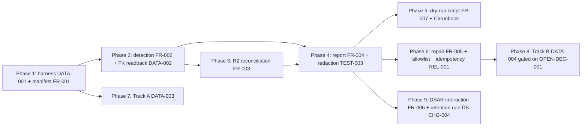

# 10 — Blast Radius and Dependencies

This is a **planning-only** pack. The blast radius of the *pack itself* is zero application files. The blast radius below describes the **future implementation** the pack designs, classified by impact tier.

## Impact classification legend

- **Required change** — must change for the capability to work.
- **Probable change** — likely changes during implementation.
- **Possible change** — might change depending on decisions.
- **Verification only** — no change, but must be verified unaffected.
- **Explicitly unaffected** — confirmed out of scope.

## Direct impact (new files)

| Path (proposed) | Impact | Notes |
|---|---|---|
| `src/lib/audit/orphan/ownership-manifest.ts` | Required (new) | derives edges from migrations |
| `src/lib/audit/orphan/detect.ts` | Required (new) | Class A detection |
| `src/lib/audit/orphan/reconcile-r2.ts` | Required (new) | Class B/C |
| `src/lib/audit/orphan/report.ts` | Required (new) | redacted formatter |
| `src/lib/audit/orphan/repair.ts` | Required (new) | gated repair |
| `src/lib/audit/orphan/port.ts` | Required (new) | ReadOnlyD1/ReadOnlyR2 + writable port |
| `src/lib/audit/orphan/adapters/local-sqlite.ts` | Required (new) | node:sqlite adapter |
| `src/lib/audit/orphan/adapters/cloudflare.ts` | Required (new) | hosted adapter |
| `scripts/run-orphan-audit.ts` | Required (new) | CLI entry |
| `tests/vitest/orphan-audit-detection.test.ts` | Required (new) | TEST-001 |
| `tests/vitest/orphan-audit-read-only.test.ts` | Required (new) | TEST-002 |
| `tests/vitest/orphan-audit-redaction.test.ts` | Required (new) | TEST-003 |
| `tests/vitest/d1-cascade-behavior.test.ts` | Possible (new, gated) | TEST-004, only if Track B approved |
| `tests/vitest/helpers/apply-all-migrations.ts` | Required (new) | DATA-001 harness helper |
| `tests/vitest/perf/orphan-audit-baseline.ts` | Required (new) | PERF evaluator |

## Direct impact (existing files)

| Path | Impact | Exact change |
|---|---|---|
| `package.json` | Required | add `cf:orphan-audit` script (and optional `cf:orphan-audit:repair`) |
| `src/lib/projects/actions.ts` | Probable (Track A, DATA-003) | add 2 explicit DELETEs to project-delete batch (region 602–754) |
| `src/lib/cloudflare/d1.ts` | Possible (Track B, DATA-004, gated) | enable `PRAGMA foreign_keys = ON` per connection |
| `src/lib/compliance/retention-core.ts` | Probable (DB-CHG-004) | add `uploads_orphaned` rule |
| `wrangler.jsonc` | Verification only | no change; audit uses existing bindings |

## Transitive impact

| Area | Impact | Notes |
|---|---|---|
| All Server Actions / Route Handlers | Explicitly unaffected | audit is not in the request path |
| Workshop UI (`src/app/workshop/**`) | Explicitly unaffected | no UI in core scope |
| Better Auth tables | Verification only | audit reads; never writes |
| Durable Object `COLLAB_ROOMS` | Explicitly unaffected | room-local SQLite, not in D1↔R2 graph |
| Cloudflare Images (`IMAGES`) | Explicitly unaffected | transform-only, no object namespace |
| Existing tests | Verification only | Track A change must keep project-delete tests green |
| Cron triggers | Possible (optional) | a new cron *may* be added for weekly prod audit; not required |
| Retention cron (`30 3 * * *`) | Verification only | DB-CHG-004 adds a rule the cron will sweep; no cron change |
| Upload cleanup cron (`0 3 * * *`) | Verification only | independent |

## Users / roles affected

- **End users:** none (no customer-facing surface).
- **Operators:** gain a new tool + runbook; must learn the report format.

## Screens / routes affected

- None in core scope.

## APIs / services affected

- None (no HTTP API in core scope).

## Shared libraries affected

- New `src/lib/audit/` namespace. Does not import application repositories or authz (decoupled by design — AD in `06`).

## Database tables affected

- Detection: reads all 69 tables.
- Repair (Track A): deletes from `estimate_sheet_events`, `estimate_sheet_adjustments` (in the project batch, not by the audit directly).
- Repair (audit): may delete orphan rows / R2 objects per finding.

## Migrations affected

- None in core scope. Track B optional follow-up migration is a separate pack.

## Background jobs affected

- None directly. DB-CHG-004 adds a retention rule the existing cron sweeps.

## Integrations / network traffic affected

- R2 `list()`/`head()`/`delete()` traffic increases during audit runs. Bounded by cost cap.

## Caches affected

- None.

## Authentication / authorization affected

- None. The audit uses raw D1; it does not change authz.

## Tests / analytics / monitoring affected

- New tests added. No analytics change. Monitoring = the report file + exit code.

## Documentation affected

- This plan pack.
- `13_ROLLOUT_ROLLBACK_AND_OPERATIONS.md` runbook.
- Optional: a note in `.ai/10_state/current-state.md` when the tooling lands.

## Backward compatibility

- Fully backward compatible. Detection is additive. Track A is a stricter (more correct) delete batch. Track B is gated.

## Other active development work

- The repo is in fast-iteration pre-launch mode. The audit module is a new namespace; file-scope ownership prevents collisions. Implementation must re-`git status` before edits (AGENTS.md shared-worktree rule).

## Dependency graph (implementation phases)

**Correction note:** a prior draft of this graph showed `P6 --> P7` (Phase 6 gating Phase 7). That was wrong and contradicted `11` Phase 7 prerequisites ("Phase 1 harness") and the README ordering. Track A (Phase 7) is a defense-in-depth correctness fix that depends **only on Phase 1** (the harness, to test cascade-off behavior) — it must NOT wait on the gated/conditionally-ready repair work (Phase 6). Phase 7 and Phase 6 are independent; both depend on Phase 1. Phase 8 (Track B) depends on Phase 6 (clean dry-run repair must clear pre-existing violations before FK enablement).

Phases 1–5 are the implementation-ready core. Phases 6–9 are conditionally ready (repair) or gated (Track B).
